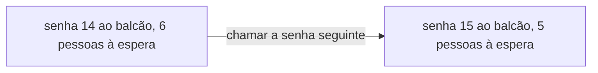
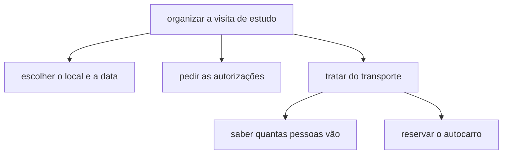

# Do problema ao algoritmo

Neste guia, aprendes a pensar um problema antes de o resolver. Vês o que é um algoritmo, o contrato de um problema, a decomposição e as instruções que deixam dúvidas. Trabalhas em papel, e os algoritmos escrevem-se em português, em passos numerados.

Não precisas de saber programar: só de ler com atenção e de fazer contas simples. Para praticar: [ficha de exercícios](exercicios/01-do-problema-ao-algoritmo-exercicios.md).

## Neste guia

1. [Programar é dar instruções a quem as cumpre à letra](#programar-é-dar-instruções-a-quem-as-cumpre-à-letra)
2. [O que é um algoritmo](#o-que-é-um-algoritmo)
3. [Algoritmia e programação](#algoritmia-e-programação)
4. [Ação e estado](#ação-e-estado)
5. [Instruções ambíguas](#instruções-ambíguas)
6. [O contrato do problema: entradas, saídas, restrições e condições](#o-contrato-do-problema-entradas-saídas-restrições-e-condições)
7. [Decompor um problema em subproblemas](#decompor-um-problema-em-subproblemas)
8. [Os quatro princípios do pensamento computacional](#os-quatro-princípios-do-pensamento-computacional)
9. [As etapas para construir um algoritmo](#as-etapas-para-construir-um-algoritmo)
10. [Exemplo guiado: o atendimento por senhas numa papelaria](#exemplo-guiado-o-atendimento-por-senhas-numa-papelaria)
11. [Exemplo guiado: os Missionários e Canibais](#exemplo-guiado-os-missionários-e-canibais)

## Programar é dar instruções a quem as cumpre à letra

Imagina que explicas a um robô como se faz uma sandes de manteiga e dizes "põe manteiga no pão". Uma pessoa abria a embalagem e espalhava a manteiga numa fatia. O robô pousa a embalagem fechada em cima do pão, que é exatamente o que lhe disseste.

Um computador é esse robô. Não adivinha intenções nem completa frases a meio: faz à letra o que lhe mandam, incluindo os erros. Imagina uma loja online com a instrução "quando se vende um artigo, tira uma unidade ao stock". Uma encomenda de três cadernos de um modelo com stock zero deixa o stock em menos três. O computador cumpriu a instrução. Quem errou foi quem a escreveu, porque não pensou no que devia acontecer quando o stock não chega.

Por isso, a parte difícil de programar raramente é a linguagem. É saber, com precisão, o que se quer pedir, também nos casos em que as coisas não correm como é costume.

## O que é um algoritmo

Uma receita e as instruções de montagem de um móvel têm a mesma forma. Partem de alguma coisa, seguem passos por ordem e chegam a um resultado.

Um **algoritmo** é uma sequência finita de passos, cada um claro e possível de executar, que parte de uns dados e chega a um resultado. Cada parte da definição conta:

- sequência: os passos têm uma ordem, e trocá-la muda o resultado, como calçar os sapatos antes das meias;
- finita: acaba, e está escrito quando acaba. "Anda sempre em frente" nunca te leva à escola;
- claro: cada passo só se pode ler de uma maneira;
- possível de executar: quem o segue consegue fazê-lo com o que tem à frente. "Adivinha quantos clientes vêm amanhã" não é executável;
- parte de dados e chega a um resultado: sabe-se de onde parte e onde chega.

No mundo da gestão, os algoritmos chamam-se muitas vezes procedimentos. Quando chega mercadoria a um armazém, com uma guia de remessa, o papel que diz o que foi enviado, o funcionário faz assim:

1. Contar as caixas que o transportador descarregou.
2. Comparar esse número com o número de caixas escrito na guia de remessa.
3. Se os dois números forem iguais, assinar a guia.
4. Se forem diferentes, escrever na guia quantas caixas chegaram de facto, assinar e avisar o fornecedor da diferença.
5. Dar entrada no stock das caixas que chegaram de facto.

As entradas são as caixas e a guia, e a saída é a guia assinada e o stock atualizado. O algoritmo termina depois do passo 5. Ao momento em que se sabe que terminou chama-se **condição de paragem**, e é uma pergunta sobre a situação: "já está tudo feito?". O passo 4 diz o que acontece quando as coisas não correm como é costume.

## Algoritmia e programação

A **algoritmia** é o trabalho de pensar, escrever e verificar algoritmos, em português ou numa notação própria, o pseudocódigo, do tema seguinte. A programação é passar um algoritmo para uma linguagem que o computador executa, como o Python. Nesta disciplina aprendes as duas, por esta ordem.

Se não sabes que passos resolvem um problema, nenhuma linguagem te ajuda. E um erro de raciocínio encontrado no papel corrige-se em cinco minutos; escondido num programa, pode levar uma tarde a encontrar.

## Ação e estado

O **estado** é o conjunto de valores que descrevem uma situação num momento, como uma fotografia. O marcador de um jogo de futebol, "2 a 1 ao minuto 60", é um estado. Uma **ação** é um passo que muda o estado: um golo muda o marcador. Comparar e verificar olham para o estado, mas não o mudam.

Na papelaria do diagrama, chamar a senha seguinte é uma ação, e o estado passa de um para o outro. A mesma ação, sem ninguém à espera, nem faria sentido: era chamar um número que ninguém tem. Por isso muitos passos começam por olhar para o estado, como "há alguém à espera?".

Para seguir o estado ao longo de um algoritmo, usa-se uma tabela, com uma coluna para cada valor e uma linha para cada momento. Quando uma solução não funciona, pergunta: qual era o estado antes deste passo, e qual é depois?

## Instruções ambíguas

Uma receita diz "junta sal q.b.", quanto baste. Quanto é que basta? Duas pessoas que sigam a receita fazem pratos diferentes, e nenhuma a desrespeitou. Uma instrução **ambígua** admite mais do que uma leitura, e por isso não determina uma solução. Pessoas diferentes fazem coisas diferentes, e o estado do prato no fim depende de quem o fez.

A ambiguidade aparece de cinco formas:

| Forma | Exemplo | A pergunta que a apanha |
| --- | --- | --- |
| A palavra vaga | "espera um pouco", "se houver muitas pessoas" | Quanto, ao certo? |
| O limite que não diz se inclui a fronteira | "as encomendas com mais de 10 kg" | E com 10 kg exatos? |
| A informação que falta | "liga ao fornecedor", quando há vários | Tenho tudo o que preciso para fazer isto? |
| A frase com duas leituras | "entregue em 2 dias" | Dias úteis ou dias seguidos? |
| A unidade em falta | "cada caixa leva no máximo 10" | Dez quê? |

Os valores que ficam exatamente em cima de um limite, como os 10 kg, chamam-se **casos de fronteira**, e são os que mais erros escondem. Corrigir uma ambiguidade é quase sempre trocar o vago por um número, um limite ou uma regra. Por exemplo, "junta 3 gramas de sal" ou "com 10 kg ou mais".

Quando o enunciado não te dá o que precisas, não inventes em silêncio: pergunta, ou toma uma decisão e escreve-a. Para encontrares as ambiguidades, dá as instruções a outra pessoa e pede-lhe que as siga como estão escritas. Cada hesitação dela aponta uma ambiguidade, porque tu sabes o que querias dizer e não as vês.

## O contrato do problema: entradas, saídas, restrições e condições

Antes de escrever qualquer passo, responde a quatro perguntas sobre o problema:

| Pergunta | O que procuras |
| --- | --- |
| Entradas | Que dados já tenho, ou vou receber? |
| Saídas | Que resultado tem de ser produzido? |
| Restrições | Que limites e regras fixas valem sempre? |
| Condições | Que situações podem acontecer e obrigam a fazer coisas diferentes? |

As respostas, com uma lista de exemplos, formam o **contrato do problema**. Chama-se contrato porque fixa, antes de haver algoritmo, o que ele tem de fazer.

### Entradas e saídas

As entradas são os dados que o algoritmo recebe, com a espécie de valor, a unidade e os valores aceitáveis. "Número da senha, um inteiro de 1 a 40" está bem descrito; "a senha" não. Uma entrada também pode ser um acontecimento, como a chegada de um cliente.

As saídas são o resultado, e têm de se conseguir ver ou verificar. Atualizar o stock é uma ação; a saída é o stock atualizado, que se pode conferir. Para as separar, pergunta a cada dado: já existe antes de eu começar, ou sou eu que o produzo?

### Restrições e condições

As restrições valem sempre, em todas as vezes que o algoritmo é usado: "só se distribuem 40 senhas por dia", "há um só balcão". Os limites fixos do enunciado, como os 4 minutos de cada atendimento, também são restrições. A situação de partida, e um valor que pode mudar de uma vez para a outra, são entradas.

As condições podem acontecer ou não, e mudam o caminho: "se o cliente chamado não aparecer, passa-se à senha seguinte". Escrevem-se quase sempre com "se". O teste é este: se vale sempre, é uma restrição; se pode acontecer numa vez e não noutra, é uma condição. Muitas vezes andam juntas: da restrição das 40 senhas nasce a condição "ainda há senhas?".

### Exemplos concretos

Os exemplos concretos são entradas escolhidas com cuidado, cada uma com a saída esperada, calculada à mão. Se não consegues calcular um exemplo à mão, ainda não percebeste o problema; depois, os exemplos servem de teste ao algoritmo.

Além do **caso normal**, o que toda a gente imagina, entram casos de fronteira. Entram também **casos extremos**, que obrigam a tomar decisões que o enunciado não tomou. Um caso pode ser as duas coisas: estar em cima de um limite e obrigar a decidir.

### Um contrato completo: o tempo de espera

> Uma papelaria atende os clientes por senha, com um só balcão. Quer pôr um ecrã ao lado da máquina de senhas que mostre a cada cliente quanto tempo vai esperar. Cada atendimento demora, em média, 4 minutos.

| Pergunta | Resposta |
| --- | --- |
| Entradas | A senha do cliente e a última senha chamada, a de quem está ao balcão, inteiros de 1 a 40 |
| Saídas | A mensagem do ecrã |
| Restrições | Cada atendimento conta 4 minutos, e o que está a decorrer conta inteiro, para não prometer menos do que o cliente vai esperar |
| Condições | A senha do cliente é maior, igual ou menor do que a última chamada |

| Senha do cliente | Última senha chamada | O ecrã mostra | Porque se escolheu |
| ---: | ---: | --- | --- |
| 18 | 14 | 16 minutos | Caso normal: à frente estão o 14, ao balcão, e o 15, o 16 e o 17, 4 atendimentos |
| 15 | 14 | 4 minutos | Caso normal, logo acima da fronteira: é o próximo |
| 14 | 14 | É a sua vez | Fronteira e extremo: "0 minutos" não diria ao cliente que se levante |
| 9 | 14 | A sua senha já foi chamada | Extremo: a conta daria menos 20 minutos |

Sem a última linha no contrato, o algoritmo fazia a conta, e o ecrã mostrava "menos 20 minutos". Os casos extremos obrigam a decidir antes, em vez de descobrir depois.

## Decompor um problema em subproblemas

"Organizar uma visita de estudo", assim inteiro, é difícil de atacar. **Decompor** é partir um problema grande em subproblemas mais pequenos. Cada um tem um objetivo próprio e resolve-se e confirma-se sem os outros.

O diagrama mostra a visita partida em subproblemas, e o transporte partido outra vez, porque ainda era grande. Um subproblema é um objetivo, e os passos são a forma de o atingir: primeiro decompõe-se, depois escrevem-se os passos de cada parte. Os subproblemas podem depender uns dos outros: só se reserva o autocarro depois de saber quantas pessoas vão.

Para de decompor quando cada parte se explica numa frase e se confirma sem as outras. "Tratar da visita" é o problema outra vez, com outro nome; "pegar na caneta" já foi longe de mais.

## Os quatro princípios do pensamento computacional

O **pensamento computacional** é uma forma de pensar sobre problemas que torna a solução possível de executar por outra pessoa ou por uma máquina. Tem quatro princípios, que se usam em conjunto. São a decomposição, que acabaste de ver, o reconhecimento de padrões, a abstração e o algoritmo, que é escrever os passos no fim.

### Reconhecimento de padrões

**Reconhecer padrões** é reparar no que se repete, dentro de um problema ou entre problemas, para resolver uma vez e aproveitar muitas. Numa soma em coluna, repetes o mesmo processo em cada coluna. Na papelaria, cada cliente passa pelos mesmos passos para receber a senha, e só muda o número.

O erro típico é confiar num padrão sem verificar cada caso. Quase todos os clientes chamados aparecem, mas há os que não aparecem, e quem confiar no padrão deixa a loja parada à espera.

### Abstração

**Abstrair** é ficar só com o que interessa para o problema e representá-lo da forma mais simples. O mapa do metro não mostra as ruas nem as distâncias: mostra as estações e onde se muda de linha, que é o que precisas.

A pergunta que decide é esta: se este pormenor fosse diferente, a resposta mudava? Se muda, é um dado relevante; se não muda, é contexto. Para a fila da papelaria, a cor da mochila do cliente é contexto, e o número da senha é um dado.

## As etapas para construir um algoritmo

Tudo junto dá estas etapas, que vais seguir em todos os problemas deste ano:

1. Ler o enunciado duas vezes, a segunda com um lápis, a sublinhar números, limites e regras.
2. Escrever o contrato, com os exemplos. Se faltar informação, perguntar ou escrever a decisão.
3. Decompor o problema em subproblemas.
4. Escrever os passos de cada subproblema. Cada passo faz uma só coisa, ou uma verificação com o que se faz em cada caso.
5. **Simular**: seguir os passos com os exemplos, como se fosses quem os executa, e anotar o estado numa tabela.
6. Procurar ambiguidades, de preferência dando os passos a outra pessoa.

É normal voltar atrás: a simulação mostra muitas vezes uma condição que falta, e volta-se ao contrato para a acrescentar.

## Exemplo guiado: o atendimento por senhas numa papelaria

Uma papelaria atende os clientes por senha. Quando um cliente chega, tira uma senha com um número, e os clientes são atendidos por ordem crescente de senha. A loja tem um único balcão e distribui no máximo 40 senhas por dia. Quando um cliente é chamado e não aparece, a sua senha é descartada e passa-se à seguinte. O algoritmo tem de ser tão preciso que um funcionário novo o siga sem perguntar nada.

### Etapa 2: o contrato

| Pergunta | Resposta |
| --- | --- |
| Entradas | Chegada de um cliente; sinal de que o balcão ficou livre; resposta do cliente quando é chamado |
| Saídas | Senha entregue a cada cliente; número chamado em voz alta; cliente atendido |
| Restrições | Um só balcão; no máximo 40 senhas por dia; atendimento por ordem crescente de senha |
| Condições | Ainda há senhas ou já se esgotaram; há ou não há alguém à espera quando o balcão fica livre; o cliente chamado aparece ou não |

As entradas são acontecimentos que vêm de fora. A condição "há alguém à espera?" não está no enunciado: encontra-se a pensar no estado. O exemplo do contrato é uma manhã com quatro clientes, em que o da senha 2 falta, e o resultado previsto está na etapa 5.

### Etapa 3: decompor

1. Entregar senha a quem chega.
2. Chamar o próximo quando o balcão fica livre.
3. Tratar a falta de quem não aparece.
4. Fechar o dia.

Chamar o próximo só faz sentido se já houver senhas entregues, e tratar a falta só acontece depois de uma chamada. Fechar o dia não se escreve neste exemplo.

### Etapa 4: escrever os passos

Entregar senha:

1. Ver o número da última senha entregue.
2. Se for 40, informar o cliente de que as senhas terminaram e terminar.
3. Caso contrário, somar 1 a esse número e registá-lo como a última senha entregue.
4. Entregar ao cliente uma senha com esse número.

Chamar o próximo:

1. Comparar o número da última senha chamada com o número da última senha entregue.
2. Se forem iguais, não há ninguém à espera: esperar que chegue alguém e voltar ao passo 1.
3. Caso contrário, somar 1 ao número da última senha chamada e registá-lo como a última senha chamada.
4. Anunciar esse número em voz alta.
5. Esperar 30 segundos pela resposta do cliente.
6. Se o cliente aparecer, atendê-lo.
7. Se o cliente não aparecer, registar esse número como descartado e voltar ao passo 1.

O "terminar" do passo 2 de entregar senha diz que os passos 3 e 4 não se fazem. Tratar a falta cabe nos passos 5 a 7 de chamar o próximo, porque só acontece depois de uma chamada.

### Etapa 5: simular com um caso concreto

O estado são dois números: a última senha entregue e a última senha chamada. Chegam quatro clientes, e o da senha 2 não aparece. Prevê quanto valem os dois números no fim da manhã.

| Momento | Última senha entregue | Última senha chamada | O que acontece |
| --- | ---: | ---: | --- |
| Abertura | 0 | 0 | Ninguém à espera |
| Chega um cliente | 1 | 0 | Recebe a senha 1 |
| Chega um cliente | 2 | 0 | Recebe a senha 2 |
| Chega um cliente | 3 | 0 | Recebe a senha 3 |
| Chega um cliente | 4 | 0 | Recebe a senha 4 |
| Balcão livre | 4 | 1 | Chamada a senha 1; o cliente é atendido |
| Balcão livre | 4 | 2 | Chamada a senha 2; não aparece; a senha é descartada |
| Ainda livre | 4 | 3 | Chamada a senha 3; o cliente é atendido |
| Balcão livre | 4 | 4 | Chamada a senha 4; o cliente é atendido |
| Balcão livre | 4 | 4 | As duas são iguais: ninguém à espera |

As duas senhas acabam em 4. Os passos são sempre os mesmos; o que muda são os números. Sem o "voltar ao passo 1" do passo 7, a simulação parava na linha da senha 2. A loja ficava parada com dois clientes à espera.

### Etapa 6: procurar ambiguidades

Se o passo 5 de chamar o próximo dissesse "esperar um pouco pela resposta do cliente", um funcionário esperava cinco segundos, e outro cinco minutos. Por isso diz 30 segundos, uma decisão que não vem do enunciado e que, por isso, fica escrita.

## Exemplo guiado: os Missionários e Canibais

Para seguires este exemplo, ajuda ter três clipes, três tampas de caneta e uma folha com um rio desenhado.

### O enunciado

> Numa manhã de verão, três missionários e três canibais chegam à margem esquerda de um rio largo, de águas castanhas e corrente fraca. Querem todos passar para a margem direita. Encontram um pequeno barco de madeira, pintado de vermelho, com dois remos. O barco leva no máximo duas pessoas e não atravessa o rio sozinho. Há um perigo. Se, em alguma das margens, os canibais ficarem em maior número do que os missionários, os missionários são atacados e o jogo está perdido. Como é que os seis chegam todos à margem direita?

### Etapa 1: ler e separar dados de contexto

| Pormenor do enunciado | É um dado? | Porquê |
| --- | --- | --- |
| "Numa manhã de verão" | Não | De noite, as travessias seriam as mesmas |
| "três missionários e três canibais" | Sim | Com outras quantidades, o problema muda |
| "margem esquerda" e "margem direita" | Sim | Dizem de onde se parte e onde se chega |
| "rio largo, de águas castanhas" e o barco "pintado de vermelho" | Não | Não mudam quem pode viajar com quem |
| "leva no máximo duas pessoas" | Sim | Limita cada travessia a uma ou duas pessoas |
| "não atravessa o rio sozinho" | Sim | Obriga a que alguém traga o barco de volta |
| "se os canibais ficarem em maior número" | Sim | É a regra que decide se uma travessia é permitida |

A frase "não atravessa o rio sozinho" parece um pormenor, mas é ela que obriga às viagens de regresso. Quem lê uma só vez passa por cima dela.

À última regra chama-se aqui a regra de segurança. Numa margem sem missionários não há ninguém para atacar. Só há perigo onde haja pelo menos um missionário e mais canibais do que missionários.

### Etapa 2: o contrato e a regra do barco

Quem está dentro do barco conta para alguma margem? O enunciado não diz, e não se inventa em silêncio. A regra das aulas: quem está no barco conta na margem onde o barco está, quer esteja dentro dele quer em terra. Entrar no barco não tira ninguém da margem de partida, e ficar sentado no barco não protege ninguém na margem de chegada. Por isso, as contas das margens só mudam quando o barco muda de lado, e chega verificar a regra de segurança depois de cada travessia.

| Pergunta | Resposta |
| --- | --- |
| Entradas | O estado inicial: 3 missionários e 3 canibais na margem esquerda, o barco na margem esquerda |
| Saídas | A lista de travessias, com quem vai e em que sentido, até às seis pessoas na margem direita |
| Restrições | Uma ou duas pessoas por travessia; o barco parte da margem onde está, e por isso os sentidos alternam; a regra de segurança, depois de cada travessia |
| Condições | A travessia escolhida cumpre ou não a regra; o estado a que se chega é novo ou repetido; chegou-se ou não ao objetivo |

O estado são três valores: os missionários e os canibais na margem esquerda, e o lado do barco. O início escreve-se (3, 3, esquerda), e o objetivo (0, 0, direita). A margem direita não faz parte do estado, porque se deduz: são 3 menos os da esquerda. O lado do barco não pode sair, porque diz quem pode viajar a seguir.

### Etapas 3 e 4: uma travessia de cada vez

Cada travessia segue os mesmos passos:

1. Ver em que margem está o barco.
2. Escolher quem vai, pela ordem desta lista: um missionário, dois missionários, um canibal, dois canibais, ou um missionário e um canibal. Se já experimentaste as cinco, ir ao passo 8.
3. Confirmar que essas pessoas estão na margem do barco. Se não estiverem, voltar ao passo 2.
4. Calcular o novo estado: tirá-las da margem de partida, pô-las na de chegada e mudar o barco de lado.
5. Verificar a regra de segurança nas duas margens.
6. Se a regra falhar, desfazer a travessia e voltar ao passo 2.
7. Se o novo estado já aconteceu antes, desfazer a travessia e voltar ao passo 2, porque regressar é andar para trás.
8. Se nenhuma hipótese servir, desfazer a travessia anterior e voltar ao passo 2 dessa travessia, com a hipótese seguinte.
9. Se o estado for (0, 0, direita), o jogo está resolvido. Se não for, voltar ao passo 1 para a travessia seguinte.

É um padrão: os passos repetem-se em todas as travessias, e só mudam os números. O passo 7 garante que o processo acaba, porque sem ele podia levar-se um canibal para a direita e trazê-lo de volta para sempre.

Na primeira travessia, a partir de (3, 3, esquerda):

| Quem vai | Margem esquerda fica com | A regra cumpre-se? |
| --- | --- | --- |
| 1 missionário | 2 missionários e 3 canibais | Não |
| 2 missionários | 1 missionário e 3 canibais | Não |
| 1 canibal | 3 missionários e 2 canibais | Sim |
| 2 canibais | 3 missionários e 1 canibal | Sim |
| 1 missionário e 1 canibal | 2 missionários e 2 canibais | Sim |

Pela ordem da lista, a primeira hipótese aceite é 1 canibal. Mas, na travessia 2, esse canibal está sozinho na direita e tem de voltar. O estado volta a ser (3, 3, esquerda), que já aconteceu. Não há outra hipótese, e o passo 8 desfaz a travessia 1 e passa à seguinte, 2 canibais. Os passos encontram assim alguns becos sem saída e voltam atrás. A tabela seguinte mostra só o caminho que ficou.

### Etapa 5: simular até ao fim

Cada linha é o estado depois de uma travessia. M quer dizer missionários e C quer dizer canibais.

| Travessia | Quem vai no barco | Sentido | Estado | Margem esquerda | Margem direita | A regra cumpre-se? |
| ---: | --- | --- | --- | --- | --- | --- |
| início | ninguém | | (3, 3, esquerda) | 3 M, 3 C | 0 M, 0 C | Sim |
| 1 | 2 canibais | esquerda → direita | (3, 1, direita) | 3 M, 1 C | 0 M, 2 C | Sim: na direita não há missionários |
| 2 | 1 canibal | direita → esquerda | (3, 2, esquerda) | 3 M, 2 C | 0 M, 1 C | Sim |
| 3 | 2 canibais | esquerda → direita | (3, 0, direita) | 3 M, 0 C | 0 M, 3 C | Sim |
| 4 | 1 canibal | direita → esquerda | (3, 1, esquerda) | 3 M, 1 C | 0 M, 2 C | Sim |
| 5 | 2 missionários | esquerda → direita | (1, 1, direita) | 1 M, 1 C | 2 M, 2 C | Sim: empates são permitidos |
| 6 | 1 missionário e 1 canibal | direita → esquerda | (2, 2, esquerda) | 2 M, 2 C | 1 M, 1 C | Sim |
| 7 | 2 missionários | esquerda → direita | (0, 2, direita) | 0 M, 2 C | 3 M, 1 C | Sim |
| 8 | 1 canibal | direita → esquerda | (0, 3, esquerda) | 0 M, 3 C | 3 M, 0 C | Sim |
| 9 | 2 canibais | esquerda → direita | (0, 1, direita) | 0 M, 1 C | 3 M, 2 C | Sim |
| 10 | 1 canibal | direita → esquerda | (0, 2, esquerda) | 0 M, 2 C | 3 M, 1 C | Sim |
| 11 | 2 canibais | esquerda → direita | (0, 0, direita) | 0 M, 0 C | 3 M, 3 C | Sim, e é o objetivo |

A margem direita está na tabela só para se verificar a regra de segurança com os números à frente.

A travessia 6 é onde muita gente fica presa. O barco está na direita, com 2 missionários e 2 canibais. Se voltar 1 missionário, ou 1 canibal, ou 2 canibais, a regra falha numa margem. Se voltarem 2 missionários, repete-se o estado da travessia 4. Só voltar 1 missionário e 1 canibal faz avançar. É a escolha menos intuitiva, porque leva de volta um dos missionários que acabaram de atravessar.

A solução só está terminada quando se confirma que cumpre o contrato. Em todas as travessias vão uma ou duas pessoas, os sentidos alternam e a regra cumpre-se, e a última linha é o objetivo. Em todas as linhas há também 3 missionários e 3 canibais ao todo. Se numa linha a soma desse 5 ou 7, havia um erro de contas.

Para ires mais longe: quantas soluções há

Não há solução com menos de 11 travessias. Há quatro sequências de 11, que só diferem nas duas primeiras travessias e nas duas últimas. Todas cumprem o contrato.

## Erros frequentes

### Esquecer o caso que corre mal

O algoritmo funciona com o caso que imaginaste e dá um disparate quando alguma coisa falha. Foi o que aconteceu ao stock de menos três cadernos e ao ecrã de menos 20 minutos. Pergunta sempre "e se não houver? E se for zero?", e põe um caso extremo nos exemplos.

### Esquecer uma regra do enunciado

A solução não usa uma regra do enunciado. Quem escreve "levar dois canibais; levar dois canibais" esqueceu-se de que o barco não volta sozinho. A tabela mostra duas travessias seguidas no mesmo sentido. Relê o enunciado à procura de uma regra que não usaste, e simula sempre numa tabela, mesmo quando a solução parece óbvia.

## Palavras novas deste guia

- Algoritmo: uma sequência finita de passos, cada um claro e possível de executar, que parte de uns dados e chega a um resultado.
- Condição de paragem: o momento em que se sabe que o algoritmo terminou; é uma pergunta sobre a situação.
- Algoritmia: o trabalho de pensar, escrever e verificar algoritmos.
- Estado: o conjunto de valores que descrevem uma situação num momento, como uma fotografia.
- Ação: um passo que muda o estado.
- Instrução ambígua: uma instrução que admite mais do que uma leitura, e por isso não determina uma solução.
- Caso de fronteira: um valor que fica exatamente em cima de um limite.
- Contrato do problema: as entradas, as saídas, as restrições, as condições e os exemplos, escritos antes de haver algoritmo.
- Entradas: os dados que o algoritmo recebe, ou que já existem quando começa.
- Saídas: o resultado que o algoritmo produz, que tem de se conseguir ver ou verificar.
- Restrições: os limites e as regras fixas que valem sempre.
- Condições: situações que podem acontecer ou não e que, quando acontecem, obrigam a fazer uma coisa diferente.
- Caso normal: o caso que toda a gente imagina ao ler o enunciado.
- Caso extremo: um caso que obriga a tomar uma decisão que o enunciado não tomou.
- Decompor: partir um problema grande em subproblemas mais pequenos, que se resolvem sem os outros.
- Pensamento computacional: uma forma de pensar sobre problemas que torna a solução possível de executar por outra pessoa ou por uma máquina.
- Reconhecer padrões: reparar no que se repete, para resolver uma vez e aproveitar muitas.
- Abstrair: ficar só com o que interessa para o problema e representá-lo da forma mais simples.
- Simular: seguir os passos com um caso concreto e anotar o estado numa tabela.

## O que vem a seguir

No tema seguinte, [Pseudocódigo](02-pseudocodigo.md), os algoritmos passam a escrever-se numa notação própria, e o estado ganha nomes, as variáveis.

