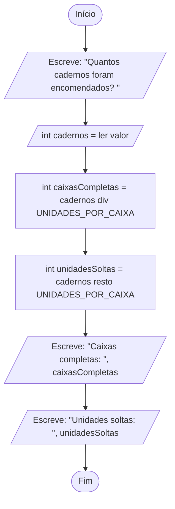

# Laboratório: Pseudocódigo e fluxogramas

Laboratório do tema Pseudocódigo e fluxogramas, do módulo Desenvolver algoritmos. Cerca de 60 minutos. Vais desenhar no diagrams.net o fluxograma de um algoritmo pequeno, o das caixas de cadernos, e guardá-lo no teu computador. Cada passo diz o que fazer, porquê e o que deves ver. Tudo o que precisas está aqui; o [guia do tema](02-pseudocodigo-e-fluxogramas.md) tem a teoria completa, para quem quiser saber mais.

Este laboratório é todo de fluxogramas, e é opcional. Só o fazes quando o professor o indicar, e nenhum exercício obrigatório da ficha depende dele. A matéria do tema é saber ler um fluxograma. Desenhá-lo é a parte opcional que este laboratório treina.

## O que vais construir

No fim, tens na tua pasta `algoritmos` o fluxograma do algoritmo das caixas de cadernos, desenhado na aplicação. Fica em dois ficheiros: o desenho que se pode editar, `fluxograma-caixas-de-cadernos.drawio`, e uma imagem, `fluxograma-caixas-de-cadernos.png`, que qualquer computador abre.

Ficas a saber abrir o diagrams.net e guardar um desenho no teu computador. Ficas também a saber pôr figuras na página, com o texto de cada instrução, ligá-las com setas e exportar uma imagem. E ficas a saber confirmar que um fluxograma diz o mesmo que o pseudocódigo.

| Fase | O que muda | O que funciona no fim |
| --- | --- | --- |
| 1 | O ficheiro `fluxograma-caixas-de-cadernos.drawio`, guardado na pasta `algoritmos` | O nome do ficheiro aparece no topo da aplicação |
| 2 | As oito figuras, cada uma com o texto de uma instrução | As oito figuras em coluna, com as formas certas |
| 3 | As sete setas | As setas presas às figuras, de cima para baixo |
| 4 | A verificação contra o pseudocódigo | Seguido com o dedo, o fluxograma dá o ecrã que o algoritmo dá |
| 5 | A imagem `fluxograma-caixas-de-cadernos.png` | A imagem mostra o fluxograma inteiro, e o `.drawio` volta a abrir |

## Palavras que vais usar

- Algoritmo: uma sequência finita de passos, cada um claro e possível de executar, que parte de uns dados e chega a um resultado.
- Pseudocódigo: a forma de escrever algoritmos que usamos nas aulas, com uma instrução por linha, como `int cadernos = ler valor`. Para saber mais, vê a secção "A forma do pseudocódigo nas aulas" do [guia](02-pseudocodigo-e-fluxogramas.md).
- Instrução: cada linha do pseudocódigo, que manda fazer uma coisa.
- Variável: um espaço com um nome, onde se guarda um valor que pode mudar enquanto o algoritmo é executado, como `cadernos`. Nasce na linha onde aparece pela primeira vez, com o tipo à frente. O tipo `int` quer dizer que guarda números inteiros.
- Constante: um valor fixo do problema, com o nome em maiúsculas, escrito com `const`, como `const UNIDADES_POR_CAIXA = 12`.
- Atribuição: uma instrução que dá um valor a uma variável, com um só sinal de igual, `=`, que se lê "recebe".
- `ler valor`: a instrução que recebe um valor escrito por quem usa o algoritmo.
- `Escreve:`: a instrução que mostra texto e valores no ecrã.
- `div` e `resto`: a divisão inteira, que diz quantas vezes um número cabe noutro, e o que sobra dela. Com 30 cadernos e caixas de 12, `30 div 12` dá 2 e `30 resto 12` dá 6.
- Função predefinida: um pedaço de algoritmo já feito, com um nome, que recebe um valor entre parênteses e devolve um resultado. A `abs`, do desafio 1, é uma delas.
- Fluxograma: o desenho de um algoritmo, com figuras ligadas por setas. Cada figura é uma instrução, e as setas dizem a ordem. Para saber mais, vê a secção "Os símbolos do fluxograma" do [guia](02-pseudocodigo-e-fluxogramas.md).
- Figura: cada forma do fluxograma. A forma diz que tipo de instrução está lá dentro.
- Oval: a figura de pontas redondas onde o algoritmo começa, `Início`, e acaba, `Fim`. Na aplicação chama-se Terminator.
- Paralelogramo: a figura das entradas e das saídas, com `ler valor` ou `Escreve:`. Na aplicação chama-se Data.
- Retângulo: a figura das atribuições e das contas. Na aplicação chama-se Process.
- Losango: a figura de uma decisão, que só se usa a partir do tema 03. Na aplicação chama-se Decision.
- Seta: a ligação de uma figura à seguinte, que diz a ordem do percurso.
- Trace: seguir um algoritmo à mão, instrução a instrução, a anotar o valor das variáveis e o que aparece no ecrã. Para saber mais, vê a secção "A tabela de trace" do [guia](02-pseudocodigo-e-fluxogramas.md).
- Browser: o programa que abre as páginas da internet, como o Chrome, o Edge, o Firefox ou o Safari.
- Trackpad: a superfície do portátil que faz de rato.
- Separador: cada página aberta no browser, com o seu título no topo da janela.
- Ficheiro `.drawio`: o desenho que a aplicação volta a abrir para continuares a editar.
- Imagem PNG: uma fotografia do desenho, que qualquer computador abre, mas que não se edita.
- Exportar: criar a imagem PNG a partir do desenho.

## O que precisas

- Um computador com um browser, como o Chrome, o Edge, o Firefox ou o Safari, e ligação à internet.
- O diagrams.net, uma aplicação gratuita de desenho de diagramas que funciona no browser, sem criar conta. Também se chama draw.io, o nome antigo, e os ficheiros que cria terminam em `.drawio`. Confirma que chegas a ela. Abre `https://app.diagrams.net/?lang=pt`. Deve aparecer um diagrama em branco chamado "Diagrama sem nome", o que quer dizer que a aplicação está pronta a usar.
- Uma pasta chamada `algoritmos`, onde vais guardar os fluxogramas desta disciplina. Cria-a antes de começar, no sítio que o professor indicar: uma pasta do computador ou uma pen. Todos os ficheiros deste laboratório têm nomes em minúsculas, com hífenes entre as palavras e sem acentos nem espaços, como `fluxograma-caixas-de-cadernos.drawio`. Um nome assim funciona em qualquer computador e diz o que o ficheiro contém sem ser preciso abri-lo.
- Papel e caneta, para o desafio, se o fizeres. O algoritmo que vais desenhar está na fase 2, e não precisas de mais nada à mão.

## Se alguma coisa falhar

1. Vês a barra de menus no topo da aplicação, com Ficheiro, Editar, Visualização, Ordenar, Extras e Ajuda? Se não a vês, a janela do browser está estreita. Maximiza-a, ou usa o botão redondo com reticências, no canto superior direito, que tem as mesmas opções.
2. O teu ficheiro está guardado no computador? O nome que lhe deste aparece no topo da aplicação. Se o "Guardar como" te pedir para entrar numa conta, o campo "Onde:" ficou no Google Drive. Muda-o para "Aparelho" ou "Descarregar".
3. As setas estão presas às figuras? Arrasta uma figura um pouco para o lado. Se as setas a acompanharem, estão presas. Depois carrega em Ctrl+Z, ou Cmd+Z num Mac, para a figura voltar ao sítio.
4. Enganaste-te? Ctrl+Z, ou Cmd+Z num Mac, desfaz a última ação. Podes repetir para desfazer várias.

## Preparar o projeto

Esta preparação leva cerca de 8 minutos. Os nomes dos menus e dos botões deste laboratório foram confirmados em setembro de 2026, com a aplicação em português. A aplicação muda de aspeto de vez em quando. Se um nome no teu ecrã não for exatamente igual, procura o que faz a mesma coisa, porque os passos são os mesmos.

1. Abre a aplicação em português. Maximiza a janela do browser, para ocupar o ecrã todo, e escreve na barra de endereços `https://app.diagrams.net/?lang=pt`. A parte final, `?lang=pt`, pede a aplicação em português. Sem ela, a aplicação usa a língua do browser, que pode ser o inglês.

   O que deves ver: um diagrama em branco, chamado "Diagrama sem nome". A aplicação não te pergunta nada nem te pede conta.

2. Conhece as quatro zonas do ecrã, porque vais usá-las todas:

   | Zona | Onde está | Para que serve |
   | --- | --- | --- |
   | Painel das figuras | à esquerda | tem as figuras, arrumadas em grupos, e no topo uma caixa de pesquisa onde se lê "Escreva / para pesquisar" |
   | Página | ao centro, a zona branca com uma grelha de quadrados | é onde desenhas; a grelha só serve para ajudar a alinhar |
   | Painel de formatação | à direita, com os separadores "Diagrama" e "Estilo" | muda o aspeto do que estiver selecionado; neste laboratório quase não precisas dele |
   | Barra de menus | no topo, com Ficheiro, Editar, Visualização, Ordenar, Extras e Ajuda | o menu "Ficheiro" tem tudo o que é guardar, abrir e exportar |

   Neste laboratório só vais usar o menu "Ficheiro", da barra de menus. Os passos dizem sempre o caminho completo, por exemplo "Ficheiro" e depois "Guardar como...". Carregas em "Ficheiro", abre-se uma lista, e escolhes a opção nessa lista.

3. Confirma que a janela está maximizada, porque a aplicação muda de aspeto conforme a largura da janela. Se a janela estiver estreita, por exemplo a ocupar só metade do ecrã, a barra de menus desaparece. No lugar dela aparece um botão redondo com reticências (três pontos), no canto superior direito. Esse botão abre um menu com "Ficheiro" e "Exportar como" lado a lado. A forma mais simples de seguir este laboratório é maximizar a janela. Se não puderes, usa esse botão sempre que os passos falarem da barra de menus. Nesse caso, procura "Exportar como" diretamente no menu, e não dentro de "Ficheiro".

## Fase 1: o fluxograma guardado no teu computador (8 minutos)

Neste momento, o diagrama só existe dentro do separador do browser. Se fechares o separador, perdes tudo. Por isso, a primeira coisa a fazer é guardar, antes de desenhar. Guardar logo no início dá um nome e um sítio ao ficheiro. A partir daí, cada vez que guardares, o trabalho vai para o mesmo ficheiro, na tua pasta `algoritmos`.

1. Abre a janela de guardar. Na barra de menus, carrega em "Ficheiro" e, na lista que se abre, escolhe "Guardar como...".

   O que deves ver: a janela "Guardar como", com três campos.

2. Dá o nome ao ficheiro. No campo "Guardar como:", apaga o que lá estiver e escreve `fluxograma-caixas-de-cadernos.drawio`. Mantém o `.drawio` no fim.

3. Confirma o tipo. No campo "Tipo:" deixa ficar "Ficheiro XML (.drawio)". É o formato próprio da aplicação, o único que ela consegue voltar a abrir para continuares a editar.

4. Escolhe onde guardar, que é o campo mais importante. O campo "Onde:" vem com "Google Drive" escolhido, e tens de o mudar. Escolhe "Aparelho", que guarda o ficheiro numa pasta do teu computador. Se "Aparelho" não funcionar no teu browser, escolhe "Descarregar", que põe o ficheiro na pasta de transferências.

   As outras opções do campo "Onde:" não servem aqui. Google Drive, OneDrive, Microsoft 365 e GitHub pedem uma conta nesses serviços. "Navegador" guarda o ficheiro dentro do próprio browser. Basta alguém limpar os dados do browser, ou mudares de computador, para o perderes.

5. Carrega em "Guardar". Com "Aparelho", abre-se a janela habitual do sistema para escolheres a pasta. Escolhe a pasta `algoritmos` e confirma. Com "Descarregar", o ficheiro vai para a pasta de transferências do browser. Nesse caso, no fim do laboratório, passa a cópia mais recente para a pasta `algoritmos`.

   O que deves ver: o nome que escreveste no topo da aplicação, onde antes estava "Diagrama sem nome". Isto quer dizer que o desenho já tem um ficheiro no teu computador. Se aparecer outra coisa, vê os [problemas frequentes](#problemas-frequentes).

Daqui para a frente, para guardar basta carregar em Ctrl+S, ou Cmd+S num Mac, ou escolher "Ficheiro" e depois "Guardar". Guarda muitas vezes, pelo menos no fim de cada fase. Se escolheste "Descarregar", cada vez que guardas é descarregada uma cópia nova, e o browser pode acrescentar um número ao nome. No fim, fica com a mais recente.

### Paragem 1

O ficheiro `fluxograma-caixas-de-cadernos.drawio` está na tua pasta `algoritmos`, ou na pasta de transferências, e o nome dele aparece no topo da aplicação.

Pensa antes de continuares: porque é que se guarda antes de desenhar, se ainda não há nada para guardar? A resposta: até guardares, o desenho só existe no separador do browser, e fechá-lo apaga tudo. Guardar logo no início dá-lhe um nome e um sítio. A partir daí, cada Ctrl+S vai para esse ficheiro, e o que desenhares fica a salvo.

## Fase 2: uma figura para cada instrução (20 minutos)

Um fluxograma é o desenho de um algoritmo. Cada instrução do pseudocódigo passa a ser uma figura, e a forma da figura diz que tipo de instrução é. As leituras e as saídas, que comunicam com quem usa o algoritmo, vão em paralelogramos. As atribuições e as contas vão em retângulos. O algoritmo começa e acaba num oval, a figura de pontas redondas, com as palavras `Início` e `Fim`. Para saber mais, lê a secção "Os símbolos do fluxograma" do [guia](02-pseudocodigo-e-fluxogramas.md).

O algoritmo que vais desenhar é o das caixas de cadernos. Uma papelaria vende cadernos que o fornecedor só entrega em caixas de 12. Dado o número de cadernos encomendados, o algoritmo diz quantas caixas completas isso dá e quantos cadernos sobram fora delas:

```text
const UNIDADES_POR_CAIXA = 12
Escreve: "Quantos cadernos foram encomendados? "
int cadernos = ler valor
int caixasCompletas = cadernos div UNIDADES_POR_CAIXA
int unidadesSoltas = cadernos resto UNIDADES_POR_CAIXA
Escreve: "Caixas completas: ", caixasCompletas
Escreve: "Unidades soltas: ", unidadesSoltas
```

Leitura guiada: lê-se de cima para baixo, uma linha de cada vez. A primeira linha fixa uma regra do problema, a constante `UNIDADES_POR_CAIXA`, que vale 12. A segunda mostra a pergunta no ecrã, e a terceira guarda em `cadernos` o número que a pessoa escrever. As duas linhas seguintes fazem as contas. `div` diz quantas vezes o 12 cabe inteiro nos cadernos, e `resto` diz quantos sobram. As duas últimas mostram os resultados, cada uma com o seu texto. Com 30 cadernos, o ecrã mostra "Caixas completas: 2" e "Unidades soltas: 6".

O fluxograma tem 8 figuras: uma para cada uma das seis instruções, mais o início e o fim. A linha da constante não tem figura. Não é uma ação que o algoritmo faça com os dados, mas uma regra do problema, que vale do princípio ao fim. Numa receita, a lista dos ingredientes também não é um dos passos da preparação.

1. Encontra as figuras de fluxograma. O painel da esquerda tem as figuras arrumadas em grupos com nome: Rascunho, Geral, Diversos, Avançado, Básico, Setas, Fluxograma e outros. As que te interessam estão no grupo "Fluxograma", perto do fim da lista. Desce no painel com a roda do rato, ou com o dedo no trackpad, e carrega no nome "Fluxograma" para abrir o grupo.

   O que deves ver: as figuras do grupo "Fluxograma". Se o grupo não aparecer na lista, carrega no botão "+ Mais formas", no fundo do painel da esquerda. Abre-se a janela "Formas". Confirma que "Fluxograma" está marcado e fecha a janela com o botão de confirmar. O grupo passa a aparecer no painel.

2. Conhece os nomes das figuras. Passa o rato por cima das figuras do grupo, devagar, e ao lado de cada uma aparece uma pré-visualização com o nome. Os nomes aparecem em inglês, mesmo com a aplicação em português, e por isso precisas de saber o que cada um quer dizer:

   | Figura | Nome que aparece | O que quer dizer | Para que a usas |
   | --- | --- | --- | --- |
   | Retângulo de pontas redondas | Terminator | terminal, o sítio onde o algoritmo começa ou acaba | `Início` e `Fim`; é o oval |
   | Paralelogramo | Data | dados, que entram ou saem do algoritmo | as leituras, com `ler valor`, e as saídas, com `Escreve:` |
   | Retângulo | Process | processo, ou seja, processamento | atribuições e contas |
   | Losango | Decision | decisão | só a partir do tema 03 |

   O grupo "Fluxograma" tem muitas outras figuras, com nomes como Display, Document ou Manual Input. Pertencem a convenções de fluxograma mais pormenorizadas do que a desta disciplina, e não as vais usar. Usa sempre as quatro da tabela, e sempre do grupo "Fluxograma", mesmo que encontres figuras parecidas noutros grupos, como o "Geral".

3. Põe a primeira figura na página. No grupo "Fluxograma", carrega na figura Terminator e, sem largar o botão do rato, arrasta-a para a página. Larga-a perto do topo, ao centro.

   O que deves ver: a figura selecionada, com um contorno azul e uns quadradinhos nos cantos. Se carregares numa zona vazia da página, deixa de estar selecionada. Se carregares nela, volta a ficar.

4. Escreve o texto dentro da figura. Faz duplo clique dentro da figura, e aparece um cursor a piscar. Se a figura já tiver algum texto, apaga-o. Escreve `Início`. Para acabar de escrever, carrega numa zona vazia da página.

   O que deves ver: a palavra Início dentro da figura. Se te enganares, faz outra vez duplo clique e corrige. Se fizeres uma asneira maior, como apagar a figura sem querer, carrega em Ctrl+Z, ou Cmd+Z num Mac, que desfaz a última ação. Podes carregar várias vezes para desfazer várias ações.

5. Põe as outras sete figuras, de cima para baixo, com a figura e o texto desta tabela. O texto de cada figura é a instrução do pseudocódigo, tal como está escrita:

   | Ordem | Figura | Nome que aparece | Texto a escrever |
   | --- | --- | --- | --- |
   | 1 | Retângulo de pontas redondas | Terminator | `Início` |
   | 2 | Paralelogramo | Data | `Escreve: "Quantos cadernos foram encomendados? "` |
   | 3 | Paralelogramo | Data | `int cadernos = ler valor` |
   | 4 | Retângulo | Process | `int caixasCompletas = cadernos div UNIDADES_POR_CAIXA` |
   | 5 | Retângulo | Process | `int unidadesSoltas = cadernos resto UNIDADES_POR_CAIXA` |
   | 6 | Paralelogramo | Data | `Escreve: "Caixas completas: ", caixasCompletas` |
   | 7 | Paralelogramo | Data | `Escreve: "Unidades soltas: ", unidadesSoltas` |
   | 8 | Retângulo de pontas redondas | Terminator | `Fim` |

   Três conselhos poupam-te tempo:

   - Deixa espaço entre as figuras, mais ou menos a altura de uma figura, para caberem as setas.
   - Mantém as figuras em coluna. Quando arrastas uma figura, a aplicação mostra linhas de guia coloridas quando ela fica alinhada com outra. Larga a figura quando a linha de guia vertical aparecer, e ficam todas centradas umas por baixo das outras.
   - Para repetir uma figura já feita, copia-a. Seleciona um paralelogramo, carrega em Ctrl+C e depois em Ctrl+V (Cmd+C e Cmd+V num Mac). Aparece uma cópia ao lado, que arrastas para o sítio certo, e só tens de mudar o texto.

   Se o texto não couber na figura, seleciona-a e arrasta um dos quadradinhos azuis dos cantos para a alargar. As instruções das figuras 4 e 5 são compridas. Alarga esses dois retângulos, para cada instrução caber numa só linha.

   Todo o texto das figuras se escreve com as teclas normais do teclado. Repara no sinal das figuras 3, 4 e 5. É um só sinal de igual, `=`, porque são atribuições, em que a variável recebe um valor. Não escrevas `==`, que é outra coisa: uma pergunta, "é igual a?", que só vais usar no tema 03.

6. Guarda (Ctrl+S ou Cmd+S).

### Paragem 2

Tens oito figuras numa coluna, cada uma com o texto de uma instrução: dois ovais, quatro paralelogramos e dois retângulos, pela ordem da tabela.

Pensa antes de continuares: o algoritmo tem sete linhas, e o fluxograma tem oito figuras. Porque não são sete? A resposta: a linha `const UNIDADES_POR_CAIXA = 12` não tem figura, porque é uma regra do problema e não uma ação. Ficam seis instruções, e cada uma dá uma figura. O `Início` e o `Fim` dão mais duas, e são oito.

## Fase 3: as setas dão a ordem (10 minutos)

As figuras sozinhas não dizem por que ordem se executam. É a seta que diz para onde se vai a seguir, de uma figura para a próxima. Num algoritmo sequencial, como este, o percurso é uma linha reta, de cima para baixo. Por isso, oito figuras em coluna precisam de sete setas, uma entre cada par de figuras seguidas. Para saber mais, lê a secção "Os símbolos do fluxograma" do [guia](02-pseudocodigo-e-fluxogramas.md).

1. Liga a primeira figura à segunda. Passa o rato por cima da figura 1, a do Início, sem carregar, e aparecem quatro pequenas setas azuis, uma de cada lado da figura. Carrega na seta azul de baixo e, sem largar o botão do rato, arrasta até à figura 2. Quando a figura 2 ficar com um contorno azul, larga o botão.

   O que deves ver: uma seta desenhada da figura 1 para a figura 2, com a ponta virada para a figura 2. A ponta tem de apontar para a figura seguinte, que é o sentido em que o algoritmo é executado.

2. Liga as outras figuras da mesma maneira: da figura 2 para a 3, da 3 para a 4, e assim até à 8. Se uma seta ficar ao contrário, seleciona-a, apaga-a com a tecla Delete ou Backspace, e desenha-a outra vez a partir da figura certa.

3. Provoca um erro de propósito, para veres como se reconhece uma seta solta. Desenha uma seta a partir da figura 8, o Fim, e larga o botão numa zona vazia da página, longe de qualquer figura.

   O que deves ver: uma seta pendurada, que não chega a nenhuma figura. Isto quer dizer que, por ali, o percurso não tem para onde ir. Um fluxograma bem feito não tem setas sem destino, e do Fim não sai nenhuma seta, porque é onde o percurso acaba. Apaga essa seta com Ctrl+Z, ou seleciona-a e carrega em Delete.

4. Confirma que as sete setas estão presas nas duas pontas. Arrasta uma figura do meio um pouco para o lado.

   O que deves ver: as setas que chegam e que saem dela a acompanhá-la, esticando-se. Isto quer dizer que estão presas. Se uma ponta ficar parada no sítio antigo, essa seta está solta. Apaga-a e desenha-a outra vez, largando só quando a figura de destino ficar com o contorno azul. No fim, carrega em Ctrl+Z, ou Cmd+Z num Mac, para a figura voltar ao sítio.

   Num algoritmo sequencial, as setas não levam texto. As setas com texto, com `Sim` e `Não`, aparecem no tema 03, quando houver decisões.

5. Guarda (Ctrl+S ou Cmd+S).

### Paragem 3

O fluxograma está completo, e tem de ficar assim, com o mesmo texto em cada figura:



Descrição do percurso, para quem não vê o desenho. É uma única coluna de oito figuras ligadas por sete setas, de cima para baixo. Começa num oval com a palavra Início. Seguem-se dois paralelogramos, o primeiro com a pergunta e o segundo com `int cadernos = ler valor`. Depois vêm dois retângulos, com as contas das caixas completas e das unidades soltas, por esta ordem. Seguem-se mais dois paralelogramos, com os dois `Escreve:` dos resultados. Termina num oval com a palavra Fim.

Pensa antes de continuares: se apagasses a seta entre a figura 4 e a figura 5, o que ficava errado? A resposta: o percurso parava na figura 4. Quem seguisse o fluxograma com o dedo não chegava à conta das unidades soltas nem aos resultados. Cada figura, menos o Fim, tem de ter uma seta a sair para a seguinte.

## Fase 4: o fluxograma diz o mesmo que o pseudocódigo (9 minutos)

Um fluxograma e o pseudocódigo do mesmo algoritmo têm de dizer a mesma coisa. Se não disserem, um dos dois está errado. Antes de dares o desenho por acabado, compara-o com o pseudocódigo, instrução a instrução. Depois segue-o com o dedo, com uma entrada concreta, e anota o que aparece no ecrã. Seguir um algoritmo assim, à mão, chama-se fazer o trace. Para saber mais, lê o passo 4 do exemplo guiado e a secção "A tabela de trace" do [guia](02-pseudocodigo-e-fluxogramas.md).

1. Verifica o desenho, com o pseudocódigo da fase 2 ao lado:

   - [ ] Tem 8 figuras e 7 setas.
   - [ ] Tem um único Início, no topo, e um único Fim, em baixo, os dois em ovais.
   - [ ] O `Escreve:` e a leitura do princípio e os dois `Escreve:` do fim estão em paralelogramos, e as duas contas estão em retângulos.
   - [ ] O texto de cada figura diz o mesmo que a instrução do pseudocódigo. Tem o tipo à frente das variáveis que nascem, o `=`, o `div` e o `resto`. Dentro das aspas, tem os mesmos espaços, que decidem o que aparece no ecrã.
   - [ ] As figuras estão pela mesma ordem que as instruções.
   - [ ] Todas as setas estão presas nas duas pontas e apontam para baixo.

   Se uma das verificações falhar, corrige o desenho antes de continuares.

2. Segue o fluxograma com o dedo, no ecrã, como se a pessoa tivesse escrito 30 cadernos. Em cada paralelogramo com `Escreve:`, diz em voz baixa o que aparece no ecrã. Em cada retângulo, faz a conta.

   O que deves ver, por esta ordem: a pergunta "Quantos cadernos foram encomendados?", depois "Caixas completas: 2" e por fim "Unidades soltas: 6". No primeiro retângulo, `30 div 12` dá 2, porque o 12 cabe duas vezes em 30. No segundo, `30 resto 12` dá 6, porque duas caixas levam 24 cadernos e sobram 6. Se não chegares a este ecrã, há uma figura fora do sítio ou com o texto errado.

3. Repete com 24 cadernos, um múltiplo exato de 12. Antes de seguires o caminho, prevê o que aparece no ecrã.

   O que deves ver: a pergunta, depois "Caixas completas: 2" e "Unidades soltas: 0". O 12 cabe exatamente duas vezes em 24, e não sobra nada. Repara que o percurso passa pela figura das unidades soltas mesmo quando dão 0. Num algoritmo sequencial, todas as figuras se percorrem sempre.

### Paragem 4

O fluxograma passou as seis verificações. Seguido com o dedo, dá o mesmo ecrã que o pseudocódigo, com 30 e com 24 cadernos.

Pensa antes de continuares: se trocasses a ordem das figuras 4 e 6, o que aparecia no ecrã com 30 cadernos? A resposta: a figura 6, `Escreve: "Caixas completas: ", caixasCompletas`, vinha antes da conta das caixas completas. Nesse momento, `caixasCompletas` ainda não tinha valor, e o ecrã não podia mostrar o número de caixas. É por isso que as figuras têm de estar pela ordem das instruções.

## Fase 5: a imagem para mostrar, o ficheiro para editar (7 minutos)

O ficheiro `.drawio` é o teu fluxograma editável, o que abres para continuar a trabalhar ou para corrigir. Para mostrar o fluxograma a alguém, ou para o entregar, exporta-se uma imagem, que qualquer computador ou telemóvel abre sem precisar da aplicação. Uma imagem não se edita. Se precisares de mudar alguma coisa, mudas o `.drawio` e exportas a imagem outra vez. Por isso, guardas sempre os dois ficheiros.

1. Guarda primeiro o `.drawio` (Ctrl+S ou Cmd+S).

2. Na barra de menus, escolhe "Ficheiro", depois "Exportar como" e depois "PNG...". PNG é um formato de imagem que mantém as letras nítidas.

   O que deves ver: uma janela chamada "Imagem", com as opções da imagem.

3. Escolhe as opções da imagem. Em "Tamanho", escolhe "Diagrama", para a imagem ter só o fluxograma, e não a página inteira com espaço vazio à volta. Confirma que "Fundo Transparente" está desligado. Com o fundo transparente, a imagem pode ficar ilegível quando aberta num fundo escuro. Deixa as outras opções, como "Zoom" e "Incluir uma cópia do meu diagrama", como estão. Carrega em "Exportar".

4. Se a aplicação te pedir um nome e um sítio, faz como na fase 1. O nome é `fluxograma-caixas-de-cadernos.png`, e o sítio é "Aparelho" ou "Descarregar", nunca Google Drive nem "Navegador".

5. Vai à pasta onde a imagem ficou e abre-a com duplo clique.

   O que deves ver: o fluxograma inteiro, com as oito figuras e o texto legível. Se a imagem tiver muito espaço vazio à volta, vê os [problemas frequentes](#problemas-frequentes).

6. Confirma que o `.drawio` ficou mesmo guardado. Fecha o separador da aplicação e abre outra vez `https://app.diagrams.net/?lang=pt`. Na barra de menus, escolhe "Ficheiro", depois "Abrir de" e o sítio onde o guardaste, e escolhe o ficheiro.

   O que deves ver: o fluxograma como o deixaste, o que quer dizer que está guardado. Se a aplicação te perguntar se queres guardar as alterações a um diagrama sem nome, podes responder que não. O teu trabalho está no ficheiro que acabaste de abrir.

### Paragem 5

Na tua pasta `algoritmos` estão `fluxograma-caixas-de-cadernos.drawio` e `fluxograma-caixas-de-cadernos.png`. A imagem mostra o fluxograma inteiro, e o `.drawio` volta a abrir na aplicação.

Pensa antes de continuares: o professor pede-te para mudar o texto de uma figura. Mudas a imagem ou o `.drawio`? A resposta: o `.drawio`, porque a imagem não se edita. Depois de mudares o desenho, exportas a imagem outra vez, para as duas versões ficarem iguais.

## Problemas frequentes

### A aplicação aparece em inglês

Abriste-a sem o `?lang=pt` no fim do endereço, e ela usou a língua do browser. Abre-a com `https://app.diagrams.net/?lang=pt`.

### Não aparece a barra de menus no topo

A janela do browser está estreita, e a aplicação esconde a barra. Maximiza a janela, ou usa o botão redondo com reticências, no canto superior direito, onde estão "Ficheiro" e "Exportar como".

### O "Guardar como" pede para entrar numa conta

O campo "Onde:" ficou em Google Drive, que vem escolhido, ou noutro serviço. Muda-o para "Aparelho" ou "Descarregar".

### Guardaste no "Navegador"

O ficheiro ficou dentro do browser, e perde-se se alguém limpar os dados do browser ou se mudares de computador. Faz outra vez "Guardar como" e escolhe "Aparelho" ou "Descarregar".

### Não sabes onde ficou o ficheiro

Com "Descarregar", o ficheiro está na pasta de transferências do computador. Passa-o para a pasta `algoritmos`.

### Não encontras o grupo "Fluxograma"

Desce até ao fim do painel da esquerda. Se não estiver lá, carrega no botão "+ Mais formas", marca "Fluxograma" e confirma.

### O texto não cabe na figura

Seleciona a figura e alarga-a pelos quadradinhos azuis dos cantos.

### A seta não fica presa à figura

Largaste o botão do rato antes de a figura de destino ficar com o contorno azul. Apaga a seta e desenha-a outra vez, largando só quando o contorno azul aparecer.

### Uma leitura ou um `Escreve:` ficou num retângulo

Escolheste a figura Process em vez de Data. As leituras e os `Escreve:` comunicam com quem usa o algoritmo, e por isso vão em paralelogramos. Apaga a figura, põe uma Data no lugar e escreve outra vez o texto.

### Escreveste `==` numa figura

O texto da figura ficou a fazer uma pergunta, "é igual a?", em vez de dar um valor. Nas atribuições, a variável recebe um valor, e o sinal é um só, `=`. Faz duplo clique na figura e corrige.

### A imagem tem muito espaço vazio à volta do fluxograma

Na janela "Imagem", o "Tamanho" ficou em "Página". Exporta outra vez, com "Tamanho" em "Diagrama".

### Apagaste ou estragaste alguma coisa

Ctrl+Z, ou Cmd+Z num Mac, desfaz a última ação. Repete para desfazer mais.

### A grelha de quadrados aparece na página

É só uma ajuda para alinhar, e normalmente não aparece na imagem exportada.

## Desafios

1. A diferença de inventário. Uma loja faz, de vez em quando, a contagem do stock. Conta à mão quantas unidades de um artigo estão na prateleira e compara com o número que o registo do computador diz que devia haver. Se os dois números não coincidirem, alguém tem de investigar porquê. Este algoritmo mostra de quantas unidades é a diferença, sem sinal, porque tanto faz faltarem unidades como sobrarem. Nos dois casos há uma diferença a investigar.

   ```text
   Escreve: "Quantas unidades diz o registo? "
   int stockRegistado = ler valor
   Escreve: "Quantas unidades foram contadas na prateleira? "
   int stockContado = ler valor
   int diferenca = abs(stockRegistado - stockContado)
   Escreve: "Diferença a investigar: ", diferenca, " unidades"
   ```

   `abs` é uma função que tira o sinal a um número: `abs(-6)` dá 6, e `abs(6)` também dá 6. O que está entre parênteses calcula-se primeiro, e só depois se tira o sinal ao resultado.

   a) Antes de desenhar, conta em papel quantas figuras e quantas setas o fluxograma vai ter, e decide a forma de cada figura. Escreve essa lista, para a comparares com o desenho no fim.

   b) Cria um diagrama novo. Na barra de menus, escolhe "Ficheiro" e depois "Novo...". A aplicação pode abrir o diagrama novo noutro separador do browser. Se te perguntar que tipo de diagrama queres, escolhe o diagrama em branco. Guarda-o logo, como na fase 1, com o nome `fluxograma-diferenca-de-inventario.drawio`.

   c) Desenha o fluxograma, com as figuras certas, o texto de cada instrução como no pseudocódigo e as setas presas nas duas pontas. Depois verifica-o com a lista da fase 4, adaptada a este algoritmo.

   d) Segue o fluxograma com o dedo para duas contagens, e escreve, para cada uma, a linha do resultado que aparece no ecrã. Na primeira, o registo diz 120 e foram contadas 115. Na segunda, o registo diz 80 e foram contadas 86. Explica numa frase porque é que a segunda não mostra um número negativo.

   e) Guarda o `.drawio` e exporta a imagem, com o nome `fluxograma-diferenca-de-inventario.png`.

2. Verifica o fluxograma de um colega. Troca de computador com um colega que tenha feito o desafio 1, e verifica o fluxograma dele com a lista da fase 4. Diz-lhe se encontraste uma figura a mais ou a menos, ou uma forma errada. Diz-lhe também se há um texto diferente do pseudocódigo, ou uma seta solta.

## Antes de terminares

- [ ] Na tua pasta `algoritmos` estão `fluxograma-caixas-de-cadernos.drawio` e `fluxograma-caixas-de-cadernos.png`.
- [ ] O fluxograma tem 8 figuras e 7 setas, com um só Início e um só Fim.
- [ ] Seguido com o dedo, com 30 cadernos, o fluxograma dá "Caixas completas: 2" e "Unidades soltas: 6".
- [ ] Se fizeste o desafio 1, estão também na pasta `fluxograma-diferenca-de-inventario.drawio` e `fluxograma-diferenca-de-inventario.png`.
- [ ] Consegues explicar, por palavras tuas, porque é que cada instrução do pseudocódigo tem uma figura, e a linha `const` não tem.

As imagens são o que entregas, pela forma de entrega que o professor indicar. Os ficheiros `.drawio` ficam contigo, porque podes voltar a precisar deles. Se o professor indicar a parte B do desafio da ficha deste tema, desenhas mais um fluxograma na aplicação. E o laboratório do tema 03, também opcional, acrescenta a figura que ainda falta, o losango das decisões.


