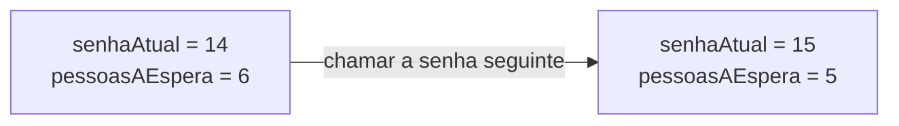

# Pseudocódigo

Neste guia, os algoritmos ganham uma escrita própria, o pseudocódigo. O estado passa a ter nomes, as variáveis, e cada valor tem um tipo. Fazes contas, usas funções que já vêm feitas e segues um algoritmo à mão, numa tabela de trace. Trabalhas em papel.

Usa o contrato e o estado do tema 01. Rever: [O contrato do problema](01-do-problema-ao-algoritmo.md#o-contrato-do-problema-entradas-saídas-restrições-e-condições), [Exemplos concretos](01-do-problema-ao-algoritmo.md#exemplos-concretos) e [Ação e estado](01-do-problema-ao-algoritmo.md#ação-e-estado). Para praticar: [ficha de exercícios](exercicios/02-pseudocodigo-exercicios.md).

## Neste guia

1. [Uma notação própria para algoritmos](#uma-notação-própria-para-algoritmos)
2. [Variáveis e estado](#variáveis-e-estado)
3. [Tipos de dados](#tipos-de-dados)
4. [Constantes](#constantes)
5. [Onde nasce uma variável, e com que tipo](#onde-nasce-uma-variável-e-com-que-tipo)
6. [Atribuição: dar um valor não é perguntar se é igual](#atribuição-dar-um-valor-não-é-perguntar-se-é-igual)
7. [Ler e escrever](#ler-e-escrever)
8. [Expressões aritméticas](#expressões-aritméticas)
9. [Funções predefinidas](#funções-predefinidas)
10. [Sequência](#sequência)
11. [A forma do pseudocódigo nas aulas](#a-forma-do-pseudocódigo-nas-aulas)
12. [A tabela de trace](#a-tabela-de-trace)
13. [Exemplo guiado: as caixas de cadernos](#exemplo-guiado-as-caixas-de-cadernos)

## Uma notação própria para algoritmos

No guia 01, escreveste algoritmos em português, em passos numerados. O português deixa passar ambiguidades sem dar sinal. "Esperar um pouco" parece uma instrução, mas duas pessoas esperam tempos diferentes.

Uma linguagem de programação, como o Python, não tem esse problema, porque cada instrução tem um só significado. Mas tem regras de escrita rígidas. Um parêntese esquecido impede o programa de correr, mesmo com o raciocínio certo.

O **pseudocódigo** fica a meio caminho. É texto escrito com um vocabulário pequeno: umas poucas palavras e sinais, sempre com o mesmo significado. "Pseudo" quer dizer falso: o pseudocódigo parece código, mas nenhum computador o executa. Serve para pensar, com a atenção no raciocínio e não na pontuação.

## Variáveis e estado

Na papelaria do guia 01, o estado era uma fotografia: "senha 14 ao balcão, 6 pessoas à espera". Com o pseudocódigo, cada parte dessa fotografia ganha um nome. `senhaAtual` vale 14, e `pessoasAEspera` vale 6.



Uma **variável** é um espaço com um nome, onde se guarda um valor que pode mudar enquanto o algoritmo é executado. Imagina uma caixa com uma etiqueta. A etiqueta é o nome e não muda. O conteúdo é o valor e pode ser trocado. Quando entra um valor novo, o antigo sai e não fica guardado em lado nenhum.

O estado de um algoritmo, num momento, passa a ser o valor de todas as suas variáveis nesse momento. Cada instrução que muda uma variável muda o estado. Para saber o que uma instrução fez, compara o estado antes e depois dela.

O nome deve dizer o que a variável guarda: `caixasCompletas` diz, e `x` ou `aux` não dizem. Nos algoritmos desta disciplina, os nomes das variáveis seguem três regras:

- começam por letra minúscula;
- não têm espaços: as palavras juntam-se, e cada uma a partir da segunda começa por maiúscula, como em `precoEmCentimos`;
- não têm acentos nem cedilhas, porque as linguagens de programação nem sempre os aceitam: escreve-se `preco`, e não `preço`.

## Tipos de dados

Um número de caixas nunca é 2,5, e com o nome de um cliente não se fazem contas. Cada variável guarda valores de um **tipo**, que decide que valores são possíveis e o que se pode fazer com eles. Nas aulas usam-se quatro:

| Tipo | Guarda | Exemplos | O que se faz com ele |
| --- | --- | --- | --- |
| `int` | números inteiros | `12`, `0`, `-3` | contas com unidades inteiras |
| `float` | números com parte decimal | `1.5`, `0.75` | contas em que a parte decimal interessa |
| `string` | texto, entre aspas | `"Ana"`, `"caderno A4"` | mostrar e guardar; não se fazem contas |
| `bool` | só um de dois valores | `true` (verdadeiro), `false` (falso) | guardar a resposta a uma pergunta de sim ou não |

No pseudocódigo e nas tabelas, a parte decimal separa-se com um ponto, `1.5`, como nas linguagens de programação. No texto em português continua a vírgula, 1,5.

O tipo escolhe-se pelo que o valor representa e pelo que vais fazer com ele, e não pelo aspeto. Um número de alunos é um `int`, porque não há meio aluno. Um peso em quilogramas e uma média são `float`. O nome de um fornecedor é uma `string`. "A encomenda já foi paga?" é um `bool`: uma variável `pago` com `false` guarda que ainda não foi.

O dinheiro guarda-se em cêntimos, num `int`: 3,49 euros são 349 cêntimos. Os computadores guardam muitos números com parte decimal com pequenos erros de aproximação. Num preço, nem um erro pequeno se aceita, e com cêntimos inteiros as contas dão sempre o valor exato.

Um número de telefone, como 912345678, só tem algarismos e é uma `string`. Ninguém soma dois telefones. Guardado como número, um telefone que começasse por 0 perdia esse zero, e não se podia escrever o + do indicativo, como em +351. Na dúvida, pergunta: vou fazer contas com este valor? Se não, é quase sempre uma `string`.

Repara também nas aspas. `12` é um número, e `"12"` é um texto com dois caracteres, o 1 e o 2. Com aspas, é texto; sem aspas, é um número ou o nome de uma variável.

<details>
<summary>Para ires mais longe: de onde vêm os nomes dos tipos</summary>

Os nomes vêm do inglês. `int` vem de *integer*, que quer dizer inteiro. `float` vem de *floating point*, "vírgula flutuante", a forma como o computador guarda os números com parte decimal. `string` quer dizer "fio": um texto é uma fila de caracteres, como as contas de um colar. `bool` vem de George Boole, um matemático inglês do século XIX que estudou a lógica do verdadeiro e do falso. Em Python, os tipos chamam-se `int`, `float`, `str` e `bool`, e os valores lógicos escrevem-se com maiúscula, `True` e `False`.

</details>

## Constantes

Uma caixa do fornecedor leva sempre 12 cadernos. Esse 12 é uma regra do problema, e não um dado que muda de encomenda para encomenda. Escrito solto numa conta, ninguém sabe o que quer dizer: tanto podiam ser os meses do ano como uma idade.

Uma **constante** é um valor com nome que não muda durante o algoritmo. Cria-se numa linha própria, no início, antes de ser usada, com a palavra `const` à frente:

```text
const UNIDADES_POR_CAIXA = 12
```

Lê-se "a constante UNIDADES_POR_CAIXA vale 12". O nome escreve-se em maiúsculas, com traço baixo entre as palavras, para se distinguir das variáveis à primeira vista. A constante não leva tipo, porque o tipo vê-se pelo valor: `12` é um `int`.

Dar nome ao valor traz duas vantagens. A primeira é que se percebe o que o número significa. A segunda é que, se o fornecedor passar a caixas de 24, muda-se uma linha, e o resto do algoritmo fica igual. Sem a constante, terias de procurar todos os 12 espalhados pelo algoritmo, com o risco de esquecer um.

A constante recebe o valor na linha do `const` e nunca mais. Uma instrução que lhe dê outro valor a meio do algoritmo está errada, porque ela deixava de ser constante.

## Onde nasce uma variável, e com que tipo

Antes de guardar um valor, é preciso dizer que a variável existe. Dizer o nome, o tipo e o valor com que ela começa chama-se **declarar** a variável. Nas aulas, declara-se na linha onde a variável aparece pela primeira vez, com o tipo à frente do nome:

```text
int caixas = 5
caixas = 8
```

A primeira linha lê-se "nasce a variável `caixas`, do tipo `int`, e recebe 5". O sinal `=` quer dizer "recebe": o valor da direita vai para a variável da esquerda. A segunda linha não leva `int`, porque `caixas` já existe, e só lhe muda o valor para 8. Se escrevesses `int caixas = 8`, parecia que nascia uma segunda variável com o mesmo nome.

Escrever o tipo obriga-te a decidir que valores a variável aceita, como o contrato já fazia com as entradas e as saídas. E deixa-o à vista: para saber de que tipo é uma variável, procuras a linha onde ela nasce. Também ajuda a apanhar enganos. Se nasceu `cadernos` e mais abaixo aparece `caderno`, sem o s, esse nome não nasceu em lado nenhum.

## Atribuição: dar um valor não é perguntar se é igual

Em matemática, x = 3 é uma afirmação: x e 3 são a mesma coisa, sempre. Num algoritmo, o `=` é uma ordem, executada num momento.

**Atribuir** é dar um valor a uma variável. Escreve-se com um só `=`, com a variável à esquerda e o valor à direita, e lê-se "recebe". A atribuição faz-se em duas fases, por esta ordem:

1. calcula-se o lado direito, com os valores que as variáveis têm nesse momento;
2. guarda-se o resultado na variável da esquerda, e o valor antigo perde-se.

```text
int total = 10
total = total + 5
```

Como igualdade de matemática, a segunda linha seria impossível, porque nenhum número é igual a ele próprio mais 5. Como atribuição, calcula-se `10 + 5`, que dá 15, e guarda-se 15 em `total`. O 10 desaparece.

Do lado esquerdo do `=` está sempre uma só variável, porque é lá que o valor fica guardado. `10 = total` não faz sentido, porque não se guarda nada dentro do número 10.

### A atribuição copia o valor

Para ver o efeito de cada linha, usa-se uma tabela com uma coluna por variável e uma linha por instrução. Cada linha mostra os valores depois dessa instrução, e o passo 0 é o momento antes de começar. Antes de uma variável nascer, a tabela diz "sem valor". A última coluna diz o que aparece no ecrã, e aqui fica "nada", porque nenhuma destas linhas mostra alguma coisa. O `*` é o sinal de multiplicar.

```text
int quantidade = 4
int total = quantidade * 250
quantidade = 6
```

Prevê: quanto vale `total` no fim?

| Passo | Instrução executada | quantidade | total | Ecrã |
| ---: | --- | ---: | ---: | --- |
| 0 | antes de começar | sem valor | sem valor | nada |
| 1 | `int quantidade = 4` | 4 | sem valor | nada |
| 2 | `int total = quantidade * 250` | 4 | 1000 | nada |
| 3 | `quantidade = 6` | 6 | 1000 | nada |

`total` fica com 1000. A conta fez-se uma vez, no passo 2, com a quantidade que havia nesse momento. Para ter o total das 6 unidades, é preciso escrever outra vez `total = quantidade * 250`, depois de mudar a quantidade.

### O valor antigo perde-se

Com `a` a valer 4 e `b` a valer 9, estas linhas parecem trocar os dois valores:

```text
int a = 4
int b = 9
a = b
b = a
```

| Passo | Instrução executada | a | b | Ecrã |
| ---: | --- | ---: | ---: | --- |
| 0 | antes de começar | sem valor | sem valor | nada |
| 1 | `int a = 4` | 4 | sem valor | nada |
| 2 | `int b = 9` | 4 | 9 | nada |
| 3 | `a = b` | 9 | 9 | nada |
| 4 | `b = a` | 9 | 9 | nada |

As duas ficam com 9. No passo 3, `a` recebe o 9, e o 4 perde-se. No passo 4, `b` recebe o valor que `a` tem nesse momento, que já é 9.

### Comparar não é atribuir

**Comparar** é perguntar se dois valores são iguais, ou se um é maior do que o outro. A resposta é `true` ou `false`, e a variável comparada não muda. A pergunta "são iguais?" escreve-se com dois sinais de igual, `==`. `caixas == 5` lê-se "caixas é igual a 5?". Com `caixas` a 5, dá `true`; com 2, dá `false`. Em nenhum dos casos `caixas` muda.

Uma comparação só é útil dentro de uma decisão, como "se `caixas` for igual a 5, faz isto". Neste tema, basta distingui-la de uma atribuição:

| Aspeto | Atribuição | Comparação |
| --- | --- | --- |
| Escreve-se | `total = total + 1` | `total == total + 1` |
| Lê-se | "total recebe total mais 1" | "total é igual a total mais 1?" |
| É | uma ordem | uma pergunta |
| Muda a variável | sim | não |
| Resultado | `total` fica com mais 1 | `false`, seja qual for o valor de `total` |

Um sinal a mais transforma uma ordem numa pergunta, e o algoritmo fica com ar de certo sem fazer o que devia. Na dúvida, lê a linha por palavras. Se diz "recebe", é um sinal; se pergunta "é igual a?", são dois.

## Ler e escrever

O contrato tem entradas e saídas, e o pseudocódigo tem uma forma para cada uma.

Para receber um valor de fora, escrito por uma pessoa no teclado, usa-se `ler valor`, do lado direito de uma atribuição:

```text
int cadernos = ler valor
```

Lê-se "nasce `cadernos`, do tipo `int`, e recebe o valor que a pessoa escrever". Ler é uma atribuição em que o valor vem de fora. Cada `ler valor` lê um só valor, e por isso dois valores leem-se em duas linhas. Por agora, os algoritmos partem do princípio de que a pessoa escreve um valor que o contrato aceita.

Para mostrar alguma coisa a quem usa o algoritmo, usa-se `Escreve:`, seguido do que se quer mostrar, com as partes separadas por vírgulas. O que está entre aspas aparece tal e qual. O que está sem aspas é uma variável ou uma conta, e aparece o seu valor. Os dois pontos de `Escreve:` fazem parte da instrução e não aparecem no ecrã.

Prevê o que aparece no ecrã com `caixas` a valer 2, antes de leres a coluna da direita:

| Instrução | O que aparece no ecrã |
| --- | --- |
| `Escreve: "caixas"` | caixas |
| `Escreve: caixas` | 2 |
| `Escreve: "Caixas completas: ", caixas` | Caixas completas: 2 |
| `Escreve: "Vão", caixas, "caixas"` | Vão2caixas |

Na última linha faltam os espaços dentro das aspas, e as palavras saem coladas ao número. O algoritmo escreve exatamente o que lhe mandas, e nada mais. `Escreve: "Vão ", caixas, " caixas"` mostra "Vão 2 caixas".

Antes de cada `ler valor`, escreve-se quase sempre um `Escreve:` com a pergunta. Sem ela, a pessoa fica a olhar para um ecrã parado, sem saber que o algoritmo espera por ela. O espaço antes da aspa final, como em `"Quantos cadernos? "`, separa a pergunta da resposta.

## Expressões aritméticas

Para saber quantos lugares tem uma sala com 6 mesas de 4 lugares, é preciso uma conta. Uma **expressão** é uma conta escrita no algoritmo, como `mesas * LUGARES_POR_MESA`, feita de valores, nomes e operadores. Um **operador** é o sinal ou a palavra que diz que conta se faz:

| Operador | O que faz | Exemplo | Resultado |
| --- | --- | --- | ---: |
| `+` | soma | `7 + 2` | `9` |
| `-` | subtração | `7 - 2` | `5` |
| `*` | multiplicação | `7 * 2` | `14` |
| `/` | divisão, com parte decimal | `7 / 2` | `3.5` |
| `div` | divisão inteira: quantas vezes cabe | `7 div 2` | `3` |
| `resto` | o que sobra da divisão inteira | `7 resto 2` | `1` |

O "x" não serve para multiplicar, porque podia ser o nome de uma variável.

### `div` e `resto`

`div` e `resto` são as contas de dividir da primária, antes dos números decimais. Prevê: com 17 cadernos, quantas caixas de 5 se enchem, e quantos cadernos sobram? Enchem-se 3 caixas, com 15 cadernos, e sobram 2:

```text
[ooooo] [ooooo] [ooooo]  o o
 caixa   caixa   caixa   soltos
```

Em pseudocódigo, `17 div 5` dá `3`, e `17 resto 5` dá `2`.

As duas contas confirmam-se juntas: o divisor vezes o `div`, mais o `resto`, dá o número de partida. Aqui, 5 vezes 3, mais 2, dá 17. E o resto é sempre mais pequeno do que o divisor: se sobrassem 5 cadernos, cabia mais uma caixa.

Há dois casos que enganam. Num múltiplo exato, o resto é zero: `12 div 12` dá `1`, e `12 resto 12` dá `0`. Com um número mais pequeno do que o divisor, não cabe nenhuma vez e sobra tudo. `5 div 12` dá `0`, e `5 resto 12` dá `5`, e não 7. O número que se divide fica sempre à esquerda.

### `/` contra `div`

Entre dois `int`, as contas com `+`, `-`, `*`, `div` e `resto` dão sempre um `int`. A divisão com `/` dá o resultado completo, com parte decimal, e é sempre um `float`, mesmo quando é exata: `6 / 2` dá `3.0`. Uma conta que mistura um `int` com um `float` também dá um `float`: `2 + 0.5` dá `2.5`.

Usa `div` e `resto` quando a parte decimal não faz sentido, como em caixas, pessoas ou senhas. Usa `/` quando ela interessa, como numa média ou numa percentagem.

### A ordem das operações

A ordem é a da matemática:

| Ordem | O que se faz |
| ---: | --- |
| 1.º | o que está entre parênteses |
| 2.º | `*`, `/`, `div` e `resto` |
| 3.º | `+` e `-` |

Entre operações do mesmo nível, faz-se da esquerda para a direita.

| Expressão | Dá | Porquê |
| --- | ---: | --- |
| `2 + 3 * 4` | `14` | A multiplicação faz-se primeiro |
| `(2 + 3) * 4` | `20` | Os parênteses passam a soma à frente |
| `20 - 8 - 2` | `10` | Da esquerda para a direita: 20 menos 8, e depois menos 2 |
| `10 + 7 div 2` | `13` | O `div` faz-se antes da soma: dá 3, mais 10 |

O erro mais frequente aparece nas médias. A média de 14 e 17 é `(14 + 17) / 2`, que dá `15.5`. Sem parênteses, `14 + 17 / 2` divide só o 17 e dá `22.5`, uma média maior do que as duas notas. Sempre que queres dividir uma soma, põe a soma entre parênteses.

<details>
<summary>Para ires mais longe: o div e o resto noutros sítios</summary>

Nas aulas, `div` e `resto` usam-se só com números inteiros. O número da esquerda é igual ou maior do que zero, e o divisor é maior do que zero. Com números negativos, as linguagens de programação não estão de acordo sobre o resultado. Noutros livros, o resto aparece como `MOD` ou `%`. Em Python, a divisão inteira escreve-se `//` e o resto escreve-se `%`.

</details>

## Funções predefinidas

Uma papelaria faz 15% de desconto num artigo de 1990 cêntimos. A conta é 1990 vezes 15, a dividir por 100, e dá 298,5 cêntimos. Meio cêntimo não se paga, e a loja arredonda ao cêntimo mais próximo: um valor acabado em ,5 vai para cima. Fica 299.

Para arredondar, não é preciso inventar passos. Uma **função predefinida** é um pedaço de algoritmo que já vem feito, com um nome. Dás-lhe um valor entre parênteses, e ela devolve um resultado, que usas numa conta ou guardas numa variável. O valor que lhe dás chama-se **argumento**. Não precisas de saber como a função trabalha por dentro: chega-te o contrato dela, o que recebe e o que devolve.

O algoritmo do desconto usa a função `arredondar`:

```text
Escreve: "Preço do artigo, em cêntimos? "
int precoEmCentimos = ler valor
Escreve: "Percentagem de desconto? "
int percentagem = ler valor
float descontoExato = precoEmCentimos * percentagem / 100
int desconto = arredondar(descontoExato)
int precoFinal = precoEmCentimos - desconto
Escreve: "Desconto: ", desconto, " cêntimos"
Escreve: "Preço final: ", precoFinal, " cêntimos"
```

A multiplicação e a divisão estão no mesmo nível. Por isso, com 1990 e 15, faz-se primeiro 1990 vezes 15 e só depois a divisão por 100. `descontoExato` fica com 298.5, um `float`, porque vem de uma divisão com `/`. `arredondar` recebe 298.5 e devolve 299, um `int`. O ecrã mostra "Desconto: 299 cêntimos" e "Preço final: 1691 cêntimos". O argumento não muda: `descontoExato` continua com 298.5.

Há quatro funções predefinidas, e os algoritmos das aulas usam só estas:

| Função | O que devolve | Exemplo | Tipo do resultado |
| --- | --- | --- | --- |
| `abs(x)` | o valor absoluto: o número sem sinal | `abs(-7)` dá `7` | o mesmo tipo de `x` |
| `arredondar(x)` | o inteiro mais próximo; um valor acabado em ,5 vai para cima | `arredondar(2.5)` dá `3` | `int` |
| `truncar(x)` | a parte inteira, cortando as casas decimais | `truncar(3.9)` dá `3` | `int` |
| `raiz(x)` | a raiz quadrada; `x` não pode ser negativo | `raiz(25)` dá `5.0` | `float` |

O nome escreve-se em minúsculas, e o argumento vai entre parênteses, logo a seguir. O argumento pode ser um número, uma variável ou uma conta. Em `abs(precoA - precoB)`, faz-se primeiro a subtração, e só depois se aplica a função.

Cada uma serve para uma coisa diferente:

- `abs` dá o tamanho de uma diferença, sem o sentido. Um caderno custa 349 cêntimos num fornecedor e 415 noutro: `abs(349 - 415)` e `abs(415 - 349)` dão os dois `66`.
- `arredondar` dá o inteiro mais próximo, como no desconto. Não arredonda sempre para cima: `arredondar(2.2)` dá `2`. Nenhuma das quatro funções arredonda sempre para cima.
- `truncar` fica só com as unidades completas. Um trabalho de 2,75 horas tem 2 horas completas: `truncar(2.75)` dá `2`. No desconto, `truncar(298.5)` dava 298, e o cliente perdia um cêntimo.
- `raiz` dá o lado de um quadrado a partir da área. Uma sala quadrada com 49 metros quadrados tem 7 metros de lado: `raiz(49)` dá `7.0`.

<details>
<summary>Para ires mais longe: os casos que enganam</summary>

- `arredondar` faz um só arredondamento. `arredondar(2.49)` dá `2`, e não 3, porque 2,49 está mais perto de 2 e não passa por 2,5.
- Nos números negativos, "para cima" quer dizer para o lado dos maiores. `arredondar(-2.6)` dá `-3`, mas `arredondar(-2.5)` dá `-2`.
- `truncar` corta as casas decimais, e por isso aproxima sempre de zero. `truncar(-3.7)` dá `-3`, e `arredondar(-3.7)` dá `-4`.
- A função aplicada a cada parcela não é a função aplicada à conta toda. `abs(-3) + abs(5)` dá `8`, e `abs(-3 + 5)` dá `2`. `raiz(9 + 16)` dá `5.0`, e `raiz(9) + raiz(16)` dá `7.0`.
- Não existe raiz de um número negativo. `raiz(-4)` não tem resultado, e cabe a quem usa a função garantir que o argumento não é negativo.
- Com dois inteiros positivos, `truncar(17 / 5)` dá o mesmo que `17 div 5`, que é `3`. Nesse caso, usa `div`, que diz logo a quem lê que a conta é inteira.

</details>

## Sequência

Uma receita em que todos os passos se fazem sempre, pela mesma ordem, é uma sequência. Uma **estrutura sequencial** é um conjunto de instruções executadas uma depois da outra, de cima para baixo, cada uma exatamente uma vez. Todos os algoritmos deste guia são assim: fazem os mesmos passos, seja qual for a entrada.

Numa sequência, a ordem importa. Uma instrução só pode usar valores que já existem quando é executada. Por isso, primeiro leem-se os dados, depois fazem-se as contas, e só no fim se escrevem os resultados.

Uma receita com "se a massa estiver mole, junta farinha" já não é uma sequência. Tem um passo que umas vezes se faz e outras não. Também não o é uma receita com "bate as claras até ficarem firmes", que repete um gesto sem se saber quantas vezes.

## A forma do pseudocódigo nas aulas

Livros e vídeos escrevem pseudocódigo de maneiras diferentes, e nenhuma está errada. Nas aulas e nos guias de algoritmos usa-se sempre a mesma, a do quadro. É um vocabulário comum, e não uma lista de regras. Em pseudocódigo não há erros de escrita que façam o algoritmo parar. A forma serve para escreveres depressa e para toda a turma se entender.

### Frases claras também valem

Se não te lembrares de como se escreve uma linha, escreve-a em frases. Um algoritmo em frases claras vale tanto como um em pseudocódigo, desde que não deixe dúvidas. Faz a cada frase três perguntas: diz quanto? Diz que conta se faz? Diz o que se mostra?

Imagina uma escola que quer saber quantos lugares sentados tem uma sala, com 4 lugares por mesa. Estas frases deixam dúvidas:

1. Pergunta quantas mesas há.
2. Multiplica pelos lugares.
3. Mostra o resultado.

A segunda não diz quantos lugares tem uma mesa. A terceira não diz que resultado se mostra. Estas não deixam dúvidas:

1. Cada mesa tem sempre 4 lugares. Chama `LUGARES_POR_MESA` a esse 4.
2. Pergunta quantas mesas tem a sala e guarda a resposta, um número inteiro, em `mesas`.
3. Guarda em `lugares` o valor de `mesas` vezes `LUGARES_POR_MESA`.
4. Mostra "Lugares sentados: " seguido do valor de `lugares`.

Em pseudocódigo, cada uma destas frases passa a uma linha mais curta, com a mesma lógica.

### A forma, peça a peça

Um algoritmo na forma das aulas começa na primeira instrução e acaba na última. Estas são as frases dos lugares sentados, agora em pseudocódigo:

```text
const LUGARES_POR_MESA = 4
Escreve: "Quantas mesas tem a sala? "
int mesas = ler valor
int lugares = mesas * LUGARES_POR_MESA
Escreve: "Lugares sentados: ", lugares
```

Lê-se de cima para baixo. A constante vem no início, antes de ser usada. A pergunta vem antes da leitura, e `mesas` nasce com o tipo à frente. A conta vem depois da leitura, e o resultado é a última coisa. Com 6 mesas, o ecrã mostra "Lugares sentados: 24".

As peças deste tema, para consultares quando escreves:

| Peça | Como se escreve | Exemplo |
| --- | --- | --- |
| Constante | `const`, o nome em maiúsculas, `=` e o valor, no início | `const UNIDADES_POR_CAIXA = 12` |
| Variável | nasce com o tipo à frente; depois, usa-se só o nome | `int total = 0` e, mais abaixo, `total = total + preco` |
| Tipos | `int`, `float`, `string`, `bool` | `float descontoExato = precoEmCentimos * percentagem / 100` |
| Valores lógicos | `true`, `false` | `bool pago = false` |
| Entrada | `ler valor`, à direita de uma atribuição | `int cadernos = ler valor` |
| Saída | `Escreve:`, com texto e valores separados por vírgulas | `Escreve: "Total: ", total` |
| Aritmética | `+`, `-`, `*`, `/`, `div`, `resto` e parênteses | `int caixas = unidades div UNIDADES_POR_CAIXA` |
| Funções predefinidas | o nome em minúsculas e o argumento entre parênteses | `abs(precoA - precoB)` |

As palavras que abrem uma instrução começam por maiúscula, como `Escreve:`. Os tipos, `const`, `div`, `resto`, as funções e `ler valor` escrevem-se em minúsculas. Um nome não pode ser uma palavra que o pseudocódigo já usa, como `Escreve`, `const` ou `div`. Ninguém saberia se é um nome ou uma instrução. Nos algoritmos deste tema, todas as linhas começam encostadas à margem esquerda.

<details>
<summary>Para ires mais longe: a forma completa, com o que vem a seguir</summary>

Quando um algoritmo escolhe um caminho, as linhas que pertencem a cada escolha vão recuadas quatro espaços. Esse recuo chama-se indentação, e é a única marca de onde começa e onde acaba um bloco de linhas. Por exemplo:

```text
const LIMITE = 50
Escreve: "Diz uma quantidade: "
int quantidade = ler valor
Se quantidade <= LIMITE
    Escreve: "Aceite"
Senão
    Escreve: "Recusado"
```

`Escreve: "Aceite"` tem quatro espaços à esquerda, e por isso só se executa quando a quantidade não passa do limite. Não há nenhuma palavra a fechar o bloco: acaba quando aparece uma linha com menos recuo. Em Python é igual.

O resto da forma, que aparece nos temas seguintes:

| Peça | Como se escreve | Exemplo |
| --- | --- | --- |
| Comparações | além do `==`, `!=` (diferente), `<`, `<=`, `>`, `>=` | `quantidade <= LIMITE` |
| Operadores lógicos | `e`, `ou`, `não`, em minúsculas | `nota >= 0 e nota <= 20` |
| Seleção | `Se condição`, `Senão se condição`, `Senão`, com o que está dentro indentado | o exemplo do `LIMITE` |
| Repetição condicional | `Enquanto condição`, com o corpo indentado | `Enquanto quantidade != SENTINELA` |
| Repetição contada | `Para i de 1 até n`, com o corpo indentado | `Para i de 1 até n` |
| Array | os valores entre parênteses retos, separados por vírgulas; cada valor pelo índice, que começa em 0 | `notas = [12, 8, 15]` e `notas[0]` |
| Percorrer um array | pelo índice, com `Para i de 0 até` o último índice, ou pelo valor, com `Para cada` | `Para cada nota em notas` |
| Função criada por ti | `Função`, o nome e, entre parênteses, os nomes dos valores que recebe; o corpo indentado | `Função mostraStock(artigo, quantidade)` |

</details>

## A tabela de trace

Um algoritmo só mostra o que escreve no ecrã. Quando o resultado está errado, isso não diz onde está o erro. Uma **tabela de trace** é uma tabela onde se executa um algoritmo à mão, instrução a instrução. Mostra o valor de todas as variáveis depois de cada uma. Já a usaste na secção da atribuição. *Trace* quer dizer rasto, em inglês, e diz-se muitas vezes só "fazer o trace".

Constrói-se assim:

1. Faz uma coluna para o passo, uma para a instrução, uma para cada variável e uma para o ecrã. As constantes não têm coluna nem passo, porque nunca mudam.
2. No passo 0, antes de começar, escreve "sem valor" em todas as variáveis.
3. Cada instrução executada acrescenta uma linha. Copia os valores da linha de cima e muda só o que essa instrução muda.
4. Numa atribuição, muda só a variável à esquerda do `=`. Numa leitura, a variável recebe o valor que a pessoa escreveu, e o ecrã diz "a pessoa escreve 30", por exemplo.
5. Num `Escreve:`, nenhuma variável muda, e o ecrã mostra exatamente o que aparece, com os valores desse momento.

O estado antes de uma instrução está na linha de cima, e o estado depois está na própria linha. A diferença entre as duas é o efeito da instrução.

A regra mais importante é executar o que está escrito, e não o que achas que o algoritmo devia fazer. Uma tabela preenchida com os valores que esperavas concorda sempre contigo e não encontra erro nenhum. Se uma linha te sair como esperavas sem teres feito a conta, refaz essa linha com a conta escrita.

## Exemplo guiado: as caixas de cadernos

Uma papelaria vende cadernos que o fornecedor só entrega em caixas de 12. Dado o número de cadernos de uma encomenda, a papelaria quer saber quantas caixas completas isso dá. Quer saber também quantos cadernos ficam de fora, para os ir buscar à prateleira dos soltos.

### O contrato

A análise do guia 01 continua a ser o primeiro passo:

| Pergunta | Resposta |
| --- | --- |
| Entradas | O número de cadernos encomendados, um inteiro igual ou maior do que zero |
| Saídas | O número de caixas completas, um inteiro, e o número de unidades soltas, um inteiro de 0 a 11 |
| Restrições | As caixas têm sempre 12 unidades |
| Condições | Não há: os passos são sempre os mesmos |

As unidades soltas nunca chegam a 12, porque 12 soltas enchiam mais uma caixa. Se o algoritmo mostrar 12 ou mais, está errado.

Os exemplos concretos do guia 01 chamam-se agora casos de teste. Um **caso de teste** é uma entrada escolhida para testar o algoritmo, com o resultado calculado à mão antes de o executar. Estes três testam coisas diferentes:

| cadernos | caixasCompletas | unidadesSoltas | Porque se escolheu |
| ---: | ---: | ---: | --- |
| 30 | 2 | 6 | Caso normal: várias caixas e alguns cadernos de fora |
| 24 | 2 | 0 | Múltiplo exato de 12: não sobra nada |
| 5 | 0 | 5 | Menos do que uma caixa: nenhuma fica completa |

Um algoritmo mal feito pode acertar no 30 e falhar no 24, se tratar mal o resto zero. Ou pode falhar no 5, se contar sempre com pelo menos uma caixa.

### As contas

A decomposição é curta: ler o número de cadernos, calcular as caixas completas, calcular as unidades soltas e mostrar os dois resultados.

Com 30 cadernos, as caixas completas são as vezes que 12 cabe em 30, sem partir caixas: `30 div 12` dá `2`. Os cadernos de fora são o que sobra, 30 menos 24: `30 resto 12` dá `6`. A verificação confirma as duas contas. 12 vezes 2, mais 6, dá 30, e 6 está entre 0 e 11.

A divisão com `/` não serve. `30 / 12` dá `2.5`, e o 0,5 não são 5 cadernos: é meia caixa, ou seja, 6 cadernos.

### O pseudocódigo

```text
const UNIDADES_POR_CAIXA = 12
Escreve: "Quantos cadernos foram encomendados? "
int cadernos = ler valor
int caixasCompletas = cadernos div UNIDADES_POR_CAIXA
int unidadesSoltas = cadernos resto UNIDADES_POR_CAIXA
Escreve: "Caixas completas: ", caixasCompletas
Escreve: "Unidades soltas: ", unidadesSoltas
```

Cada escolha tem uma razão:

- O 12 é uma constante, porque é uma regra do fornecedor. As duas contas usam o nome, e não o número.
- As três variáveis são `int`, porque o contrato diz que cadernos e caixas não têm meios.
- A pergunta vem antes da leitura. As contas vêm depois dela, porque precisam de `cadernos`.
- `cadernos` e `unidadesSoltas` são variáveis diferentes. Com `cadernos = cadernos resto UNIDADES_POR_CAIXA`, o total encomendado perdia-se.
- O espaço depois dos dois pontos, dentro das aspas, faz o ecrã mostrar "Caixas completas: 2", e não "Caixas completas:2".

### O trace de três entradas

Com 30 cadernos:

| Passo | Instrução executada | cadernos | caixasCompletas | unidadesSoltas | Ecrã |
| ---: | --- | ---: | ---: | ---: | --- |
| 0 | antes de começar | sem valor | sem valor | sem valor | nada |
| 1 | `Escreve: "Quantos cadernos foram encomendados? "` | sem valor | sem valor | sem valor | Quantos cadernos foram encomendados? |
| 2 | `int cadernos = ler valor` | 30 | sem valor | sem valor | a pessoa escreve 30 |
| 3 | `int caixasCompletas = cadernos div UNIDADES_POR_CAIXA` | 30 | 2 | sem valor | nada |
| 4 | `int unidadesSoltas = cadernos resto UNIDADES_POR_CAIXA` | 30 | 2 | 6 | nada |
| 5 | `Escreve: "Caixas completas: ", caixasCompletas` | 30 | 2 | 6 | Caixas completas: 2 |
| 6 | `Escreve: "Unidades soltas: ", unidadesSoltas` | 30 | 2 | 6 | Unidades soltas: 6 |

No passo 2, só `cadernos` muda, porque a leitura guarda o valor só na variável da esquerda. No passo 3, calcula-se `30 div 12` com o valor desse momento. `cadernos` continua com 30, porque usar uma variável numa conta não a altera. Nos passos 5 e 6, nenhuma variável muda, e aparecem os dois resultados.

Os traces de 24 e de 5 têm as mesmas sete linhas, com outros valores. A diferença está nos passos 3 e 4:

| cadernos | Passo 3: caixasCompletas | Passo 4: unidadesSoltas | O ecrã, nos passos 5 e 6 |
| ---: | ---: | ---: | --- |
| 24 | 2 | 0 | Caixas completas: 2 e Unidades soltas: 0 |
| 5 | 0 | 5 | Caixas completas: 0 e Unidades soltas: 5 |

Com 24, o 12 cabe exatamente duas vezes, e não sobra nada. O algoritmo mostra "Unidades soltas: 0" e não salta essa linha, porque numa sequência todas as instruções se executam. Com 5, o 12 não cabe nenhuma vez, e sobram os 5 cadernos. Com 0 cadernos, os passos 3 e 4 dão 0 e 0, sem nenhuma instrução especial.

### Confirmar que cumpre o contrato

O algoritmo está certo se o trace mostrar, em cada caso de teste, o resultado que o contrato previu à mão. Os três coincidem: 2 e 6, 2 e 0, 0 e 5. Se um caso não coincidisse, procurava-se no trace a primeira linha onde um valor ficou diferente do previsto. É aí que está o erro.

## Erros frequentes

### Uma variável usada antes de ter valor

No trace, a coluna de uma variável diz "sem valor" na linha que a usa, e a conta dessa linha fica sem resultado. Neste algoritmo dos lugares sentados, a conta foi escrita antes da leitura:

```text
const LUGARES_POR_MESA = 4
int lugares = mesas * LUGARES_POR_MESA
Escreve: "Quantas mesas tem a sala? "
int mesas = ler valor
Escreve: "Lugares sentados: ", lugares
```

Na linha da conta, `mesas` ainda não nasceu. O algoritmo não sabe quantos lugares há, mesmo que a pessoa escreva o número de mesas depois. Acontece porque, numa sequência, cada instrução só usa os valores que já existem. Para o encontrares, procura a linha onde a variável nasce, a que tem o tipo à frente. Depois vê se está antes da linha que a usa. Corrige-se passando a conta para depois da leitura.

## Palavras novas deste guia

- Pseudocódigo: texto escrito com um vocabulário pequeno, que parece código mas que nenhum computador executa; serve para pensar.
- Variável: um espaço com um nome, onde se guarda um valor que pode mudar enquanto o algoritmo é executado.
- Tipo: o que decide que valores uma variável pode guardar e o que se pode fazer com eles.
- Constante: um valor com nome que não muda durante o algoritmo; escreve-se com `const`, em maiúsculas.
- Declarar: dizer o nome de uma variável, o tipo e o valor com que começa.
- Atribuir: dar um valor a uma variável, com um só `=`; lê-se "recebe".
- Comparar: perguntar se dois valores são iguais, ou se um é maior do que o outro; a resposta é `true` ou `false`.
- Expressão: uma conta escrita no algoritmo, feita de valores, nomes e operadores.
- Operador: o sinal ou a palavra que diz que conta se faz, como `+`, `*` ou `div`.
- Função predefinida: um pedaço de algoritmo que já vem feito, com um nome; recebe um valor entre parênteses e devolve um resultado.
- Argumento: o valor que se dá a uma função, entre parênteses.
- Estrutura sequencial: um conjunto de instruções executadas uma depois da outra, de cima para baixo, cada uma exatamente uma vez.
- Tabela de trace: uma tabela onde se executa um algoritmo à mão, com o valor de todas as variáveis depois de cada instrução.
- Caso de teste: uma entrada escolhida para testar o algoritmo, com o resultado calculado à mão antes de o executar.

## O que vem a seguir

No tema seguinte, [Decisões e validação](03-decisoes-e-validacao.md), o algoritmo passa a escolher o caminho, por exemplo para recusar -30 cadernos, que o contrato não aceita.


