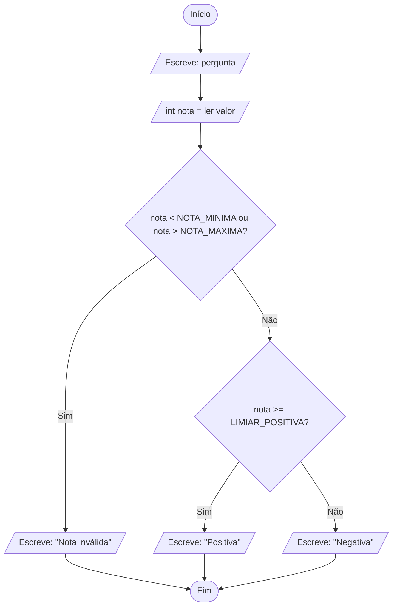

# Laboratório: Decisões e validação

Laboratório do tema Decisões e validação, do módulo Desenvolver algoritmos. Vais desenhar no diagrams.net os fluxogramas de dois algoritmos que tomam decisões, e seguir neles, com o dedo, o caminho de cada caso. Cada passo diz o que fazer, porquê e o que deves ver. Avanças ao teu ritmo: o que não acabares na aula, acabas em casa ou na aula seguinte. Tudo o que precisas está aqui; o [guia do tema](03-decisoes-e-validacao.md) tem a teoria completa, para quem quiser saber mais.

Este laboratório é todo de fluxogramas, e é opcional. Só o fazes quando o professor o indicar, e nesse caso faz-se antes da ficha de exercícios. Nenhum exercício obrigatório da ficha depende dele. A matéria do tema é saber ler um fluxograma. Desenhá-lo é a parte opcional que este laboratório treina.

## O que vais construir

No fim, tens na tua pasta `algoritmos` dois fluxogramas desenhados na aplicação. O primeiro é o de um algoritmo que classifica a nota de um teste. O segundo é o de um algoritmo que escolhe a caixa de envio de uma encomenda. Cada um fica em dois ficheiros: o desenho que se pode editar, `.drawio`, e uma imagem, `.png`. Na tua folha ficam as tabelas dos caminhos que seguiste com o dedo.

Ficas a saber pôr num fluxograma um losango com uma condição e ligar as suas duas saídas, `Sim` e `Não`. Ficas também a saber juntar os ramos antes de o algoritmo continuar. E ficas a saber confirmar, caso a caso, que cada entrada tem um caminho, e um só.

| Fase | O que muda | O que funciona no fim |
| --- | --- | --- |
| 1 | Um losango com as saídas `Sim` e `Não`, num desenho de ensaio | Com o stock a 3 e a 12, os dois caminhos chegam à mesma figura |
| 2 | O fluxograma do algoritmo da nota, com dois losangos em cadeia | Nove figuras e dez setas, e os três caminhos chegam ao mesmo Fim |
| 3 | A tabela dos nove casos, seguidos com o dedo, e a imagem | Cada nota chega à mensagem certa por um só caminho, e os dois ficheiros estão guardados |
| 4 | O fluxograma da caixa de envio, com os ramos juntos antes do fim | Os seis pesos passam por "Pesagem concluída" antes do Fim, e os dois ficheiros estão guardados |

## Palavras que vais usar

- Algoritmo: uma sequência de passos que resolve um problema, sem dúvidas sobre o que fazer em cada passo.
- Pseudocódigo: a forma de escrever algoritmos que usamos nas aulas, com uma instrução por linha, como `int nota = ler valor`.
- Fluxograma: o desenho de um algoritmo, com figuras ligadas por setas. Cada figura é uma instrução, e as setas dizem a ordem.
- Figura: cada forma do fluxograma. A forma diz que tipo de instrução está lá dentro.
- Terminal: a figura de pontas redondas onde o algoritmo começa, `Início`, e acaba, `Fim`. Na aplicação chama-se Terminator.
- Paralelogramo: a figura das entradas e das saídas, como `ler valor` e `Escreve:`. Na aplicação chama-se Data.
- Losango: a figura de uma decisão, com uma entrada e duas saídas. Na aplicação chama-se Decision.
- Condição: uma pergunta cuja resposta só pode ser sim ou não, como `stock < 5?`. Escreve-se dentro do losango. Para saber mais, vê a secção "Condições" do [guia](03-decisoes-e-validacao.md).
- Saídas `Sim` e `Não`: as duas setas que saem de um losango. Segue-se a do `Sim` quando a resposta à condição é sim, e a do `Não` quando é não.
- Ramo: cada um dos caminhos que saem de um losango.
- Ponto de encontro: a figura onde os ramos de uma decisão se voltam a juntar, antes de o algoritmo continuar.
- Cadeia de decisões: losangos em que cada um está pendurado na saída `Não` do anterior. Para saber mais, vê a secção "Seleção encadeada" do [guia](03-decisoes-e-validacao.md).
- Indentação: o recuo de quatro espaços que mostra, no pseudocódigo, que uma linha está dentro de um ramo.
- Constante: um valor fixo do problema, com um nome em maiúsculas, escrito com `const`, como `const NOTA_MAXIMA = 20`.
- Caso de teste: uma entrada escolhida para testar o algoritmo, com o resultado que o enunciado pede.
- Ficheiro `.drawio`: o desenho que a aplicação volta a abrir para continuares a editar.
- Imagem PNG: uma fotografia do desenho, que qualquer computador abre, mas que não se edita.
- Exportar: criar a imagem PNG a partir do desenho.

## O que precisas

- Um computador com um browser, como o Chrome, o Edge, o Firefox ou o Safari, e ligação à internet.
- O diagrams.net, uma aplicação gratuita de desenho de diagramas que funciona no browser, sem criar conta. Também se chama draw.io, o nome antigo. Confirma que chegas a ela. Abre `https://app.diagrams.net/?lang=pt`. Deve aparecer um diagrama em branco chamado "Diagrama sem nome", o que quer dizer que a aplicação está pronta a usar.
- A pasta `algoritmos`, onde guardas os fluxogramas desta disciplina. Se fizeste o laboratório do tema 02, já a tens. Se não, cria-a antes de começar, no sítio que o professor indicar: uma pasta do computador ou uma pen.
- Papel e caneta, para as tabelas das fases 3 e 4.

Se fizeste o laboratório do tema 02, já conheces a aplicação, e podes passar depressa pelos passos que já sabes. Se não o fizeste, não faz mal, porque cada ação está explicada na primeira vez que aparece.

## Se alguma coisa falhar

1. Vês a barra de menus no topo da aplicação, com Ficheiro, Editar, Visualização, Ordenar, Extras e Ajuda? Se não a vês, a janela do browser está estreita. Maximiza-a, ou usa o botão redondo com reticências, no canto superior direito, que tem as mesmas opções.
2. O teu ficheiro está guardado no computador? O nome que lhe deste aparece no topo da aplicação. Se o "Guardar como" te pedir para entrar numa conta, o campo "Onde:" ficou no Google Drive. Muda-o para "Aparelho" ou "Descarregar".
3. As setas estão presas às figuras? Arrasta uma figura um pouco para o lado. Se as setas a acompanharem, estão presas. Depois carrega em Ctrl+Z, ou Cmd+Z num Mac, para a figura voltar ao sítio.
4. Enganaste-te? Ctrl+Z, ou Cmd+Z num Mac, desfaz a última ação. Podes repetir para desfazer várias.

## Preparar o projeto

Os nomes dos menus e dos botões deste laboratório foram confirmados em setembro de 2026, com a aplicação em português. A aplicação muda de aspeto de vez em quando. Se um nome no teu ecrã não for exatamente igual, procura o que faz a mesma coisa, porque os passos são os mesmos.

1. Abre a aplicação em português. Maximiza a janela do browser, para ocupar o ecrã todo, e escreve na barra de endereços `https://app.diagrams.net/?lang=pt`. A parte final, `?lang=pt`, pede a aplicação em português. Sem ela, a aplicação usa a língua do browser, que pode ser o inglês.

   O que deves ver: um diagrama em branco, chamado "Diagrama sem nome". A aplicação não te pergunta nada nem te pede conta.

2. Conhece as quatro zonas do ecrã, porque vais usá-las todas:

   | Zona | Onde está | Para que serve |
   | --- | --- | --- |
   | Painel das figuras | à esquerda | tem as figuras, arrumadas em grupos, e no topo uma caixa de pesquisa |
   | Página | ao centro, a zona branca com uma grelha | é onde desenhas; a grelha só ajuda a alinhar |
   | Painel de formatação | à direita | muda o aspeto do que estiver selecionado; aqui quase não precisas dele |
   | Barra de menus | no topo | o menu "Ficheiro" tem tudo o que é guardar e exportar |

3. Guarda já o ficheiro, antes de desenhares. Neste momento, o diagrama só existe dentro do separador do browser, e se o fechares perdes tudo. Guardar logo dá-lhe um nome e um sítio.

   1. Na barra de menus, carrega em "Ficheiro" e, na lista que se abre, em "Guardar como...".
   2. Abre-se a janela "Guardar como". No campo "Guardar como:", apaga o que lá estiver e escreve `fluxograma-classificar-nota.drawio`.
   3. No campo "Tipo:", deixa ficar "Ficheiro XML (.drawio)". É o formato que a aplicação volta a abrir para continuares a editar.
   4. O campo "Onde:" vem com "Google Drive". Muda-o para "Aparelho", que guarda o ficheiro numa pasta do teu computador. Se "Aparelho" não funcionar, escolhe "Descarregar", que põe o ficheiro na pasta de transferências.
   5. Carrega em "Guardar". Com "Aparelho", abre-se a janela do sistema para escolheres a pasta. Escolhe a pasta `algoritmos` e confirma.

   O que deves ver: o nome `fluxograma-classificar-nota.drawio` no topo da aplicação, onde antes estava "Diagrama sem nome". Daqui para a frente, para guardar, carrega em Ctrl+S, ou Cmd+S num Mac. Se escolheste "Descarregar", cada vez que guardas vai uma cópia nova para as transferências. No fim, passa a mais recente para a pasta `algoritmos`.

   As outras opções do campo "Onde:" não servem aqui. Google Drive, OneDrive e GitHub pedem uma conta nesses serviços. "Navegador" guarda o ficheiro dentro do browser, e perde-lo se alguém limpar os dados do browser ou se mudares de computador.

4. Encontra as figuras de fluxograma. O painel da esquerda tem as figuras arrumadas em grupos com nome, e as que te interessam estão no grupo "Fluxograma". Desce no painel até perto do fim da lista e carrega no nome "Fluxograma" para o abrir. Se o grupo não estiver na lista, carrega no botão "+ Mais formas", no fundo do painel. Na janela "Formas", marca "Fluxograma" e confirma.

   Passa o rato devagar por cima das figuras do grupo. Ao lado de cada uma aparece o nome dela, em inglês, mesmo com a aplicação em português. Neste laboratório usas estas três:

   | Figura | Nome que vais ver | O que quer dizer | Para que serve |
   | --- | --- | --- | --- |
   | Retângulo de pontas redondas | Terminator | "terminal": onde o algoritmo começa ou acaba | `Início` e `Fim` |
   | Paralelogramo | Data | "dados": é por ali que os dados entram e saem | ler um valor (`ler valor`) e escrever no ecrã (`Escreve:`) |
   | Losango | Decision | "decisão" | uma condição, com duas saídas |

   O grupo tem também o retângulo, chamado Process, para as contas e para as instruções que dão um valor a uma variável. Aqui não o usas, porque os algoritmos deste laboratório não fazem contas. O grupo tem ainda muitas outras figuras, que pertencem a convenções mais pormenorizadas do que a nossa. Usa sempre estas, do grupo "Fluxograma".

## Fase 1: o losango e as saídas Sim e Não

Até aqui, os algoritmos que conheces fazem sempre as mesmas instruções, pela mesma ordem. Um algoritmo que decide faz uma pergunta e escolhe o caminho conforme a resposta. Vê este, de uma papelaria que avisa quando um artigo está quase a acabar. O stock do artigo já está guardado na variável `stock`, porque foi lido mais acima:

```text
Se stock < 5
    Escreve: "Atenção: stock baixo"
Escreve: "Verificação concluída"
```

Leitura guiada: a linha do `Se` faz uma pergunta, "o stock é menor do que 5?", a que se chama condição. A linha do aviso está quatro espaços mais para dentro, e essa indentação quer dizer que ela só se executa quando a resposta é sim. A última linha está encostada à margem, alinhada com o `Se`. Por isso está fora da decisão, e executa-se sempre.

No fluxograma, a pergunta vai dentro de um losango. Do losango saem duas setas, uma marcada `Sim` e outra marcada `Não`. Os dois caminhos voltam a juntar-se na figura de "Verificação concluída", que é a instrução que se executa sempre. Neste laboratório usamos sempre a mesma arrumação. A saída `Não` sai por baixo do losango e a saída `Sim` sai pela direita. Assim, quem lê os teus fluxogramas sabe onde procurar cada uma.

Este primeiro desenho é de ensaio, para aprenderes a técnica com um algoritmo pequeno. Na fase 2 apagas este desenho.

1. Põe o losango na página. No grupo "Fluxograma", encontra a figura Decision e, sem largar o botão do rato, arrasta-a para a página, perto do topo. Depois faz duplo clique dentro do losango, escreve `stock < 5?` e carrega numa zona vazia da página para acabar.

   O ponto de interrogação não é obrigatório, mas lembra a quem lê que dentro do losango está uma pergunta, com resposta sim ou não. Os sinais `<` e `>` estão numa tecla própria, muitas vezes junto ao Z nos teclados portugueses, e o `>` faz-se com Shift. Se não a encontrares, pede ajuda, porque os teclados variam.

   O que deves ver: o losango com o texto `stock < 5?` lá dentro.

2. Desenha a saída `Sim`. Arrasta um paralelogramo, a figura Data, para a direita do losango, à mesma altura. Faz duplo clique nele e escreve `Escreve: "Atenção: stock baixo"`. Depois passa o rato por cima do losango, sem carregar. Aparecem pequenas setas azuis nos quatro lados. Carrega na seta azul do lado direito e, sem largar, arrasta até ao paralelogramo. Larga quando o paralelogramo ficar com o contorno azul. É esse contorno que mostra que a seta ficou presa à figura.

   Falta o nome da saída. Faz duplo clique a meio da seta que acabaste de desenhar, escreve `Sim` e carrega numa zona vazia.

   O que deves ver: uma seta do losango para o paralelogramo, com a palavra `Sim` em cima. Se o `Sim` não acompanhar a seta quando a mexes, vê os [problemas frequentes](#problemas-frequentes).

3. Desenha a saída `Não` e o ponto de encontro. Arrasta outro paralelogramo para baixo do losango, com espaço entre os dois, e escreve dentro `Escreve: "Verificação concluída"`. Liga a seta azul de baixo do losango a este paralelogramo, e escreve `Não` nessa seta.

   Agora junta os ramos. Passa o rato pelo paralelogramo do aviso e arrasta a seta azul de baixo até ao paralelogramo de "Verificação concluída". Larga quando ele ficar com o contorno azul. Esta seta não leva texto, porque não sai de um losango.

   O que deves ver: três figuras e três setas. Do losango saem duas setas, e as duas chegam, por caminhos diferentes, ao paralelogramo de "Verificação concluída".

4. Verifica com o dedo. Põe o dedo no losango, primeiro com o stock a valer 3. A condição `3 < 5` é verdadeira, por isso sais pelo `Sim`, passas pelo aviso e chegas a "Verificação concluída". Depois com o stock a valer 12. A condição `12 < 5` é falsa, por isso sais pelo `Não` e chegas diretamente a "Verificação concluída".

   O que deves ver: nos dois casos, o dedo chega ao mesmo sítio. Com o 3, passa pelo aviso no caminho; com o 12, não passa.

### Paragem 1

O teu desenho tem um losango, com duas setas a sair, e cada seta tem o seu nome, `Sim` ou `Não`. As duas acabam por chegar à mesma figura. Confirma estas três coisas antes de avançares.

Pensa antes de continuares: no pseudocódigo, que linha corresponde à figura onde os dois ramos se juntam? A resposta: a linha `Escreve: "Verificação concluída"`, a primeira que volta a estar alinhada com o `Se`. Por estar fora da decisão, executa-se sempre, seja qual for a resposta ao losango. É isto que quer dizer "os ramos voltam a juntar-se": o algoritmo acaba por passar pela mesma figura e continua a partir daí.

## Fase 2: uma cadeia de decisões, o fluxograma da nota

Às vezes há mais do que dois caminhos. Vê este problema:

> Um professor quer um algoritmo que o ajude a classificar os testes. O algoritmo lê a nota de um teste, que é um número inteiro na escala de 0 a 20. Se a nota for igual ou superior a 10, escreve "Positiva". Se for inferior a 10, escreve "Negativa". Se a nota escrita não pertencer à escala, o algoritmo escreve "Nota inválida" e não a classifica.

O algoritmo, em pseudocódigo:

```text
const NOTA_MINIMA = 0
const NOTA_MAXIMA = 20
const LIMIAR_POSITIVA = 10
Escreve: "Nota do teste (inteiro de 0 a 20)?"
int nota = ler valor
Se nota < NOTA_MINIMA ou nota > NOTA_MAXIMA
    Escreve: "Nota inválida"
Senão se nota >= LIMIAR_POSITIVA
    Escreve: "Positiva"
Senão
    Escreve: "Negativa"
```

Leitura guiada: as três linhas `const` dão nome a valores fixos do problema: o 0, o 20 e o 10. Depois o algoritmo faz a pergunta e lê a nota. A cadeia de `Se`, `Senão se` e `Senão` faz as perguntas por ordem, de cima para baixo:

- O `Se` pergunta se a nota está fora da escala: menor do que 0 ou maior do que 20. O `ou` dá verdadeiro quando pelo menos uma das partes é verdadeira, e por isso basta falhar um dos lados para a nota ser inválida.
- O `Senão se` só se pergunta quando a resposta ao `Se` foi não, isto é, quando a nota é válida. Pergunta se a nota é maior ou igual a 10, com o sinal `>=`.
- O `Senão` não pergunta nada. Apanha o que sobra: uma nota válida e menor do que 10, que é negativa.

Numa cadeia, a primeira condição verdadeira ganha. O algoritmo executa o ramo dela e salta para depois da cadeia, sem fazer as perguntas seguintes. Por isso, no fluxograma, o segundo losango fica pendurado na saída `Não` do primeiro. Só se chega a ele quando a primeira resposta é não.

Algumas linhas do pseudocódigo não dão figura. As três linhas `const` não fazem nada com os dados. Dão nome a valores fixos, e esses nomes aparecem dentro dos losangos, onde são usados. A palavra `Senão` também não tem figura própria. A figura do ramo dela é o paralelogramo "Negativa", à saída `Não` do segundo losango.

O desenho vai ter duas colunas. Ao centro desce o caminho principal, e à direita ficam os resultados que saem pelo `Sim` de cada losango.

1. Limpa a página. Carrega numa zona vazia e, sem largar o botão do rato, arrasta um retângulo que envolva as três figuras e as setas da fase 1. Tudo o que ficar dentro do retângulo fica selecionado. Carrega na tecla Delete ou Backspace.

   O que deves ver: a página vazia.

2. Desenha o início e a entrada. Arrasta um Terminator para o topo da página e escreve dentro `Início`. Por baixo, põe um paralelogramo com `Escreve: pergunta`, e por baixo deste outro paralelogramo com `int nota = ler valor`. No primeiro paralelogramo escreves só `Escreve: pergunta`, para não ocupar espaço. A pergunta completa está no pseudocódigo. Liga as três figuras pela seta azul de baixo de cada uma, e larga sempre com a figura de destino de contorno azul.

   O que deves ver: três figuras em coluna, ligadas por duas setas que apontam para baixo.

3. Desenha o primeiro losango, o da validação. Por baixo do paralelogramo que lê a nota, arrasta um losango e escreve `nota < NOTA_MINIMA ou nota > NOTA_MAXIMA?`. O texto é comprido e não cabe bem num losango pequeno. Carrega uma vez no losango para o selecionar. Aparecem pequenos pontos nos cantos e a meio dos lados. Puxa um dos cantos para fora até o texto caber, de preferência numa ou duas linhas.

   Liga o paralelogramo que lê a nota ao losango. Depois, à direita do losango e à mesma altura, põe um paralelogramo com `Escreve: "Nota inválida"`. Liga a seta azul do lado direito do losango a este paralelogramo, e escreve `Sim` na seta.

   O que deves ver: o losango, com uma seta `Sim` para "Nota inválida". Quem sai por este `Sim` é uma nota fora da escala, e vai direta para a mensagem de erro, sem passar por mais nenhum losango.

4. Desenha o segundo losango, o do `Senão se`. Por baixo do primeiro losango, com espaço entre os dois, põe outro losango com `nota >= LIMIAR_POSITIVA?`. Liga a seta azul de baixo do primeiro losango a este segundo, e escreve `Não` na seta. É assim que se desenha um `Senão se`: o segundo losango pendurado na saída `Não` do primeiro.

   À direita do segundo losango, põe um paralelogramo com `Escreve: "Positiva"`, ligado pela seta azul do lado direito, com `Sim`. Por baixo do segundo losango, põe um paralelogramo com `Escreve: "Negativa"`, ligado pela seta azul de baixo, com `Não`. É o ramo do `Senão`. É para lá que vai a nota quando as duas condições dão não.

   O que deves ver: dois losangos em coluna, cada um com uma seta `Sim` para a direita e uma seta `Não` para baixo.

5. Desenha o Fim e junta os três caminhos. Por baixo de "Negativa", arrasta um Terminator e escreve `Fim`. Liga "Negativa" ao Fim. Depois liga "Positiva" ao Fim, e "Nota inválida" ao Fim. Estas duas setas descem pela coluna da direita e entram no Fim. Se uma seta atravessar outra figura ou fizer um percurso estranho, carrega nela. Depois arrasta o pequeno ponto que aparece a meio da linha, até ela passar por onde queres.

   Um fluxograma tem um só início e um só fim. Os três caminhos juntam-se no Fim. No pseudocódigo, esse ponto de encontro é o sítio onde a cadeia acaba. Como o algoritmo da nota não tem mais nenhuma linha depois da cadeia, é também o fim.

   O que deves ver: os três paralelogramos de resultado, cada um com uma seta para o mesmo Fim.

### Paragem 2

Conta as figuras e as setas do teu desenho. Deve ter:

- nove figuras: dois terminais (Início e Fim), cinco paralelogramos (a pergunta, a leitura da nota e as três mensagens) e dois losangos;
- dez setas, das quais quatro têm texto: as duas que saem de cada losango;
- cada losango com uma seta `Sim` e uma seta `Não`, e nenhum com uma só saída;
- nenhuma seta solta, sem figura numa das pontas.

O teu desenho deve corresponder a este:



Descrição do fluxograma: do Início desce-se para a pergunta e para a leitura da nota, e depois para o primeiro losango, a validação. O `Sim` dele leva a "Nota inválida". O `Não` leva ao segundo losango, `nota >= LIMIAR_POSITIVA?`. Deste, o `Sim` leva a "Positiva" e o `Não` leva a "Negativa". As três mensagens têm setas para o mesmo Fim.

Se o teu desenho tiver uma figura a mais ou a menos, compara-o figura a figura com o pseudocódigo, pela mesma ordem. Assim descobres qual é. Guarda o ficheiro, com Ctrl+S ou Cmd+S.

Pensa antes de continuares: o algoritmo tem três mensagens possíveis e o teu desenho tem três caminhos do Início ao Fim. É coincidência? A resposta: não. Cada mensagem é um resultado possível do algoritmo, e cada resultado tem o seu caminho. Se contasses mais caminhos do que resultados, ou menos, o desenho estaria errado.

## Fase 3: seguir cada caminho com o dedo

Um fluxograma de decisões está certo quando cada caso de teste tem um caminho, e um só, do Início até ao Fim. Esse caminho tem de acabar na mensagem que o enunciado pede. É isso que vais confirmar agora.

Os erros de uma decisão escondem-se nos limites, porque é aí que a resposta muda. Por isso, os casos de teste escolhem-se junto de cada limite: o valor imediatamente abaixo, o próprio limite e o valor imediatamente acima. Os limites do enunciado são o 0, o 10 e o 20. A tabela tem, para cada limite, esses três valores, a que chamamos os vizinhos do limite. Ao lado de cada um está a mensagem que o enunciado pede:

| Nota | Mensagem que o enunciado pede |
| ---: | --- |
| -1 | Nota inválida |
| 0 | Negativa |
| 1 | Negativa |
| 9 | Negativa |
| 10 | Positiva |
| 11 | Positiva |
| 19 | Positiva |
| 20 | Positiva |
| 21 | Nota inválida |

1. Copia esta tabela para a tua folha. As duas primeiras linhas estão preenchidas, para veres como se faz.

   | Nota | Saída do primeiro losango | Saída do segundo losango | Mensagem a que chegaste | Coincide com o enunciado? |
   | ---: | --- | --- | --- | --- |
   | -1 | Sim, porque `-1 < 0` dá `true` | não se chega a ele | Nota inválida | sim |
   | 0 | Não, porque `0 < 0` e `0 > 20` dão `false` | Não, porque `0 >= 10` dá `false` | Negativa | sim |
   | 1 | | | | |
   | 9 | | | | |
   | 10 | | | | |
   | 11 | | | | |
   | 19 | | | | |
   | 20 | | | | |
   | 21 | | | | |

2. Para cada nota, põe o dedo no Início do teu desenho e segue as setas. Em cada losango, calcula a condição com o valor da nota e sai pelo `Sim` ou pelo `Não`, conforme o resultado. Escreve por onde saíste de cada losango e a mensagem a que chegaste.

3. Confere a tua folha com a tabela completa:

   | Nota | Saída do primeiro losango | Saída do segundo losango | Mensagem a que chegaste | Coincide com o enunciado? |
   | ---: | --- | --- | --- | --- |
   | -1 | Sim | não se chega a ele | Nota inválida | sim |
   | 0 | Não | Não | Negativa | sim |
   | 1 | Não | Não | Negativa | sim |
   | 9 | Não | Não | Negativa | sim |
   | 10 | Não | Sim | Positiva | sim |
   | 11 | Não | Sim | Positiva | sim |
   | 19 | Não | Sim | Positiva | sim |
   | 20 | Não | Sim | Positiva | sim |
   | 21 | Sim | não se chega a ele | Nota inválida | sim |

   Se alguma linha da tua folha for diferente, segue outra vez esse caso devagar. Se o dedo for parar a outra mensagem, há uma seta ligada à figura errada ou um losango com o texto trocado.

4. Responde na folha a quatro perguntas, e confere cada resposta com a que está logo a seguir.

   1. Cada caso seguiu um caminho só, sem teres de escolher entre duas setas em nenhum losango? A resposta: sim. Em cada losango, a condição dá um só resultado, e por isso só uma das setas serve.
   2. Cada uma das três mensagens foi alcançada por pelo menos um caso? A resposta: sim. "Nota inválida" com -1 e 21, "Negativa" com 0, 1 e 9, e "Positiva" com 10, 11, 19 e 20. Se uma mensagem não fosse alcançada por nenhum caso, ou faltava um caso na tabela, ou o desenho tinha um caminho impossível.
   3. Todos os caminhos acabaram no Fim? A resposta: sim, todos chegam ao mesmo Fim.
   4. Houve alguma nota fora da escala que chegasse ao segundo losango? A resposta: não. Uma nota fora da escala torna verdadeira a condição do primeiro losango e sai pelo `Sim`. Numa cadeia, a primeira condição verdadeira ganha, e o segundo losango só é visitado pelo `Não`, isto é, pelas notas válidas.

5. Guarda o ficheiro e exporta a imagem. O ficheiro `.drawio` é o teu desenho editável, e a imagem serve para o mostrar ou entregar. Uma imagem não se edita. Se precisares de mudar alguma coisa, mudas o `.drawio` e exportas outra vez.

   Guarda primeiro o `.drawio`, com Ctrl+S ou Cmd+S. Depois, na barra de menus, carrega em "Ficheiro", depois em "Exportar como" e depois em "PNG...". Abre-se a janela "Imagem". Mantém as opções como estão, com a opção "Fundo Transparente" desligada, e carrega em "Exportar". Se a aplicação te pedir um nome e um sítio, o nome é `fluxograma-classificar-nota.png` e o sítio é "Aparelho" ou "Descarregar", na pasta `algoritmos`. Nunca escolhas o Google Drive nem o "Navegador".

   O que deves ver: a imagem na pasta `algoritmos`. Abre-a com duplo clique e confirma que se vê o fluxograma inteiro, com o texto legível.

### Paragem 3

O teu fluxograma da nota leva cada um dos nove casos, por um só caminho, à mensagem que o enunciado pede. Na pasta `algoritmos` tens `fluxograma-classificar-nota.drawio` e `fluxograma-classificar-nota.png`.

Pensa antes de continuares: com a nota 20, porque é que sais pelo `Não` do primeiro losango? A resposta: porque `20 < 0` é falso e `20 > 20` também é falso. Vinte não é maior do que vinte, e por isso o 20 está dentro da escala e é classificado como positiva.

## Fase 4: os ramos juntam-se antes do fim, a caixa de envio

No fluxograma da nota, os ramos juntaram-se no Fim, porque não havia mais nada depois da cadeia. Mas muitas vezes há uma instrução depois da decisão, que se executa sempre. Nesse caso, os ramos juntam-se nessa instrução, e só depois se desce para o Fim, que continua a ser um só. Vê este problema:

> Uma loja online escolhe a caixa de envio pelo peso da encomenda, em gramas (um número inteiro). Encomendas até 2000 gramas, inclusive, vão numa caixa pequena; acima de 2000 gramas, vão numa caixa grande. Um peso de zero gramas, ou negativo, é um erro de pesagem, e o algoritmo escreve "Peso inválido" em vez de escolher a caixa. Em todos os casos, no fim, o algoritmo escreve "Pesagem concluída".

```text
const PESO_MAXIMO_CAIXA_PEQUENA = 2000
Escreve: "Peso da encomenda em gramas?"
int peso = ler valor
Se peso <= 0
    Escreve: "Peso inválido"
Senão se peso <= PESO_MAXIMO_CAIXA_PEQUENA
    Escreve: "Caixa pequena"
Senão
    Escreve: "Caixa grande"
Escreve: "Pesagem concluída"
```

Leitura guiada: a cadeia tem a mesma forma que a da nota, com três ramos. O `Se` apanha os pesos inválidos, de 0 ou menos, com o sinal `<=`, que quer dizer menor ou igual. O `Senão se` só se pergunta com pesos válidos, e escolhe a caixa pequena até 2000, inclusive. O `Senão` apanha o resto, a caixa grande. Repara na última linha. Está encostada à margem, alinhada com o `Se`, e não indentada dentro de nenhum ramo. Como volta à coluna do `Se` sem ser um `Senão se` nem um `Senão`, já está fora da cadeia, e executa-se seja qual for o peso. Se estivesse indentada, com quatro espaços, pertencia ao ramo do `Senão` e só aparecia com a caixa grande.

1. Guarda uma cópia com outro nome. Na barra de menus, carrega em "Ficheiro" e em "Guardar como...". Escreve o nome `fluxograma-caixa-de-envio.drawio`, escolhe "Aparelho" e a pasta `algoritmos`, e carrega em "Guardar". O ficheiro da nota fica guardado como estava. Passas a trabalhar no ficheiro novo, que por enquanto tem o mesmo desenho.

   Se preferires começar num diagrama em branco, usa antes "Ficheiro" e "Novo...". A aplicação pode abrir o diagrama novo noutro separador. Se te perguntar que tipo de diagrama queres, escolhe o diagrama em branco, e guarda-o logo com o nome `fluxograma-caixa-de-envio.drawio`.

   O que deves ver: o nome `fluxograma-caixa-de-envio.drawio` no topo da aplicação.

2. Muda os textos das figuras, com duplo clique em cada uma. O primeiro paralelogramo continua a ser `Escreve: pergunta`. As outras mudam assim:

   - a leitura passa a `int peso = ler valor`;
   - o primeiro losango passa a `peso <= 0?`, e a mensagem do `Sim` dele a `Escreve: "Peso inválido"`;
   - o segundo losango passa a `peso <= PESO_MAXIMO_CAIXA_PEQUENA?`;
   - a mensagem do `Sim` do segundo losango passa a `Escreve: "Caixa pequena"`, e a do `Não` a `Escreve: "Caixa grande"`.

   Atenção ao segundo losango. Na nota era `>=`, e o `Sim` levava à positiva. Aqui é `<=`, e o `Sim` leva à caixa pequena. Confirma figura a figura que o desenho corresponde a este pseudocódigo, e não ao da nota.

3. Junta os ramos em "Pesagem concluída". Apaga as três setas que vão das mensagens para o Fim. Para isso, carrega em cada uma e carrega em Delete ou Backspace. Arrasta o Fim um pouco para baixo, para abrir espaço. Põe, entre as mensagens e o Fim, um paralelogramo com `Escreve: "Pesagem concluída"`. Liga as três mensagens a este paralelogramo, e o paralelogramo ao Fim.

   O que deves ver: as três mensagens com setas para "Pesagem concluída", e uma só seta de "Pesagem concluída" para o Fim.

4. Conta as figuras e as setas. São dez figuras (dois terminais, seis paralelogramos e dois losangos) e onze setas, das quais quatro têm texto. O teu desenho deve corresponder a este:

   ```mermaid
   flowchart TD
       A([Início]) --> B[/"Escreve: pergunta"/]
       B --> C[/"int peso = ler valor"/]
       C --> D{"peso <= 0?"}
       D -->|Sim| E[/"Escreve: #quot;Peso inválido#quot;"/]
       D -->|Não| F{"peso <= PESO_MAXIMO_CAIXA_PEQUENA?"}
       F -->|Sim| G[/"Escreve: #quot;Caixa pequena#quot;"/]
       F -->|Não| H[/"Escreve: #quot;Caixa grande#quot;"/]
       E --> I[/"Escreve: #quot;Pesagem concluída#quot;"/]
       G --> I
       H --> I
       I --> Z([Fim])
   ```

   Descrição do fluxograma: é o desenho da nota com outros textos e com uma figura a mais. As três mensagens da cadeia têm setas para o paralelogramo "Pesagem concluída", e só deste sai uma seta para o Fim.

5. Segue com o dedo o caminho de seis pesos. São o valor abaixo, o próprio limite e o valor acima de cada um dos dois limites do enunciado, o 0 e o 2000. Copia esta tabela para a folha e preenche-a como na fase 3:

   | Peso | Saída do primeiro losango | Saída do segundo losango | Mensagens a que chegaste | Coincide com o enunciado? |
   | ---: | --- | --- | --- | --- |
   | -1 | | | | |
   | 0 | | | | |
   | 1 | | | | |
   | 1999 | | | | |
   | 2000 | | | | |
   | 2001 | | | | |

   Depois confere com a tabela completa:

   | Peso | Saída do primeiro losango | Saída do segundo losango | Mensagens a que chegaste | Coincide com o enunciado? |
   | ---: | --- | --- | --- | --- |
   | -1 | Sim, `-1 <= 0` dá `true` | não se chega a ele | Peso inválido; Pesagem concluída | sim |
   | 0 | Sim, `0 <= 0` dá `true` | não se chega a ele | Peso inválido; Pesagem concluída | sim |
   | 1 | Não, `1 <= 0` dá `false` | Sim, `1 <= 2000` dá `true` | Caixa pequena; Pesagem concluída | sim |
   | 1999 | Não | Sim, `1999 <= 2000` dá `true` | Caixa pequena; Pesagem concluída | sim |
   | 2000 | Não | Sim, `2000 <= 2000` dá `true` | Caixa pequena; Pesagem concluída | sim |
   | 2001 | Não | Não, `2001 <= 2000` dá `false` | Caixa grande; Pesagem concluída | sim |

   O 0 e o 2000 são os casos que distinguem um desenho certo de um desenho com o sinal trocado num losango. É neles que `<=` e `<` dão resultados diferentes.

6. Guarda o ficheiro e exporta a imagem, como na fase 3, com o nome `fluxograma-caixa-de-envio.png`.

### Paragem 4

Os seis pesos têm um caminho cada um. Cada caminho chega à mensagem que o enunciado pede e passa por "Pesagem concluída" antes do Fim. Na pasta `algoritmos` tens `fluxograma-caixa-de-envio.drawio` e `fluxograma-caixa-de-envio.png`.

Pensa antes de continuares: o que mudava no desenho se a última linha do pseudocódigo estivesse indentada, com quatro espaços? A resposta: passava a pertencer ao ramo do `Senão`. No fluxograma, "Pesagem concluída" ficava só no caminho da caixa grande, e os ramos de "Peso inválido" e de "Caixa pequena" iam direitos ao Fim. Com o peso 1, aparecia só "Caixa pequena".

## Problemas frequentes

### Não encontras o losango

Desce até ao fim da lista do painel da esquerda e abre o grupo "Fluxograma". A figura chama-se Decision. Também podes escrever `Decision` na caixa de pesquisa, no topo do painel.

### Quando mexes uma figura, a seta não vai atrás dela

A seta não ficou presa à figura. Apaga-a e desenha-a outra vez, largando o botão do rato só quando a figura de destino ficar com o contorno azul.

### O Sim fica no sítio quando mexes a seta

Escreveste o `Sim` numa caixa de texto solta, ao lado da seta, e não na própria seta. Apaga essa caixa e faz duplo clique exatamente em cima da linha da seta, e não ao lado.

### O texto não cabe no losango

Carrega uma vez no losango para o selecionar e puxa um dos cantos para fora.

### Uma seta passa por cima de outra figura

Carrega na seta e arrasta o pequeno ponto que aparece a meio da linha, até ela passar por onde queres.

### Não aparece a barra de menus no topo

A janela do browser está estreita. Maximiza-a, ou usa o botão redondo com reticências, no canto superior direito. Nesse botão, o "Exportar como" aparece logo ao lado do "Ficheiro", em vez de estar dentro dele.

### O ficheiro foi para o Google Drive, ou o "Guardar como" pede uma conta

O campo "Onde:" ficou no Google Drive, que vem escolhido de início. Volta a guardar com "Guardar como..." e, no campo "Onde:", escolhe "Aparelho" ou "Descarregar". Se guardaste no "Navegador", faz o mesmo.

### Não sabes onde ficou o ficheiro

Se escolheste "Descarregar", o ficheiro está na pasta de transferências do computador. Passa a cópia mais recente para a pasta `algoritmos`.

### A imagem tem muito espaço vazio à volta do fluxograma

Exporta outra vez. Na janela "Imagem", escolhe "Diagrama" no campo "Tamanho", para a imagem ter só o fluxograma.

### Apagaste uma figura sem querer

Ctrl+Z, ou Cmd+Z num Mac, desfaz a última ação. Repete para desfazer mais.

### Desenhaste "Verificação concluída" duas vezes, uma em cada ramo

No pseudocódigo, essa mensagem aparece uma só vez, alinhada com o `Se`. No fluxograma é uma só figura, e as duas setas dos ramos chegam a ela.

### O segundo losango ficou ligado ao Sim do primeiro

Segue o caminho da nota 21 com o dedo. Com o desenho assim, a nota inválida chegava à pergunta da positiva. O segundo losango é o `Senão se`, e só se chega a ele pela saída `Não` do primeiro. Liga-o a essa saída.

### Desenhaste um Fim em cada ramo

Um fluxograma tem um só início e um só fim. Os ramos de uma decisão voltam a juntar-se antes de o algoritmo continuar, e todos os caminhos chegam ao mesmo Fim. Apaga os Fim a mais e liga os ramos ao que ficou.

### Na caixa de envio, o peso 0 chega a "Caixa pequena"

O primeiro losango diz `peso < 0?` em vez de `peso <= 0?`. Com `<`, o 0 não é apanhado pela validação. O enunciado diz que um peso de zero gramas é um erro, e por isso o sinal é `<=`.

### Na caixa de envio, o peso 2000 chega a "Caixa grande"

O segundo losango diz `peso < PESO_MAXIMO_CAIXA_PEQUENA?`. O enunciado diz "até 2000 gramas, inclusive", e por isso o sinal é `<=`.

### O peso 1 só mostra "Caixa pequena", sem "Pesagem concluída"

"Pesagem concluída" ficou dentro de um ramo, ou algum ramo vai direito ao Fim. As três mensagens da cadeia têm de ter setas para "Pesagem concluída", e só esta figura liga ao Fim. O mesmo acontece se o peso -1 só mostrar "Peso inválido".

### O peso 1 chega a "Caixa grande", e o 2001 a "Caixa pequena"

Aproveitaste o desenho da nota e o segundo losango ficou com o sinal dela, `peso >= PESO_MAXIMO_CAIXA_PEQUENA?`, com o `Sim` para a caixa pequena. Muda o texto para `peso <= PESO_MAXIMO_CAIXA_PEQUENA?`. Segue outra vez o peso 1 para confirmar.

## Desafios

Para quem acabou e quer consolidar. Cada desafio é um ficheiro novo na pasta `algoritmos`, com um nome em minúsculas, com hífenes e sem acentos.

1. A loja passou a ter três caixas. Até 2000 gramas, inclusive, a encomenda vai na caixa pequena. De 2001 a 5000 gramas, inclusive, vai na caixa média. Acima de 5000 gramas, vai na caixa grande. Os pesos de 0 ou menos continuam a ser inválidos, e "Pesagem concluída" continua a aparecer sempre. Desenha o fluxograma em `fluxograma-tres-caixas.drawio`. Antes de desenhar, conta na folha as figuras e as setas que vai ter. Depois segue com o dedo os vizinhos de cada limite: -1, 0, 1, 1999, 2000, 2001, 4999, 5000 e 5001. Pista: no pseudocódigo, a caixa média seria mais um `Senão se`. Pensa onde fica pendurado o losango novo.

2. Um colega escreveu o algoritmo da nota com dois `Se` separados, em vez de uma cadeia:

   ```text
   const NOTA_MINIMA = 0
   const NOTA_MAXIMA = 20
   const LIMIAR_POSITIVA = 10
   Escreve: "Nota do teste (inteiro de 0 a 20)?"
   int nota = ler valor
   Se nota < NOTA_MINIMA ou nota > NOTA_MAXIMA
       Escreve: "Nota inválida"
   Se nota >= LIMIAR_POSITIVA
       Escreve: "Positiva"
   Senão
       Escreve: "Negativa"
   ```

   Desenha o fluxograma deste algoritmo em `fluxograma-dois-se.drawio`. Diz onde se juntam os ramos da primeira decisão. Depois compara o teu desenho com o fluxograma da fase 2. Que seta é diferente? Pista: o segundo `Se` está encostado à margem, alinhado com o primeiro, e por isso não pertence a nenhum dos ramos dele.

3. Uma papelaria distribui senhas numeradas de 1 a 40, incluindo o 1 e o 40. Este algoritmo diz se o número que o funcionário escreve é uma senha que existe:

   ```text
   Escreve: "Número da senha?"
   int senha = ler valor
   Se senha >= 1 e senha <= 40
       Escreve: "Senha válida"
   Senão
       Escreve: "Senha inválida"
   ```

   A condição do `Se` usa `e`, que só dá verdadeiro quando as duas partes são verdadeiras. Desenha o fluxograma em `fluxograma-senha.drawio` e segue com o dedo as senhas 0, 1, 40 e 41. Pista: a condição inteira, com as duas comparações e o `e`, conta como uma só pergunta.

## Antes de terminares

- [ ] Na pasta `algoritmos` estão `fluxograma-classificar-nota.drawio` e `fluxograma-classificar-nota.png`.
- [ ] Na pasta `algoritmos` estão `fluxograma-caixa-de-envio.drawio` e `fluxograma-caixa-de-envio.png`.
- [ ] Na tua folha estão a tabela das nove notas, as respostas às quatro perguntas e a tabela dos seis pesos.
- [ ] Cada losango dos teus fluxogramas tem duas saídas, uma `Sim` e outra `Não`, e cada fluxograma tem um só Início e um só Fim.
- [ ] Consegues explicar, por palavras tuas, porque é que o segundo losango de uma cadeia fica na saída `Não` do primeiro.
- [ ] Consegues explicar, por palavras tuas, onde se juntam os ramos de uma decisão, e porquê.


