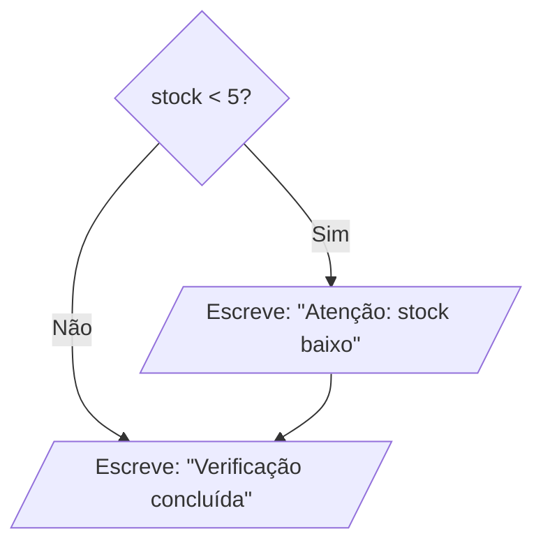
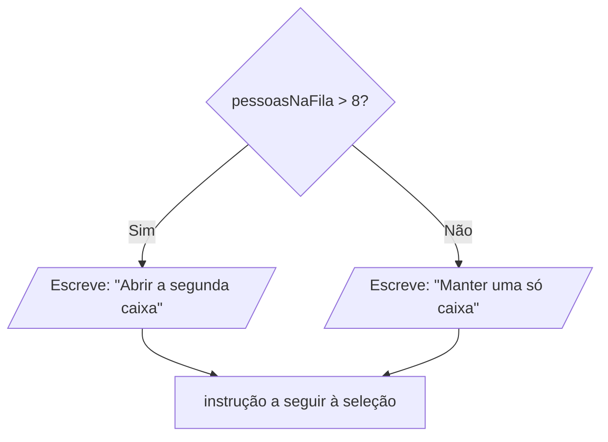
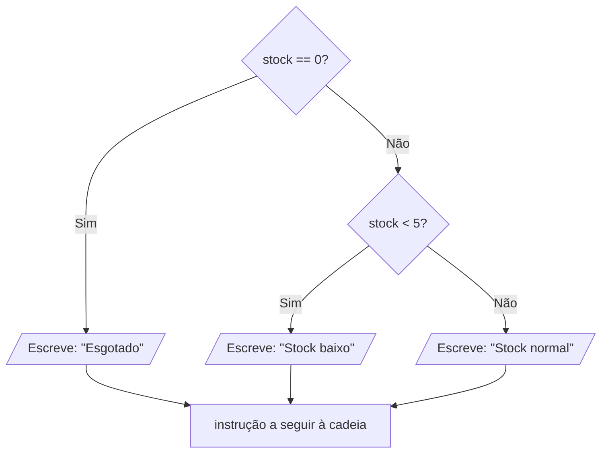
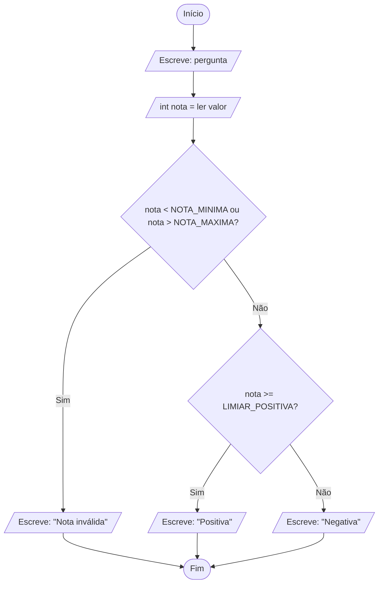

# Decisões e validação

Módulo Desenvolver algoritmos. Neste guia aprendes a escrever algoritmos que tomam decisões, isto é, que fazem uma coisa ou outra conforme os dados. Aprendes também a recusar os dados que não fazem sentido, antes de os usar. Lês o guia ao teu ritmo, em duas ou três vezes, com as previsões que ele te pede. Para praticar, há a [ficha de exercícios](03-decisoes-e-validacao-exercicios.md) e o [laboratório](03-decisoes-e-validacao-laboratorio.md) deste tema, que é de fluxogramas e só se faz quando o professor o indicar.

No guia 02, todos os algoritmos faziam sempre as mesmas contas, fosse qual fosse a entrada. Neste guia passam a escolher o caminho. Se já trabalhaste na aula as instruções `Se`, `Senão se` e `Senão`, vais reconhecê-las. O guia retoma-as desde o princípio, na forma das aulas, porque são a base de tudo o resto. Depois acrescenta o que falta: os operadores `e`, `ou` e `não`, os intervalos, as fronteiras e a validação. Este tema ainda não repete instruções. Um algoritmo que recebe um valor errado avisa e termina, e voltar a pedir o valor é o assunto do tema seguinte.

Para estudares este guia, tem à mão papel e lápis, porque vais desenhar retas de valores, árvores e tabelas. Os fluxogramas que aqui aparecem são para saberes o que são e como se leem. Desenhá-los, no papel ou numa aplicação, é opcional, e só o fazes quando o professor o indicar. Nenhum exercício obrigatório precisa de um fluxograma desenhado.

## Neste guia

1. O que vais aprender
2. O que já sabes e vais usar
3. Algoritmos que escolhem o caminho
4. Condições
5. Operadores de comparação
6. Dois sinais de igual para perguntar
7. Seleção simples
8. Seleção composta
9. Seleção encadeada
10. Operador `e`
11. Operador `ou`
12. Operador `não`
13. Misturar `e` e `ou`
14. Intervalos
15. A reta com as regiões
16. O contrário de um intervalo
17. Condições que não se sobrepõem e que cobrem todos os casos
18. Fronteiras e casos de teste
19. Validar os dados antes de os usar
20. A árvore de casos e a tabela de casos esperados
21. Uma decisão dentro de outra
22. Exemplo guiado: classificar a nota de um teste
23. Erros frequentes
24. Palavras novas deste guia
25. Verificar o que aprendeste
26. O que vem a seguir
27. Para saber mais

## O que vais aprender

No fim deste guia, consegues:

- dizer se uma condição é verdadeira ou falsa para valores concretos, também no próprio limite, e distinguir `=` de `==`;
- juntar condições com `e`, `ou` e `não`, e prever o resultado com as tabelas de verdade;
- escrever seleções simples, compostas e encadeadas em pseudocódigo, com a indentação a mostrar o que fica dentro de cada decisão, e reconhecê-las num fluxograma;
- escrever um intervalo de valores como condição, com cada extremo incluído ou excluído como o enunciado diz, e escrever também o seu contrário;
- validar uma entrada, recusando o que está fora do domínio antes de o usar;
- construir a árvore de casos e a tabela de casos esperados de um problema, com casos abaixo, no e acima de cada limite.

## O que já sabes e vais usar

- O contrato de um problema: guia [01 Do problema ao algoritmo](01-do-problema-ao-algoritmo.md), secção "O contrato do problema: entradas, saídas, restrições e condições".
- As instruções ambíguas, e o que fazer quando o enunciado não diz uma coisa: guia [01](01-do-problema-ao-algoritmo.md), secção "Instruções ambíguas".
- Os casos de fronteira, os valores exatamente em cima de um limite: guia [01](01-do-problema-ao-algoritmo.md), na mesma secção.
- A forma do pseudocódigo das aulas, como `int quantidade = ler valor`: guia [02 Pseudocódigo e fluxogramas](02-pseudocodigo-e-fluxogramas.md), "A forma do pseudocódigo nas aulas".
- Um algoritmo em frases claras, que não deixa dúvidas, também vale: guia [02](02-pseudocodigo-e-fluxogramas.md), na mesma secção.
- A indentação, o recuo de quatro espaços que marca um bloco de instruções: guia [02](02-pseudocodigo-e-fluxogramas.md), na mesma secção.
- Os tipos `int`, `float`, `string` e `bool`, e os valores `true` e `false`: guia [02](02-pseudocodigo-e-fluxogramas.md), secção "Tipos de dados".
- Ler um valor com `ler valor` e escrever no ecrã com `Escreve:`: guia [02](02-pseudocodigo-e-fluxogramas.md), secção "Ler e escrever".
- Dar um valor com um só `=`, que se lê "recebe": guia [02](02-pseudocodigo-e-fluxogramas.md), "Atribuição: dar um valor não é perguntar se é igual".
- O estado, o valor das variáveis num dado momento: guia [02](02-pseudocodigo-e-fluxogramas.md), secção "Variáveis e estado".
- As constantes, como `const LIMITE = 50`: guia [02](02-pseudocodigo-e-fluxogramas.md), secção "Constantes".
- A ordem das operações numa conta, como em `2 + 3 * 4`: guia [02](02-pseudocodigo-e-fluxogramas.md), secção "Expressões aritméticas".
- A sequência, em que os passos se fazem sempre pela mesma ordem: guia [02](02-pseudocodigo-e-fluxogramas.md), secção "Sequência".
- Os símbolos do fluxograma, incluindo o losango: guia [02](02-pseudocodigo-e-fluxogramas.md), secção "Os símbolos do fluxograma".
- A tabela de trace, com uma coluna por variável: guia [02](02-pseudocodigo-e-fluxogramas.md), secção "A tabela de trace".
- Os casos de teste, as entradas escolhidas para testar um algoritmo, com o resultado calculado à mão: guia [02](02-pseudocodigo-e-fluxogramas.md), no passo 1 do exemplo.

## Algoritmos que escolhem o caminho

Todos os algoritmos do guia 02 eram sequenciais. Executavam sempre as mesmas instruções, pela mesma ordem, fosse qual fosse a entrada. O algoritmo das caixas de cadernos fazia as mesmas duas contas para 30 cadernos e para 5 cadernos. E fazia-as também para -30 cadernos, que o contrato diz não ser uma entrada válida, porque não tinha forma de o verificar. O guia 02 terminou precisamente com esse problema.

Na gestão de uma loja, quase nada funciona assim. Um pedido só é aceite se houver stock. Uma encomenda só tem portes grátis a partir de um certo valor. Um código de artigo com cinco algarismos, quando devia ter quatro, tem de ser recusado antes de alguém o usar. Em todos estes casos, o que o algoritmo faz depende dos dados que recebeu.

No dia a dia tomas decisões destas a toda a hora. Por exemplo: "se estiver a chover, levo o guarda-chuva". Ou então: "se o semáforo estiver verde, atravesso; senão, espero". Cada uma destas frases tem duas partes: uma pergunta cuja resposta é sim ou não, e o que fazer em cada caso. Os algoritmos decidem da mesma maneira, e é essa estrutura que vais aprender a escrever.

## Condições

No guia 01, uma condição era uma situação que pode acontecer ou não e que, quando acontece, obriga a fazer uma coisa diferente. A partir de agora vais escrevê-la dentro do algoritmo, com uma notação própria.

Uma **condição** é uma pergunta cuja resposta só pode ser sim ou não. "O stock é maior do que zero?" é uma condição. "Qual é o stock?" não é, porque a resposta é um número.

Num algoritmo, a resposta a uma condição é um valor do tipo `bool`. É o tipo que conheceste no guia 02, que só tem dois valores. Lá serviu para guardar respostas de sim ou não, como em `bool pago = false`. No guia 02 usaste-o pouco. Neste guia passa a estar em todo o lado.

Em pseudocódigo, os dois valores escrevem-se `true` e `false`, que são as palavras inglesas para verdadeiro e falso. Quando falamos, ou quando escrevemos uma frase normal, dizemos simplesmente verdadeiro e falso, e é assim que este guia os diz no meio do texto.

Uma condição é, portanto, uma expressão que dá um valor `bool`, da mesma forma que uma conta dá um valor numérico. `7 + 3` dá `10`. `7 > 3` dá `true`.

Uma condição não depende do que achas que o valor devia ser. Depende do valor que as variáveis têm no momento em que a condição é avaliada. Se `stock` valer 0, a condição `stock > 0` é falsa. É falsa mesmo que saibas que vai chegar uma entrega amanhã, porque o algoritmo só vê o estado, e o estado diz 0.

## Operadores de comparação

As condições mais simples comparam dois valores. Escrevem-se com seis operadores. A tabela mostra o resultado de cada um quando a variável `quantidade` vale 10:

| Operador | Pergunta | Exemplo | Resultado com quantidade a valer 10 |
| --- | --- | --- | --- |
| `==` | é igual a? | `quantidade == 10` | `true` |
| `!=` | é diferente de? | `quantidade != 10` | `false` |
| `<` | é menor do que? | `quantidade < 10` | `false` |
| `<=` | é menor ou igual a? | `quantidade <= 10` | `true` |
| `>` | é maior do que? | `quantidade > 10` | `false` |
| `>=` | é maior ou igual a? | `quantidade >= 10` | `true` |

Na Matemática, "menor ou igual" escreve-se com o sinal ≤, "maior ou igual" com ≥ e "diferente" com ≠. Significam o mesmo. Aqui usam-se `<=`, `>=` e `!=`, por duas razões. Escrevem-se com as teclas que existem no teclado. E vais encontrar os três tal e qual nas linguagens de programação, incluindo o Python. O `!=` lê-se "diferente de". O ponto de exclamação antes do igual quer dizer "não igual".

Repara na primeira linha da tabela. O "é igual a?" não se escreve com um sinal de igual, como na Matemática, mas com dois seguidos, `==`, sem espaço entre eles. A razão é tão importante que tem uma secção só para ela, logo a seguir a esta.

Olha com atenção para as linhas de `<` e de `<=`. Com a quantidade a valer 10, `quantidade < 10` é falso e `quantidade <= 10` é verdadeiro. A única diferença entre os dois operadores é o que acontece exatamente no valor 10. Para 9 dão os dois verdadeiro, e para 11 dão os dois falso. Guarda esta observação, porque é a razão de ser da secção "Fronteiras e casos de teste", mais à frente.

Os operadores `==` e `!=` também servem para comparar textos. A condição `resposta == "S"` pergunta se a variável `resposta` guarda exatamente o texto `"S"`. Dois textos só são iguais se tiverem os mesmos caracteres, pela mesma ordem, e isso inclui as maiúsculas. `"S"` e `"s"` são textos diferentes, e `"Sim"` e `"S"` também. Nos exercícios deste tema, os textos só se comparam com `==` e `!=`.

## Dois sinais de igual para perguntar

No guia 02 aprendeste a dar um valor a uma variável com o sinal de igual. A linha `total = total + 5` é uma ordem: "guarda em total o valor de total mais 5". Neste guia precisas de fazer outra coisa, que é perguntar se dois valores são iguais. E para perguntar não se usa o mesmo sinal. Usam-se dois, `==`.

A razão para usar dois símbolos diferentes vem do guia 01. Um sinal com dois significados é uma ambiguidade. Imagina que o `=` servia ao mesmo tempo para dar valores e para perguntar. A linha `total = 100` podia ser lida de duas maneiras: como uma ordem ("total recebe 100") ou como uma pergunta ("total vale 100?"). Na primeira leitura, o valor de `total` muda. Na segunda, não muda nada, e a resposta é sim ou não. As duas leituras dão resultados diferentes, e quem lê o algoritmo não saberia qual é a certa. Com um sinal para dar valores e outro para perguntar, cada linha só tem uma leitura possível:

```text
total = total + 5
```

Esta é uma ordem. A variável `total` passa a valer mais 5 do que valia. Um só sinal de igual dá um valor.

```text
Se total == 100
```

Esta é uma pergunta, que se lê "`total` vale 100?". A resposta é `true` ou `false`, e perguntar não muda nada. Depois de avaliar `total == 100`, a variável `total` continua a valer exatamente o que valia antes. Só dar um valor, com um só `=`, muda o valor de uma variável.

Uma forma de distinguires os sinais é a que o guia 02 já te deu: interpretar cada sinal por palavras, sempre da mesma maneira. O `=` significa "recebe", e o `==` pergunta "é igual a?", com o ponto de interrogação. Se a frase for uma pergunta, precisas de dois sinais. Se for uma ordem, precisas de um.

As duas coisas podem até aparecer na mesma linha. Imagina uma variável `semStock`, do tipo `bool`:

```text
bool semStock = stock == 0
```

Antes de leres o resultado, tenta prever: com o stock a valer 0, o que fica guardado em `semStock`? E com o stock a valer 7? E o stock muda?

| Valor de stock | O que a comparação `stock == 0` dá | O que fica em semStock | O que acontece ao stock |
| ---: | --- | --- | --- |
| 0 | `true` | `true` | nada, continua a valer 0 |
| 7 | `false` | `false` | nada, continua a valer 7 |

Leitura guiada: lê a linha da direita para a esquerda, como qualquer atribuição. Pela regra do guia 02, primeiro calcula-se o lado direito do `=`, e só depois o resultado é guardado no lado esquerdo. O lado direito é uma comparação, que dá `true` ou `false`, e é esse valor que fica guardado em `semStock`. Lê-se "`semStock` recebe a resposta à pergunta: `stock` é igual a 0?". O tipo `bool` aparece à frente porque esta é a linha em que a variável `semStock` aparece pela primeira vez.

Não vais precisar de escrever linhas destas nos exercícios deste tema. A linha está aqui porque mostra, de uma vez, as duas coisas que não podes confundir. Um sinal de igual manda, e dois sinais de igual perguntam.

Quando passares para o Python, depois da algoritmia, vais encontrar exatamente esta separação, com os mesmos símbolos. Lá também se dá um valor com um só `=` e se pergunta se dois valores são iguais com dois, `==`. Nessa altura, esta distinção já não vai ser novidade para ti.

## Seleção simples

Uma **seleção** é uma instrução que escolhe o que executar consoante uma condição. A forma mais simples executa um bloco de instruções quando a condição é verdadeira e não faz nada quando é falsa:

```text
Se condição
    instruções que só se executam se a condição for verdadeira
```

A linha do `Se` tem a condição. As instruções que dependem dela escrevem-se por baixo, com mais quatro espaços à esquerda. É a **indentação** que o guia 02 apresentou, e a partir de agora vais usá-la sempre. Não há nenhuma linha a dizer onde a seleção acaba, e não é precisa. A seleção acaba quando aparece uma linha que volta a começar na mesma coluna do `Se`, e essa linha já está fora dela.

Um exemplo de uma papelaria, que avisa quando um artigo está quase a acabar. O stock do artigo já está guardado na variável `stock`. Foi lido ou calculado mais acima, numa parte do algoritmo que aqui não se mostra.

Antes de leres o resultado, tenta prever: o que aparece no ecrã com o stock a valer 3? E com o stock a valer 12?

```text
Se stock < 5
    Escreve: "Atenção: stock baixo"
Escreve: "Verificação concluída"
```

O resultado está nas duas tabelas seguintes. São tabelas de trace como as do guia 02, com uma coluna nova, "Condição e resultado". Na linha do `Se`, essa coluna mostra a condição com o valor do stock no lugar da variável, e o que ela dá.

Com o stock a valer 3:

| Passo | Instrução executada | stock | Condição e resultado | Ecrã |
| ---: | --- | ---: | --- | --- |
| 0 | antes da seleção | 3 | nenhuma | nada |
| 1 | `Se stock < 5` | 3 | `3 < 5` dá `true` | nada |
| 2 | `Escreve: "Atenção: stock baixo"` | 3 | nenhuma | Atenção: stock baixo |
| 3 | `Escreve: "Verificação concluída"` | 3 | nenhuma | Verificação concluída |

Com o stock a valer 12:

| Passo | Instrução executada | stock | Condição e resultado | Ecrã |
| ---: | --- | ---: | --- | --- |
| 0 | antes da seleção | 12 | nenhuma | nada |
| 1 | `Se stock < 5` | 12 | `12 < 5` dá `false` | nada |
| 2 | `Escreve: "Verificação concluída"` | 12 | nenhuma | Verificação concluída |

Com o stock a 3, a condição `3 < 5` é verdadeira. Aparece o aviso, e o algoritmo continua na primeira linha que está fora da seleção, que escreve "Verificação concluída". Com o stock a 12, a condição `12 < 5` é falsa. O aviso é saltado, e o algoritmo continua também em "Verificação concluída". Nos dois casos aparece "Verificação concluída". A seleção só decide se o que está lá dentro se executa ou não. O que vem depois dela, alinhado com o `Se`, executa-se sempre.

Leitura guiada: começa pela linha do `Se` e lê a condição. Depois olha para a margem esquerda de cada linha. A linha do aviso está indentada, quatro espaços para dentro do `Se`, e por isso está dentro da seleção. Só se executa quando a condição é verdadeira. A linha de "Verificação concluída" começa na mesma coluna do `Se`, encostada à margem. Já está fora da seleção, e executa-se sempre.

Aqui a indentação deixa de ser uma questão de arrumação, porque muda o que o algoritmo faz. Compara o exemplo acima com esta versão, que tem exatamente as mesmas palavras. Antes de leres a explicação, tenta prever o que aparece com o stock a 12.

```text
Se stock < 5
    Escreve: "Atenção: stock baixo"
    Escreve: "Verificação concluída"
```

Aqui a segunda mensagem também está indentada, e por isso passou para dentro da seleção. Com o stock a 3 aparecem as duas mensagens, como antes. Com o stock a 12 não aparece nada no ecrã, porque as duas linhas dependem da condição, e a condição é falsa. A única diferença entre as duas versões são quatro espaços no início de uma linha.

É por isso que, a partir deste tema, cada linha se indenta com cuidado, sempre com quatro espaços por nível. A indentação é a única coisa que mostra o que está dentro de uma decisão e o que está fora. O Python, que vais aprender a seguir, funciona exatamente da mesma maneira. Imagina que suspeitas que uma linha que devia executar-se sempre ficou dentro da seleção. Faz o trace com um valor que siga o outro caminho, como o 12, e vê se ela aparece. Para evitares este engano, indenta só o que depende da condição, e deixa o resto alinhado com o `Se`.

No fluxograma, a condição é o **losango**, a figura que o guia 02 apresentou e que ainda não tinhas usado. O losango tem uma entrada e duas saídas. Uma saída está marcada `Sim`, para quando a condição é verdadeira, e a outra está marcada `Não`, para quando é falsa. É o primeiro exemplo, desenhado:



Descrição do fluxograma: do losango `stock < 5?` saem duas setas. A seta `Sim` leva a um paralelogramo que escreve "Atenção: stock baixo". Desse paralelogramo sai uma seta para o paralelogramo que escreve "Verificação concluída". A seta `Não` vai diretamente para esse mesmo paralelogramo, sem passar pelo aviso. Os dois caminhos juntam-se no paralelogramo de "Verificação concluída". No pseudocódigo, esse ponto de encontro corresponde à primeira linha que volta a estar alinhada com o `Se`.

A cada um dos caminhos que saem de um losango chama-se **ramo**. Numa seleção simples, o ramo do `Não` não tem nenhuma figura: vai direto ao ponto onde os ramos se juntam. No pseudocódigo, um ramo é o que está indentado por baixo da linha que o abre. No exemplo do stock, o ramo do `Se` é a linha do aviso.

## Seleção composta

A **seleção composta** escolhe entre dois blocos: um para quando a condição é verdadeira e outro para quando é falsa.

```text
Se condição
    instruções para quando a condição é verdadeira
Senão
    instruções para quando a condição é falsa
```

O `Senão` escreve-se na mesma coluna do `Se` a que pertence. As instruções de cada ramo ficam indentadas por baixo da linha que as abre. Assim vê-se à primeira vista onde acaba uma parte e começa a outra. O que depende do `Se` acaba quando aparece o `Senão`, alinhado com ele. O que depende do `Senão` acaba quando aparece outra linha nessa coluna.

No guia 01 viste uma instrução ambígua, "se houver muitas pessoas na fila, chama um colega". Quantas são muitas? No guia 01, esta instrução corrigiu-se com "8 ou mais pessoas". Na papelaria deste guia, o colega vem abrir uma segunda caixa, e a papelaria escolheu outro limite. Abre-se a segunda caixa quando houver mais de 8 pessoas na fila. Com exatamente 8 pessoas, as duas regras dão respostas diferentes, e por isso a regra tem de dizer o que acontece no 8.

Antes de leres o resultado, tenta prever o que aparece com 12 pessoas na fila, com 5 e com exatamente 8.

```text
Se pessoasNaFila > 8
    Escreve: "Abrir a segunda caixa"
Senão
    Escreve: "Manter uma só caixa"
```

| pessoasNaFila | Condição e resultado | Ramo executado | Ecrã |
| ---: | --- | --- | --- |
| 12 | `12 > 8` dá `true` | o do `Se` | Abrir a segunda caixa |
| 5 | `5 > 8` dá `false` | o do `Senão` | Manter uma só caixa |
| 8 | `8 > 8` dá `false` | o do `Senão` | Manter uma só caixa |

Com exatamente 8 pessoas, `8 > 8` é falso, e aparece "Manter uma só caixa". São precisas mais de 8 pessoas para abrir a segunda caixa.

Leitura guiada: lê primeiro a condição do `Se`. Depois procura, na mesma coluna, o `Senão` que lhe pertence. Cada um tem a sua mensagem, indentada por baixo. Para cada valor, avalias a condição uma vez. Se der `true`, executas o ramo do `Se` e saltas o do `Senão`. Se der `false`, saltas o do `Se` e executas o do `Senão`.

Numa seleção composta executa-se sempre exatamente um dos dois blocos, nunca os dois e nunca nenhum. Não há nenhum número de pessoas para o qual apareçam as duas mensagens, nem nenhum para o qual não apareça nenhuma.



Descrição do fluxograma: do losango `pessoasNaFila > 8?` saem duas setas. A seta `Sim` leva ao paralelogramo que escreve "Abrir a segunda caixa". A seta `Não` leva ao paralelogramo que escreve "Manter uma só caixa". Dos dois paralelogramos saem setas para a mesma figura, a instrução que vem a seguir à seleção. No pseudocódigo, essa instrução é a primeira linha que volta a estar alinhada com o `Se` depois do ramo do `Senão`. Aqui os dois ramos têm uma figura cada um, e voltam a juntar-se antes de o algoritmo continuar.

## Seleção encadeada

Às vezes há mais do que duas possibilidades. A **seleção encadeada** usa `Senão se` para acrescentar condições, umas a seguir às outras:

```text
Se condição1
    instruções para quando a condição1 é verdadeira
Senão se condição2
    instruções para quando a condição1 é falsa e a condição2 é verdadeira
Senão
    instruções para quando todas as condições anteriores são falsas
```

Este modelo tem três ramos: o do `Se`, o do `Senão se` e o do `Senão`, cada um com as suas instruções indentadas por baixo. O funcionamento tem três regras, e as três são importantes:

1. As condições avaliam-se por ordem, de cima para baixo.
2. A primeira condição verdadeira ganha. Executa-se o seu ramo e salta-se para depois da cadeia inteira. As condições que estão abaixo dela nem chegam a ser avaliadas.
3. Se nenhuma condição for verdadeira, executa-se o ramo do `Senão`. Se não houver `Senão`, não se executa nada.

Um exemplo, para classificar o stock de um artigo. Antes de leres o resultado, tenta prever o que aparece com o stock a 3, a 9 e a 0.

```text
Se stock == 0
    Escreve: "Esgotado"
Senão se stock < 5
    Escreve: "Stock baixo"
Senão
    Escreve: "Stock normal"
```

| stock | `stock == 0` | `stock < 5` | Ramo executado | Ecrã |
| ---: | --- | --- | --- | --- |
| 3 | `3 == 0` dá `false` | `3 < 5` dá `true` | o do `Senão se` | Stock baixo |
| 9 | `9 == 0` dá `false` | `9 < 5` dá `false` | o do `Senão` | Stock normal |
| 0 | `0 == 0` dá `true` | não é avaliada | o do `Se` | Esgotado |

Segue as três regras com os três valores. Com stock 3, a primeira condição, `3 == 0`, é falsa. Passa-se à segunda, `3 < 5`, que é verdadeira, e aparece "Stock baixo". Com stock 9, as duas condições são falsas, e aparece "Stock normal", que é o ramo do `Senão`.

O caso interessante é o stock 0. A primeira condição, `0 == 0`, é verdadeira, e aparece "Esgotado". Repara que a segunda condição também seria verdadeira, porque 0 é menor do que 5. Mas nunca chega a ser avaliada, porque a primeira verdadeira ganha e o algoritmo salta para depois da cadeia. É por isso que um artigo esgotado não aparece também como "Stock baixo".

Leitura guiada: lê a cadeia de cima para baixo, uma pergunta de cada vez, e para na primeira que der `true`. Na tabela, o "não é avaliada" mostra essa paragem. Se nenhuma pergunta der `true`, desces até ao `Senão`.

Destas regras resulta uma consequência que vais usar muito. Quando o algoritmo chega a avaliar a segunda condição, já sabe que a primeira é falsa, porque se não fosse nunca teria chegado ali. No exemplo, quando se pergunta `stock < 5`, já se sabe que o stock não é 0. É por isso que, no modelo, o ramo do `Senão se` diz "quando a condição1 é falsa e a condição2 é verdadeira". Vais ver no exemplo guiado como isto simplifica as condições.

Numa cadeia, é a indentação que diz onde começa e acaba cada ramo, e onde acaba a cadeia inteira. Para o veres bem, acrescenta ao exemplo uma linha no fim. Antes de continuares, tenta prever com que valores de stock aparece essa última linha.

```text
Se stock == 0
    Escreve: "Esgotado"
Senão se stock < 5
    Escreve: "Stock baixo"
Senão
    Escreve: "Stock normal"
Escreve: "Verificação concluída"
```

Lê as sete linhas uma a uma, olhando para a coluna onde cada uma começa:

| Linha | Onde começa | O que é |
| ---: | --- | --- |
| 1 | encostada à margem, com `Se` | abre a cadeia e faz a primeira pergunta |
| 2 | quatro espaços para dentro | o ramo da primeira pergunta |
| 3 | encostada à margem, com `Senão se` | fecha o ramo anterior e faz a segunda pergunta, na mesma cadeia |
| 4 | quatro espaços para dentro | o ramo da segunda pergunta |
| 5 | encostada à margem, com `Senão` | fecha o ramo anterior e abre o último, o de quando tudo foi falso |
| 6 | quatro espaços para dentro | o ramo do `Senão` |
| 7 | encostada à margem, sem `Senão` | já não pertence à cadeia: executa-se sempre, seja qual for o stock |

A regra que sai desta tabela é simples. O `Senão se` e o `Senão` escrevem-se sempre na mesma coluna do `Se` a que pertencem. É por estarem nessa coluna que se sabe que continuam a mesma cadeia. O que está dentro de cada ramo fica quatro espaços mais para dentro. A cadeia acaba quando aparece, na coluna do `Se`, uma linha que não começa por `Senão se` nem por `Senão`. Essa linha já está fora da cadeia. Não há nenhuma palavra a fechar a cadeia, e não é precisa, porque a indentação já mostra tudo.

Com o stock a valer 0, 3 ou 9, a linha 7 aparece sempre no ecrã, depois da mensagem do ramo escolhido. Numa cadeia destas executa-se sempre, no máximo, um ramo. Com `Senão` no fim, executa-se sempre exatamente um.



Descrição do fluxograma: há dois losangos. Do primeiro, `stock == 0?`, a seta `Sim` leva ao paralelogramo "Esgotado" e a seta `Não` leva ao segundo losango, `stock < 5?`. Do segundo losango, a seta `Sim` leva ao paralelogramo "Stock baixo" e a seta `Não` leva ao paralelogramo "Stock normal". Os três paralelogramos têm setas para a mesma figura, a instrução a seguir à cadeia. No exemplo com sete linhas, essa instrução seria a de "Verificação concluída". O segundo losango está pendurado na saída `Não` do primeiro. É assim que se desenha um `Senão se`, porque só se chega a ele quando a primeira condição é falsa.

## Operador `e`

Muitas decisões dependem de mais do que uma pergunta. Os **operadores lógicos** `e`, `ou` e `não` juntam condições para formar uma condição maior, e cada um tem uma regra fixa. Escrevem-se em minúsculas, como as palavras portuguesas que são. No meio de uma frase deste guia, vão escritos na letra do código, como `e`. Assim não se confundem com o "e" e o "ou" das frases normais. No Python vais encontrar as mesmas três ideias escritas em inglês: `and`, `or` e `not`.

Uma condição do tipo `A e B` é verdadeira só quando `A` e `B` são as duas verdadeiras. Basta uma ser falsa para o conjunto ser falso.

Vê um exemplo de uma loja online. Um pedido sai do armazém no próprio dia se estiver pago e tiver chegado antes das 15 horas. O sistema da loja guarda o estado do pagamento numa variável `pago`, do tipo `bool`. Vale `true` se o pedido já foi pago e `false` se ainda não foi. A hora de chegada está numa variável `hora`, do tipo `int`. A condição escreve-se assim:

```text
pago e hora < 15
```

Repara que `pago` entra na condição sozinho, sem nenhuma comparação. Não precisa, porque uma variável `bool` já vale `true` ou `false`, que é exatamente o que uma condição tem de dar. Escrever `pago == true` dava o mesmo resultado, com mais letras.

As duas partes são independentes uma da outra. Um pedido pode estar pago e chegar tarde, ou chegar cedo e não estar pago. Por isso há quatro combinações possíveis, e a tabela seguinte mostra o resultado de cada uma. A uma tabela destas, que mostra o resultado de um operador para todas as combinações possíveis, chama-se **tabela de verdade**. Antes de leres a tabela, tapa a última coluna e tenta prever tu o resultado de cada linha.

| A: `pago` | B: `hora < 15` | `A e B` |
| --- | --- | --- |
| `true` | `true` | `true` |
| `true` | `false` | `false` |
| `false` | `true` | `false` |
| `false` | `false` | `false` |

Lê a tabela linha a linha, com um pedido concreto em cada uma:

1. Primeira linha: um pedido pago que chegou às 10 horas. `pago` vale `true` e `10 < 15` é verdadeiro. As duas partes cumprem-se, e o pedido sai hoje. É a única linha em que o `e` dá verdadeiro.
2. Segunda linha: um pedido pago que chegou às 16 horas. Está pago, mas `16 < 15` é falso. Chegou tarde, e já não sai hoje, apesar de estar pago.
3. Terceira linha: um pedido por pagar que chegou às 10 horas. Chegou a tempo, mas `pago` vale `false`. Não se envia o que não está pago, por muito cedo que tenha chegado.
4. Quarta linha: um pedido por pagar que chegou às 16 horas. Falham as duas partes, e o resultado é falso.

Para decorares o `e`, pensa nele como exigente: só dá verdadeiro quando tudo se cumpre.

## Operador `ou`

Uma condição do tipo `A ou B` é verdadeira quando pelo menos uma das duas é verdadeira. Só é falsa quando são as duas falsas.

Volta à fila da papelaria. A regra passou a ser esta. Abre-se a segunda caixa se houver mais de 8 pessoas na fila ou se o tempo de espera passar de 10 minutos. Com a variável `espera` para os minutos de espera, a condição escreve-se:

```text
pessoasNaFila > 8 ou espera > 10
```

Outra vez, tapa a última coluna e prevê cada linha antes de a leres.

| A: `pessoasNaFila > 8` | B: `espera > 10` | `A ou B` |
| --- | --- | --- |
| `true` | `true` | `true` |
| `true` | `false` | `true` |
| `false` | `true` | `true` |
| `false` | `false` | `false` |

Outra vez linha a linha:

1. Primeira linha: 12 pessoas e 15 minutos de espera. As duas partes são verdadeiras, e abre-se a segunda caixa.
2. Segunda linha: 12 pessoas e 4 minutos de espera. A fila anda depressa, mas é comprida. Basta a primeira parte para abrir a caixa.
3. Terceira linha: 5 pessoas e 15 minutos de espera. A fila é curta, mas está parada. Basta a segunda parte.
4. Quarta linha: 5 pessoas e 4 minutos de espera. Nenhuma das razões se verifica, e é a única linha em que o `ou` dá falso.

O `ou` é tolerante: basta uma parte para dar verdadeiro.

Repara na primeira linha. Com as duas partes verdadeiras, o `ou` dá verdadeiro. No português do dia a dia, "ou" às vezes quer dizer "um ou outro, mas não os dois". É o caso de "ao almoço podes escolher sopa ou sobremesa". O `ou` dos algoritmos não é esse. Funciona como "podes pagar com dinheiro ou com cartão". Se tiveres os dois, continuas a poder pagar.

## Operador `não`

`não A` troca o valor de `A`. Se `A` é verdadeiro, dá falso, e se `A` é falso, dá verdadeiro. A tabela de verdade só tem duas linhas, porque só há uma condição:

| A: `stock > 0` | `não A` |
| --- | --- |
| `true` | `false` |
| `false` | `true` |

Com stock 7, `stock > 0` é verdadeiro e `não (stock > 0)` é falso: há stock. Com stock 0, `stock > 0` é falso e `não (stock > 0)` é verdadeiro: não há stock.

O `não` é útil, mas quase sempre se pode escrever a mesma coisa sem ele, trocando a comparação pelo seu contrário. `não (stock > 0)` é o mesmo que `stock <= 0`. E aqui está uma armadilha em que muita gente cai. O contrário de "maior do que 0" não é "menor do que 0". É "menor ou igual a 0". O 0 não é maior do que 0, e por isso o contrário tem de dar verdadeiro para o 0. Com `stock < 0`, o 0 não cabia em nenhuma das duas condições. Quando trocas o sentido de uma comparação, o valor do limite muda de lado.

| Condição | O seu contrário |
| --- | --- |
| `a == b` | `a != b` |
| `a != b` | `a == b` |
| `a < b` | `a >= b` |
| `a <= b` | `a > b` |
| `a > b` | `a <= b` |
| `a >= b` | `a < b` |

Também se pode escrever o contrário de uma condição com `e` ou com `ou`. A regra é esta. Troca-se o `e` por `ou`, ou então o `ou` por `e`, e cada parte pelo seu contrário. O pedido que não sai hoje é o contrário de `pago e hora < 15`:

```text
(não pago) ou hora >= 15
```

Aqui o mais simples é o `não`, porque `pago` é uma variável `bool` e não uma comparação. O contrário de `pago` é `não pago`, e os parênteses mostram que o `não` se aplica só a `pago`. Também dava `pago == false`, com mais letras. A outra parte é uma comparação, e troca-se pela contrária, como na tabela acima.

Lê-se: o pedido não sai hoje se não estiver pago, ou se tiver chegado às 15 horas ou depois. Confirma com as quatro linhas da tabela do `e`. Na primeira linha, que era a única verdadeira, esta condição dá falso, porque `não pago` é falso e `10 >= 15` é falso. Nas outras três dá verdadeiro. Dá sempre o contrário, que era o que se queria.

Do mesmo modo, a fila mantém uma só caixa quando não se cumpre `pessoasNaFila > 8 ou espera > 10`, isto é:

```text
pessoasNaFila <= 8 e espera <= 10
```

Uma só caixa só chega se a fila for curta e andar depressa. Faz sentido, porque para manter uma caixa as duas coisas têm de estar bem.

## Misturar `e` e `ou`

Quando uma condição tem `e` e `ou` ao mesmo tempo, a ordem por que se avaliam muda o resultado. É como nas contas `2 + 3 * 4` e `(2 + 3) * 4`. Imagina que a loja online passou a enviar no próprio dia também os pedidos urgentes, marcados numa variável `urgente`, do tipo `bool`. Há duas maneiras de pôr os parênteses, e dizem coisas diferentes:

```text
(pago e hora < 15) ou urgente
pago e (hora < 15 ou urgente)
```

Antes de leres a explicação, tenta prever o que dá cada forma com um pedido urgente, por pagar, que chegou às 10 horas. Nesse pedido, `pago` é falso, `hora < 15` é verdadeiro e `urgente` é verdadeiro.

- Na primeira forma, avalia-se primeiro o parêntese: falso `e` verdadeiro dá falso. Depois, falso `ou` verdadeiro dá verdadeiro. O pedido sai hoje, mesmo por pagar.
- Na segunda forma, o parêntese é verdadeiro `ou` verdadeiro, que dá verdadeiro. Depois, falso `e` verdadeiro dá falso. O pedido não sai, porque não está pago.

As mesmas três partes dão resultados diferentes conforme os parênteses. Qual das duas está certa? Depende do que o enunciado diz sobre os pedidos urgentes por pagar. Se o enunciado não disser, é uma ambiguidade, e pergunta-se a quem pediu o algoritmo.

Por isso, nas aulas, fazemos sempre assim. Sempre que misturares `e` com `ou`, usa parênteses para mostrar o que se avalia primeiro. Não custa nada, e evita que tu, ou quem ler o algoritmo, tenha de adivinhar.

As comparações calculam-se sempre antes do `e`, do `ou` e do `não`. Um `não` sem parênteses aplica-se só ao que vem logo a seguir. Na dúvida, usa parênteses.

## Intervalos

Muitas condições perguntam se um valor está entre dois limites. A esse conjunto de valores chama-se **intervalo**.

Na Matemática, os intervalos escrevem-se com parênteses retos: [1, 40] são os números de 1 a 40, incluindo o 1 e o 40. Um extremo que pertence ao intervalo diz-se **fechado**. Um extremo que não pertence diz-se **aberto**. Na notação portuguesa, o extremo aberto escreve-se com o parêntese reto virado para fora. Por exemplo, [1, 40[ inclui o 1 e exclui o 40.

Lembras-te das senhas da papelaria do guia 01? A loja distribui no máximo 40 senhas por dia, numeradas de 1 a 40. Quando o funcionário escreve o número de uma senha, esse número só faz sentido se estiver entre 1 e 40, incluindo os extremos. Num algoritmo, um intervalo escreve-se como duas comparações ligadas por `e`:

```text
senha >= 1 e senha <= 40
```

Lê-se "a senha é maior ou igual a 1 e a senha é menor ou igual a 40". Porquê `e`? Porque o valor tem de cumprir as duas coisas ao mesmo tempo. Não pode estar abaixo do limite de baixo, e não pode estar acima do limite de cima. O 45 cumpre a primeira parte e falha a segunda. O 0 cumpre a segunda e falha a primeira. Só os números de 1 a 40 cumprem as duas.

Os operadores escolhem-se pelo que o enunciado diz sobre os extremos. "Entre 1 e 40, inclusive" leva `>=` e `<=`. "Maior do que 0 e menor do que 41" leva `>` e `<`, e para números inteiros acaba por ser o mesmo conjunto de valores. No guia 01 viste que um limite que não diz se inclui a fronteira é uma ambiguidade. Por isso, quando o enunciado não diz se os extremos estão incluídos, não adivinhes. Pergunta, como aprendeste no guia 01.

Há uma forma de escrever intervalos que parece natural e que nas aulas não usamos:

```text
1 <= senha <= 40
```

Para uma pessoa, lê-se bem. O problema aparece quando o algoritmo passa para uma linguagem de programação. Muitas linguagens avaliam uma comparação de cada vez. Avaliam primeiro `1 <= senha`, que dá `true` ou `false`, e depois tentam comparar esse resultado com 40, o que não faz sentido. Em algumas linguagens, como o Python que vais aprender a seguir, esta forma até funciona. Noutras dá um resultado errado sem avisar.

Queremos que o teu algoritmo diga o mesmo em qualquer linguagem em que um dia venha a ser escrito. Por isso, escrevemos cada comparação com os seus dois valores. Depois juntamos as comparações com `e` ou com `ou`. Se escreveste `1 <= senha <= 40`, corrige para `senha >= 1 e senha <= 40`. Se preferires dizer o intervalo por palavras, como "a senha está entre 1 e 40, incluindo o 1 e o 40", também fica claro. O que nunca pode faltar, de uma forma ou de outra, é o que acontece aos extremos.

## A reta com as regiões

A forma mais segura de pensar num intervalo é desenhá-lo. Desenha-se uma reta com os valores possíveis e marcam-se os limites. Depois escreve-se, por cima de cada pedaço da reta, a resposta que o algoritmo deve dar aos valores que lá caem. A cada um desses pedaços chama-se **região**. Para o número da senha:

```text
       inválida    |              válida              |    inválida
  ...  -1    0     |   1    2    3   ...   39    40   |   41    42  ...
                   ↑                                  ↑
              entre 0 e 1                        entre 40 e 41
```

A reta tem três regiões. Os sítios onde se passa de uma região para outra, marcados com as setas, chamam-se **fronteiras**. Aqui há duas: entre o 0 e o 1, e entre o 40 e o 41. Vais usar muito esta palavra.

## O contrário de um intervalo

Muitas vezes o que interessa é o contrário: a senha não está entre 1 e 40. Um valor está fora do intervalo quando está abaixo do limite de baixo ou acima do limite de cima:

```text
senha < 1 ou senha > 40
```

Repara no que mudou em relação à condição de dentro. É a regra que viste no operador `não`. O `e` passou a `ou`, e cada comparação passou para o seu contrário, com o limite a mudar de lado. `>= 1` passou a `< 1`, e `<= 40` passou a `> 40`.

Porquê `ou`? Porque, para estar fora, basta falhar um dos lados. O 0 está fora por estar abaixo de 1. O 45 está fora por estar acima de 40. E não existe nenhum número que esteja ao mesmo tempo abaixo de 1 e acima de 40. Uma condição que pedisse as duas coisas, com `e`, não seria verdadeira para nenhum número que existe. Em "Erros frequentes" vês o que esse engano faz a um algoritmo inteiro.

Também podias escrever `não (senha >= 1 e senha <= 40)`. Está correto e diz o mesmo, mas é mais difícil de ler, e por isso nestes guias usa-se a forma com `ou`.

## Condições que não se sobrepõem e que cobrem todos os casos

Quando uma seleção separa os valores possíveis em grupos, há duas propriedades a verificar.

A primeira é que as condições **não se sobrepõem**: nenhum valor pode pertencer a dois grupos ao mesmo tempo. A condições assim chama-se **mutuamente exclusivas**. Imagina uma regra que dissesse "stock baixo até 10 unidades, inclusive" e "stock normal a partir de 10 unidades, inclusive". O 10 pertencia aos dois grupos, e o algoritmo não saberia o que dizer de um artigo com 10 unidades.

A segunda é que as condições **cobrem todos os casos**: todos os valores possíveis pertencem a algum grupo. Se a regra dissesse "stock baixo abaixo de 10" e "stock normal acima de 10", o 10 não pertencia a nenhum, e ficava sem resposta.

Para verificar as duas propriedades, usa a reta. Cada valor da reta tem de cair numa região, e numa só.

A seleção encadeada ajuda com a primeira propriedade, mas não a resolve. Como a primeira condição verdadeira ganha e as seguintes nem são avaliadas, dois blocos nunca se executam para o mesmo valor. Isso não elimina a sobreposição, esconde-a. O valor que pertencia a dois grupos passa a ir, sem aviso, para o que estiver escrito primeiro. Se não era isso que o enunciado pedia, o algoritmo está errado e nada no ecrã te avisa. Por isso, a verificação na reta faz-se na mesma.

## Fronteiras e casos de teste

Uma fronteira é o sítio onde a resposta de um algoritmo muda: de um lado dá uma coisa, do outro dá outra. Os erros de decisão concentram-se nas fronteiras.

Viste na secção dos operadores que `<` e `<=` dão o mesmo resultado para todos os valores menos um, o próprio limite. Com as senhas, `senha <= 40` e `senha < 40` dão o mesmo para 39, para 41 e para qualquer valor longe de 40. Só discordam no 40. Se testares um algoritmo com as senhas 20 e 50, nunca vais descobrir que escreveste o operador errado. Para esses valores, os dois operadores respondem o mesmo.

Daí a regra para escolher os casos de teste de uma decisão. Para cada limite, testa o valor imediatamente abaixo, o próprio limite e o valor imediatamente acima. Com números inteiros, os vizinhos são os valores a uma unidade de distância. Para o limite 40 das senhas, são o 39, o 40 e o 41. Para o limite 1, são o 0, o 1 e o 2.

Cada um destes três casos apanha um erro diferente:

- o próprio limite apanha quem trocou o operador com igual pelo operador sem igual. Quem escreveu `senha < 40` em vez de `senha <= 40` só erra no 40. Quem escreveu `senha > 1` em vez de `senha >= 1` só erra no 1;
- o valor do lado de fora apanha quem pôs o limite uma unidade ao lado. Quem escreveu `senha <= 41` só erra no 41, e quem escreveu `senha >= 0` só erra no 0;
- o valor do lado de dentro apanha quem escreveu `==` em vez de `<=` ou `>=`. A condição `senha == 1` acerta no 1 e falha logo no 2. A condição `senha == 40` acerta no 40 e falha logo no 39.

Os dois primeiros erros nunca aparecem se testares só com valores do meio, como 20 e 50, porque só se notam exatamente na fronteira. O terceiro até aparecia com o 20, mas quem testa assim encontra-o por sorte, sem saber porquê. Os três casos junto de cada limite apanham os três erros de propósito.

## Validar os dados antes de os usar

No guia 01, o contrato de cada entrada dizia que valores são aceitáveis, como "número da senha, inteiro de 1 a 40". E avisava que, se alguém der uma entrada fora do combinado, como a senha 57, o contrato tem de dizer o que acontece nesse caso. Chegou a altura de o algoritmo tratar esse caso por si próprio.

O **domínio** de uma entrada é o conjunto de valores que ela pode ter para o problema fazer sentido. É o que o contrato diz sobre os valores aceitáveis. O domínio do número de uma senha são os inteiros de 1 a 40. O domínio da quantidade de um pedido são os inteiros a partir de 1, porque ninguém encomenda zero cadernos, nem menos três. O domínio de uma resposta a uma pergunta de sim ou não são os textos `"S"` e `"N"`.

Uma entrada é **válida** quando pertence ao domínio e **inválida** quando não pertence. E **validar** uma entrada é verificar se é válida antes de a usar, e recusá-la com uma mensagem se não for.

Porque é que um algoritmo há de desconfiar dos dados? Porque quem os escreve é gente, e a gente engana-se. Quem quer escrever 10 pode escrever 100, ou -10, ou 1. Sem validação, um algoritmo de notas aceita o 100 e classifica-o, com toda a confiança, como uma nota positiva. E um algoritmo de stock aceita um pedido de -10 cadernos e aumenta o stock em vez de o diminuir. Um algoritmo que dá respostas erradas com ar de certas é pior do que um que avisa que não consegue responder.

No dia a dia estás rodeado de validações. Um formulário de inscrição que não aceita uma data de nascimento no futuro está a validar. Uma máquina de bilhetes que devolve uma moeda estrangeira está a validar. Em ambos os casos, a entrada é verificada antes de ser usada, e quem a escreveu fica a saber que tem de a corrigir.

Validar faz-se sempre da mesma maneira:

1. Relê o enunciado e escreve o domínio de cada entrada, com os limites e os extremos bem claros.
2. Transforma cada limite numa condição. Um domínio que é um intervalo dá uma condição de inválido com `ou`, como viste no contrário de um intervalo.
3. Põe a validação em primeiro lugar, antes de qualquer conta ou decisão que use o valor. Não faz sentido calcular, classificar ou decidir com um valor que ainda não se sabe se é aceitável.
4. No ramo do inválido, escreve uma mensagem que diga o que está errado, e não uses o valor para mais nada.

Há um limite ao que se valida nesta fase. Assume-se que, quando o algoritmo lê um valor com `ler valor` para uma variável `int`, recebe sempre um número inteiro. O que fazer quando alguém escreve letras onde se esperava um número é um problema que vais tratar quando passares para o Python.

Há também uma coisa que ainda não consegues fazer: voltar a pedir o valor até a pessoa acertar. Neste tema, uma entrada inválida termina o algoritmo com uma mensagem. Repetir o pedido exige repetir instruções, e isso é o tema seguinte.

## A árvore de casos e a tabela de casos esperados

Antes de escreveres o pseudocódigo de uma decisão, há duas ferramentas que te dizem se a percebeste. São elas o trabalho principal deste tema.

A **árvore de casos** mostra as perguntas que o algoritmo faz, pela ordem em que as faz, e onde vai parar cada resposta. Cada resposta leva a outra pergunta ou a um resultado. Cada ponta da árvore, onde já não há mais perguntas, é um dos resultados possíveis do algoritmo. Para a classificação do stock que viste na seleção encadeada, a árvore é esta:

```text
Pergunta 1: stock == 0?
├── Sim → "Esgotado"
└── Não → Pergunta 2: stock < 5?
          ├── Sim → "Stock baixo"
          └── Não → "Stock normal"
```

A árvore tem três pontas, e por isso o algoritmo tem três resultados possíveis. Cada ponta corresponde a um ramo do pseudocódigo e a um caminho do fluxograma, do início até ao fim. Se desenhares o fluxograma e contares mais ou menos caminhos do que pontas na árvore, uma das duas representações está errada. Por isso, desenha primeiro a árvore e confirma que cada ponta tem o seu caminho.

A **tabela de casos esperados** é a lista das entradas com que vais testar o algoritmo. Cada entrada tem o resultado que o algoritmo deve dar e a razão por que foi escolhida. Já a conheces. É a parte "exemplos concretos" do contrato, do guia 01, que já tinha casos em cima das fronteiras. A diferença é que, numa decisão, os casos deixam de se escolher a olho. A tabela constrói-se antes do algoritmo, a partir do enunciado. Constrói-se antes porque, com o algoritmo à frente, é fácil escolher resultados que concordam com ele. Aí a tabela deixa de apanhar os seus erros. Tem duas regras:

- cada ponta da árvore tem pelo menos um caso de teste, para que todos os caminhos sejam percorridos;
- cada limite dá três casos: abaixo, no limite e acima.

A árvore diz que caminhos existem. A tabela diz com que valores se testa cada um. Juntas, permitem dizer que um algoritmo de decisão está certo. Sem elas, só podes dizer que funcionou com os valores que te lembraste de experimentar.

## Uma decisão dentro de outra

Numa árvore, uma pergunta aparece pendurada na resposta de outra. Em pseudocódigo já viste uma forma de o escrever, o `Senão se`. Há outra, que vais encontrar em algoritmos escritos por outras pessoas e que convém saberes ler. Consiste em pôr um `Se` inteiro dentro de um ramo de outro `Se`. A uma decisão escrita assim chama-se **decisão aninhada**, porque fica dentro da outra, como num ninho. A classificação do stock, escrita assim, fica deste modo:

```text
Se stock == 0
    Escreve: "Esgotado"
Senão
    Se stock < 5
        Escreve: "Stock baixo"
    Senão
        Escreve: "Stock normal"
```

Agora há dois níveis de indentação, e é preciso ler com atenção a coluna onde começa cada linha:

| Linha | Onde começa | O que é |
| ---: | --- | --- |
| 1 | encostada à margem, com `Se` | o `Se` de fora, com a primeira pergunta |
| 2 | quatro espaços para dentro | o ramo do `Se` de fora |
| 3 | encostada à margem, com `Senão` | o `Senão` do `Se` de fora |
| 4 | quatro espaços para dentro, com `Se` | dentro do `Senão` de fora começa um `Se` novo, com a segunda pergunta |
| 5 | oito espaços para dentro | o ramo do `Se` de dentro |
| 6 | quatro espaços para dentro, com `Senão` | o `Senão` do `Se` de dentro |
| 7 | oito espaços para dentro | o ramo do `Senão` de dentro |

A pergunta que resolve qualquer dúvida é sempre a mesma: a que `Se` pertence este `Senão`? Pertence ao `Se` mais próximo que está na mesma coluna, acima dele. O `Senão` da linha 3 está encostado à margem, como o `Se` da linha 1, e por isso é dele. O `Senão` da linha 6 está quatro espaços para dentro, como o `Se` da linha 4, e por isso é deste. O `Se` de dentro, com os seus dois ramos, ocupa todo o ramo do `Senão` de fora, da linha 4 à linha 7. Se desenhares uma linha vertical a partir de cada `Se`, vês logo o que fica dentro de quê.

Antes de leres o resultado, tenta prever o que esta versão escreve com o stock a 0, a 3 e a 9. Dá o mesmo que a cadeia da secção "Seleção encadeada"?

| stock | Pergunta de fora, `stock == 0` | Pergunta de dentro, `stock < 5` | Ecrã |
| ---: | --- | --- | --- |
| 0 | `0 == 0` dá `true` | não é avaliada | Esgotado |
| 3 | `3 == 0` dá `false` | `3 < 5` dá `true` | Stock baixo |
| 9 | `9 == 0` dá `false` | `9 < 5` dá `false` | Stock normal |

Esta versão dá sempre o mesmo resultado da cadeia. Com stock 0, a pergunta de fora é verdadeira e aparece "Esgotado". A pergunta de dentro nem chega a ser feita, porque está no outro ramo. Com stock 3, a pergunta de fora é falsa e entra-se no `Senão`. Só aí se faz a segunda pergunta, `3 < 5`, que é verdadeira, e aparece "Stock baixo". Com stock 9, as duas perguntas são falsas e aparece "Stock normal". É a mesma árvore de casos, com as mesmas três pontas, escrita de outra maneira.

Leitura guiada: começa pela pergunta de fora e decide o ramo. Se for o do `Senão`, desce para dentro dele. Trata o `Se` de dentro como uma seleção nova, com a sua própria pergunta e os seus dois ramos.

A cadeia com `Senão se` diz o mesmo com menos níveis de indentação, e por isso é mais fácil de ler. Nos exercícios deste tema não precisas de escrever decisões umas dentro das outras. As cadeias com `Senão se` chegam para todos os problemas. Mas se encontrares uma, já sabes lê-la, seguindo a coluna onde começa cada linha.

## Exemplo guiado: classificar a nota de um teste

Este exemplo usa uma situação que conheces de dentro, as notas dos testes, para te poderes concentrar só nas decisões. Os problemas de gestão ficam para a ficha.

### O problema

> Um professor quer um algoritmo que o ajude a classificar os testes. O algoritmo lê a nota de um teste, que é um número inteiro na escala de 0 a 20. Se a nota for igual ou superior a 10, escreve "Positiva". Se for inferior a 10, escreve "Negativa". Se a nota escrita não pertencer à escala, o algoritmo escreve "Nota inválida" e não a classifica.

### Passo 1: O contrato

Começa-se, como sempre, pelo contrato. Os exemplos concretos ficam para os passos 2 a 4, porque neste tema escolhem-se com a ajuda da reta e da árvore.

| Parte do contrato | Resposta |
| --- | --- |
| Entradas | A nota do teste, um número inteiro |
| Saídas | Exatamente uma de três mensagens: "Positiva", "Negativa" ou "Nota inválida" |
| Restrições | A escala vai de 0 a 20 e inclui os dois extremos; a nota é inteira |
| Condições | A nota pode estar fora da escala; se estiver dentro, pode ser igual ou superior a 10, ou inferior a 10 |

Repara num pormenor. O algoritmo aceita qualquer inteiro que lhe escrevam, e é ele próprio que verifica se o valor pertence à escala. O domínio da nota são os inteiros de 0 a 20. É isso que o enunciado pede quando diz o que fazer com uma nota fora da escala.

Os extremos da escala estão incluídos, porque 0 e 20 são notas possíveis. Ao limite que separa duas respostas dentro da escala, como o 10 entre negativa e positiva, chama-se **limiar**. O limiar de positiva é 10, e "igual ou superior a 10" quer dizer que o 10 já é positiva.

O limiar é um dado do enunciado, e não uma regra que o algoritmo possa ir buscar a outro lado. Sabes da tua escola que há situações em que um 9,5 se arredonda para 10. Este enunciado não fala de arredondamentos e diz que a nota é inteira, e por isso o algoritmo não arredonda nada. Usar uma regra que conheces de fora, mas que o enunciado não dá, é inventar requisitos. Se o enunciado dissesse que o limiar era 12, o limiar seria 12.

### Passo 2: A reta com as regiões

Antes de escrever uma única condição, desenha-se a reta dos valores inteiros e marcam-se as regiões com a resposta que cada uma deve dar:

```text
     inválida   |         negativa         |          positiva          |   inválida
  ...  -2   -1  |   0   1   2  ...  8   9  |  10  11  12  ...  19  20   |  21  22  ...
                ↑                          ↑                            ↑
           entre -1 e 0               entre 9 e 10                entre 20 e 21
```

A reta mostra quatro regiões e três fronteiras. Verifica as duas propriedades da secção "Condições que não se sobrepõem e que cobrem todos os casos". Cada inteiro cai numa região, e numa só. Não há nenhum valor sem resposta, e nenhum valor com duas.

### Passo 3: A árvore de casos

A reta mostra as regiões. A árvore mostra por que ordem o algoritmo as vai distinguir. A primeira pergunta é a da validação, porque não faz sentido perguntar se uma nota é positiva antes de saber se é uma nota:

```text
Pergunta 1: a nota está fora da escala?  (nota < 0 ou nota > 20)
├── Sim → "Nota inválida"
└── Não → Pergunta 2: a nota é 10 ou mais?  (nota >= 10)
          ├── Sim → "Positiva"
          └── Não → "Negativa"
```

A árvore tem três pontas, uma por cada mensagem, e por isso o algoritmo vai ter três caminhos. Repara que as duas regiões inválidas da reta, a de baixo e a de cima, vão parar à mesma ponta. Dão a mesma resposta, e por isso são uma só ponta, apanhada por uma única pergunta com `ou`.

### Passo 4: A tabela de casos esperados

Para cada limite escolhem-se o valor abaixo, o próprio limite e o valor acima. Os limites do enunciado são o 0, o 10 e o 20. Os resultados esperados escrevem-se agora, antes de haver algoritmo, a partir do enunciado e da reta:

| Nota | Resultado esperado | Ponta da árvore | Porque é que este caso foi escolhido |
| ---: | --- | --- | --- |
| -1 | Nota inválida | Nota inválida | Imediatamente abaixo do limite 0 |
| 0 | Negativa | Negativa | O próprio limite 0, que é uma nota válida |
| 1 | Negativa | Negativa | Imediatamente acima do limite 0 |
| 9 | Negativa | Negativa | Imediatamente abaixo do limiar 10 |
| 10 | Positiva | Positiva | O próprio limiar, que o enunciado diz ser positiva |
| 11 | Positiva | Positiva | Imediatamente acima do limiar |
| 19 | Positiva | Positiva | Imediatamente abaixo do limite 20 |
| 20 | Positiva | Positiva | O próprio limite 20, que é uma nota válida |
| 21 | Nota inválida | Nota inválida | Imediatamente acima do limite 20 |

Confirma as duas regras da tabela: as três pontas da árvore têm casos de teste, e os três limites têm os seus três vizinhos. Esta tabela de casos com os resultados esperados é tão importante como o algoritmo, porque é ela que vai dizer se o algoritmo está certo.

### Passo 5: As condições

A condição de validação é o contrário do intervalo da escala. A nota é inválida se estiver abaixo de 0 ou acima de 20:

```text
nota < NOTA_MINIMA ou nota > NOTA_MAXIMA
```

A condição de positiva é a do limiar, com o 10 incluído:

```text
nota >= LIMIAR_POSITIVA
```

Repara que a condição de positiva não diz nada sobre a nota ser menor ou igual a 20. Não precisa, e a razão está nas regras da seleção encadeada. Esta condição vai ficar num `Senão se` logo a seguir à validação. Quando o algoritmo chegar a ela, já sabe que a nota não é inválida, porque se fosse tinha entrado no primeiro ramo. Uma nota válida está sempre entre 0 e 20, e por isso basta perguntar se é maior ou igual a 10.

A negativa não precisa de condição nenhuma. Se a nota não é inválida e não é positiva, só pode ser negativa, e isso é exatamente o que o `Senão` apanha.

### Passo 6: O pseudocódigo

```text
const NOTA_MINIMA = 0
const NOTA_MAXIMA = 20
const LIMIAR_POSITIVA = 10
Escreve: "Nota do teste (inteiro de 0 a 20)?"
int nota = ler valor
Se nota < NOTA_MINIMA ou nota > NOTA_MAXIMA
    Escreve: "Nota inválida"
Senão se nota >= LIMIAR_POSITIVA
    Escreve: "Positiva"
Senão
    Escreve: "Negativa"
```

As decisões deste pseudocódigo, uma a uma:

1. Os limites da escala e o limiar são constantes, escritas no início com `const`, antes de serem usadas. São regras do enunciado e não dados que mudem de teste para teste. Se o professor passar a usar outro limiar, muda-se uma linha.
2. A variável `nota` é `int`, porque o enunciado diz que a nota é inteira. O tipo aparece uma só vez, na linha em que a variável nasce e recebe o valor lido, `int nota = ler valor`. Nas linhas seguintes, a variável usa-se só pelo nome.
3. A pergunta do `Escreve:` diz a escala. Quem usa o algoritmo fica a saber o que se espera dele, e é menos provável que se engane.
4. A validação é a primeira condição da cadeia. As outras só são avaliadas para notas válidas.
5. O `Senão se` e o `Senão` estão encostados à margem, na coluna do `Se`, porque pertencem à mesma cadeia. Cada mensagem está quatro espaços para dentro, porque pertence a um ramo. Não há nenhuma linha a fechar a cadeia. Acaba no último ramo, que aqui é também o fim do algoritmo.
6. Qualquer que seja a nota, aparece exatamente uma mensagem, porque numa seleção encadeada com `Senão` se executa sempre exatamente um ramo.
7. Os três ramos da cadeia correspondem, pela mesma ordem, às três pontas da árvore do passo 3.

Este é o algoritmo na forma que usamos nas aulas. O mesmo algoritmo, escrito em frases, também é válido, desde que não deixe dúvidas:

> Pergunta a nota do teste, um número inteiro de 0 a 20, e lê-a. Se a nota for menor do que 0 ou maior do que 20, escreve "Nota inválida" e não faz mais nada. Se não for, e se a nota for 10 ou mais, escreve "Positiva". Em todos os outros casos, escreve "Negativa".

Repara no que estas frases têm para não deixarem dúvidas. Dizem os limites, com números, o que acontece exatamente no 10 e o que acontece quando a nota não serve. Uma frase como "se a nota for boa, escreve Positiva" não chegava. Não diz a partir de quanto é boa, e cada pessoa que a lesse podia decidir de maneira diferente. Nesta fase, o que conta é a lógica. Se ela estiver toda lá, sem ambiguidades, a maneira de a escrever é secundária. O pseudocódigo tem uma vantagem, que vais sentir nos passos seguintes. É mais curto, e cada linha corresponde a uma figura do fluxograma e a um passo do trace.

### Passo 7: A validação vem primeiro

Imagina que, depois das mesmas três constantes e da mesma leitura da nota, a cadeia começava pela positiva. Antes de leres a explicação, tenta prever o que esta versão escreve com a nota 21 e com a nota -1.

```text
Se nota >= LIMIAR_POSITIVA
    Escreve: "Positiva"
Senão se nota < NOTA_MINIMA ou nota > NOTA_MAXIMA
    Escreve: "Nota inválida"
Senão
    Escreve: "Negativa"
```

Com a nota 21, a primeira condição pergunta se 21 é maior ou igual a 10. É verdadeiro. Pela segunda regra da seleção encadeada, a primeira condição verdadeira ganha. Aparece "Positiva", e o algoritmo salta para depois da cadeia. A validação nunca chega a ser avaliada, e uma nota que não existe foi classificada como positiva.

Repara num pormenor que torna este erro traiçoeiro. Com a nota -1, esta versão errada responde bem. A nota -1 não é maior ou igual a 10, a primeira condição é falsa, e passa-se à validação, que é verdadeira. Aparece "Nota inválida". Quem testasse só -1 como caso inválido ficava convencido de que a validação funcionava. É por isso que a tabela de casos tem um caso inválido de cada lado da escala.

### Passo 8: O fluxograma



Descrição do fluxograma: do oval de início desce-se para um paralelogramo que escreve a pergunta e para outro que lê a nota, com `int nota = ler valor`. Segue-se o primeiro losango, com a condição `nota < NOTA_MINIMA ou nota > NOTA_MAXIMA?`. A sua seta `Sim` leva ao paralelogramo que escreve "Nota inválida". A sua seta `Não` leva ao segundo losango, com a condição `nota >= LIMIAR_POSITIVA?`. Deste, a seta `Sim` leva ao paralelogramo "Positiva" e a seta `Não` leva ao paralelogramo "Negativa". Dos três paralelogramos de resultado saem setas para o mesmo oval de fim, que é onde os três caminhos se juntam.

As três linhas `const` do pseudocódigo não têm figura no fluxograma, como a constante do guia 02. Não fazem nada com os dados. Dão nome a valores fixos, e esses nomes aparecem dentro dos losangos, onde são usados.

Segue com o dedo o caminho de uma entrada inválida, como 21. Depois de ler a nota, chegas ao primeiro losango. A condição é verdadeira e sais pelo `Sim`. Mostras "Nota inválida" e segues diretamente para o fim, sem passar pelo segundo losango. É o desenho da regra "a primeira condição verdadeira ganha". O segundo losango está no caminho do `Não`, e por isso só é visitado por notas válidas.

Agora segue o caminho de 10. No primeiro losango a condição é falsa e sais pelo `Não`. No segundo losango, 10 é maior ou igual a 10, sais pelo `Sim` e mostras "Positiva". Com 9 farias o mesmo caminho até ao segundo losango e sairias pelo `Não`, para "Negativa".

Compara o desenho com o pseudocódigo e com a árvore. O primeiro losango é o `Se` e a pergunta 1 da árvore. O segundo losango, pendurado no `Não` do primeiro, é o `Senão se` e a pergunta 2. A figura do `Não` do segundo losango é o ramo do `Senão`. O ponto onde os três caminhos se juntam é o sítio onde, no pseudocódigo, a cadeia acaba. Como aqui não há mais nenhuma linha depois dela, esse ponto é o Fim, que é um só. Há três caminhos possíveis do início ao fim, um por cada ponta da árvore, e cada entrada percorre exatamente um deles.

Se o professor indicar o laboratório deste tema, que é opcional, é este o fluxograma que vais desenhar no diagrams.net. Depois segues nele, com o dedo, os nove casos da tabela do passo 4.

### Passo 9: O trace dos casos de fronteira

Primeiro, o trace completo de duas entradas, instrução a instrução. As constantes não têm coluna, porque nunca mudam. As três linhas `const` do início também não têm passo na tabela, porque só dão nome a valores fixos. O trace começa na instrução a seguir a elas. Numa linha com uma condição, a coluna "Condição e resultado" mostra a condição com os valores substituídos e o resultado da avaliação.

Antes de leres as tabelas, tenta prever duas coisas. Que mensagem aparece com a nota 10? E que condições chegam a ser avaliadas com a nota 21?

Com a nota 10, o próprio limiar:

| Passo | Instrução executada | nota | Condição e resultado | Ecrã |
| ---: | --- | ---: | --- | --- |
| 0 | antes de começar | sem valor | nenhuma | nada |
| 1 | `Escreve: "Nota do teste (inteiro de 0 a 20)?"` | sem valor | nenhuma | Nota do teste (inteiro de 0 a 20)? |
| 2 | `int nota = ler valor` | 10 | nenhuma | a pessoa escreve 10 |
| 3 | `Se nota < NOTA_MINIMA ou nota > NOTA_MAXIMA` | 10 | `10 < 0` dá `false`, `10 > 20` dá `false`; `false ou false` dá `false` | nada |
| 4 | `Senão se nota >= LIMIAR_POSITIVA` | 10 | `10 >= 10` dá `true` | nada |
| 5 | `Escreve: "Positiva"` | 10 | nenhuma | Positiva |

No passo 3 a validação é falsa, e por isso o ramo do `Se` é saltado e passa-se ao `Senão se`. No passo 4 a condição é verdadeira, e executa-se o seu ramo, no passo 5. Depois disso o algoritmo salta para depois da cadeia. O `Senão` e o `Escreve: "Negativa"` não aparecem na tabela, porque não foram executados. A variável `nota` nunca muda depois de receber o valor lido, porque avaliar uma condição não altera o estado.

Com a nota 21, acima da escala:

| Passo | Instrução executada | nota | Condição e resultado | Ecrã |
| ---: | --- | ---: | --- | --- |
| 0 | antes de começar | sem valor | nenhuma | nada |
| 1 | `Escreve: "Nota do teste (inteiro de 0 a 20)?"` | sem valor | nenhuma | Nota do teste (inteiro de 0 a 20)? |
| 2 | `int nota = ler valor` | 21 | nenhuma | a pessoa escreve 21 |
| 3 | `Se nota < NOTA_MINIMA ou nota > NOTA_MAXIMA` | 21 | `21 < 0` dá `false`, `21 > 20` dá `true`; `false ou true` dá `true` | nada |
| 4 | `Escreve: "Nota inválida"` | 21 | nenhuma | Nota inválida |

Aqui a primeira condição é verdadeira, executa-se o seu ramo, e o algoritmo salta para depois da cadeia. A condição do `Senão se` nunca é avaliada. Se fosse, `21 >= 10` daria verdadeiro, e é precisamente por ela não ser avaliada que a nota 21 não aparece como positiva.

Os outros casos seguem o mesmo raciocínio. Na tabela seguinte, cada linha resume o trace de uma entrada. Mostra o valor de cada comparação, o ramo por onde a execução seguiu e o que apareceu no ecrã.

| nota | `nota < NOTA_MINIMA` | `nota > NOTA_MAXIMA` | Validação (`ou`) | `nota >= LIMIAR_POSITIVA` | Ramo executado | Ecrã |
| ---: | --- | --- | --- | --- | --- | --- |
| -1 | `true` | `false` | `true` | não é avaliada | o do `Se` | Nota inválida |
| 0 | `false` | `false` | `false` | `false` | o do `Senão` | Negativa |
| 1 | `false` | `false` | `false` | `false` | o do `Senão` | Negativa |
| 9 | `false` | `false` | `false` | `false` | o do `Senão` | Negativa |
| 10 | `false` | `false` | `false` | `true` | o do `Senão se` | Positiva |
| 11 | `false` | `false` | `false` | `true` | o do `Senão se` | Positiva |
| 19 | `false` | `false` | `false` | `true` | o do `Senão se` | Positiva |
| 20 | `false` | `false` | `false` | `true` | o do `Senão se` | Positiva |
| 21 | `false` | `true` | `true` | não é avaliada | o do `Se` | Nota inválida |

Explica agora por palavras os casos de fronteira. É essa explicação que mostra que percebeste a decisão, e não apenas que acertaste no resultado.

O 0 é negativa, e não inválida, porque `0 < 0` é falso: zero não é menor do que zero. Pertence à escala, a validação deixa-o passar, e depois `0 >= 10` é falso, pelo que cai no `Senão`. O -1 é inválido porque `-1 < 0` é verdadeiro.

O 10 é positiva, e não negativa, porque o operador é `>=` e não `>`. `10 >= 10` é verdadeiro. O 9 é negativa porque `9 >= 10` é falso.

O 20 é positiva, e não inválida, porque `20 > 20` é falso: vinte não é maior do que vinte. O 21 é inválido porque `21 > 20` é verdadeiro.

Em todas as fronteiras, a decisão é tomada por um único operador. O operador com igual e o operador sem igual só dão resultados diferentes no próprio limite.

### Passo 10: Comparar com o previsto

Compara a coluna "Ecrã" da tabela anterior com a coluna "Resultado esperado" da tabela do passo 4. Coincidem nos nove casos. O algoritmo cumpre o enunciado em todas as fronteiras e em todas as regiões da reta. Se algum caso não coincidisse, o trace mostraria a condição que deu um resultado diferente do que devia. É essa condição que se corrigia.

## Erros frequentes

Os primeiros erros desta secção são versões erradas do exemplo guiado. Para cada um vais ver o que acontece e que entrada o demonstra. Um erro só está bem explicado quando se consegue mostrar a entrada que o revela.

### Limiar sem o igual

Se a condição de positiva for `nota > LIMIAR_POSITIVA`, a nota 10 aparece como negativa, quando o enunciado diz que é positiva. A entrada que demonstra o erro é o 10, e só o 10. Com 9 e com 11, as duas versões dão o mesmo resultado. É um exemplo de erro que só se encontra testando o valor do próprio limite.

A correção é voltar ao enunciado. "Igual ou superior" inclui o igual, e por isso o operador é `>=`.

### Limite da escala com o igual no sítio errado

Se a validação for `nota < NOTA_MINIMA ou nota >= NOTA_MAXIMA`, o 20 passa a ser considerado inválido, quando é uma nota possível. A entrada que demonstra o erro é o 20. O 21 continua a dar inválido e o 19 continua a dar positiva, e por isso quem só testasse esses dois não dava por nada.

Numa condição de inválido, o limite de cima tem de ficar de fora. É inválido o que é maior do que 20, e não o que é maior ou igual a 20.

### `e` onde é preciso `ou`

Se a validação for `nota < NOTA_MINIMA e nota > NOTA_MAXIMA`, a condição pede uma nota que seja ao mesmo tempo menor do que 0 e maior do que 20. Nenhum número é as duas coisas, e por isso a condição é falsa para todas as notas. A validação nunca apanha nada.

As entradas que demonstram o erro são quaisquer valores fora da escala. Com -1, a validação é falsa, a condição de positiva também, e o algoritmo escreve "Negativa". Com 21, a validação é falsa, `21 >= 10` é verdadeiro, e o algoritmo escreve "Positiva". Todos os casos válidos continuam a dar o resultado certo, e é por isso que este erro passa despercebido a quem só testa notas normais.

A correção vem da secção "O contrário de um intervalo". Para estar fora basta falhar um dos lados, e por isso a condição de inválido leva `ou`.

### `ou` onde é preciso `e`

O erro simétrico aparece em quem prefere perguntar se a nota é válida, para depois classificar só as notas válidas. Essa pessoa escreve a condição de válida com `ou`: `nota >= NOTA_MINIMA ou nota <= NOTA_MAXIMA`. Qualquer número é maior ou igual a 0 ou menor ou igual a 20. Os números que falham a primeira parte, os negativos, cumprem a segunda. Esta condição é verdadeira para todos os números, e por isso não separa nada. Todas as notas passam por válidas. As entradas que o demonstram são as mesmas do erro anterior, o -1 e o 21, que são aceites e classificadas.

Um intervalo, "entre isto e aquilo", escreve-se com `e`. O seu contrário, "fora disto", escreve-se com `ou`. Trocar um pelo outro, num sentido ou no outro, dá sempre uma condição que não separa nada.

### Igual em vez de maior ou igual

Se a condição de positiva for `nota == LIMIAR_POSITIVA`, só o 10 aparece como positiva. O 11, o 20 e todas as outras notas acima do limiar aparecem como negativas. A entrada que demonstra o erro é o 11. O 10, sozinho, não o mostra, porque essa versão acerta precisamente no 10. É esta a razão de o 11 estar nos casos de teste. A correção é o `>=`, que inclui o limiar e tudo o que está acima dele.

### Ordem da cadeia trocada

Já o viste no passo 7. Se a positiva vier antes da validação, o 21 aparece como positiva. A entrada que demonstra o erro é o 21, e não o -1, que continua a dar o resultado certo. Acontece porque a primeira condição verdadeira ganha, e a da positiva já é verdadeira para o 21. Numa cadeia de `Senão se`, a validação vem primeiro.

### Dois `Se` separados em vez de uma cadeia

Imagina a validação escrita num `Se` sozinho, e a classificação escrita noutro `Se` logo a seguir. Antes de leres a explicação, tenta prever o que aparece com a nota 21.

```text
Se nota < NOTA_MINIMA ou nota > NOTA_MAXIMA
    Escreve: "Nota inválida"
Se nota >= LIMIAR_POSITIVA
    Escreve: "Positiva"
Senão
    Escreve: "Negativa"
```

Compara com as últimas seis linhas do pseudocódigo do passo 6. As condições são as mesmas, as mensagens são as mesmas, e a indentação é exatamente a mesma. A única diferença está no princípio da terceira linha: aqui é `Se`, e no passo 6 é `Senão se`.

Um `Senão se` encostado à margem continua a cadeia de cima. Um `Se` encostado à margem começa uma seleção nova. Pela regra que viste na secção "Seleção encadeada", a primeira seleção acaba na segunda linha. A terceira volta à coluna do `Se` sem começar por `Senão se` nem por `Senão`, e por isso já não lhe pertence. Ficam duas seleções independentes, uma a seguir à outra. A segunda é avaliada sempre, mesmo quando a primeira já apanhou uma nota inválida.

Com 21, aparecem duas mensagens: "Nota inválida" e, logo a seguir, "Positiva". Com -1, aparece "Nota inválida" e depois "Negativa". O enunciado diz que uma nota inválida não é classificada, e esta versão falha-o com qualquer entrada inválida. Com as notas válidas funciona bem, e é por isso que quem só testa notas válidas não dá por nada.

Quando os resultados são alternativas uns dos outros, e só um deve acontecer, escrevem-se numa única cadeia. Leva um `Se` no princípio, e depois `Senão se` e `Senão`, todos na mesma coluna.

### Testar só valores do meio

Quase todos os erros desta secção têm uma coisa em comum. Não aparecem se testares só com notas como 5 e 15. Com essas duas notas, seis das versões erradas dão o resultado certo. São o limiar sem o igual, o igual no sítio errado, o `e` onde é preciso `ou` e o `ou` onde é preciso `e`. São também a ordem trocada e os dois `Se` separados. A exceção é o igual em vez de maior ou igual, que o 15 apanha por acaso. Essa versão só dá positiva ao 10, e dá negativa a todas as notas válidas acima dele, o 15 incluído. Um algoritmo testado apenas no meio das regiões parece quase sempre certo. Os casos de teste de uma decisão escolhem-se nos limites, e é aí que se encontram os erros.

### Um `Senão se` ou um `Senão` fora da coluna do seu `Se`

O que se vê: um `Senão` que parece pertencer a um `Se`, mas está dois espaços mais à direita ou mais à esquerda. Quem lê não sabe a que `Se` ele pertence, e o algoritmo deixa de ter uma só leitura. Acontece por descuido ao escrever, sobretudo quando a cadeia é comprida. Para o encontrares, põe o dedo no `Se` e desce a direito. O `Senão se` e o `Senão` da mesma cadeia têm de começar exatamente nessa coluna. Para o corrigires, alinha-os com o seu `Se`, e põe o que está dentro de cada ramo quatro espaços mais para dentro.

### Um só sinal de igual numa condição

O que se vê: `Se stock = 0`. Interpretada por palavras, a linha diz "se stock recebe 0", o que não é uma pergunta. Acontece porque na Matemática a igualdade se escreve com um só sinal. Para o corrigires, verifica se estás a comparar ou a atribuir um valor. A pergunta "é igual a?" precisa de dois sinais: `Se stock == 0`.

### Dois sinais de igual onde se queria dar um valor

O que se vê: `total == total + 1`, a querer somar 1. No trace, nessa linha a variável não muda, porque o `==` só pergunta, e a resposta é sempre falsa. Acontece por confundir os dois sinais no sentido contrário ao do erro anterior. Para dar um valor, usa um só `=`.

### Comparar `"s"` com `"S"` e esperar que sejam iguais

O que se vê: alguém responde `"s"`, com minúscula, e o algoritmo trata a resposta como se não fosse `"S"`. Acontece porque dois textos só são iguais com os mesmos caracteres, incluindo as maiúsculas. Para o encontrares, escreve os dois textos lado a lado, carácter a carácter. Para o evitares, vê no enunciado que texto é aceite e compara exatamente com esse.

### Um losango com uma só saída, ou com saídas sem `Sim` e `Não`

O que se vê: um losango de onde só sai uma seta, ou duas setas sem nome. Quem segue o fluxograma com o dedo não sabe por onde ir. Acontece quando se esquece que uma condição tem sempre duas respostas. Para o encontrares, aponta para cada losango e conta as setas que saem dele. Para o corrigires, garante que todo o losango tem duas setas de saída, uma com `Sim` e outra com `Não`.

### Ramos que acabam cada um no seu fim

O que se vê: um fluxograma com três ovais de Fim, um no fim de cada ramo. Acontece quando cada ramo se desenha até ao fim sem pensar no resto do algoritmo. Um fluxograma tem um só início e um só fim. Os ramos de uma decisão voltam a juntar-se antes de o algoritmo continuar, como no passo 8 do exemplo guiado. Para o encontrares, segue os caminhos com o dedo e vê onde cada um termina.

## Palavras novas deste guia

- Algoritmo sequencial: um algoritmo que executa sempre as mesmas instruções, pela mesma ordem, fosse qual fosse a entrada.
- Condição: uma pergunta cuja resposta só pode ser sim ou não; num algoritmo, dá `true` ou `false`.
- Operador de comparação: cada um dos seis sinais que comparam dois valores, `==`, `!=`, `<`, `<=`, `>` e `>=`.
- Seleção: uma instrução que escolhe o que executar consoante uma condição.
- Seleção simples: a seleção que executa um bloco quando a condição é verdadeira e não faz nada quando é falsa.
- Seleção composta: a seleção que escolhe entre dois blocos, um com `Se` e outro com `Senão`.
- Seleção encadeada: a seleção com `Senão se`, que escolhe entre vários ramos; a primeira condição verdadeira ganha.
- Losango: a figura do fluxograma que tem a condição, com uma entrada e duas saídas, `Sim` e `Não`.
- Ramo: cada um dos caminhos que saem de um losango; no pseudocódigo, o que está indentado por baixo da linha que o abre.
- Operadores lógicos: `e`, `ou` e `não`, que juntam ou trocam condições para formar uma condição maior.
- Tabela de verdade: a tabela que mostra o resultado de um operador lógico para todas as combinações possíveis.
- Intervalo: o conjunto de valores entre dois limites.
- Extremo fechado: um extremo que pertence ao intervalo.
- Extremo aberto: um extremo que não pertence ao intervalo.
- Região: cada pedaço da reta dos valores, com a resposta que o algoritmo dá a todos os valores que lá caem.
- Fronteira: o sítio onde se passa de uma região para outra, isto é, onde a resposta do algoritmo muda.
- Mutuamente exclusivas: condições que não se sobrepõem, porque nenhum valor pertence a duas ao mesmo tempo.
- Domínio: o conjunto de valores que uma entrada pode ter para o problema fazer sentido.
- Entrada válida: uma entrada que pertence ao domínio; uma entrada inválida não pertence.
- Validar: verificar se uma entrada é válida antes de a usar, e recusá-la com uma mensagem se não for.
- Árvore de casos: o desenho das perguntas que o algoritmo faz, pela ordem em que as faz, e de onde vai parar cada resposta.
- Ponta da árvore: o fim de um caminho da árvore de casos, com um dos resultados possíveis do algoritmo.
- Tabela de casos esperados: a lista das entradas de teste, cada uma com o resultado que o algoritmo deve dar e a razão da escolha.
- Decisão aninhada: um `Se` escrito dentro de um ramo de outro `Se`.
- Limiar: o limite que separa duas respostas dentro da escala, como o 10 entre negativa e positiva.

## Verificar o que aprendeste

Responde numa folha, ao teu ritmo.

1. Com `quantidade` a valer 10, quanto dá `quantidade < 10`? E `quantidade <= 10`? Que valor de `quantidade` faz estes dois operadores darem resultados diferentes?
2. Qual é a diferença entre `stock = 0` e `stock == 0`? Depois de o algoritmo avaliar `Se stock == 0`, quanto vale `stock`? Porquê?
3. Preenche de memória as tabelas de verdade do `e`, do `ou` e do `não`. Em que é que o `ou` dos algoritmos é diferente do "ou" de "sopa ou sobremesa"?
4. Qual é o contrário de `stock > 0`, escrito sem `não`? E o contrário de `pago e hora < 15`?
5. Escreve uma seleção simples, uma composta e uma encadeada, à tua escolha. Como mostras, só com a indentação, onde começa e acaba cada ramo?
6. Numa seleção encadeada com `Senão` no fim, quantos ramos se executam? E sem `Senão`?
7. A que `Se` pertence um `Senão`? Como o descobres numa decisão aninhada?
8. Escreve como condição "a senha está entre 1 e 40, incluindo o 1 e o 40", e depois o seu contrário. Porque é que o contrário leva `ou`?
9. Desenha a reta da senha, com as regiões e as fronteiras. Como confirmas que as condições não se sobrepõem e cobrem todos os casos?
10. Para o limite 40, que três casos de teste escolhes? Que erro apanha cada um?
11. Porque é que a validação vem antes de qualquer conta ou decisão que use o valor?
12. Que duas regras tem a tabela de casos esperados? Porque é que se constrói antes do algoritmo?
13. No exemplo guiado, porque é que a nota 0 é negativa e não inválida? Porque é que a nota 10 é positiva e não negativa? E porque é que a nota 20 é positiva e não inválida? Em cada caso, diz que operador decide e o que acontecia se lhe juntasses ou tirasses o igual.
14. Num armazém de iogurtes, a temperatura da câmara frigorífica tem de estar entre 2 e 8 graus, incluindo os extremos. Cada vez que alguém lê o termómetro, escreve a temperatura, um número inteiro de graus. Abaixo de 2 graus, o algoritmo devia escrever "Demasiado fria"; acima de 8, "Demasiado quente"; e de 2 a 8, "Temperatura correta". Este é o algoritmo:

    ```text
    const TEMPERATURA_MINIMA = 2
    const TEMPERATURA_MAXIMA = 8
    Escreve: "Temperatura da câmara (graus)?"
    int temperatura = ler valor
    Se temperatura < TEMPERATURA_MINIMA
        Escreve: "Demasiado fria"
    Senão se temperatura > TEMPERATURA_MAXIMA
        Escreve: "Demasiado quente"
    Senão se temperatura > TEMPERATURA_MINIMA e temperatura < TEMPERATURA_MAXIMA
        Escreve: "Temperatura correta"
    ```

    Os limites da regra são o 2 e o 8. Se ajudar, desenha primeiro a reta do problema, com as três regiões.

    a) Escreve os seis casos de teste: o valor abaixo, o próprio limite e o valor acima de cada limite. Ao lado de cada um, escreve a mensagem que o enunciado pede.

    b) Faz o trace do algoritmo com cada caso, numa tabela de resumo como a do passo 9 do exemplo guiado. A tabela mostra o valor de cada condição avaliada e o que aparece no ecrã.

    c) Escreve que entradas revelam o erro, o que o algoritmo faz com elas, qual é a condição responsável e como a corrigias.

    d) Diz qual das duas propriedades da secção "Condições que não se sobrepõem e que cobrem todos os casos" este algoritmo não cumpre.

## O que vem a seguir

Para praticar este tema, faz a [ficha de exercícios](03-decisoes-e-validacao-exercicios.md). O [laboratório](03-decisoes-e-validacao-laboratorio.md) é de fluxogramas e é opcional: só o fazes quando o professor o indicar, e nesse caso faz-se antes da ficha. Nele desenhas no diagrams.net o fluxograma do exemplo guiado. Tem os losangos, as setas `Sim` e `Não` e o ponto onde os ramos se juntam. Depois segues nele, com o dedo, cada caso da tabela do passo 4.

O tema seguinte é Repetição e padrões. No algoritmo deste guia, uma nota inválida termina o algoritmo com uma mensagem, e quem se enganou tem de começar tudo outra vez. Seria mais útil o algoritmo voltar a pedir a nota até receber uma válida. Para isso tem de repetir instruções, e até agora cada instrução executava-se no máximo uma vez. No tema seguinte vais aprender a escrever repetições, a contar e a somar valores ao longo delas, e a garantir que uma repetição acaba.

## Para saber mais

- [A unidade de algoritmos no Catálogo Nacional de Qualificações](https://catalogo.snq.gov.pt/ucDetalhe/355272): o texto oficial do que esta unidade ensina.


