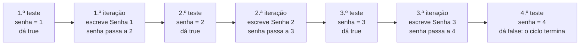
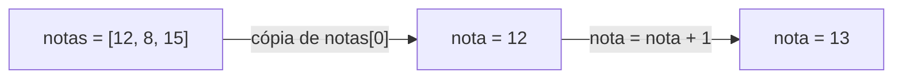

# Repetição e padrões

Neste guia, os algoritmos passam a repetir instruções. Escreves ciclos com o `Enquanto` e com o `Para`, e segues cada um numa tabela de iterações. Aprendes também cinco padrões que vais usar em quase todos os algoritmos. No fim, guardas vários valores num array e percorres esse array. Trabalhas em papel.

Usa a atribuição e a tabela de trace do tema 02, e a seleção e os intervalos do tema 03. Rever: [Atribuição](02-pseudocodigo.md#atribuição-dar-um-valor-não-é-perguntar-se-é-igual), [A tabela de trace](02-pseudocodigo.md#a-tabela-de-trace), [Seleção simples](03-decisoes-e-validacao.md#seleção-simples) e [O contrário de um intervalo](03-decisoes-e-validacao.md#o-contrário-de-um-intervalo). Para praticar: [ficha de exercícios](exercicios/04-repeticao-e-padroes-exercicios.md).

## Neste guia

1. [A mesma instrução cem vezes](#a-mesma-instrução-cem-vezes)
2. [Enquanto: repetir enquanto a condição for verdadeira](#enquanto-repetir-enquanto-a-condição-for-verdadeira)
3. [A indentação mostra o que está dentro do ciclo](#a-indentação-mostra-o-que-está-dentro-do-ciclo)
4. [As três peças de um ciclo](#as-três-peças-de-um-ciclo)
5. [O trace linha a linha do primeiro ciclo](#o-trace-linha-a-linha-do-primeiro-ciclo)
6. [A tabela de iterações](#a-tabela-de-iterações)
7. [O ciclo que nunca começa](#o-ciclo-que-nunca-começa)
8. [O ciclo que nunca acaba](#o-ciclo-que-nunca-acaba)
9. [Para: a forma curta do ciclo contado](#para-a-forma-curta-do-ciclo-contado)
10. [Padrão contador](#padrão-contador)
11. [Padrão totalizador](#padrão-totalizador)
12. [Padrão sentinela](#padrão-sentinela)
13. [Padrão validação repetida](#padrão-validação-repetida)
14. [Um ciclo dentro de outro](#um-ciclo-dentro-de-outro)
15. [Escolher entre Enquanto e Para](#escolher-entre-enquanto-e-para)
16. [Arrays: muitos valores numa só variável](#arrays-muitos-valores-numa-só-variável)
17. [O índice de cada elemento](#o-índice-de-cada-elemento)
18. [Percorrer um array com o índice](#percorrer-um-array-com-o-índice)
19. [Percorrer um array com o para cada](#percorrer-um-array-com-o-para-cada)
20. [O para cada não muda o array](#o-para-cada-não-muda-o-array)
21. [Padrão flag](#padrão-flag)
22. [Um ciclo com duas maneiras de acabar](#um-ciclo-com-duas-maneiras-de-acabar)
23. [O Para com as três peças à vista](#o-para-com-as-três-peças-à-vista)
24. [Exemplo guiado: contar pedidos válidos e totalizar unidades](#exemplo-guiado-contar-pedidos-válidos-e-totalizar-unidades)

## A mesma instrução cem vezes

A papelaria dos guias anteriores atende os clientes por senha. Imagina que a máquina passa a imprimir, todas as manhãs, as senhas de 1 a 100. Com o que já sabes, o algoritmo seria assim:

```text
Escreve: "Senha ", 1
Escreve: "Senha ", 2
Escreve: "Senha ", 3
(e assim por diante, uma linha por senha, até)
Escreve: "Senha ", 100
```

São cem linhas quase iguais, e um engano na linha 57 passa despercebido. Para 150 senhas, era preciso escrever mais cinquenta. E há problemas em que nenhum número de linhas serve: quem lê os pedidos de um dia não sabe quantos vão chegar.

As linhas só diferem no número, que aumenta 1 de cada vez. Bastava dizer: escreve uma senha, passa à seguinte, e faz o mesmo até chegares à última. Fazes isto todos os dias: "enquanto houver pratos na banca, lava um prato". Cada prato lavado sai da banca, e um dia a banca fica vazia.

Num algoritmo, uma parte que se executa várias vezes seguidas chama-se **ciclo**. Cada execução dessa parte é uma **iteração**, ou, na conversa de todos os dias, uma volta do ciclo.

## Enquanto: repetir enquanto a condição for verdadeira

Na forma das aulas, a repetição escreve-se assim:

```text
Enquanto condição
    instruções que se repetem
```

A condição é como as do guia 03: dá `true` ou `false`. As instruções indentadas debaixo do `Enquanto` são o **corpo do ciclo**. O `Enquanto` funciona assim:

1. Quando o algoritmo chega ao `Enquanto`, avalia a condição com os valores desse momento.
2. Se der `true`, executa o corpo, de cima para baixo.
3. Depois da última linha do corpo, volta ao `Enquanto` e avalia outra vez a condição, com os valores novos.
4. Se der `false`, salta o corpo e continua na primeira linha a seguir a ele.

O `Enquanto` é um `Se` que, no fim do bloco, volta a subir para fazer a mesma pergunta. A condição diz quando continuar, e não quando parar. E só se avalia na linha do `Enquanto`: se ficar falsa a meio do corpo, o corpo acaba na mesma.

O algoritmo das senhas, com um ciclo:

```text
const ULTIMA_SENHA = 3
int senha = 1
Enquanto senha <= ULTIMA_SENHA
    Escreve: "Senha ", senha
    senha = senha + 1
Escreve: "Fim da distribuição"
```

Prevê: o que aparece no ecrã, e com que valor fica `senha` depois do ciclo?

O ecrã mostra "Senha 1", "Senha 2" e "Senha 3", e no fim "Fim da distribuição". Depois do ciclo, `senha` vale 4, e não 3. O ciclo só para quando a senha passa da última, porque só aí a condição dá `false`.

## A indentação mostra o que está dentro do ciclo

No algoritmo das senhas, só o `Escreve:` da senha e `senha = senha + 1` estão quatro espaços mais à direita do que o `Enquanto`. São o corpo, e repetem-se uma vez por iteração. As linhas alinhadas com o `Enquanto` estão fora do ciclo e executam-se uma vez só.

As mesmas linhas, com outra margem, fazem outro algoritmo. Aqui, a última linha ganhou quatro espaços:

```text
const ULTIMA_SENHA = 3
int senha = 1
Enquanto senha <= ULTIMA_SENHA
    Escreve: "Senha ", senha
    senha = senha + 1
    Escreve: "Fim da distribuição"
```

A mensagem final passou para o corpo e aparece três vezes, uma depois de cada senha. Para leres a margem, põe o dedo debaixo da primeira letra do `Enquanto` e desce. O corpo são as linhas que começam à direita do dedo.

## As três peças de um ciclo

Os ciclos que terminam têm três peças. Quando um ciclo falha, é quase sempre porque falta uma, ou porque uma está errada.

A **inicialização** dá o valor de partida às variáveis que a condição usa. Fica antes do ciclo, sem indentação: nas senhas, é `int senha = 1`. A condição, na linha do `Enquanto`, decide se há mais uma iteração.

A **atualização** é a instrução do corpo que muda a variável da condição e aproxima o ciclo do fim. Nas senhas, `senha = senha + 1` faz a senha subir até passar da última. É a atualização que tira o prato da banca.

Para cada ciclo, faz três perguntas, uma por peça:

1. Com que valor começa, e porquê esse? (a inicialização)
2. Em que situação continua, e quando deixa de continuar? (a condição)
3. O que muda em cada iteração, e a variável da condição chega a um valor que dá `false`? (a atualização)

Nas senhas, a senha começa em 1, porque é a primeira. O ciclo continua enquanto ela for menor ou igual a 3, e ela sobe 1 por iteração, até chegar a 4.

## O trace linha a linha do primeiro ciclo

O trace segue as regras do guia 02, com a coluna "Condição e resultado" do guia 03. A novidade é que, depois da última linha do corpo, vem outra vez a linha do `Enquanto`.

| Passo | Instrução executada | senha | Condição e resultado | Ecrã |
| ---: | --- | ---: | --- | --- |
| 0 | antes de começar | sem valor | nenhuma | nada |
| 1 | `int senha = 1` | 1 | nenhuma | nada |
| 2 | `Enquanto senha <= ULTIMA_SENHA` | 1 | `1 <= 3` dá `true` | nada |
| 3 | `Escreve: "Senha ", senha` | 1 | nenhuma | Senha 1 |
| 4 | `senha = senha + 1` | 2 | nenhuma | nada |
| 5 | `Enquanto senha <= ULTIMA_SENHA` | 2 | `2 <= 3` dá `true` | nada |
| 6 | `Escreve: "Senha ", senha` | 2 | nenhuma | Senha 2 |
| 7 | `senha = senha + 1` | 3 | nenhuma | nada |
| 8 | `Enquanto senha <= ULTIMA_SENHA` | 3 | `3 <= 3` dá `true` | nada |
| 9 | `Escreve: "Senha ", senha` | 3 | nenhuma | Senha 3 |
| 10 | `senha = senha + 1` | 4 | nenhuma | nada |
| 11 | `Enquanto senha <= ULTIMA_SENHA` | 4 | `4 <= 3` dá `false` | nada |
| 12 | `Escreve: "Fim da distribuição"` | 4 | nenhuma | Fim da distribuição |

No passo 5, o algoritmo voltou ao `Enquanto` e testou outra vez, com a senha a 2. No passo 11, `4 <= 3` dá `false`, e o ciclo termina. A linha do `Enquanto` aparece quatro vezes, para três iterações: num ciclo que termina, há sempre um teste a mais do que iterações.

## A tabela de iterações

Com cem senhas, o trace teria 303 passos. A **tabela de iterações** é mais curta: tem uma linha por cada teste da condição, e não por cada instrução. O ciclo das senhas, desenrolado, é uma sequência de testes e de iterações:



Cada linha da tabela junta um teste e a iteração que vem a seguir. Mostra os valores no momento do teste, como uma fotografia do estado, e o que se escreve e lê na iteração seguinte.

| Teste | senha | Condição | Durante a iteração |
| --- | ---: | --- | --- |
| 1.º | 1 | `1 <= 3` dá `true` | escreve "Senha 1" |
| 2.º | 2 | `2 <= 3` dá `true` | escreve "Senha 2" |
| 3.º | 3 | `3 <= 3` dá `true` | escreve "Senha 3" |
| 4.º | 4 | `4 <= 3` dá `false` | o ciclo termina |

O 1.º teste resume os passos 2 a 4 do trace. A senha passa a 2 durante a 1.ª iteração, e por isso o 2 só aparece na linha do 2.º teste. Nos exercícios, o trace de um ciclo faz-se com esta tabela, a não ser que te peçam o trace linha a linha.

## O ciclo que nunca começa

Se a condição der `false` logo no primeiro teste, o corpo não se executa nenhuma vez. Pode ser um erro, como nesta versão das senhas:

```text
const ULTIMA_SENHA = 3
int senha = 1
Enquanto senha > ULTIMA_SENHA
    Escreve: "Senha ", senha
    senha = senha + 1
Escreve: "Fim da distribuição"
```

| Teste | senha | Condição | Durante a iteração |
| --- | ---: | --- | --- |
| 1.º | 1 | `1 > 3` dá `false` | o ciclo termina |

O ecrã mostra só "Fim da distribuição". Quem escreveu isto pôs no `Enquanto` a situação em que o ciclo devia parar, e esse é o sítio de quando continuar.

Outras vezes, zero iterações é a resposta certa: num dia sem pedidos, um algoritmo que conta pedidos não entra no ciclo e responde 0. Por isso, um ciclo testa-se com quatro casos. O primeiro é o caso de zero voltas, em que o ciclo não dá nenhuma volta. Os outros são um caso com uma iteração, um com várias e as fronteiras das decisões dentro do ciclo.

## O ciclo que nunca acaba

Um **ciclo infinito** é um ciclo cuja condição nunca chega a dar `false`. Num computador, o programa só para quando alguém o interrompe. No papel, a tabela de iterações mostra o problema.

Nesta versão das senhas falta uma linha:

```text
const ULTIMA_SENHA = 3
int senha = 1
Enquanto senha <= ULTIMA_SENHA
    Escreve: "Senha ", senha
Escreve: "Fim da distribuição"
```

Prevê o que acontece à senha de um teste para o seguinte.

| Teste | senha | Condição | Durante a iteração |
| --- | ---: | --- | --- |
| 1.º | 1 | `1 <= 3` dá `true` | escreve "Senha 1" |
| 2.º | 1 | `1 <= 3` dá `true` | escreve "Senha 1" |
| 3.º | 1 | `1 <= 3` dá `true` | escreve "Senha 1" |
| 4.º | 1 | `1 <= 3` dá `true` | escreve "Senha 1" |

Falta a atualização, que é a causa mais frequente, e o ciclo repete-se para sempre. O corpo não lê nada, e por isso, a partir do mesmo estado, faz sempre o mesmo e volta ao mesmo estado.

Num ciclo que lê valores, a atualização é a leitura do valor seguinte. Sem ela, os contadores mudam, mas a coluna da condição fica sempre igual, e é essa que se olha.

A atualização também pode estar no sítio errado, alinhada com o `Enquanto`:

```text
int senha = 1
Enquanto senha <= ULTIMA_SENHA
    Escreve: "Senha ", senha
senha = senha + 1
```

A linha ficou depois do ciclo, e como o ciclo nunca acaba, nunca chega a executar-se.

Pode ainda andar no sentido errado: com `senha = senha - 1`, a senha passa a 0, a -1, a -2, e afasta-se de 4. E pode saltar por cima da saída. Com `Enquanto x != 10`, um `x` que começa em 1 e sobe 2 de cada vez passa pelo 9 e pelo 11, e nunca pelo 10.

A terceira pergunta das peças apanha as quatro causas. Em cada iteração, a variável da condição muda e chega a um valor que dá `false`? Se não chega, o ciclo é infinito.

## Para: a forma curta do ciclo contado

No ciclo das senhas, sabe-se antes de começar quantas iterações vai haver. Um ciclo assim chama-se **ciclo contado**, e escreve-se mais curto com o `Para`:

```text
const ULTIMA_SENHA = 3
Para senha de 1 até ULTIMA_SENHA
    Escreve: "Senha ", senha
Escreve: "Fim da distribuição"
```

O corpo executa-se com a senha a 1, a 2 e a 3, e o ecrã é o do `Enquanto`. A inicialização é o `de 1`, e a condição, `senha <= ULTIMA_SENHA`, está escondida no `até`. A atualização é o próprio `Para` que a faz: no fim de cada iteração, soma 1 e volta ao teste.

A variável que o `Para` faz avançar chama-se **variável de controlo**. Não leva tipo, porque é o `Para` que a cria. O `Para` segue quatro regras:

1. A variável de controlo avança de 1 em 1.
2. Dentro do corpo, não se muda a variável de controlo nem o limite. Se for preciso mudá-los, usa-se o `Enquanto`.
3. Se o limite for menor do que o valor inicial, o corpo executa-se zero vezes: em `Para dia de 1 até 0`, `1 <= 0` dá `false` logo no início.
4. Depois do ciclo, não se usa a variável de controlo.

A variável pode chamar-se `i`, mas um nome como `senha` ou `dia` diz o que se conta. Com o `Para`, não te esqueces da inicialização nem da atualização, porque não és tu que as escreves.

## Padrão contador

Uma loja tem 5 produtos e quer saber quantos estão abaixo do stock mínimo, de 10 unidades. No guia 01, [reconhecer padrões](01-do-problema-ao-algoritmo.md#reconhecimento-de-padrões) era reparar no que se repete. Num algoritmo, um **padrão** é uma forma de resolver um pequeno problema que aparece em muitos algoritmos diferentes. O primeiro é o **contador**, uma variável que conta quantas vezes uma coisa aconteceu:

1. Começa em 0, antes do ciclo: antes de contar, contaram-se zero coisas.
2. Sempre que a coisa acontece, aumenta 1: `contador = contador + 1`.
3. O resultado lê-se depois do ciclo, quando a contagem está completa.

O algoritmo da loja, `ContarStockBaixo`, tem um `Se` dentro do ciclo, que se avalia em todas as iterações:

```text
const NUMERO_DE_PRODUTOS = 5
const STOCK_MINIMO = 10
int produtosAbaixoDoMinimo = 0
Para produto de 1 até NUMERO_DE_PRODUTOS
    Escreve: "Stock do produto ", produto, "?"
    int stock = ler valor
    Se stock < STOCK_MINIMO
        produtosAbaixoDoMinimo = produtosAbaixoDoMinimo + 1
Escreve: "Produtos abaixo do mínimo: ", produtosAbaixoDoMinimo
```

A linha `int stock = ler valor` escreve-se uma vez, com o tipo, mas executa-se cinco, e cada leitura substitui o stock anterior.

Prevê quantos produtos estão abaixo do mínimo com os stocks 12, 4, 10, 0 e 9. As perguntas não aparecem na última coluna, e cada stock lido só aparece na linha seguinte.

| Teste | produto | stock | produtosAbaixoDoMinimo | Condição | Durante a iteração |
| --- | ---: | ---: | ---: | --- | --- |
| 1.º | 1 | sem valor | 0 | `1 <= 5` dá `true` | lê 12 |
| 2.º | 2 | 12 | 0 | `2 <= 5` dá `true` | lê 4 |
| 3.º | 3 | 4 | 1 | `3 <= 5` dá `true` | lê 10 |
| 4.º | 4 | 10 | 1 | `4 <= 5` dá `true` | lê 0 |
| 5.º | 5 | 0 | 2 | `5 <= 5` dá `true` | lê 9 |
| 6.º | 6 | 9 | 3 | `6 <= 5` dá `false` | o ciclo termina |

O ecrã acaba com "Produtos abaixo do mínimo: 3": o 4, o 0 e o 9. O 10 não conta, porque `10 < 10` dá `false`, e um produto com exatamente o mínimo não está abaixo dele.

É a margem que decide quantas vezes cada linha se executa:

| Margem | Linhas | Quantas vezes se executam, com estes stocks |
| --- | --- | --- |
| Nenhuma | `int produtosAbaixoDoMinimo = 0` e o `Escreve:` do fim | 1 vez |
| Quatro espaços | a pergunta, a leitura do stock e o `Se` | 5 vezes, uma por produto |
| Oito espaços | `produtosAbaixoDoMinimo = produtosAbaixoDoMinimo + 1` | 3 vezes, só quando o `Se` dá `true` |

A linha do `Para`, que é o teste, executa-se 6 vezes.

## Padrão totalizador

Agora a pergunta é "quanto?": uma loja quer o total das vendas de vários dias. Um **totalizador** é uma variável que vai somando valores ao longo das iterações. Segue as regras do contador, com uma diferença: em cada iteração, soma o próprio valor, `total = total + valor`, e não 1. Com pedidos de 12, 30 e 50 unidades, um contador de pedidos fica com 3, e um totalizador de unidades fica com 92.

No algoritmo `TotalDeVendas`, o funcionário diz quantos dias quer somar e depois as vendas de cada dia, em cêntimos:

```text
Escreve: "Quantos dias queres somar?"
int dias = ler valor
int totalVendas = 0
Para dia de 1 até dias
    Escreve: "Vendas do dia ", dia, ", em cêntimos?"
    int vendasDoDia = ler valor
    totalVendas = totalVendas + vendasDoDia
Escreve: "Total vendido: ", totalVendas, " cêntimos"
```

Quando o algoritmo chega ao `Para`, o número de dias já foi lido, e por isso o ciclo é contado. Com 3 dias e as vendas 1250, 800 e 2100:

| Teste | dia | vendasDoDia | totalVendas | Condição | Durante a iteração |
| --- | ---: | ---: | ---: | --- | --- |
| 1.º | 1 | sem valor | 0 | `1 <= 3` dá `true` | lê 1250 |
| 2.º | 2 | 1250 | 1250 | `2 <= 3` dá `true` | lê 800 |
| 3.º | 3 | 800 | 2050 | `3 <= 3` dá `true` | lê 2100 |
| 4.º | 4 | 2100 | 4150 | `4 <= 3` dá `false` | o ciclo termina |

O algoritmo escreve "Total vendido: 4150 cêntimos". Com 0 dias, o total é 0, que está certo.

Os erros do totalizador estão quase sempre na inicialização. Sem `int totalVendas = 0`, a primeira soma usa uma variável sem valor, como no erro do guia 02. O outro erro é pôr a inicialização dentro do ciclo:

```text
Para dia de 1 até dias
    int totalVendas = 0
    Escreve: "Vendas do dia ", dia, ", em cêntimos?"
    int vendasDoDia = ler valor
    totalVendas = totalVendas + vendasDoDia
```

Prevê o total que esta versão escreve, com os mesmos dados.

| Teste | dia | vendasDoDia | totalVendas | Condição | Durante a iteração |
| --- | ---: | ---: | ---: | --- | --- |
| 1.º | 1 | sem valor | sem valor | `1 <= 3` dá `true` | lê 1250 |
| 2.º | 2 | 1250 | 1250 | `2 <= 3` dá `true` | lê 800 |
| 3.º | 3 | 800 | 800 | `3 <= 3` dá `true` | lê 2100 |
| 4.º | 4 | 2100 | 2100 | `4 <= 3` dá `false` | o ciclo termina |

O total volta a 0 em cada iteração, e o algoritmo escreve "Total vendido: 2100 cêntimos", só o último dia. O que se inicializa dentro do ciclo recomeça em cada iteração.

## Padrão sentinela

Num armazém, um funcionário regista o peso, em quilogramas, de cada caixa descarregada de um camião, e ninguém sabe quantas caixas vêm. Não há um número para pôr no `até`, e o `Para` não serve.

Combina-se um valor que quer dizer "acabou", escrito no fim dos dados. Esse valor chama-se **sentinela**, e nunca pode ser um dado verdadeiro: aqui é o 0, porque nenhuma caixa pesa 0 kg. A pergunta diz qual é, e o algoritmo guarda-o numa constante, `SENTINELA`.

O primeiro valor lê-se antes do ciclo, na **leitura antecipada**, e o corpo acaba a ler o valor seguinte. Assim, cada valor vai direto ao teste, e a sentinela termina o ciclo sem ser tratada como dado. O algoritmo `SomarCaixas` conta as caixas e soma o peso:

```text
const SENTINELA = 0
int caixas = 0
int pesoTotal = 0
Escreve: "Peso da caixa em kg (0 para terminar)?"
int peso = ler valor
Enquanto peso != SENTINELA
    caixas = caixas + 1
    pesoTotal = pesoTotal + peso
    Escreve: "Peso da caixa em kg (0 para terminar)?"
    peso = ler valor
Escreve: "Caixas descarregadas: ", caixas
Escreve: "Peso total: ", pesoTotal, " kg"
```

A leitura antecipada leva o tipo, porque `peso` nasce aí; a do fim do corpo já não o leva. Com os pesos 18, 25 e 7, e no fim o 0:

| Teste | peso | caixas | pesoTotal | Condição | Durante a iteração |
| --- | ---: | ---: | ---: | --- | --- |
| 1.º | 18 | 0 | 0 | `18 != 0` dá `true` | lê 25 |
| 2.º | 25 | 1 | 18 | `25 != 0` dá `true` | lê 7 |
| 3.º | 7 | 2 | 43 | `7 != 0` dá `true` | lê 0 |
| 4.º | 0 | 3 | 50 | `0 != 0` dá `false` | o ciclo termina |

O ecrã mostra "Caixas descarregadas: 3" e "Peso total: 50 kg". Se o camião vier vazio, o algoritmo escreve 0 caixas e 0 kg.

Quem não conhece a leitura antecipada põe a leitura no princípio do corpo e inventa um peso para entrar no ciclo:

```text
const SENTINELA = 0
int caixas = 0
int pesoTotal = 0
int peso = 1
Enquanto peso != SENTINELA
    Escreve: "Peso da caixa em kg (0 para terminar)?"
    peso = ler valor
    caixas = caixas + 1
    pesoTotal = pesoTotal + peso
Escreve: "Caixas descarregadas: ", caixas
Escreve: "Peso total: ", pesoTotal, " kg"
```

Prevê quantas caixas esta versão conta, com os mesmos pesos.

| Teste | peso | caixas | pesoTotal | Condição | Durante a iteração |
| --- | ---: | ---: | ---: | --- | --- |
| 1.º | 1 | 0 | 0 | `1 != 0` dá `true` | lê 18 |
| 2.º | 18 | 1 | 18 | `18 != 0` dá `true` | lê 25 |
| 3.º | 25 | 2 | 43 | `25 != 0` dá `true` | lê 7 |
| 4.º | 7 | 3 | 50 | `7 != 0` dá `true` | lê 0 |
| 5.º | 0 | 4 | 50 | `0 != 0` dá `false` | o ciclo termina |

O algoritmo escreve "Caixas descarregadas: 4", quando foram três: o 0 foi contado antes de a condição o testar. O peso total só está certo por coincidência, porque somar 0 não muda nada. O `int peso = 1` já era um sinal de alarme, um valor inventado para entrar no ciclo.

## Padrão validação repetida

No guia 03, uma entrada inválida terminava o algoritmo. Rever: [Validar os dados antes de os usar](03-decisoes-e-validacao.md#validar-os-dados-antes-de-os-usar).

Com um ciclo, pede-se o valor outra vez, até ser válido. É a **validação repetida**: a condição do ciclo diz que o valor é inválido, e o corpo volta a pedi-lo. A papelaria só aceita pedidos de 1 a 50 unidades:

```text
const QUANTIDADE_MINIMA = 1
const QUANTIDADE_MAXIMA = 50
Escreve: "Quantidade do pedido (1 a 50)?"
int quantidade = ler valor
Enquanto quantidade < QUANTIDADE_MINIMA ou quantidade > QUANTIDADE_MAXIMA
    Escreve: "Quantidade inválida. Escreve um número de 1 a 50."
    quantidade = ler valor
Escreve: "Pedido aceite: ", quantidade, " unidades"
```

É o algoritmo `PedirQuantidadeValida`. A condição é o contrário do intervalo, com `ou`, e a mensagem diz o que se pode escrever.

Prevê quantas vezes aparece a mensagem de erro quando a pessoa escreve 0, depois 75 e depois 12.

| Teste | quantidade | Condição | Durante a iteração |
| --- | ---: | --- | --- |
| 1.º | 0 | `0 < 1 ou 0 > 50` dá `true` | escreve "Quantidade inválida. Escreve um número de 1 a 50."; lê 75 |
| 2.º | 75 | `75 < 1 ou 75 > 50` dá `true` | escreve "Quantidade inválida. Escreve um número de 1 a 50."; lê 12 |
| 3.º | 12 | `12 < 1 ou 12 > 50` dá `false` | o ciclo termina |

A mensagem aparece duas vezes, e o ecrã acaba com "Pedido aceite: 12 unidades". Se a pessoa escrever logo 12, o ciclo tem zero iterações e não aparece nenhuma mensagem.

Na linha a seguir ao ciclo, a condição acabou de dar `false`. Por isso, a quantidade está de certeza entre 1 e 50, e o resto do algoritmo usa-a sem voltar a verificar. Vale para todos os ciclos: depois de um ciclo, a sua condição é falsa.

O erro típico é escrever no `Enquanto` a condição de valor válido:

```text
Enquanto quantidade >= QUANTIDADE_MINIMA e quantidade <= QUANTIDADE_MAXIMA
```

Com 12, aparece "Quantidade inválida"; com 0, o ciclo termina e aceita-o. Numa validação, continua-se enquanto o valor for inválido.

Os exemplos 7 e 8 de [intervalos e validação](../exemplos/algoritmos/intervalos-e-validacao/README.md) mostram este padrão com a temperatura de um ar condicionado. O 8 tem um engano de propósito.

## Um ciclo dentro de outro

O corpo de um ciclo pode ter outro ciclo lá dentro. O de dentro faz todas as suas iterações durante uma só iteração do de fora. O de fora só passa à linha seguinte quando o de dentro tiver acabado.

A papelaria recebe dois pedidos, e cada um tem de ter de 1 a 50 unidades. A validação repetida de `PedirQuantidadeValida` fica dentro de um `Para` de dois pedidos:

```text
const QUANTIDADE_MINIMA = 1
const QUANTIDADE_MAXIMA = 50
const NUMERO_DE_PEDIDOS = 2
Para pedido de 1 até NUMERO_DE_PEDIDOS
    Escreve: "Quantidade do pedido ", pedido, " (1 a 50)?"
    int quantidade = ler valor
    Enquanto quantidade < QUANTIDADE_MINIMA ou quantidade > QUANTIDADE_MAXIMA
        Escreve: "Quantidade inválida. Escreve um número de 1 a 50."
        quantidade = ler valor
    Escreve: "Pedido aceite: ", quantidade, " unidades"
```

O corpo do `Enquanto` tem oito espaços, porque está dentro de dois blocos. A pessoa escreve 0, 75, 12 e 30. Prevê quantas vezes aparece "Quantidade inválida", e que pedidos são aceites.

| Teste | pedido | quantidade | Condição | Durante a iteração |
| --- | ---: | ---: | --- | --- |
| 1.º | 1 | sem valor | `1 <= 2` dá `true` | lê 0; a validação testa `0 < 1 ou 0 > 50`, que dá `true`: escreve "Quantidade inválida. Escreve um número de 1 a 50." e lê 75; testa `75 < 1 ou 75 > 50`, que dá `true`: escreve a mesma mensagem e lê 12; testa `12 < 1 ou 12 > 50`, que dá `false`, e a validação termina; escreve "Pedido aceite: 12 unidades" |
| 2.º | 2 | 12 | `2 <= 2` dá `true` | lê 30; a validação testa `30 < 1 ou 30 > 50`, que dá `false`, e não faz nenhuma iteração; escreve "Pedido aceite: 30 unidades" |
| 3.º | 3 | 30 | `3 <= 2` dá `false` | o ciclo termina |

"Quantidade inválida" aparece duas vezes, as duas na primeira iteração do `Para`. Os dois pedidos são aceites, com 12 e 30 unidades. A tabela é a do ciclo de fora, e o que o ciclo de dentro faz escreve-se na coluna "Durante a iteração". Por isso, a validação do primeiro pedido, com duas iterações e três testes, cabe toda numa linha.

## Escolher entre Enquanto e Para

Quando o algoritmo chega ao ciclo, já se sabe quantas vezes ele se vai repetir? Se sim, o ciclo é contado, e o `Para` é mais seguro. Se o fim depende do que acontece durante o ciclo, usa-se o `Enquanto`. No `TotalDeVendas`, o número de dias já foi lido quando o ciclo começa.

| Situação | Ciclo | Porquê |
| --- | --- | --- |
| Imprimir as senhas de 1 a 100 | `Para` | Sabe-se que são 100 antes de começar |
| Somar as vendas de um número de dias que o funcionário escreve no início | `Para` | O número é lido antes de o ciclo começar |
| Ler pesos até aparecer o 0 | `Enquanto` | Só se sabe que acabou quando aparece a sentinela |
| Pedir a quantidade até ser válida | `Enquanto` | Depende do que a pessoa escrever |

Todo o `Para` se pode escrever como um `Enquanto`. O contrário não, porque a sentinela e a validação repetida não têm um número para pôr no `até`. Em todos, as três peças estão lá, em sítios diferentes:

| Ciclo | Inicialização | Condição | Atualização |
| --- | --- | --- | --- |
| Senhas, com `Enquanto` | `int senha = 1`, antes do ciclo | `senha <= ULTIMA_SENHA` | `senha = senha + 1`, no corpo |
| Senhas, com `Para` | o `de 1` | escondida no `até` | feita pelo `Para`, no fim de cada iteração |
| Sentinela | a leitura antecipada | o valor lido não é a sentinela | a leitura do valor seguinte, no fim do corpo |
| Validação repetida | a primeira leitura | o valor é inválido | a leitura dentro do corpo |

<details>
<summary>Para ires mais longe: o ciclo que testa no fim</summary>

Há linguagens com um ciclo que testa a condição no fim do corpo, e não no princípio. Por isso, executa-se sempre pelo menos uma vez. Em alguns livros aparece como `REPETIR ... ATÉ`. Nas aulas não se usa, porque o que ele faz consegue-se com o `Enquanto`, como na validação repetida. O Python também não o tem.

</details>

## Arrays: muitos valores numa só variável

Para guardar as notas de 25 alunos, precisavas de 25 variáveis, de `nota1` a `nota25`. Somá-las, ou mostrá-las, levava 25 linhas.

Um **array** é uma variável que guarda vários valores, uns a seguir aos outros, numa ordem fixa. Cada valor guardado é um **elemento** do array. Pensa numa fila de cacifos numerados: a fila tem um nome, e cada cacifo guarda uma coisa. Nas aulas, escreve-se com os valores entre parênteses retos, separados por vírgulas:

```text
notas = [12, 8, 15]
```

O array não leva tipo à frente, e o nome vai no plural, porque guarda vários valores.

## O índice de cada elemento

Para ires buscar o que está num cacifo, dizes o número dele. Num array, a posição de cada elemento chama-se **índice**, e os índices começam em 0:

```text
notas    [ 12 |  8 | 15 ]
índice      0    1    2
```

`notas[0]` é 12, `notas[1]` é 8 e `notas[2]` é 15. O índice diz quantas posições andas desde o início. Por isso, num array com `n` elementos, o último índice é `n - 1`: aqui, é o 2.

Um elemento usa-se como qualquer variável, numa conta, numa condição ou a receber um valor, como em `notas[1] = 10`. E `notas[3]`? Não existe. Usar um índice que não existe chama-se índice fora do array, e é um dos erros mais frequentes com arrays.

## Percorrer um array com o índice

Passar por todos os elementos, um a um, e fazer alguma coisa com cada um chama-se **percorrer** o array. A forma mais direta usa o `Para`, com a variável de controlo a servir de índice. O número de elementos fica numa constante:

```text
const N_NOTAS = 3

notas = [12, 8, 15]
Para i de 0 até N_NOTAS - 1
    Escreve: "Nota ", i + 1, ": ", notas[i]
```

A condição escondida do `Para` é `i <= N_NOTAS - 1`, ou seja, `i <= 2`:

| Teste | i | Condição | notas[i] | Durante a iteração |
| --- | ---: | --- | ---: | --- |
| 1.º | 0 | `0 <= 2` dá `true` | 12 | escreve "Nota 1: 12" |
| 2.º | 1 | `1 <= 2` dá `true` | 8 | escreve "Nota 2: 8" |
| 3.º | 2 | `2 <= 2` dá `true` | 15 | escreve "Nota 3: 15" |
| 4.º | 3 | `3 <= 2` dá `false` | não se usa | o ciclo termina |

Em cada iteração, `notas[i]` é o elemento da posição `i`. O `i + 1` está no `Escreve:` porque, para as pessoas, a primeira nota é a nota 1. Com o `Para` até `N_NOTAS`, havia uma quarta iteração, com `notas[3]`, fora do array.

## Percorrer um array com o para cada

Muitas vezes, a posição de cada elemento não interessa, só o valor. Para esses casos há o **para cada**. Para somar as notas:

```text
notas = [12, 8, 15]
int soma = 0
Para cada nota em notas
    soma = soma + nota
Escreve: "Soma das notas: ", soma
```

Lê-se "para cada nota no array das notas, soma-a". Em cada iteração, a variável `nota` recebe o elemento seguinte, e o ciclo acaba sozinho quando os elementos se esgotam. Não há índice, nem condição a escrever, nem risco de usar um índice fora do array. A variável não leva tipo, e costuma ter o nome do array no singular.

Como não há condição escrita, a tabela de iterações do para cada tem uma linha por iteração, com os valores no fim dessa iteração:

| Iteração | nota | soma no fim da iteração |
| --- | ---: | ---: |
| 1.ª | 12 | 12 |
| 2.ª | 8 | 20 |
| 3.ª | 15 | 35 |

O ecrã mostra "Soma das notas: 35". O totalizador funciona como num `Para`: começa em 0 antes do ciclo e soma a variável do para cada.

## O para cada não muda o array

O professor decidiu dar mais um valor a todas as notas de um teste. O algoritmo tem de aumentar 1 a cada nota do array.

### Primeira tentativa, com o para cada

```text
notas = [12, 8, 15]
Para cada nota em notas
    nota = nota + 1
Escreve: notas[0], " ", notas[1], " ", notas[2]
```

Prevê as três notas que o algoritmo escreve. O trace tem a variável `nota` e o array `notas` lado a lado:

| Passo | Instrução executada | nota | notas | Ecrã |
| ---: | --- | ---: | --- | --- |
| 0 | antes de começar | sem valor | sem valor | nada |
| 1 | `notas = [12, 8, 15]` | sem valor | [12, 8, 15] | nada |
| 2 | para cada, 1.ª iteração: `nota` recebe uma cópia de `notas[0]` | 12 | [12, 8, 15] | nada |
| 3 | `nota = nota + 1` | 13 | [12, 8, 15] | nada |
| 4 | para cada, 2.ª iteração: `nota` recebe uma cópia de `notas[1]` | 8 | [12, 8, 15] | nada |
| 5 | `nota = nota + 1` | 9 | [12, 8, 15] | nada |
| 6 | para cada, 3.ª iteração: `nota` recebe uma cópia de `notas[2]` | 15 | [12, 8, 15] | nada |
| 7 | `nota = nota + 1` | 16 | [12, 8, 15] | nada |
| 8 | para cada: não há mais elementos, o ciclo termina | 16 | [12, 8, 15] | nada |
| 9 | `Escreve:` das três notas | 16 | [12, 8, 15] | 12 8 15 |

A coluna `nota` muda três vezes, e a coluna `notas` nunca muda: as notas continuam 12, 8 e 15. A variável do para cada recebe uma cópia do valor do elemento, e não o próprio elemento. Na 1.ª iteração:



O 12 vai do array para a variável, e a soma muda só a variável: nada volta ao array. A cópia não sabe de que posição veio, e para mudar um elemento é preciso o índice.

### A versão certa, com o índice

```text
const N_NOTAS = 3

notas = [12, 8, 15]
Para i de 0 até N_NOTAS - 1
    notas[i] = notas[i] + 1
Escreve: notas[0], " ", notas[1], " ", notas[2]
```

Em cada iteração, o algoritmo lê o elemento da posição `i`, soma-lhe 1 e guarda o resultado na mesma posição:

| Passo | Instrução executada | i | Condição e resultado | notas | Ecrã |
| ---: | --- | ---: | --- | --- | --- |
| 0 | antes de começar | sem valor | nenhuma | sem valor | nada |
| 1 | `notas = [12, 8, 15]` | sem valor | nenhuma | [12, 8, 15] | nada |
| 2 | `Para`: `i` começa em 0 | 0 | `0 <= 2` dá `true` | [12, 8, 15] | nada |
| 3 | `notas[i] = notas[i] + 1`, ou seja 12 + 1 | 0 | nenhuma | [13, 8, 15] | nada |
| 4 | volta ao `Para`: `i` passa a 1 | 1 | `1 <= 2` dá `true` | [13, 8, 15] | nada |
| 5 | `notas[i] = notas[i] + 1`, ou seja 8 + 1 | 1 | nenhuma | [13, 9, 15] | nada |
| 6 | volta ao `Para`: `i` passa a 2 | 2 | `2 <= 2` dá `true` | [13, 9, 15] | nada |
| 7 | `notas[i] = notas[i] + 1`, ou seja 15 + 1 | 2 | nenhuma | [13, 9, 16] | nada |
| 8 | volta ao `Para`: `i` passa a 3 | 3 | `3 <= 2` dá `false`: o ciclo termina | [13, 9, 16] | nada |
| 9 | `Escreve:` das três notas | 3 | nenhuma | [13, 9, 16] | 13 9 16 |

Agora é a coluna `notas` que muda, um elemento por iteração, e o ecrã mostra "13 9 16".

Para ler os elementos, para os somar, contar ou mostrar, usa o para cada. Para os mudar, usa o `Para` e o índice.

## Padrão flag

Há algum produto sem stock? Esta pergunta responde-se com sim ou não: aconteceu alguma vez?

Para responder, usa-se uma **flag**, palavra inglesa que quer dizer bandeira. É uma variável `bool` que guarda se uma coisa já aconteceu. Pensa numa bandeira num mastro: começa em baixo, é içada quando alguém vê o que se procura, e fica no alto. Ao lado do contador e do totalizador:

| Padrão | Responde a | Começa, antes do ciclo | Dentro do ciclo | Lê-se |
| --- | --- | --- | --- | --- |
| Contador | quantos? | `0` | soma 1 | depois do ciclo |
| Totalizador | quanto? | `0` | soma o valor | depois do ciclo |
| Flag | aconteceu alguma vez? | `false` | passa a `true` dentro de um `Se`, e nunca volta a `false` | depois do ciclo |

O nome da flag é a pergunta, e `true` quer dizer sim. Por isso, entra sozinha numa condição, como o `pago` do guia 03: `Se haProdutoSemStock` lê-se "se há um produto sem stock". O algoritmo `HaProdutoSemStock` percorre o stock de quatro produtos com o para cada, porque só precisa de ler os valores:

```text
stocks = [12, 0, 9, 7]
bool haProdutoSemStock = false
Para cada stock em stocks
    Se stock == 0
        haProdutoSemStock = true
Se haProdutoSemStock
    Escreve: "Há pelo menos um produto sem stock"
Senão
    Escreve: "Todos os produtos têm stock"
```

| Iteração | stock | `stock == 0` | haProdutoSemStock no fim da iteração |
| --- | ---: | --- | --- |
| 1.ª | 12 | `false` | `false` |
| 2.ª | 0 | `true` | `true` |
| 3.ª | 9 | `false` | `true` |
| 4.ª | 7 | `false` | `true` |

O ecrã mostra "Há pelo menos um produto sem stock". Nas iterações 3 e 4, a flag continua `true`: depois de içada, a bandeira não desce. A flag não diz quantos foram; para isso, usa-se um contador.

### Um `Senão` que baixa a bandeira

O erro mais frequente com flags é acrescentar um `Senão`:

```text
Para cada stock em stocks
    Se stock == 0
        haProdutoSemStock = true
    Senão
        haProdutoSemStock = false
```

Prevê o que escreve esta versão com o array `[12, 0, 9, 7]`.

A bandeira é içada no 0 e desce logo no 9, e o algoritmo escreve "Todos os produtos têm stock". Com `[12, 9, 7, 0]`, as duas versões dão o mesmo, e esse teste não apanha o erro. Para testar uma flag, escolhe três casos:

- um em que nenhum valor cumpre a condição, e a flag tem de acabar `false`;
- um em que o valor procurado aparece no início ou no meio, seguido de valores que não cumprem;
- um em que só o último valor cumpre.

A resposta a "há algum?" escreve-se depois do ciclo. Com um `Escreve:` num `Senão` dentro do ciclo, aparecia "Todos os produtos têm stock" logo no 12, antes de se ver o 0.

<details>
<summary>Para ires mais longe: Parar e Continuar</summary>

São duas instruções que mudam o caminho de um ciclo a meio de uma iteração. Escrevem-se sozinhas numa linha, quase sempre dentro de um `Se`.

`Parar` termina o ciclo imediatamente. Serve, por exemplo, para deixar de procurar quando já se encontrou o que se procurava:

```text
stocks = [12, 0, 9, 7]
bool haProdutoSemStock = false
Para cada stock em stocks
    Se stock == 0
        haProdutoSemStock = true
        Parar
```

Com este array, o ciclo dá duas iterações. No 0, a flag é içada, e o `Parar` sai do ciclo sem olhar para o 9 e para o 7. A resposta é a mesma do padrão flag, com menos iterações.

`Continuar` termina só a iteração atual, e o ciclo passa à seguinte. Este algoritmo soma as vendas de uma semana e põe de lado os valores negativos, que são enganos de escrita:

```text
vendas = [5, -2, 8, -1, 4]
int total = 0
Para cada venda em vendas
    Se venda < 0
        Continuar
    total = total + venda
Escreve: "Total das vendas: ", total
```

O total é 5 + 8 + 4, que dá 17. Num `Enquanto`, há um cuidado: se a atualização estiver abaixo do `Continuar`, também é saltada, e o ciclo pode nunca acabar.

</details>

## Um ciclo com duas maneiras de acabar

Até aqui, cada ciclo acabava por uma razão: a contagem chegava ao fim, aparecia a sentinela ou o valor ficava válido. Há ciclos que podem acabar por duas. A papelaria quer saber se algum de 5 produtos está sem stock, e deixa de perguntar logo que encontra um.

Pensa primeiro em quando o ciclo para: quando encontra um produto sem stock, ou quando já perguntou pelos 5. A condição do `Enquanto` diz quando continuar, e por isso é o contrário. O `ou` passa a `e`, e cada parte passa à sua contrária. Rever: [O contrário de um intervalo](03-decisoes-e-validacao.md#o-contrário-de-um-intervalo).

```text
const NUMERO_DE_PRODUTOS = 5
int produto = 1
bool haProdutoSemStock = false
Enquanto produto <= NUMERO_DE_PRODUTOS e não haProdutoSemStock
    Escreve: "Stock do produto ", produto, "?"
    int stock = ler valor
    Se stock == 0
        haProdutoSemStock = true
    produto = produto + 1
Se haProdutoSemStock
    Escreve: "Há pelo menos um produto sem stock"
Senão
    Escreve: "Todos os produtos têm stock"
```

Com os stocks 12, 0, 9, 7 e 4, o ciclo para depois do segundo produto. O 9, o 7 e o 4 nem são pedidos. Prevê porque é que o ciclo para com os stocks 12, 9, 7, 4 e 0.

| Teste | produto | stock | haProdutoSemStock | Condição | Durante a iteração |
| --- | ---: | ---: | --- | --- | --- |
| 1.º | 1 | sem valor | `false` | `1 <= 5 e não false` dá `true` | lê 12 |
| 2.º | 2 | 12 | `false` | `2 <= 5 e não false` dá `true` | lê 9 |
| 3.º | 3 | 9 | `false` | `3 <= 5 e não false` dá `true` | lê 7 |
| 4.º | 4 | 7 | `false` | `4 <= 5 e não false` dá `true` | lê 4 |
| 5.º | 5 | 4 | `false` | `5 <= 5 e não false` dá `true` | lê 0; `haProdutoSemStock` passa a `true` |
| 6.º | 6 | 0 | `true` | `6 <= 5 e não true` dá `false` | o ciclo termina |

No último teste, as duas partes dão `false`: o 0 apareceu no último produto, e as duas razões aconteceram ao mesmo tempo. Depois de um ciclo, a sua condição é falsa, mas isso só diz que pelo menos uma das razões aconteceu. Por isso, a decisão do fim pergunta pela razão que interessa, a flag.

Com `Se produto > NUMERO_DE_PRODUTOS` a escrever "Todos os produtos têm stock", este caso dava a resposta errada. Um ciclo assim testa-se com cada razão sozinha e com as duas ao mesmo tempo.

## O Para com as três peças à vista

O `Para` também se escreve com as três peças na primeira linha, separadas por vírgulas, como em várias linguagens de programação:

```text
Para i = 0, i < 10, i++
    Escreve: i
```

Lê-se "para `i` a começar em 0, enquanto `i` for menor do que 10, aumentando `i` de 1 em 1". Cada parte da primeira linha é uma das peças:

1. `i = 0` é a inicialização, feita uma vez, antes do primeiro teste.
2. `i < 10` é a condição, testada antes de cada iteração, como a do `Enquanto`.
3. `i++` é a atualização, feita no fim de cada iteração. Lê-se "i mais mais" e quer dizer `i = i + 1`.

Prevê que números este ciclo escreve.

Escreve os números de 0 a 9: são dez iterações, com `i` a valer 0, 1, 2, e assim por diante até 9. Quando `i` chega a 10, `10 < 10` dá `false`, e o ciclo termina.

O `Para` das senhas fica assim, nesta forma:

```text
Para senha = 1, senha <= ULTIMA_SENHA, senha++
    Escreve: "Senha ", senha
```

O `<=` deixa entrar a última senha, como o `até`. Com `<`, faltava uma iteração.

Nesta forma, és tu que escreves as três peças, e os erros do `Enquanto` voltam a ser possíveis. Com `senha > ULTIMA_SENHA` na condição, o ciclo nunca começa. Com `senha--`, que quer dizer `senha = senha - 1`, nunca acaba. As três perguntas das peças servem como no `Enquanto`. A variável de controlo continua sem tipo, e não se muda dentro do corpo.

## Exemplo guiado: contar pedidos válidos e totalizar unidades

Este exemplo junta um ciclo com sentinela, um `Se` com um intervalo dentro do ciclo, dois contadores e um totalizador.

### O enunciado

> Uma papelaria recebe pedidos de material ao longo do dia. Cada pedido tem uma quantidade de unidades. A papelaria só aceita pedidos de 1 a 50 unidades, porque 50 é o máximo que a carrinha de entregas leva numa viagem. Uma quantidade negativa é um engano de escrita e também é recusada. O funcionário escreve a quantidade de cada pedido, um de cada vez, e escreve 0 quando já não há mais pedidos. Cada pedido recusado é assinalado no momento em que é escrito. No fim, o algoritmo mostra quantos pedidos válidos houve, quantas unidades somam os pedidos válidos e quantos pedidos foram recusados.

### O contrato

| Pergunta | Resposta |
| --- | --- |
| Entradas | Uma sequência de quantidades de pedidos, números inteiros, que acaba com um 0 |
| Saídas | Uma mensagem por cada pedido recusado, no momento em que é escrito; no fim, o número de pedidos válidos, o total de unidades dos pedidos válidos e o número de pedidos recusados |
| Restrições | Um pedido é válido se tiver de 1 a 50 unidades, os dois extremos incluídos; o 0 não é um pedido, é o sinal de fim |
| Condições | Cada pedido é válido ou recusado; os pedidos repetem-se até aparecer o 0 |

Um pedido recusado é assinalado e contado, e o funcionário segue para o seguinte.

### Quatro casos, escolhidos pelo enunciado

Os casos escolhem-se antes de haver algoritmo, como no guia 03. Rever: [A árvore de casos e a tabela de casos esperados](03-decisoes-e-validacao.md#a-árvore-de-casos-e-a-tabela-de-casos-esperados).

| Caso | Quantidades escritas | Válidos | Unidades | Recusados | Porque se escolheu |
| --- | --- | ---: | ---: | ---: | --- |
| A | 12, 60, 30, -4, 50, 0 | 3 | 92 | 2 | O caso normal, com válidos e recusados dos dois lados do intervalo |
| B | 0 | 0 | 0 | 0 | O caso de zero voltas: nenhum pedido no dia |
| C | 1, 50, 51, 0 | 2 | 51 | 1 | As fronteiras: o 1 e o 50 são válidos, o 51 não; o 0 não se testa, porque é a sentinela, e o -4 do caso A faz esse papel |
| D | 75, 0 | 0 | 0 | 1 | Só pedidos recusados |

O caso B é o que apanha mais erros: com zero pedidos, tem de dar zero em tudo, sem mensagens.

### As peças do ciclo

Antes de o ciclo começar, não se sabe quantos pedidos vai haver: é o padrão sentinela, com `Enquanto`, e as peças são as dele. Os três resultados começam em 0, porque antes do primeiro pedido não se contou nem somou nada.

Em cada iteração, um `Se` com o intervalo de 1 a 50 decide se o pedido é válido. Se for, conta-o nos válidos e soma-o ao total; se não for, conta-o nos recusados e assinala-o. A validade é um `Se`, e não uma validação repetida, porque o enunciado manda seguir para o pedido seguinte, e não corrigir o errado.

### O pseudocódigo

O algoritmo `ContarPedidosValidos`:

```text
const SENTINELA = 0
const QUANTIDADE_MINIMA = 1
const QUANTIDADE_MAXIMA = 50
int pedidosValidos = 0
int pedidosRecusados = 0
int totalUnidades = 0
Escreve: "Quantidade do pedido (0 para terminar)?"
int quantidade = ler valor
Enquanto quantidade != SENTINELA
    Se quantidade >= QUANTIDADE_MINIMA e quantidade <= QUANTIDADE_MAXIMA
        pedidosValidos = pedidosValidos + 1
        totalUnidades = totalUnidades + quantidade
    Senão
        pedidosRecusados = pedidosRecusados + 1
        Escreve: "Pedido recusado: ", quantidade, " unidades"
    Escreve: "Quantidade do pedido (0 para terminar)?"
    quantidade = ler valor
Escreve: "Pedidos válidos: ", pedidosValidos
Escreve: "Total de unidades: ", totalUnidades
Escreve: "Pedidos recusados: ", pedidosRecusados
```

A pergunta e a leitura aparecem antes do ciclo e no fim do corpo, como em todos os ciclos com sentinela. As linhas do `Se` e do `Senão` têm oito espaços. A pergunta e a leitura do fim do corpo voltam aos quatro, e por isso executam-se em todas as iterações. Os resultados escrevem-se depois do ciclo, e durante ele só aparece a mensagem de pedido recusado, que o enunciado pede no momento.

### A tabela de iterações do caso normal

O caso A, sem as perguntas na última coluna:

| Teste | quantidade | pedidosValidos | pedidosRecusados | totalUnidades | Condição | Durante a iteração |
| --- | ---: | ---: | ---: | ---: | --- | --- |
| 1.º | 12 | 0 | 0 | 0 | `12 != 0` dá `true` | lê 60 |
| 2.º | 60 | 1 | 0 | 12 | `60 != 0` dá `true` | escreve "Pedido recusado: 60 unidades"; lê 30 |
| 3.º | 30 | 1 | 1 | 12 | `30 != 0` dá `true` | lê -4 |
| 4.º | -4 | 2 | 1 | 42 | `-4 != 0` dá `true` | escreve "Pedido recusado: -4 unidades"; lê 50 |
| 5.º | 50 | 2 | 2 | 42 | `50 != 0` dá `true` | lê 0 |
| 6.º | 0 | 3 | 2 | 92 | `0 != 0` dá `false` | o ciclo termina |

Na 1.ª iteração, o 12 é válido, e por isso o 2.º teste já tem 1 válido e 12 unidades. O 50 é válido, porque `50 <= 50` dá `true`. O ciclo termina depois de 5 iterações, com 3 válidos, 92 unidades e 2 recusados.

Cada pedido vai para um só ramo do `Se`. Por isso, de uma linha para a seguinte, ou mudam os válidos e o total, ou só os recusados.

As tabelas dos outros três casos dão os resultados previstos. O caso B tem zero iterações e escreve três zeros. O caso C tem 3 iterações, e o D tem uma, com o total em 0, porque o único pedido foi recusado.

## Erros frequentes

### O contador fora do `Se`

No caso A, o algoritmo diz que houve 5 pedidos válidos, quando foram 3. No caso D, diz que houve 1 válido e, ao mesmo tempo, 1 recusado. O aumento de `pedidosValidos` ficou no corpo do ciclo, com quatro espaços, antes do `Se`:

```text
Enquanto quantidade != SENTINELA
    pedidosValidos = pedidosValidos + 1
    Se quantidade >= QUANTIDADE_MINIMA e quantidade <= QUANTIDADE_MAXIMA
        totalUnidades = totalUnidades + quantidade
    Senão
        pedidosRecusados = pedidosRecusados + 1
        Escreve: "Pedido recusado: ", quantidade, " unidades"
    Escreve: "Quantidade do pedido (0 para terminar)?"
    quantidade = ler valor
```

Assim, conta todos os pedidos. Corrige-se pondo o aumento dentro do `Se`, com oito espaços.

### Uma iteração a mais ou a menos

Com `Enquanto senha < ULTIMA_SENHA`, o ciclo das senhas escreve a senha 1 e a senha 2 e para, porque `3 < 3` dá `false`. Com `int senha = 0`, a primeira senha impressa é a 0, que não existe. O ciclo acaba nos dois casos, e por isso o erro passa a quem só confirma que ele acaba.

Antes da tabela, diz quantas iterações o ciclo devia ter, e com que valores começa e acaba. Se falta ou sobra a última, corrige-se a condição; se a primeira está errada, a inicialização.

## Palavras novas deste guia

- Ciclo: uma parte de um algoritmo que se executa várias vezes seguidas.
- Iteração: cada execução do corpo de um ciclo; também se diz uma volta do ciclo.
- Corpo do ciclo: as instruções indentadas debaixo do `Enquanto` ou do `Para`, que se repetem.
- Inicialização: a instrução, antes do ciclo, que dá o valor de partida às variáveis que a condição usa.
- Atualização: a instrução do corpo que muda a variável da condição e aproxima o ciclo do fim.
- Tabela de iterações: uma tabela com uma linha por cada teste da condição, com a fotografia do estado no momento do teste.
- Ciclo infinito: um ciclo cuja condição nunca chega a dar `false`.
- Ciclo contado: um ciclo em que se sabe, antes de começar, quantas iterações vai ter.
- Variável de controlo: a variável que o `Para` cria e faz avançar de 1 em 1.
- Padrão: uma forma de resolver um pequeno problema que aparece em muitos algoritmos diferentes.
- Contador: uma variável que conta quantas vezes uma coisa aconteceu; começa em 0 e soma 1.
- Totalizador: uma variável que vai somando valores ao longo das iterações; começa em 0 e soma o valor.
- Sentinela: um valor combinado que quer dizer "acabou" e que os dados verdadeiros nunca têm.
- Leitura antecipada: a leitura do primeiro valor, feita antes do ciclo.
- Validação repetida: um ciclo que volta a pedir um valor enquanto ele for inválido.
- Array: uma variável que guarda vários valores, uns a seguir aos outros, numa ordem fixa.
- Elemento: cada valor guardado num array.
- Índice: a posição de um elemento num array, a contar de 0.
- Percorrer um array: passar por todos os elementos, um a um, e fazer alguma coisa com cada um.
- Para cada: o ciclo que percorre um array elemento a elemento, como `Para cada nota em notas`.
- Flag: uma variável `bool` que guarda se uma coisa já aconteceu; começa `false` e passa a `true`.

## O que vem a seguir

No tema seguinte, [Testar, depurar e melhorar](05-testar-depurar-e-melhorar.md), testas os teus algoritmos de forma organizada e escreves as primeiras funções.


