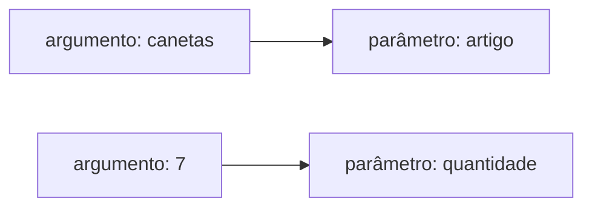
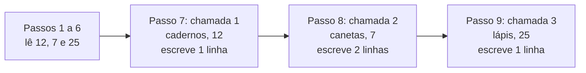

# Testar, depurar e melhorar

Neste guia, testas os teus algoritmos com casos escolhidos antes de os executar e, quando um caso falha, encontras a causa com um método. Contas os passos para comparar duas versões de um algoritmo e escreves as primeiras funções.

Usa a tabela de casos esperados do tema 03 e a tabela de iterações e os padrões do tema 04. Rever: [Fronteiras e casos de teste](03-decisoes-e-validacao.md#fronteiras-e-casos-de-teste), [A árvore de casos e a tabela de casos esperados](03-decisoes-e-validacao.md#a-árvore-de-casos-e-a-tabela-de-casos-esperados), [A tabela de iterações](04-repeticao-e-padroes.md#a-tabela-de-iterações) e [Padrão sentinela](04-repeticao-e-padroes.md#padrão-sentinela). Para praticar: [ficha de exercícios](exercicios/05-testar-depurar-e-melhorar-exercicios.md) e os projetos guiados [Duelo de dados](projetos-guiados/05-projeto-1-duelo-de-dados.md) e [Adivinha o número](projetos-guiados/05-projeto-2-adivinha-o-numero.md).

## Neste guia

1. [Um algoritmo que parece certo ainda não está provado](#um-algoritmo-que-parece-certo-ainda-não-está-provado)
2. [Testar é comparar o obtido com o esperado](#testar-é-comparar-o-obtido-com-o-esperado)
3. [O resultado esperado decide-se antes de executar](#o-resultado-esperado-decide-se-antes-de-executar)
4. [Casos normais, de fronteira e inválidos](#casos-normais-de-fronteira-e-inválidos)
5. [Duas maneiras de escolher casos](#duas-maneiras-de-escolher-casos)
6. [A tabela de casos esperados](#a-tabela-de-casos-esperados)
7. [Depurar com método](#depurar-com-método)
8. [Quatro erros que vais encontrar muitas vezes](#quatro-erros-que-vais-encontrar-muitas-vezes)
9. [Corrigir a causa e não o sintoma](#corrigir-a-causa-e-não-o-sintoma)
10. [Contar passos](#contar-passos)
11. [Melhorar um algoritmo sem mudar o que ele faz](#melhorar-um-algoritmo-sem-mudar-o-que-ele-faz)
12. [Funções: dar nome a uma parte do algoritmo](#funções-dar-nome-a-uma-parte-do-algoritmo)
13. [Escrever uma função](#escrever-uma-função)
14. [Chamar uma função](#chamar-uma-função)
15. [Parâmetros e argumentos](#parâmetros-e-argumentos)
16. [O que acontece numa chamada](#o-que-acontece-numa-chamada)
17. [O trace de uma chamada](#o-trace-de-uma-chamada)
18. [As variáveis da função são da função](#as-variáveis-da-função-são-da-função)
19. [Testar uma função sozinha](#testar-uma-função-sozinha)
20. [Trocar uma repetição por uma função](#trocar-uma-repetição-por-uma-função)
21. [Exemplo guiado: o inventário da papelaria](#exemplo-guiado-o-inventário-da-papelaria)

## Um algoritmo que parece certo ainda não está provado

Quando escreves um algoritmo, tens na cabeça um caso concreto, como uma encomenda de 30 cadernos. Fazes o trace com esse caso, o resultado bate certo, e apetece dar o trabalho por acabado.

Esse trace só prova que o algoritmo funciona para aquele caso. No guia 03, a classificação com `nota > LIMIAR_POSITIVA` acertava no 9 e no 11 e errava no 10. Rever: [Limiar sem o igual](03-decisoes-e-validacao.md#limiar-sem-o-igual).

Um algoritmo assim executa até ao fim e escreve uma resposta, sem nenhum aviso. Num **erro de lógica**, o algoritmo faz o que está escrito, mas o que está escrito não é o que se queria.

Para apanhar estes erros, testa-se o algoritmo com casos escolhidos de propósito. Quando um caso falha, procura-se a causa e corrige-se. A isto chama-se **depurar**.

## Testar é comparar o obtido com o esperado

No guia 02, um caso de teste era uma entrada com o resultado calculado à mão, antes de executar o algoritmo. Rever: [O contrato](02-pseudocodigo.md#o-contrato). Esse resultado é o **resultado esperado**: o que o algoritmo deve dar com aquela entrada, segundo o contrato. O que o algoritmo dá quando o executas é o **resultado obtido**.

Testar é executar o algoritmo com a entrada de um caso e comparar o obtido com o esperado. Se forem iguais, o teste passou. Se forem diferentes, há um erro num de dois sítios: no algoritmo, ou no resultado esperado, se te enganaste a calculá-lo.

O pseudocódigo não corre num computador, e por isso executar um algoritmo é fazer o trace à mão. Um teste que falha é útil: mostra o erro no papel, antes de ele chegar a uma loja a sério.

## O resultado esperado decide-se antes de executar

O resultado esperado escreve-se antes de executar, a partir do enunciado, como na tabela de casos esperados do guia 03. Rever: [A árvore de casos e a tabela de casos esperados](03-decisoes-e-validacao.md#a-árvore-de-casos-e-a-tabela-de-casos-esperados). Um resultado copiado do algoritmo concorda sempre com o obtido, mesmo quando os dois estão errados.

Às vezes, o enunciado não diz o resultado de um caso, como o de um stock que fica exatamente no limite. É uma ambiguidade, como as do guia 01. Rever: [Instruções ambíguas](01-do-problema-ao-algoritmo.md#instruções-ambíguas). Decide-se, escreve-se a decisão no contrato, e só depois se escreve o resultado esperado.

## Casos normais, de fronteira e inválidos

Os casos de teste são de três tipos, e cada tipo apanha erros diferentes. Os casos normais e os de fronteira vêm do guia 01, e um **caso inválido** é uma entrada que o contrato não aceita:

| Tipo | O que é | Exemplo | Que erro apanha |
| --- | --- | --- | --- |
| Normal | A entrada típica, em que pensaste ao escrever o algoritmo | Uma venda de 5 cadernos numa loja com 20 | Quase nenhum: se há um erro, raramente é ele que o mostra |
| De fronteira | O próprio limite e os valores logo abaixo e logo acima | Para o limite 10, o 9, o 10 e o 11 | Um `<` no lugar de um `<=`, que só se nota no limite |
| Inválido | Uma entrada que o contrato não aceita | Uma quantidade negativa | Uma validação que falta ou está no sítio errado |

Com um caso inválido, o algoritmo tem de fazer o que o contrato diz: escrever uma mensagem, ignorá-lo ou voltar a pedi-lo. A validação também tem um limite. Se as quantidades válidas começam em 1, testa-se com o 0, o 1 e o 2.

Num ciclo, juntam-se três casos: o caso de zero voltas, um caso com uma iteração e um com várias. Rever: [O ciclo que nunca começa](04-repeticao-e-padroes.md#o-ciclo-que-nunca-começa). Com zero voltas, só se executa o que está antes e depois do ciclo. Por isso, este caso apanha uma variável que só recebe valor lá dentro. O caso com várias iterações apanha o que só corre mal quando uma iteração usa o que a anterior deixou.

## Duas maneiras de escolher casos

Há duas perguntas para escolher os casos, e fazem-se as duas, por esta ordem:

| Antes de haver algoritmo | Com o algoritmo escrito |
| --- | --- |
| Olha-se só para o contrato: que entradas permite, onde estão os limites, que entradas são inválidas? | Olha-se para o algoritmo: há algum ramo de um `Se` por onde nenhum caso passa? Há algum ciclo sem o caso de zero voltas? |
| Como ainda não há algoritmo, não herdas os esquecimentos de quem o escreveu | Um ramo que nenhum caso executou não tem nenhuma prova de estar certo |

Quando a segunda pergunta encontra um ramo sem caso, acrescenta-se um caso que passe por ele.

## A tabela de casos esperados

No guia 03, a tabela tinha, em cada linha, uma entrada de teste, o resultado esperado e a razão da escolha. Aqui ganha uma coluna com o tipo de caso, que mostra de relance se falta algum tipo. Depois de executar, acrescentam-se mais duas: o resultado obtido e se o teste passou.

Uma loja dá desconto nas encomendas de 10 ou mais unidades. Uma encomenda tem de ter pelo menos 1 unidade, e com menos o algoritmo escreve "Quantidade inválida". Antes de haver algoritmo, a tabela fica assim:

| N.º | Tipo | Quantidade | Resultado esperado | Porque foi escolhido |
| ---: | --- | ---: | --- | --- |
| 1 | normal | 25 | Tem desconto | Encomenda grande típica |
| 2 | fronteira | 9 | Sem desconto | Logo abaixo do limite 10 |
| 3 | fronteira | 10 | Tem desconto | O limite 10, que o enunciado diz ter desconto |
| 4 | fronteira | 11 | Tem desconto | Logo acima do limite 10 |
| 5 | inválido | 0 | Quantidade inválida | Logo abaixo do limite 1 |
| 6 | fronteira | 1 | Sem desconto | O limite 1, a primeira quantidade válida |
| 7 | fronteira | 2 | Sem desconto | Logo acima do limite 1 |
| 8 | inválido | -4 | Quantidade inválida | Um engano típico a escrever |

Cada limite, o 10 e o 1, tem os seus três casos.

## Depurar com método

Quando um teste falha, sabes que há um erro, mas não sabes onde. Mudar uma linha ao acaso e ver se passa às vezes resulta, mas por sorte, e muitas vezes troca um erro por outro. Depura-se em cinco passos, sempre pela mesma ordem:

1. Observar e reproduzir o erro. Escreve o caso que falhou, o resultado esperado e o obtido, e diz que saída está errada. Depois procura o **caso mínimo**, o caso mais pequeno que ainda mostra o mesmo erro. Se o erro aparece com três vendas, experimenta com uma, porque um caso mais pequeno dá um trace mais curto.
2. Formular uma hipótese, uma explicação possível para o erro, numa frase que os valores podem confirmar ou desmentir. "O contador volta a zero em cada iteração" é uma hipótese. "Está tudo mal" não é, porque não diz onde procurar.
3. Verificar a hipótese com o trace. Faz o trace do caso mínimo e procura a primeira linha onde uma variável fica com um valor que não devia ter. Se a hipótese cair, já sabes onde o erro não está, e formulas outra com o que o trace mostrou.
4. Corrigir a causa. Muda a instrução que produz o erro, uma de cada vez. Se mudares três linhas e o teste passar, não sabes qual era o erro, nem se as outras duas estragaram outra coisa.
5. Voltar a testar tudo. Executa outra vez a tabela inteira, e não só o caso que falhou.

O quinto passo chama-se **teste de regressão**. Regredir é andar para trás, e o teste confirma que a correção não fez o algoritmo voltar atrás em nada do que já fazia bem.

<details>
<summary>Para ires mais longe: porque se diz bug</summary>

Em inglês, um erro num programa chama-se *bug*, que quer dizer inseto. A palavra já se usava em engenharia no século XIX, e ficou famosa em 1947, na Universidade de Harvard. Os operadores de um dos primeiros computadores encontraram uma traça presa numa das peças da máquina e colaram-na no livro de registo. Encontrar e corrigir erros diz-se, por isso, *debugging*.

</details>

## Quatro erros que vais encontrar muitas vezes

Há quatro erros que aparecem vezes sem conta nos algoritmos com decisões e ciclos, e cada um tem um nome. Com o nome, a hipótese formula-se depressa. Estes três apareceram nos guias 03 e 04:

| Erro | O que se vê | A causa | O caso que o mostra | Rever |
| --- | --- | --- | --- | --- |
| Fronteira mal posta | O limite recebe a resposta do lado errado: no desconto, 10 unidades ficam sem desconto | Uma comparação sem o igual, ou com o igual a mais, como `>` onde devia estar `>=` | O próprio limite | [Limiar sem o igual](03-decisoes-e-validacao.md#limiar-sem-o-igual) |
| Atualização esquecida | Se a variável está na condição do ciclo, o ciclo nunca acaba; se não está, fica parada num valor antigo | Falta a instrução que muda a variável, como a leitura do fim do corpo | Um caso com pelo menos uma iteração; o de zero voltas não o mostra | [O ciclo que nunca acaba](04-repeticao-e-padroes.md#o-ciclo-que-nunca-acaba) |
| Inicialização no sítio errado | O contador ou o totalizador fica só com o valor da última iteração | A linha que o põe a zero está dentro do ciclo, e repete-se em cada iteração | Um caso com várias iterações; com zero voltas, a variável fica sem valor | [Padrão totalizador](04-repeticao-e-padroes.md#padrão-totalizador) |

### Ramo em falta

Um **ramo em falta** é uma situação que o enunciado prevê e para a qual o algoritmo não tem caminho. Neste exemplo, as encomendas de 3000 cêntimos ou mais não pagam portes, e as outras pagam 400:

```text
const LIMITE_GRATIS = 3000
const PORTES = 400
Escreve: "Valor da encomenda em cêntimos? "
int valorEncomenda = ler valor
Se valorEncomenda >= LIMITE_GRATIS
    int portes = 0
int total = valorEncomenda + portes
Escreve: "Total a pagar em cêntimos: ", total
```

Com 3500 cêntimos, o total é 3500, e o teste passa. Com 1200, a condição é falsa, e `portes` chega à conta do total sem valor. Falta o ramo `Senão`, para a encomenda mais frequente de todas, a pequena:

```text
const LIMITE_GRATIS = 3000
const PORTES = 400
Escreve: "Valor da encomenda em cêntimos? "
int valorEncomenda = ler valor
int portes = 0
Se valorEncomenda >= LIMITE_GRATIS
    portes = 0
Senão
    portes = PORTES
int total = valorEncomenda + portes
Escreve: "Total a pagar em cêntimos: ", total
```

A linha `int portes = 0`, antes do `Se`, fica num sítio por onde passam todos os caminhos. Por isso, `portes` existe sempre que se chega ao total. Depois, cada ramo dá-lhe o valor do seu caso. Com 1200 cêntimos, o total passa a 1600, e com 3000, o próprio limite, é 3000.

Um ramo em falta também pode ser uma validação que não existe. A entrada inválida segue então por um caminho que não era o dela.

## Corrigir a causa e não o sintoma

Quando um teste falha, o que vês é o **sintoma**: o sítio onde o erro aparece, quase sempre uma saída errada. A **causa** é a instrução que produz o erro.

A tentação é emendar o algoritmo onde o número aparece, com uma conta no fim que o acerte. O caso que falhou passa a dar certo, e a causa fica onde estava, pronta a aparecer noutro caso.

Antes de corrigir, pergunta: esta alteração explica porque é que o valor ficou errado, ou só o acerta no fim? Se só o acerta no fim, é uma correção do sintoma.

## Contar passos

Duas versões de um algoritmo podem dar os mesmos resultados com mais ou menos trabalho. Para as comparar, contam-se os **passos** de cada uma, sempre com a mesma regra:

- conta um passo cada `Escreve:` e cada atribuição executada, também as leituras e as linhas onde uma variável nasce com valor, como `int total = 0`;
- conta também um passo cada vez que se avalia a condição de um `Se`, de um `Senão se` ou de um `Enquanto`;
- a última avaliação do `Enquanto`, a que dá falso, também conta;
- as linhas `const` e o `Senão` não contam, porque não fazem trabalho durante a execução, e também não têm linha no trace.

Assim, os passos são as linhas de um trace linha a linha, sem a linha "antes de começar". Num algoritmo com um ciclo, conta-se por partes: antes do ciclo, cada tipo de iteração, a última avaliação da condição e depois do ciclo. Multiplica-se cada tipo de iteração pelas vezes que acontece, e soma-se. As contagens usam o `Enquanto`, porque o `Para` faz o teste e a atualização sem linhas próprias.

No guia 02, as caixas completas calculavam-se com `div` e `resto`. Rever: [`div` e `resto`](02-pseudocodigo.md#div-e-resto). Quem não conhecesse estes operadores podia tirar 12 unidades de cada vez, enquanto houvesse pelo menos 12:

```text
const UNIDADES_POR_CAIXA = 12
Escreve: "Quantas unidades? "
int unidades = ler valor
int caixas = 0
int soltas = unidades
Enquanto soltas >= UNIDADES_POR_CAIXA
    caixas = caixas + 1
    soltas = soltas - UNIDADES_POR_CAIXA
Escreve: "Caixas completas: ", caixas
Escreve: "Unidades soltas: ", soltas
```

A versão com as contas:

```text
const UNIDADES_POR_CAIXA = 12
Escreve: "Quantas unidades? "
int unidades = ler valor
int caixas = unidades div UNIDADES_POR_CAIXA
int soltas = unidades resto UNIDADES_POR_CAIXA
Escreve: "Caixas completas: ", caixas
Escreve: "Unidades soltas: ", soltas
```

Com 30 unidades, a versão com o ciclo faz 4 passos antes do ciclo e 3 em cada uma das 2 iterações. Faz ainda 1 na última avaliação e 2 depois do ciclo: 4 + 2 × 3 + 1 + 2 = 13. A versão com as contas faz sempre 6.

| Unidades | Caixas | Soltas | Passos com o ciclo | Passos com as contas |
| ---: | ---: | ---: | ---: | ---: |
| 0 | 0 | 0 | 7 | 6 |
| 11 | 0 | 11 | 7 | 6 |
| 12 | 1 | 0 | 10 | 6 |
| 30 | 2 | 6 | 13 | 6 |
| 120 | 10 | 0 | 37 | 6 |
| 1200 | 100 | 0 | 307 | 6 |

A versão com o ciclo gasta 3 passos por cada caixa completa, e por isso trabalha mais quanto maior for a encomenda. A versão com as contas faz 6 passos com 12 unidades ou com 12 mil.

## Melhorar um algoritmo sem mudar o que ele faz

Trocar o ciclo das caixas pelas contas é uma melhoria: o algoritmo faz o mesmo com menos passos. A regra de uma melhoria é que o algoritmo novo faz exatamente o mesmo que o antigo. Dois algoritmos são **equivalentes** quando, para todas as entradas que o contrato aceita, escrevem exatamente o mesmo no ecrã.

A equivalência mostra-se pelos testes e por uma explicação, e são precisos os dois. Na tabela das caixas, as colunas "Caixas" e "Soltas" valem para as duas versões em todos os casos. A explicação diz porque é que vai ser sempre assim. Tirar 12 de cada vez e contar quantas vezes se tirou é a definição de `div`, e o que sobra é o `resto`. Os testes só cobrem os casos testados, e a explicação cobre os outros.

Uma "melhoria" que muda um resultado é um erro novo. Por isso, só se melhora um algoritmo que já passa em todos os testes, e depois da melhoria volta-se a executar a tabela inteira.

Há três maneiras simples de fazer menos passos. A primeira é trocar um ciclo por uma conta, como nas caixas. A segunda é fazer uma só vez, depois do ciclo, uma conta que dava sempre o mesmo resultado no fim. A terceira é não voltar a perguntar o que já se sabe, com a regra da cadeia do guia 03. Rever: [Seleção encadeada](03-decisoes-e-validacao.md#seleção-encadeada).

Uma melhoria também deixa menos sítios onde errar. Uma linha que deixa de existir já não pode ter um erro, nem ser esquecida numa correção.

## Funções: dar nome a uma parte do algoritmo

Ao fim do dia, a papelaria da escola faz a lista do stock de três artigos: cadernos, canetas e lápis. Para cada artigo, escreve a quantidade que ficou e, se ficarem menos de 10 unidades, pede a encomenda:

```text
const STOCK_MINIMO = 10
Escreve: "Cadernos em stock? "
int cadernos = ler valor
Escreve: "Canetas em stock? "
int canetas = ler valor
Escreve: "Lápis em stock? "
int lapis = ler valor
Escreve: "Stock de cadernos: ", cadernos
Se cadernos < STOCK_MINIMO
    Escreve: "Encomendar cadernos"
Escreve: "Stock de canetas: ", canetas
Se canetas < STOCK_MINIMO
    Escreve: "Encomendar canetas"
Escreve: "Stock de lápis: ", lapis
Se lapis < STOCK_MINIMO
    Escreve: "Encomendar lápis"
```

Com 12 cadernos, 7 canetas e 25 lápis, o algoritmo escreve o stock dos três e pede só as canetas. Está certo, mas as últimas nove linhas são três blocos que fazem o mesmo trabalho. De um bloco para o outro, mudam só o nome do artigo e a variável com a quantidade.

Um bloco repetido copia também os erros: uma fronteira mal posta no primeiro bloco ficava em três sítios. E uma mudança, como passar a mensagem a "Encomendar já", faz-se três vezes. Esquecer uma é um erro novo, que só aparece num dos artigos.

A saída é escrever o bloco uma só vez, dar-lhe um nome e usá-lo três vezes. Uma **função** é um bloco de instruções com nome, escrito uma vez e usado sempre que for preciso. Num livro de receitas, o molho de tomate está numa página. As receitas da massa e da pizza dizem só "junta o molho da página 12".

## Escrever uma função

Na forma das aulas, uma função escreve-se assim:

```text
Função nome(parametro1, parametro2)
    instruções da função
```

A primeira linha é o **cabeçalho**. Tem a palavra `Função`, com maiúscula, como `Se` e `Enquanto`, o nome da função e, entre parênteses, os **parâmetros**, separados por vírgulas. Os parâmetros são os nomes que a função dá aos valores que vai receber, e escrevem-se sem tipo.

Por baixo do cabeçalho, quatro espaços para dentro, fica o corpo da função, como o corpo de um ciclo. Nenhuma palavra fecha a função: a primeira linha que volta à margem já não lhe pertence.

A função mais simples não recebe nada, e os parênteses escrevem-se vazios:

```text
Função escreveCabecalho()
    Escreve: "Papelaria da escola"
    Escreve: "Stock ao fim do dia"
```

O nome segue as regras dos nomes das variáveis e diz o que a função faz, de preferência com um verbo, como `escreveCabecalho` ou `mostraStock`. Num algoritmo com funções, as constantes vêm primeiro, depois as funções e, no fim, a parte que as usa.

## Chamar uma função

Escrever uma função não a executa. A função fica à espera, como a receita do molho no livro. Para a executar, é preciso **chamar** a função: escrever o seu nome, com os parênteses, numa linha. A parte do algoritmo que faz as chamadas é o **algoritmo principal**, e começa na primeira linha encostada à margem depois da última função. Prevê o que aparece no ecrã, e por que ordem:

```text
Função escreveCabecalho()
    Escreve: "Papelaria da escola"
    Escreve: "Stock ao fim do dia"

escreveCabecalho()
Escreve: "Fim da lista"
```

As três primeiras linhas só definem a função, e por isso a primeira instrução executada é a chamada. O algoritmo entra na função e escreve "Papelaria da escola" e "Stock ao fim do dia". Depois volta à linha a seguir à chamada, que escreve "Fim da lista". Com duas chamadas, o ecrã ficava com cinco linhas, e sem nenhuma, só com "Fim da lista".

As funções predefinidas do guia 02, como `arredondar`, devolvem um valor, que se usa numa conta ou se guarda numa variável. As funções deste guia não devolvem nada: fazem um trabalho, que aqui é escrever no ecrã. Por isso, a chamada fica sozinha numa linha, e não do lado direito de um `=`.

## Parâmetros e argumentos

A função `escreveCabecalho` faz sempre o mesmo. A do stock faz o mesmo trabalho com valores diferentes: primeiro os cadernos, depois as canetas, depois os lápis. É para isso que servem os parâmetros:

```text
const STOCK_MINIMO = 10

Função mostraStock(artigo, quantidade)
    Escreve: "Stock de ", artigo, ": ", quantidade
    Se quantidade < STOCK_MINIMO
        Escreve: "Encomendar ", artigo
```

O corpo é um dos blocos repetidos, com o parâmetro `artigo` onde estava o nome do artigo e o parâmetro `quantidade` onde estava a variável. É sempre assim que se escolhem os parâmetros. Comparam-se os blocos linha a linha. O que muda de um para o outro passa a parâmetro, e o que é igual fica dentro da função.

Numa chamada, dá-se um valor a cada parâmetro, como em `mostraStock("canetas", 7)`. Os valores de uma chamada são os argumentos. É a palavra que o guia 02 usou para o valor de uma função predefinida, como o 2.5 em `arredondar(2.5)`. Rever: [Funções predefinidas](02-pseudocodigo.md#funções-predefinidas).



O parâmetro é o nome que está no cabeçalho, e escreve-se uma vez. O argumento é o valor que esse nome recebe numa chamada, e muda de chamada para chamada. Um argumento pode ser uma variável do algoritmo principal: em `mostraStock("canetas", canetas)`, o parâmetro `quantidade` recebe o valor que `canetas` tiver nesse momento.

## O que acontece numa chamada

Uma chamada executa-se em três fases, por esta ordem:

1. Os argumentos passam para os parâmetros pela ordem, e não pelo nome. O primeiro argumento vai para o primeiro parâmetro, e o segundo para o segundo.
2. O algoritmo entra na função e executa o corpo, de cima para baixo. Um `Se` ou um ciclo lá dentro funcionam como sempre.
3. Quando o corpo acaba, o algoritmo volta ao principal e continua na linha a seguir à chamada.

Nada passa de uma chamada para a seguinte. Na chamada seguinte, os parâmetros recebem valores novos.

Por causa da primeira fase, trocar os argumentos muda o resultado, sem nenhum aviso. Esta função escreve as caixas completas e as unidades soltas de uma encomenda:

```text
Função escreveCaixas(unidades, unidadesPorCaixa)
    int completas = unidades div unidadesPorCaixa
    int soltas = unidades resto unidadesPorCaixa
    Escreve: "Caixas completas: ", completas
    Escreve: "Unidades soltas: ", soltas
```

A chamada `escreveCaixas(30, 12)` escreve 2 caixas completas e 6 unidades soltas. A chamada `escreveCaixas(12, 30)` põe 12 em `unidades` e 30 em `unidadesPorCaixa`, e escreve 0 caixas completas e 12 unidades soltas. Quando um resultado não faz sentido, como 0 caixas numa encomenda grande, compara a chamada com o cabeçalho, argumento a argumento.

## O trace de uma chamada

Com a função, o algoritmo do stock fica assim:

```text
const STOCK_MINIMO = 10

Função mostraStock(artigo, quantidade)
    Escreve: "Stock de ", artigo, ": ", quantidade
    Se quantidade < STOCK_MINIMO
        Escreve: "Encomendar ", artigo

Escreve: "Cadernos em stock? "
int cadernos = ler valor
Escreve: "Canetas em stock? "
int canetas = ler valor
Escreve: "Lápis em stock? "
int lapis = ler valor
mostraStock("cadernos", cadernos)
mostraStock("canetas", canetas)
mostraStock("lápis", lapis)
```

Os textos `"cadernos"`, `"canetas"` e `"lápis"` vão entre aspas, porque são o que aparece no ecrã. As variáveis `cadernos`, `canetas` e `lapis` vão sem aspas, porque o que interessa é o valor delas.

A linha `const` e as linhas da função não fazem nada até haver uma chamada. Com 12 cadernos, 7 canetas e 25 lápis, a execução segue esta ordem:



Os passos 1 a 6 são as três perguntas e as três leituras. Cada chamada é um passo do principal, e no trace tem uma tabela própria, com os parâmetros. A chamada 2:

| Passo | Instrução executada | artigo | quantidade | Condição e resultado | Ecrã |
| ---: | --- | --- | ---: | --- | --- |
| 0 | os argumentos passam para os parâmetros | canetas | 7 | nenhuma | nada |
| 1 | `Escreve: "Stock de ", artigo, ": ", quantidade` | canetas | 7 | nenhuma | Stock de canetas: 7 |
| 2 | `Se quantidade < STOCK_MINIMO` | canetas | 7 | `7 < 10` dá `true` | nada |
| 3 | `Escreve: "Encomendar ", artigo` | canetas | 7 | nenhuma | Encomendar canetas |

Na linha 0, os parâmetros já têm os argumentos, porque a primeira fase acontece antes da primeira linha do corpo. Depois do passo 3, o corpo acabou, e o algoritmo continua no passo 9 do principal. Na chamada 1, `quantidade` recebe 12, `12 < 10` dá `false`, e a chamada escreve uma só linha.

## As variáveis da função são da função

Os parâmetros e as variáveis que nascem dentro de uma função só existem enquanto a chamada dura. Chamam-se **variáveis locais** da função. Por isso, a tabela da chamada não tem as colunas `cadernos`, `canetas` e `lapis`.

Uma variável com o mesmo nome dentro e fora da função são duas variáveis diferentes, e mexer numa não mexe na outra. Com a função `escreveCaixas` da secção anterior, prevê o número da última linha do ecrã:

```text
int completas = 5
escreveCaixas(30, 12)
Escreve: "Caixas completas no armazém: ", completas
```

O ecrã fica assim:

```text
Caixas completas: 2
Unidades soltas: 6
Caixas completas no armazém: 5
```

Dentro da chamada, a `completas` da função nasce com `30 div 12`, que dá 2, e desaparece quando a chamada acaba. A última linha escreve a `completas` do algoritmo principal, que nunca deixou de valer 5.

Daqui sai uma regra das aulas. Dentro de uma função só existem os seus parâmetros, as suas variáveis locais e as constantes, que valem em todo o algoritmo. Tudo o resto, a função recebe-o pelos parâmetros.

O engano mais comum é escrever `cadernos` em vez de `quantidade` no corpo de `mostraStock`, porque a função nasceu do bloco dos cadernos. Dentro da chamada não existe nenhuma variável `cadernos`, e o algoritmo para nessa linha, logo na primeira chamada.

## Testar uma função sozinha

Uma função tem um contrato próprio, mais pequeno do que o do problema, escrito em três linhas ao lado dela. O de `mostraStock` é este:

- recebe: o nome do artigo, um texto, e a quantidade em stock, um inteiro igual ou maior do que zero, por esta ordem;
- escreve: uma linha com o stock e, se a quantidade for menor do que `STOCK_MINIMO`, uma segunda linha a pedir a encomenda;
- exemplo: `mostraStock("canetas", 7)` escreve "Stock de canetas: 7" e "Encomendar canetas".

Com o contrato, a função testa-se antes de se juntar ao resto, com uma tabela de casos esperados escrita antes de executar. As entradas são os argumentos, e o resultado esperado é o que a função escreve:

| N.º | Tipo | Argumentos | Ecrã esperado | Porque foi escolhido |
| ---: | --- | --- | --- | --- |
| 1 | normal | `"cadernos"`, 25 | Stock de cadernos: 25 | Um artigo com stock folgado |
| 2 | fronteira | `"canetas"`, 10 | Stock de canetas: 10 | O limite, que não está abaixo de 10 |
| 3 | fronteira | `"canetas"`, 9 | Stock de canetas: 9<br>Encomendar canetas | Logo abaixo do limite |
| 4 | fronteira | `"lápis"`, 0 | Stock de lápis: 0<br>Encomendar lápis | Um artigo esgotado, a menor quantidade que o contrato aceita |

Para executar um caso, basta um algoritmo principal de uma linha, só com a chamada, como `mostraStock("canetas", 10)`, e o trace dessa chamada.

É a decomposição do guia 01 levada até ao fim: cada parte é uma função com o seu contrato, testada com poucos casos. Se depois o algoritmo completo falhar, procura primeiro nas chamadas: nos argumentos, na ordem ou no sítio de cada uma.

## Trocar uma repetição por uma função

Passar o algoritmo do stock dos três blocos para a função é uma melhoria, e por isso as duas versões têm de ser equivalentes. Pelos testes, escrevem o mesmo ecrã. Com 12 cadernos, 7 canetas e 25 lápis, escrevem estas quatro linhas depois das três perguntas:

```text
Stock de cadernos: 12
Stock de canetas: 7
Encomendar canetas
Stock de lápis: 25
```

Com 10 cadernos, 9 canetas e 0 lápis, que estão nos limites, escrevem as mesmas cinco linhas:

```text
Stock de cadernos: 10
Stock de canetas: 9
Encomendar canetas
Stock de lápis: 0
Encomendar lápis
```

A explicação é que cada chamada executa as três linhas do bloco que substituiu, com `artigo` e `quantidade` a valerem o que estava nesse bloco. E as chamadas estão pela ordem dos blocos.

Esta melhoria não poupa passos ao algoritmo. Ganha-se outra coisa: a mensagem "Encomendar" e a condição `quantidade < STOCK_MINIMO` ficam num só sítio. Uma mudança faz-se uma vez, e a tabela de casos da função testa-as para os três artigos.

## Exemplo guiado: o inventário da papelaria

### O enunciado

> A papelaria da escola controla o stock de cadernos ao longo do dia. De manhã, a funcionária escreve quantos cadernos há na loja. Depois, a cada venda, escreve a quantidade vendida. Quando a loja fecha, escreve 0. Uma venda só é aceite se houver cadernos suficientes. Se não houver, o algoritmo escreve que a venda foi recusada e quantos cadernos restam, e o stock não muda. Uma quantidade negativa é um engano a escrever. O algoritmo escreve "Quantidade inválida" e ignora-a. Cada caderno custa 150 cêntimos. No fim do dia, o algoritmo mostra o stock final, as unidades vendidas, o valor vendido em cêntimos e o número de vendas recusadas. Se o stock final ficar abaixo de 10 cadernos, escreve também "Encomendar cadernos".

### O contrato

| Pergunta | Resposta |
| --- | --- |
| Entradas | O stock do início do dia, um inteiro igual ou maior do que zero, que vem da contagem da loja e não se valida; depois, as quantidades escritas ao longo do dia, todas inteiras |
| Saídas | Uma mensagem por cada venda recusada e por cada quantidade inválida; no fim, o stock final, as unidades vendidas, o valor vendido, as vendas recusadas e, se for caso disso, o aviso de encomenda |
| Restrições | O stock nunca fica negativo; o preço é 150 cêntimos, e o valor trabalha-se em cêntimos inteiros; o mínimo de stock é 10 |
| Condições | Uma venda aceite, uma venda recusada, uma quantidade inválida, um dia sem vendas, e o stock final abaixo do mínimo ou não |

O 0 marca o fim do dia, e por isso é a sentinela. O contrato decide as duas ambiguidades do enunciado. Uma venda igual ao stock é aceite, e deixa a loja com 0 cadernos. Um stock final de exatamente 10 não dá o aviso, porque 10 não está abaixo de 10.

### A tabela de casos esperados

A tabela escreve-se só a partir do contrato, antes de haver algoritmo:

| N.º | Tipo | Stock inicial | Quantidades escritas | Resultado esperado | Porque foi escolhido |
| ---: | --- | ---: | --- | --- | --- |
| 1 | normal | 20 | 5, 3, 0 | Stock 12, vendidas 8, valor 1200, recusadas 0, sem aviso | Um dia normal com duas vendas |
| 2 | fronteira | 20 | 20, 0 | Stock 0, vendidas 20, valor 3000, recusadas 0, aviso | Uma venda igual ao stock, que tem de ser aceite |
| 3 | fronteira | 20 | 15, 6, 0 | Mensagem de recusa com 5 cadernos; stock 5, vendidas 15, valor 2250, recusadas 1, aviso | Uma venda uma unidade acima do que resta |
| 4 | fronteira | 20 | 10, 0 | Stock 10, vendidas 10, valor 1500, recusadas 0, sem aviso | O stock final fica no limite 10 |
| 5 | fronteira | 20 | 11, 0 | Stock 9, vendidas 11, valor 1650, recusadas 0, aviso | O stock final fica logo abaixo do limite 10 |
| 6 | inválido | 20 | -3, 4, 0 | "Quantidade inválida"; stock 16, vendidas 4, valor 600, recusadas 0, sem aviso | Um engano a escrever, no meio do dia |
| 7 | fronteira | 8 | 0 | Stock 8, vendidas 0, valor 0, recusadas 0, aviso | Um dia sem vendas: o caso de zero voltas |

Na decisão de aceitar uma venda, o limite é o stock que resta. O caso 2 é a venda igual a esse limite, e o caso 3 é a venda logo acima dele. No caso 3, o stock tem de descer na primeira venda para a segunda, de 6, ficar acima dos 5 que restam.

### A primeira versão

Esta é a versão 1, escrita a pensar no caso 1:

```text
const STOCK_MINIMO = 10
const PRECO_CADERNO = 150
const SENTINELA = 0
Escreve: "Stock de cadernos no início do dia? "
int stock = ler valor
int vendidas = 0
int recusadas = 0
int valorVendido = 0
Escreve: "Quantidade vendida (0 para terminar)? "
int quantidade = ler valor
Enquanto quantidade != SENTINELA
    Se quantidade < 0
        Escreve: "Quantidade inválida"
    Senão se quantidade <= stock
        vendidas = vendidas + quantidade
        valorVendido = valorVendido + quantidade * PRECO_CADERNO
    Senão
        Escreve: "Venda recusada: só há ", stock, " cadernos"
        recusadas = recusadas + 1
    Escreve: "Quantidade vendida (0 para terminar)? "
    quantidade = ler valor
Escreve: "Stock final: ", stock
Escreve: "Unidades vendidas: ", vendidas
Escreve: "Valor vendido em cêntimos: ", valorVendido
Escreve: "Vendas recusadas: ", recusadas
Se stock < STOCK_MINIMO
    Escreve: "Encomendar cadernos"
```

Dentro do ciclo, a cadeia põe a validação em primeiro lugar. A pergunta e a leitura do fim do corpo estão alinhadas com o `Se`, a quatro espaços, e não a oito. Fazem-se em todas as iterações, qualquer que seja o ramo.

O algoritmo tem um erro. Antes de leres os testes, olha para o ramo da venda aceite: que variável devia mudar numa venda aceite, e muda?

### Testar a primeira versão

Os sete casos, executados na versão 1:

| N.º | Resultado obtido | Passou? |
| ---: | --- | --- |
| 1 | Stock 20, vendidas 8, valor 1200, recusadas 0, sem aviso | Não |
| 2 | Stock 20, vendidas 20, valor 3000, recusadas 0, sem aviso | Não |
| 3 | Sem recusa; stock 20, vendidas 21, valor 3150, recusadas 0, sem aviso | Não |
| 4 | Stock 20, vendidas 10, valor 1500, recusadas 0, sem aviso | Não |
| 5 | Stock 20, vendidas 11, valor 1650, recusadas 0, sem aviso | Não |
| 6 | "Quantidade inválida"; stock 20, vendidas 4, valor 600, recusadas 0, sem aviso | Não |
| 7 | Stock 8, vendidas 0, valor 0, recusadas 0, aviso | Sim |

O padrão das falhas já diz muito. Em todos os casos que falham, o stock final é o do início do dia, como se nada se tivesse vendido. As unidades vendidas e o valor estão certos nos casos 1, 2, 4, 5 e 6. E o único caso que passa é o de zero voltas. Tudo aponta para dentro do ciclo.

### Depurar com o método

Observar e reproduzir. O caso 1 falha no stock final: esperado 12, obtido 20. O caso mínimo é stock 20, uma só venda de 5, e depois 0. O esperado é stock 15, e a versão 1 escreve 20.

Formular uma hipótese. O stock pode não ter mudado porque a venda foi recusada, ou porque foi aceite e o stock não desceu. A primeira cai logo, porque as unidades vendidas são 5 e não apareceu nenhuma recusa. Fica a segunda: o stock não diminui quando uma venda é aceite.

Verificar com o trace. A tabela de iterações do caso mínimo:

| Teste | quantidade | stock | vendidas | recusadas | valorVendido | Condição | Durante a iteração |
| --- | ---: | ---: | ---: | ---: | ---: | --- | --- |
| 1.º | 5 | 20 | 0 | 0 | 0 | `5 != 0` dá `true` | `5 < 0` dá `false`; `5 <= 20` dá `true`: `vendidas` passa a 5 e `valorVendido` a 750; lê 0 |
| 2.º | 0 | 20 | 5 | 0 | 750 | `0 != 0` dá `false` | o ciclo termina |

O stock vale 20 nas duas linhas. Na venda aceite, só mudam `vendidas` e `valorVendido`, e nenhuma instrução tira ao stock os cadernos vendidos. A hipótese está confirmada.

É uma atualização esquecida. O `stock` não está na condição do ciclo, e por isso o ciclo termina normalmente, com o stock parado no valor da manhã.

### A correção da causa e a do sintoma

A causa está no ramo da venda aceite. A correção é acrescentar lá, com oito espaços, a instrução que falta:

```text
        stock = stock - quantidade
```

Há uma correção que parece mais fácil. O sintoma é o stock final errado, e para o acertar bastava escrever `stock = stock - vendidas` depois do ciclo, antes do primeiro `Escreve:` do fim. No caso mínimo dá 20 menos 5, que é 15, e o teste passa.

Com a tabela inteira, esta correção do sintoma passa nos casos 1, 2, 4, 5, 6 e 7, e falha no caso 3:

| Caso 3 | Stock final | Vendidas | Valor | Recusadas | Mensagem durante o dia | Aviso |
| --- | ---: | ---: | ---: | ---: | --- | --- |
| Esperado | 5 | 15 | 2250 | 1 | Venda recusada: só há 5 cadernos | Sim |
| Obtido com a correção do sintoma | -1 | 21 | 3150 | 0 | nenhuma | Sim |

O stock não serve só para se escrever no fim. A condição `quantidade <= stock` usa-o dentro do ciclo, para decidir cada venda. Com a correção do sintoma, essa decisão continua a usar o stock da manhã. A venda de 6 é aceite sem haver cadernos para ela. Sem o caso 3 na tabela, escrito antes de haver algoritmo, a correção do sintoma passava em todos os testes.

### A versão corrigida e o teste de regressão

A versão 2 é a versão 1 com a linha `stock = stock - quantidade` no ramo da venda aceite. A linha não leva `int`, porque o `stock` já nasceu na leitura do início do dia. O teste de regressão executa a tabela inteira outra vez, e os sete casos dão o resultado esperado. No caso 3:

| Teste | quantidade | stock | vendidas | recusadas | valorVendido | Condição | Durante a iteração |
| --- | ---: | ---: | ---: | ---: | ---: | --- | --- |
| 1.º | 15 | 20 | 0 | 0 | 0 | `15 != 0` dá `true` | `15 <= 20` dá `true`: venda aceite, o stock passa a 5; lê 6 |
| 2.º | 6 | 5 | 15 | 0 | 2250 | `6 != 0` dá `true` | `6 <= 5` dá `false`: escreve "Venda recusada: só há 5 cadernos" e soma 1 às recusadas; lê 0 |
| 3.º | 0 | 5 | 15 | 1 | 2250 | `0 != 0` dá `false` | o ciclo termina |

Na primeira iteração, o stock desce para 5, e é esse 5 que a condição da venda usa na segunda. Depois do ciclo, o algoritmo escreve os quatro valores da última linha e, como `5 < 10` dá `true`, também "Encomendar cadernos".

### O registo de depuração

Cada depuração fica escrita num **registo de depuração**, com uma linha por passo do método. O registo, a versão com o erro e a versão corrigida vão para o portefólio. É a capa onde guardas, em papel, as folhas dos dois projetos guiados. O registo desta depuração:

| Passo do método | O que foi feito |
| --- | --- |
| Erro observado | Caso 1: stock final esperado 12, obtido 20. Caso mínimo: stock 20, venda 5, depois 0; esperado 15, obtido 20 |
| Hipótese | O stock não diminui quando uma venda é aceite |
| Verificação com o trace | Na tabela de iterações, o stock vale 20 nas duas linhas; na venda aceite só mudam `vendidas` e `valorVendido` |
| Correção | Acrescentada `stock = stock - quantidade` no ramo da venda aceite. Rejeitada a correção do sintoma `stock = stock - vendidas` no fim, porque falha o caso 3 |
| Novo teste | Os sete casos da tabela passam |

<details>
<summary>Para ires mais longe: melhorar o inventário</summary>

Na versão 2, cada venda aceite soma `quantidade * PRECO_CADERNO` ao valor vendido. Pela propriedade distributiva, 5 × 150 + 3 × 150 é o mesmo que (5 + 3) × 150. O valor vendido é sempre as unidades vendidas vezes o preço, e basta calculá-lo uma vez, depois do ciclo.

A versão 3 tira a linha `int valorVendido = 0`, de antes do ciclo, e a atualização do valor, do ramo da venda aceite. Acrescenta, depois do ciclo e antes do primeiro `Escreve:`, a linha onde o valor passa a nascer:

```text
int valorVendido = vendidas * PRECO_CADERNO
```

Antes do ciclo, `vendidas` ainda valia 0, e a conta dava sempre 0. Os sete casos escrevem, na versão 3, o mesmo ecrã que na versão 2. Os passos, contados por partes:

| N.º | Vendas aceites | Passos da versão 2 | Passos da versão 3 | Diferença |
| ---: | ---: | ---: | ---: | ---: |
| 1 | 2 | 29 | 27 | 2 |
| 2 | 1 | 22 | 21 | 1 |
| 3 | 1 | 29 | 28 | 1 |
| 4 | 1 | 21 | 20 | 1 |
| 5 | 1 | 22 | 21 | 1 |
| 6 | 1 | 26 | 25 | 1 |
| 7 | 0 | 14 | 14 | 0 |

No caso 1, a versão 2 faz 7 passos antes do ciclo e 8 em cada uma das 2 vendas. Faz ainda 1 na última avaliação e 5 depois: 29. A versão 3 faz 6 + 2 × 7 + 1 + 6 = 27. A diferença é sempre o número de vendas aceites, porque a versão 3 poupa a atualização do valor em cada uma.

</details>

## Erros frequentes

### Um argumento a menos

Cada parâmetro precisa do seu argumento. A chamada `mostraStock(cadernos)` dá um valor só ao primeiro parâmetro, `artigo`, e nenhum a `quantidade`, e a função não pode ser executada assim. Uma chamada tem tantos argumentos quantos os parâmetros do cabeçalho.

### Uma linha da função encostada à margem

É a indentação que diz que linhas pertencem à função. Aqui, o `Se` ficou encostado à margem:

```text
const STOCK_MINIMO = 10

Função mostraStock(artigo, quantidade)
    Escreve: "Stock de ", artigo, ": ", quantidade
Se quantidade < STOCK_MINIMO
    Escreve: "Encomendar ", artigo

mostraStock("canetas", 7)
```

A função ficou só com o primeiro `Escreve:`. O `Se` passou a ser a primeira instrução do algoritmo principal, executada logo no início, antes da chamada. Nesse momento não existe nenhuma variável `quantidade`, porque os parâmetros só existem dentro de uma chamada. O `Se` tem de ficar quatro espaços para dentro, como o `Escreve:` de cima, e o `Escreve:` da encomenda oito.

### `Função` escrito na chamada

A palavra `Função` escreve-se só no cabeçalho, uma vez, quando a função se define. A chamada é só o nome e os argumentos: `mostraStock("cadernos", cadernos)`, e não `Função mostraStock("cadernos", cadernos)`. Uma linha que começa por `Função` define uma função nova, e os parênteses de um cabeçalho levam nomes de parâmetros, e não valores.

## Palavras novas deste guia

- Erro de lógica: um erro em que o algoritmo faz o que está escrito, mas o que está escrito não é o que se queria.
- Depurar: encontrar a causa de um erro e corrigi-la.
- Resultado esperado: o que o algoritmo deve dar com a entrada de um caso, segundo o contrato.
- Resultado obtido: o que o algoritmo dá quando o executas com essa entrada.
- Caso inválido: uma entrada que o contrato não aceita.
- Caso mínimo: o caso mais pequeno que ainda mostra o mesmo erro.
- Teste de regressão: voltar a executar a tabela de casos inteira depois de uma correção, para confirmar que nada do que funcionava deixou de funcionar.
- Ramo em falta: uma situação que o enunciado prevê e para a qual o algoritmo não tem caminho.
- Sintoma: o sítio onde um erro aparece, quase sempre uma saída errada.
- Causa: a instrução que produz um erro.
- Passo: cada `Escreve:` e cada atribuição executados, e cada avaliação da condição de um `Se`, de um `Senão se` ou de um `Enquanto`.
- Equivalentes: dois algoritmos que, para todas as entradas que o contrato aceita, escrevem exatamente o mesmo no ecrã.
- Função: um bloco de instruções com nome, escrito uma vez e usado sempre que for preciso.
- Cabeçalho: a primeira linha de uma função, com a palavra `Função`, o nome e os parâmetros.
- Parâmetros: os nomes que a função dá aos valores que vai receber, escritos entre parênteses no cabeçalho.
- Chamar: escrever o nome de uma função, com os parênteses, numa linha, para que ela se execute.
- Algoritmo principal: a parte do algoritmo que faz as chamadas; começa na primeira linha encostada à margem depois da última função.
- Variáveis locais: os parâmetros e as variáveis que nascem dentro de uma função; só existem enquanto a chamada dura.
- Registo de depuração: o erro observado, a hipótese, o que o trace mostrou, a correção e o novo teste, uma linha por passo do método.

## O que vem a seguir

No tema seguinte, [Do algoritmo ao programa](../02-python/01-do-algoritmo-ao-programa.md), começas a programar em Python, e os teus algoritmos passam a ser executados pelo computador.


