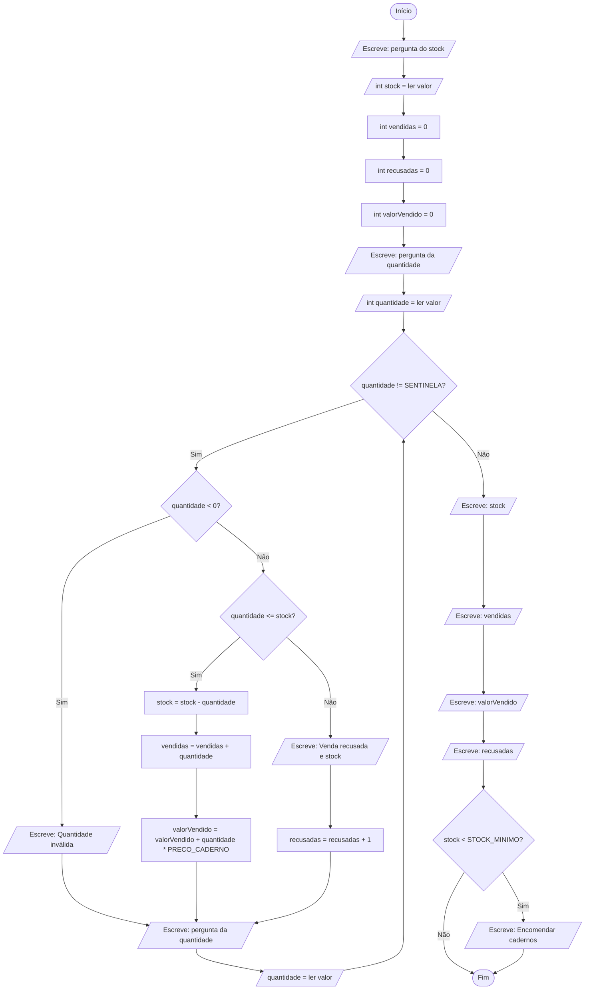

# Testar, depurar e melhorar

Módulo Desenvolver algoritmos. É o último tema do módulo. Este guia explica como confirmas que um algoritmo está certo e como encontras e corriges um erro quando ele não está. Explica também como tornas um algoritmo mais simples sem o estragar, e como escreves uma função, para dar um nome a uma parte do algoritmo. Lês o guia ao teu ritmo, e não precisas de o ler todo de uma vez. Para praticar, há a [ficha de exercícios](05-testar-depurar-e-melhorar-exercicios.md) deste tema e os dois projetos guiados, o [duelo de dados](05-projeto-1-duelo-de-dados.md) e o [adivinha o número](05-projeto-2-adivinha-o-numero.md).

Este é o último guia da unidade, e usa tudo o que aprendeste nos quatro anteriores. Traz uma só instrução nova, `Função`, numa parte própria, depois da teoria de testar, depurar e melhorar. O resto não é matéria nova de pseudocódigo. É uma forma de trabalhar com o que já sabes. Lê-o com papel e lápis ao lado, porque vais fazer muitos traces à mão.

A unidade fecha com três projetos, todos jogos, cada um mais difícil do que o anterior. Os dois primeiros fazes com o professor. Servem para treinares o caminho completo de um problema, que é o caminho deste guia. O caminho tem seis etapas: o contrato, a tabela de casos esperados antes do algoritmo, o algoritmo, os testes, a depuração e a melhoria. O terceiro projeto é a avaliação prática individual, com um problema novo, maior do que os dos projetos. Testar e depurar não têm uma aula só para eles, porque já os treinas em cada exercício. Este guia é o texto onde tudo isso está explicado. Lê-o com calma, e volta a ele sempre que um passo dos projetos te deixar com dúvidas.

## Neste guia

1. O que vais aprender
2. O que já sabes e vais usar
3. Um algoritmo que parece certo ainda não está provado
4. Testar é comparar o obtido com o esperado
5. O resultado esperado decide-se antes de executar
6. Casos normais, de fronteira e inválidos
7. Duas maneiras de escolher casos
8. A tabela de casos esperados
9. Depurar com método
10. Quatro erros que vais encontrar muitas vezes
11. Corrigir a causa e não o sintoma
12. Melhorar um algoritmo sem mudar o que ele faz
13. Contar passos
14. Uma melhoria com os passos contados: trocar um ciclo por uma conta
15. Estratégias simples para fazer menos passos
16. A síntese: sequência, seleção e repetição
17. O teu portefólio
18. Funções: dar nome a uma parte do algoritmo
19. Exemplo guiado: o inventário da papelaria
20. Erros frequentes
21. Palavras novas deste guia
22. Verificar o que aprendeste
23. O que vem a seguir
24. Para saber mais

## O que vais aprender

No fim deste guia, consegues:

- explicar porque é que o resultado esperado se escreve antes de executar, e escolher os casos de teste normais, de fronteira e inválidos;
- depurar um algoritmo com método: observar o erro, formular uma hipótese, verificá-la com o trace, corrigir a causa e voltar a testar tudo;
- reconhecer os quatro erros mais frequentes: a fronteira mal posta, a atualização esquecida, a inicialização no sítio errado e o ramo em falta;
- melhorar um algoritmo sem mudar o que ele faz, e contar os passos antes e depois da melhoria;
- justificar uma solução completa que junta sequência, seleção e repetição, e reconhecê-la num fluxograma;
- escrever uma função com parâmetros, chamá-la com argumentos, seguir a chamada no trace e trocar por ela uma parte repetida de um algoritmo.

## O que já sabes e vais usar

- O contrato de um problema, com as quatro perguntas (entradas, saídas, restrições e condições): guia [01 Do problema ao algoritmo](01-do-problema-ao-algoritmo.md).
- Os exemplos de um contrato, cada um com o resultado esperado calculado à mão: guia [01 Do problema ao algoritmo](01-do-problema-ao-algoritmo.md).
- As ambiguidades de um enunciado, que se decidem e se escrevem no contrato: guia [01 Do problema ao algoritmo](01-do-problema-ao-algoritmo.md).
- O estado, a fotografia dos valores num dado momento: guia [01 Do problema ao algoritmo](01-do-problema-ao-algoritmo.md).
- A decomposição de um problema em partes mais pequenas: guia [01 Do problema ao algoritmo](01-do-problema-ao-algoritmo.md).
- As variáveis e os tipos, com o tipo à frente na linha onde a variável nasce, como em `int total = 0`: guia [02 Pseudocódigo e fluxogramas](02-pseudocodigo-e-fluxogramas.md).
- As constantes, escritas com `const`, como em `const SENTINELA = 0`: guia [02 Pseudocódigo e fluxogramas](02-pseudocodigo-e-fluxogramas.md).
- A atribuição com `=`, a leitura com `ler valor` e a escrita no ecrã com `Escreve:`: guia [02 Pseudocódigo e fluxogramas](02-pseudocodigo-e-fluxogramas.md).
- A divisão inteira, com `div` e `resto`: guia [02 Pseudocódigo e fluxogramas](02-pseudocodigo-e-fluxogramas.md).
- As funções predefinidas `abs`, `arredondar`, `truncar` e `raiz`, e o argumento, o valor que se lhes dá entre parênteses: guia [02 Pseudocódigo e fluxogramas](02-pseudocodigo-e-fluxogramas.md).
- Os símbolos do fluxograma e a maneira de o ler: guia [02 Pseudocódigo e fluxogramas](02-pseudocodigo-e-fluxogramas.md).
- A tabela de trace, onde executas um algoritmo à mão, instrução a instrução, com uma coluna por variável: guia [02 Pseudocódigo e fluxogramas](02-pseudocodigo-e-fluxogramas.md). É a ferramenta principal deste guia.
- A forma de pseudocódigo das aulas: guia [02 Pseudocódigo e fluxogramas](02-pseudocodigo-e-fluxogramas.md).
- Um algoritmo em frases claras também vale, se não deixar dúvidas: guia [02 Pseudocódigo e fluxogramas](02-pseudocodigo-e-fluxogramas.md).
- As comparações (`==`, `!=`, `<`, `<=`, `>`, `>=`) e os operadores `e`, `ou` e `não`: guia [03 Decisões e validação](03-decisoes-e-validacao.md).
- A seleção com `Se`, `Senão se` e `Senão`, e a regra de que, numa cadeia, a primeira condição verdadeira ganha: guia [03 Decisões e validação](03-decisoes-e-validacao.md).
- A indentação, que mostra que instruções estão dentro de cada ramo: guia [03 Decisões e validação](03-decisoes-e-validacao.md).
- Um `Se` dentro do ramo de outro `Se`, que se lê pela coluna onde começa cada linha: guia [03 Decisões e validação](03-decisoes-e-validacao.md).
- Os intervalos, os limites e a validação de uma entrada antes de a usar: guia [03 Decisões e validação](03-decisoes-e-validacao.md).
- As fronteiras, testadas imediatamente abaixo, em cima e imediatamente acima de cada limite: guia [03 Decisões e validação](03-decisoes-e-validacao.md).
- A árvore de casos e a tabela de casos esperados, escrita antes do algoritmo: guia [03 Decisões e validação](03-decisoes-e-validacao.md).
- O `Enquanto` e o `Para`, na forma `Para i de 1 até n`, com o corpo indentado por baixo: guia [04 Repetição e padrões](04-repeticao-e-padroes.md).
- As três peças de um ciclo, a inicialização, a condição e a atualização: guia [04 Repetição e padrões](04-repeticao-e-padroes.md).
- A tabela de iterações, com uma linha por cada teste da condição do ciclo: guia [04 Repetição e padrões](04-repeticao-e-padroes.md).
- O caso de zero voltas, em que o ciclo não chega a dar nenhuma volta: guia [04 Repetição e padrões](04-repeticao-e-padroes.md). Neste guia chama-se, mais curto, caso zero.
- Os padrões contador e totalizador: guia [04 Repetição e padrões](04-repeticao-e-padroes.md).
- O padrão sentinela, com a leitura antecipada, a leitura no fim do corpo e a constante `SENTINELA`: guia [04 Repetição e padrões](04-repeticao-e-padroes.md).
- A validação repetida, que volta a pedir um valor enquanto ele for inválido: guia [04 Repetição e padrões](04-repeticao-e-padroes.md).
- A flag, uma variável `bool` que começa `false` e passa a `true` quando uma coisa acontece: guia [04 Repetição e padrões](04-repeticao-e-padroes.md).

Se algum destes pontos te parecer pouco firme, volta ao guia onde ele está antes de continuares. Este guia não os explica outra vez desde o princípio. Usa-os.

Uma palavra sobre a forma como os algoritmos estão escritos. Neste guia estão todos na forma de pseudocódigo que usamos nas aulas, a mesma dos guias anteriores. Essa forma é um vocabulário comum, para lermos e escrevermos algoritmos depressa e sem nos desentendermos. Não é um conjunto de regras que dão erro se falhares uma palavra. Quando fores tu a escrever, um algoritmo em frases claras também vale. Basta que não deixe dúvidas: quanto, quando, e o que acontece se não der. Neste guia isso nota-se ainda mais do que nos outros, porque testar e depurar são trabalho sobre a lógica. Uma fronteira mal posta ou uma atualização esquecida são erros de lógica. Aparecem da mesma maneira num algoritmo em pseudocódigo e num algoritmo em frases. O pseudocódigo tem uma vantagem prática, que vais sentir muitas vezes nas próximas páginas. Como cada linha é uma instrução, é mais fácil fazer o trace linha a linha e contar os passos.

## Um algoritmo que parece certo ainda não está provado

Quando escreves um algoritmo, tens na cabeça um caso concreto: uma encomenda de 30 cadernos, uma nota de 14, uma fila com três clientes. Escreves os passos a pensar nesse caso, fazes o trace com ele, e o resultado bate certo. Nesse momento é muito tentador dar o trabalho por acabado.

O problema é que esse trace só prova uma coisa: que o algoritmo funciona para aquele caso. Não diz nada sobre os outros. No guia 03 viste algoritmos que davam a resposta certa para 5 e para 15, e a resposta errada para 10. Bastava um `>` onde devia estar um `>=`. Quem os testou com 5 e com 15 ficou convencido de que estavam certos.

Um algoritmo com um erro destes não se queixa. Executa até ao fim e escreve um número com ar de resultado. É isso que torna os **erros de lógica** perigosos. O algoritmo faz exatamente o que está escrito, só que o que está escrito não é o que se queria. Não há mensagem de erro, não há aviso, há só uma resposta errada que parece certa.

Toda a gente que escreve algoritmos comete erros destes, incluindo os programadores com muitos anos de profissão. A diferença entre um principiante e um profissional não está em errar menos. Está em ter um método para encontrar os erros antes de eles chegarem a quem usa o algoritmo. Esse método tem três partes, que são as três partes deste guia. Primeiro, testar, para descobrir se há erros. Depois, depurar, para encontrar a causa de um erro e corrigi-la. Por fim, melhorar, para tornar o algoritmo mais simples sem mudar o que ele faz.

Em inglês, um erro num programa chama-se *bug*, que quer dizer inseto. A palavra já se usava em engenharia no século XIX. Ficou famosa em 1947, na Universidade de Harvard. Os operadores de um dos primeiros computadores encontraram uma traça presa num relé, uma das peças que ligavam e desligavam os circuitos da máquina. Colaram-na no livro de registo. Encontrar e corrigir erros chama-se, por isso, *debugging*, e em português **depurar**.

## Testar é comparar o obtido com o esperado

Um **caso de teste** é um conjunto de entradas concretas, escolhidas de propósito, acompanhado do resultado esperado. O **resultado esperado** é o que o algoritmo deve produzir com essas entradas, segundo o contrato. O que o algoritmo produz de facto quando o executas chama-se **resultado obtido**.

**Testar** é executar o algoritmo com as entradas de um caso de teste e comparar o resultado obtido com o resultado esperado. Se forem iguais, o teste passou. Se forem diferentes, o teste falhou, e há um erro em algum lado. Pode estar no algoritmo, ou no resultado esperado que escreveste, se te enganaste a calculá-lo.

Um pseudocódigo não corre num computador. Por isso, neste percurso, executar um algoritmo é fazer o seu trace à mão, exatamente como aprendeste no guia 02. A este teste feito com papel e lápis chama-se **teste de mesa**. Quando passares para Python, na unidade seguinte, o computador vai executar por ti. Mas a comparação entre o obtido e o esperado continua a ser tua.

Um teste que falha é útil. Traz-te uma informação que ainda não tinhas, e trá-la num sítio onde não faz mal nenhum, o teu caderno. Se o mesmo erro só aparecesse na caixa de uma loja, cobrava mal a um cliente. Um teste que falha no teste de mesa é um erro que já não chega a ninguém.

## O resultado esperado decide-se antes de executar

O resultado esperado de cada caso escreve-se antes de executar o algoritmo, a partir do enunciado e do contrato, e nunca a partir do algoritmo. Esta regra parece um pormenor, e é a mais importante do guia.

Imagina que fazes o trace primeiro e que, no fim, o algoritmo diz "Stock final: 20". Olhas para o número e pensas: "sim, faz sentido, 20". O teu cérebro acabou de aceitar o resultado porque o viu escrito. Agora imagina que, antes do trace, tinhas escrito à parte, com base no enunciado, que o stock final devia ser 15. Quando aparecer o 20, a diferença salta à vista. O mesmo número, visto com uma previsão escrita ao lado, deixa de parecer normal.

É por isso que, no guia 02, te foi pedido tantas vezes que previsses o resultado antes de fazer o trace. Essas previsões tinham um propósito. Eram treino para esta regra.

Há uma segunda razão. O resultado esperado vem do enunciado, e o enunciado é a única autoridade sobre o que o algoritmo deve fazer. Se calculares o esperado olhando para o algoritmo, estás a perguntar ao algoritmo se ele concorda consigo próprio, e ele concorda sempre. Quando o enunciado não diz qual é o resultado de um caso, há uma ambiguidade, como as que aprendeste a encontrar no guia 01. Um exemplo é o stock que fica exatamente no limite. Decide-se, escreve-se a decisão no contrato, e só depois se escreve o resultado esperado.

## Casos normais, de fronteira e inválidos

Não se testa um algoritmo com casos ao acaso. Escolhem-se casos de três tipos, porque cada tipo apanha erros diferentes.

Um **caso normal** é uma entrada típica, das que o enunciado imagina. Por exemplo, uma venda de 5 cadernos numa loja com 20, ou uma encomenda de 30 unidades. Os casos normais são necessários, porque um algoritmo que falha no caso normal não serve para nada. Mas quase nunca chegam, porque o caso normal é precisamente aquele em que pensaste quando escreveste o algoritmo. Se houver um erro, raramente está aí.

Um **caso de fronteira** é uma entrada no sítio onde a resposta do algoritmo muda de comportamento. No guia 03 aprendeste a testar cada fronteira em três pontos: imediatamente abaixo, em cima dela e imediatamente acima. É nas fronteiras que se escondem os erros de `<` trocado por `<=`. Os dois operadores só dão resultados diferentes no valor exato da fronteira.

Os ciclos também têm fronteiras, e são fáceis de esquecer. A mais importante é o caso zero, o caso de zero voltas do guia 04, em que o ciclo não chega a ter nenhuma iteração. Acontece quando a sentinela aparece logo na leitura antecipada, ou quando o `Para` vai de 1 até 0. Com zero iterações, o algoritmo executa só o que está antes e depois do ciclo. Por isso revela erros que nenhum outro caso revela, como uma variável que só recebe valor dentro do ciclo. Sem iterações, essa variável fica sem valor nenhum. As outras fronteiras de um ciclo são o caso de uma só iteração e o caso de várias iterações. Há erros que só aparecem quando uma iteração depende do que a anterior deixou.

Um **caso inválido** é uma entrada que o contrato não aceita. Por exemplo, uma quantidade negativa, ou uma nota de 25 numa escala de 0 a 20. O algoritmo tem de fazer com ela exatamente o que o contrato diz, seja escrever uma mensagem, ignorá-la ou voltar a pedi-la. Testar casos inválidos confirma que a validação existe e que está no sítio certo. Uma validação também tem fronteiras. Se as quantidades válidas começam em 1, a fronteira da validação testa-se como as outras: com o 0, o 1 e o 2.

## Duas maneiras de escolher casos

Há duas perguntas que te ajudam a escolher casos de teste, e vale a pena fazer as duas.

A primeira olha só para o contrato, sem olhar para o algoritmo: que entradas o enunciado permite, onde estão as fronteiras, que entradas são inválidas? Os casos que saem daqui podem escrever-se antes de o algoritmo existir. E têm uma grande vantagem. Como não olhaste para o algoritmo, não herdas os pontos cegos de quem o escreveu, isto é, os casos em que essa pessoa não pensou. Os profissionais chamam a isto testes de **caixa preta**. O algoritmo é tratado como uma caixa fechada, de que só se veem as entradas e as saídas.

A segunda olha para o algoritmo depois de escrito: há algum ramo de um `Se` por onde nenhum caso passa? Há algum ciclo que nunca foi testado com o caso zero? Se um ramo nunca foi executado por nenhum caso, não tens nenhuma prova de que esteja certo, e acrescentas um caso que passe por ele. A isto chama-se testes de **caixa branca**, porque se olha para dentro da caixa.

A ordem recomendada é esta. Primeiro, os casos do contrato, antes de haver algoritmo. Depois, com o algoritmo escrito, confirma que cada ramo e cada ciclo ficou coberto, e acrescenta o que faltar.

## A tabela de casos esperados

Os casos de teste organizam-se na tabela de casos esperados, que construíste no guia 03 para as decisões. Tem uma linha por caso, com as entradas, o resultado esperado e a razão da escolha. Neste guia a tabela passa a servir para algoritmos completos, com ciclos, e ganha duas coisas. Ganha uma coluna com o tipo de caso (normal, fronteira ou inválido), para se ver de relance se falta algum tipo. E ganha as colunas do que acontece depois de executar: o resultado obtido e se o teste passou. As cinco primeiras colunas (número, tipo, entradas, resultado esperado e razão) preenchem-se antes de executar; as duas últimas, depois.

A árvore de casos do guia 03 continua a ajudar. Cada ponta da árvore é um caminho do algoritmo, e cada caminho tem de ter pelo menos um caso na tabela. É a pergunta da caixa branca feita antes de haver algoritmo.

Um exemplo pequeno: uma loja dá desconto em encomendas de 10 ou mais unidades. Uma encomenda tem de ter pelo menos 1 unidade. Com menos do que isso, o algoritmo escreve "Quantidade inválida". Antes de haver algoritmo, a tabela fica assim:

| N.º | Tipo | Quantidade | Resultado esperado | Porque foi escolhido |
| ---: | --- | ---: | --- | --- |
| 1 | normal | 3 | Sem desconto | Encomenda pequena típica |
| 2 | normal | 25 | Tem desconto | Encomenda grande típica |
| 3 | fronteira | 9 | Sem desconto | Imediatamente abaixo do desconto |
| 4 | fronteira | 10 | Tem desconto | O próprio limite, que o enunciado diz ter desconto |
| 5 | fronteira | 11 | Tem desconto | Imediatamente acima do limite |
| 6 | inválido | 0 | Quantidade inválida | Imediatamente abaixo da primeira quantidade válida |
| 7 | inválido | -4 | Quantidade inválida | Um engano de digitação típico |

A quantidade 1, a primeira quantidade válida, também merecia um lugar na tabela, e a 2 também. Com o 0 do caso 6, são os três pontos da fronteira da validação: imediatamente abaixo, em cima e imediatamente acima. A quantidade 1 podia até substituir a quantidade 3 do caso 1. Esse caso passava a testar duas coisas de uma vez: uma encomenda pequena e a fronteira da validação. Numa tabela real, um caso bem escolhido testa muitas vezes duas coisas. Nesta, ficaram separadas para se verem melhor.

Um pouco mais abaixo, na secção "Quatro erros que vais encontrar muitas vezes", vais ver um algoritmo para este problema. E vais ver o que esta tabela descobre nele.

## Depurar com método

Quando um teste falha, sabes que há um erro, mas não sabes onde ele está. **Depurar** é encontrar a causa desse erro e corrigi-la. A tentação é olhar para o algoritmo, desconfiar de uma linha qualquer, mudá-la e ver se passa. Por vezes resulta, mas quase sempre por sorte, e muitas vezes troca um erro por outro. Depurar com método segue cinco passos, sempre pela mesma ordem.

**1. Observar e reproduzir o erro**. Escreve o caso que falhou, o resultado esperado e o resultado obtido, e diz exatamente qual das saídas está errada. Depois procura o **caso mínimo**: o caso mais pequeno que ainda mostra o mesmo erro. Se o erro aparece com três vendas, experimenta com uma só. Um caso mais pequeno dá um trace mais curto, e um trace mais curto é mais fácil de ler.

**2. Formular uma hipótese**. Uma **hipótese** é uma explicação possível para o erro, escrita numa frase que pode ser verdadeira ou falsa. Por exemplo, "o contador volta a zero em cada iteração do ciclo" é uma hipótese. Outra é "a condição recusa a venda quando a quantidade é igual ao stock". "Está tudo mal" não é hipótese, porque não diz onde procurar nem o que verificar.

**3. Verificar a hipótese com o trace**. Faz o trace do caso mínimo, linha a linha. Procura a primeira linha onde uma variável fica com um valor diferente do que devia ter. Essa linha confirma a hipótese ou deita-a abaixo. Se a deitar abaixo, não perdeste tempo. Ficas a saber onde o erro não está, e formulas outra hipótese com o que o trace te mostrou.

**4. Corrigir a causa**. A **causa** de um erro é a instrução que o produz. O **sintoma** é o sítio onde ele se vê, normalmente uma saída errada. Corrige-se a causa, mudando o menos possível, e uma coisa de cada vez. Imagina que mudas três linhas ao mesmo tempo e o teste passa. Não sabes qual delas era o erro, nem se as outras duas estragaram outra coisa. Por isso, trabalha com uma hipótese, uma alteração e um teste de cada vez.

**5. Voltar a testar tudo**. Depois da correção, executa outra vez a tabela de casos inteira, e não só o caso que falhou. Uma correção pode estragar um caso que antes funcionava, e isso só se vê se voltares a executar a tabela inteira. Os profissionais chamam a isto **teste de regressão**. Confirma que o algoritmo não regrediu, isto é, que não voltou atrás em nada do que já fazia bem.

Cada depuração fica escrita num **registo de depuração**, com cinco linhas, uma por passo. As linhas são o caso e o erro observado, a hipótese, o que o trace mostrou, a correção feita e o resultado do novo teste. É este registo que vai para o teu portefólio. É ele que mostra que sabes explicar uma correção, uma das coisas que a avaliação prática observa.

## Quatro erros que vais encontrar muitas vezes

Nos temas anteriores há quatro erros que aparecem vezes sem conta, em alunos e em profissionais. Conhecê-los de nome ajuda a formular hipóteses depressa.

### Fronteira mal posta

Uma **fronteira mal posta** é uma comparação que põe o valor da fronteira do lado errado. É o caso de `>` onde devia estar `>=`, ou de `<` onde devia estar `<=`. Volta ao exemplo do desconto, da secção "A tabela de casos esperados". Alguém escreveu para ele o algoritmo seguinte. Antes de leres a explicação, tenta prever: qual dos sete casos da tabela falha?

```text
const QUANTIDADE_MINIMA = 1
const MINIMO_DESCONTO = 10
Escreve: "Quantas unidades tem a encomenda?"
int quantidade = ler valor
Se quantidade < QUANTIDADE_MINIMA
    Escreve: "Quantidade inválida"
Senão se quantidade > MINIMO_DESCONTO
    Escreve: "Tem desconto"
Senão
    Escreve: "Sem desconto"
```

Lê-o primeiro pela indentação. O `Se`, o `Senão se` e o `Senão` estão todos encostados à margem, porque são as três saídas da mesma cadeia de perguntas. Cada `Escreve:` está indentado por baixo da pergunta a que responde. É assim que se sabe que "Tem desconto" só é escrito quando a condição do `Senão se` é verdadeira.

Executa a tabela de casos da secção "A tabela de casos esperados". Os casos 1, 2, 3, 5, 6 e 7 passam. O caso 4 falha. Com 10 unidades, `10 > 10` é falso, e o algoritmo escreve "Sem desconto", quando o enunciado diz que 10 unidades já têm desconto. Só o caso 4 mostra o erro. Se a tabela não tivesse o próprio valor da fronteira, este algoritmo passava em todos os testes e continuava errado.

A correção é voltar ao enunciado. "10 ou mais" inclui o 10, e por isso a condição do `Senão se` passa a ser `quantidade >= MINIMO_DESCONTO`. Muda um sinal, e tudo o resto fica igual, incluindo a indentação.

### Atualização esquecida

Uma **atualização esquecida** é uma variável que devia mudar e não muda, porque falta a instrução que a altera. Tem duas formas.

Na primeira, a variável esquecida é a que controla o ciclo, e o resultado é um ciclo que nunca acaba. O algoritmo seguinte devia contar os pedidos do dia. Antes de leres a explicação, tenta prever: o que acontece se o primeiro pedido for de 5 unidades?

```text
const SENTINELA = 0
int pedidos = 0
Escreve: "Unidades do pedido (0 para terminar)?"
int unidades = ler valor
Enquanto unidades != SENTINELA
    pedidos = pedidos + 1
Escreve: "Pedidos: ", pedidos
```

Com um primeiro pedido de 5 unidades, a condição `5 != 0` é verdadeira, o ciclo soma 1 a `pedidos` e volta à condição. Olha para o que está indentado por baixo do `Enquanto`. É só uma linha, `pedidos = pedidos + 1`, e esse é o corpo inteiro do ciclo. O `Escreve:` da última linha já está encostado à margem, e por isso está fora do ciclo. Como dentro do ciclo não há nenhuma leitura, `unidades` continua a valer 5 para sempre, e a condição nunca chega a ser falsa. O ciclo nunca acaba. No trace vê-se logo, porque a coluna de `unidades` nunca muda, e é ela que a condição consulta. Falta a leitura `unidades = ler valor` no fim do corpo do ciclo, que é a atualização do padrão sentinela. É a leitura esquecida no fim do corpo, um dos erros frequentes do guia 04. Com o 0 logo na leitura antecipada, este algoritmo funciona. O caso zero não mostra este erro, e o caso de uma iteração mostra-o.

A correção são duas linhas acrescentadas no fim do corpo: a pergunta e a leitura do pedido seguinte. Ficam indentadas como `pedidos = pedidos + 1`, para ficarem dentro do ciclo. Com os pedidos 5 e 3, seguidos do 0, a versão corrigida escreve "Pedidos: 2".

```text
const SENTINELA = 0
int pedidos = 0
Escreve: "Unidades do pedido (0 para terminar)?"
int unidades = ler valor
Enquanto unidades != SENTINELA
    pedidos = pedidos + 1
    Escreve: "Unidades do pedido (0 para terminar)?"
    unidades = ler valor
Escreve: "Pedidos: ", pedidos
```

A leitura dentro do ciclo escreve-se sem o `int`, porque `unidades` já existe. Nasceu na leitura antecipada, antes do ciclo, e agora só recebe um valor novo.

Na segunda forma, a variável esquecida não controla o ciclo, e por isso o ciclo acaba normalmente. Mas uma parte do estado fica parada num valor antigo. É mais traiçoeira, porque o algoritmo termina e escreve resultados com ar de certos. É esse o erro do exemplo guiado deste guia.

### Inicialização no sítio errado

Um contador ou um totalizador tem de receber o valor inicial uma só vez, antes do ciclo. Uma **inicialização no sítio errado** é pô-lo dentro do ciclo, onde volta a zero em cada iteração. O algoritmo seguinte devia contar os pedidos grandes, de 50 unidades ou mais. Antes de leres a explicação, tenta prever: com os pedidos 60, 80 e 10, seguidos do 0, que número escreve no fim?

```text
const PEDIDO_GRANDE = 50
const SENTINELA = 0
Escreve: "Unidades do pedido (0 para terminar)?"
int unidades = ler valor
Enquanto unidades != SENTINELA
    int grandes = 0
    Se unidades >= PEDIDO_GRANDE
        grandes = grandes + 1
    Escreve: "Unidades do pedido (0 para terminar)?"
    unidades = ler valor
Escreve: "Pedidos grandes: ", grandes
```

A indentação mostra o erro antes de qualquer trace. A linha `int grandes = 0` está indentada por baixo do `Enquanto`, e por isso faz parte do corpo do ciclo. É executada em todas as iterações, e não uma vez só.

Com os pedidos 60, 80 e 10, seguidos do 0, esperavas 2 pedidos grandes. O algoritmo escreve 0. Na primeira iteração, `grandes` passa a 0 e depois a 1. Na segunda, volta a 0 e sobe outra vez a 1. Na terceira, volta a 0 e, como 10 não é um pedido grande, fica em 0. O contador só se lembra da última iteração, e por isso nunca passa de 1. Com o 0 logo à cabeça é ainda pior. É o caso zero, e a linha `int grandes = 0` nunca chega a ser executada. A variável `grandes` nunca recebe valor, e o `Escreve:` final tenta mostrar uma variável sem valor.

A correção é mudar a linha `int grandes = 0` para antes do ciclo, encostada à margem. É aí que se diz quanto vale o contador antes de começar a contar:

```text
const PEDIDO_GRANDE = 50
const SENTINELA = 0
int grandes = 0
Escreve: "Unidades do pedido (0 para terminar)?"
int unidades = ler valor
Enquanto unidades != SENTINELA
    Se unidades >= PEDIDO_GRANDE
        grandes = grandes + 1
    Escreve: "Unidades do pedido (0 para terminar)?"
    unidades = ler valor
Escreve: "Pedidos grandes: ", grandes
```

Nenhuma palavra da linha mudou. Mudou o sítio e a distância à margem, e é isso que decide se ela é executada uma vez ou em todas as iterações. Com a linha fora do ciclo, os pedidos 60, 80 e 10 dão 2 pedidos grandes, e o dia sem pedidos dá 0.

### Ramo em falta

Um **ramo em falta** é uma situação que o enunciado prevê e para a qual o algoritmo não tem caminho. Neste exemplo, as encomendas de 3000 cêntimos ou mais não pagam portes, e as outras pagam 400 cêntimos. Antes de leres a explicação, tenta prever: que total escreve o algoritmo para uma encomenda de 1200 cêntimos?

```text
const LIMITE_GRATIS = 3000
const PORTES = 400
Escreve: "Valor da encomenda em cêntimos?"
int valorEncomenda = ler valor
Se valorEncomenda >= LIMITE_GRATIS
    int portes = 0
int total = valorEncomenda + portes
Escreve: "Total a pagar em cêntimos: ", total
```

Com 3500 cêntimos, o total é 3500, e o teste passa. Com 1200 cêntimos, a condição é falsa, o `Se` não faz nada, e `portes` chega à conta do total sem valor nenhum. A indentação mostra porquê. A única linha que dá valor a `portes` está indentada por baixo do `Se`, e só é executada quando a condição é verdadeira. A linha do total já está encostada à margem, fora do `Se`, e é executada sempre. O algoritmo não sabe quanto somar. Falta o ramo `Senão`, com `portes = PORTES`, para o caso mais frequente de todos, que é a encomenda pequena.

Na versão corrigida, o `Senão` fica encostado à margem, como o `Se`, porque é a outra saída da mesma pergunta. A linha `portes = PORTES` fica indentada por baixo dele:

```text
const LIMITE_GRATIS = 3000
const PORTES = 400
Escreve: "Valor da encomenda em cêntimos?"
int valorEncomenda = ler valor
int portes = 0
Se valorEncomenda >= LIMITE_GRATIS
    portes = 0
Senão
    portes = PORTES
int total = valorEncomenda + portes
Escreve: "Total a pagar em cêntimos: ", total
```

Repara no que aconteceu à linha com o `int`. Agora há duas linhas que dão valor a `portes`, uma em cada ramo, e só uma delas é executada de cada vez. Se cada ramo tivesse o seu `int`, a variável nascia num sítio diferente conforme a encomenda. Na forma que usamos, cada variável aparece com o tipo uma só vez, numa linha por onde passam todos os caminhos que a vão usar. Por isso `portes` passa a nascer antes do `Se`, numa linha própria, `int portes = 0`, e cada ramo dá-lhe depois o valor certo, já sem o tipo. O `portes = 0` do primeiro ramo repete o valor inicial, e podia até sair sem mudar nenhum resultado. Fica, porque assim o algoritmo diz, ramo a ramo, o que o enunciado diz. Com 3000 cêntimos ou mais não há portes, e com menos há 400. Com 3500 cêntimos o total é 3500, com 1200 é 1600, e com 3000, o próprio limite, é 3000.

Um ramo em falta também pode ser uma validação que não existe. Nesse caso, é a entrada inválida que segue por um caminho que não era o dela. Por exemplo, uma quantidade negativa tratada como se fosse uma venda.

## Corrigir a causa e não o sintoma

Quando um teste falha, o que vês é o sintoma: um número errado numa saída. A tentação é emendar o algoritmo precisamente onde o número aparece, com uma conta no fim que o acerte. Essa emenda faz passar o caso que falhou, e deixa a causa exatamente onde estava. Na maior parte das vezes, o erro volta a aparecer noutro caso, com outro aspeto.

A pergunta a fazer antes de corrigir é: "esta alteração explica por que razão o valor ficou errado, ou só o acerta no fim?". Se só o acerta no fim, é uma correção do sintoma. O número do fim fica certo, e as decisões tomadas pelo caminho continuam erradas. Corrige-se mudando a instrução que produz o erro, e não a que o mostra. No exemplo guiado vais ver uma correção destas que passa em seis dos sete testes de uma tabela. Só um teste, o do caso 3, mostra que o erro continua lá dentro.

## Melhorar um algoritmo sem mudar o que ele faz

Um algoritmo certo ainda pode ser melhorado. Pode fazer contas desnecessárias, ou perguntar coisas cujo resultado já se conhece. Pode também repetir em todas as iterações de um ciclo um trabalho que bastava fazer uma vez. Melhorar um algoritmo para fazer o mesmo com menos trabalho chama-se **otimizar**.

A regra principal de uma melhoria é que o algoritmo novo tem de fazer exatamente o mesmo que o antigo. Dois algoritmos são **equivalentes** quando, para todas as entradas que o contrato aceita, escrevem exatamente o mesmo no ecrã. Uma "melhoria" que muda um resultado, por pequeno que seja, não é uma melhoria. É um erro novo. Se a versão nova escrever outra coisa num caso, faz o trace das duas versões com esse caso. Procura a primeira linha onde elas divergem.

Daqui saem duas consequências. A primeira é que só se melhora um algoritmo que já passa em todos os testes. Melhorar um algoritmo errado junta dois problemas num só, e depois não se sabe qual dos dois causou o que se vê. A segunda é que a equivalência se mostra de duas maneiras, e as duas são precisas. Mostra-se com os testes, executando outra vez a tabela de casos inteira na versão nova e confirmando que dá exatamente os mesmos resultados. E mostra-se com uma explicação por palavras, que diz por que razão a alteração não pode mudar nenhum resultado. Os testes provam que a versão nova funciona nos casos testados. A explicação cobre os casos que não testaste.

Há ainda outra razão para melhorar, além de fazer menos trabalho. Um algoritmo com menos instruções tem menos sítios onde errar. Uma variável que deixa de ser atualizada dentro do ciclo é uma atualização que já ninguém se pode esquecer de escrever.

## Contar passos

Para comparar duas versões de um algoritmo é preciso medir o trabalho de cada uma, e a medida mais simples é contar passos. Neste percurso usa-se esta regra:

- conta um **passo** cada `Escreve:` e cada atribuição que é executada, incluindo as leituras. Por exemplo, `int quantidade = ler valor` e `quantidade = ler valor` contam um passo cada vez que são executadas, como `total = total + preco`;
- conta um passo cada vez que se avalia a condição de um `Se`, de um `Senão se` ou de um `Enquanto`. Conta também a última avaliação de um `Enquanto`, a que dá falso e faz sair do ciclo;
- não contam as linhas `const` nem o `Senão`.

Cada uma destas regras tem uma razão. O tipo à frente de uma variável não acrescenta passos. A linha `int total = 0` dá um valor a `total`, e conta um, tal como `total = 0` contaria. As linhas `const` não contam porque não fazem trabalho durante a execução. Dão um nome a um valor fixo, que vale o mesmo do princípio ao fim. É por isso que as constantes também não têm coluna no trace. O `Senão` não conta porque não pergunta nada. Marca só onde começa o caminho de quando todas as condições anteriores deram falso. E não há nenhuma linha de fim de bloco para contar, porque o fim de um bloco não se escreve. É a indentação que o mostra.

Se reparares, esta regra dá exatamente o número de linhas de um trace linha a linha, sem contar a linha "antes de começar". O trace começa na primeira instrução que trabalha, e não nas linhas `const`, como vais ver no trace do exemplo guiado. Contar passos é contar as linhas do trace.

Se escreveste um algoritmo em frases, também podes contar os passos. Mas tens primeiro de o partir em ações simples, uma de cada vez:

- cada pergunta que se faz a uma condição;
- cada valor que se lê;
- cada conta que se guarda;
- cada coisa que se escreve.

É um trabalho que o pseudocódigo já te dá feito, porque tem uma instrução por linha.

Um computador verdadeiro não gasta o mesmo tempo em todas as instruções, e há formas mais finas de medir. Para comparar duas versões do mesmo algoritmo, isso não interessa. O que interessa é contar as duas da mesma maneira. Uma regra simples, aplicada igual às duas versões, mostra qual delas trabalha menos.

Num algoritmo com um ciclo, não é preciso escrever o trace inteiro para contar. Conta-se por partes:

- os passos antes do ciclo;
- os passos de cada tipo de iteração;
- o passo da última avaliação da condição, que faz sair do ciclo;
- os passos depois do ciclo.

Depois multiplica-se cada tipo de iteração pelo número de vezes que acontece, e soma-se tudo. É a mesma ideia que viste no guia 04. Há sempre mais um teste da condição do que iterações.

O `Para` também faz trabalho escondido em cada iteração. A condição e a atualização estão na linha `Para i de 1 até n`, e não se veem como linhas próprias. Para não complicar, as contagens de passos deste tema usam sempre `Enquanto`.

## Uma melhoria com os passos contados: trocar um ciclo por uma conta

No guia 02 calculaste caixas completas e unidades soltas com `div` e `resto`. Imagina alguém que não conhecia estes operadores e resolveu o mesmo problema tirando 12 unidades de cada vez, enquanto houvesse pelo menos 12. É a versão com ciclo:

```text
const UNIDADES_POR_CAIXA = 12
Escreve: "Quantas unidades?"
int unidades = ler valor
int caixas = 0
int soltas = unidades
Enquanto soltas >= UNIDADES_POR_CAIXA
    caixas = caixas + 1
    soltas = soltas - UNIDADES_POR_CAIXA
Escreve: "Caixas completas: ", caixas
Escreve: "Unidades soltas: ", soltas
```

O algoritmo está certo. A versão com contas é esta:

```text
const UNIDADES_POR_CAIXA = 12
Escreve: "Quantas unidades?"
int unidades = ler valor
int caixas = unidades div UNIDADES_POR_CAIXA
int soltas = unidades resto UNIDADES_POR_CAIXA
Escreve: "Caixas completas: ", caixas
Escreve: "Unidades soltas: ", soltas
```

Antes de leres a contagem, tenta prever: com 30 unidades, quantos passos faz cada uma das duas versões?

Conta os passos da versão com ciclo por partes. Antes do ciclo há 4 passos: o `Escreve:`, a leitura das unidades e as duas atribuições, `int caixas = 0` e `int soltas = unidades`. A linha `const` não conta. Cada iteração tem 3 passos: a avaliação da condição, que dá verdadeiro, e as duas atribuições indentadas por baixo do `Enquanto`. Há ainda 1 passo para a última avaliação, a que dá falso, e 2 passos depois do ciclo, os dois `Escreve:` encostados à margem. O ciclo tem uma iteração por cada caixa completa. Com 30 unidades são 2 caixas, e por isso 4 + 2 × 3 + 1 + 2 = 13 passos. A versão com contas tem sempre 6 passos: o `Escreve:`, a leitura, as duas contas e os dois `Escreve:` finais.

| Unidades | Caixas | Soltas | Passos com ciclo | Passos com contas |
| ---: | ---: | ---: | ---: | ---: |
| 0 | 0 | 0 | 7 | 6 |
| 11 | 0 | 11 | 7 | 6 |
| 12 | 1 | 0 | 10 | 6 |
| 30 | 2 | 6 | 13 | 6 |
| 120 | 10 | 0 | 37 | 6 |
| 1200 | 100 | 0 | 307 | 6 |

As duas versões dão as mesmas caixas e as mesmas unidades soltas em todos os casos, e isso não é coincidência. Tirar 12 de cada vez enquanto houver pelo menos 12, e contar quantas vezes se tirou, é exatamente a definição de `div`. E o que sobra no fim é exatamente o `resto`. É essa a explicação que acompanha os testes.

Repara agora na forma como os passos crescem. A versão com ciclo gasta 3 passos por cada caixa completa, e por isso quanto maior a encomenda, mais trabalha. Com 1200 unidades já vai em 307 passos. A versão com contas faz sempre 6, quer a encomenda tenha 12 unidades quer tenha 12 mil. Não precisas de mais do que esta observação para comparar as duas. Uma cresce com a encomenda, a outra não.

## Estratégias simples para fazer menos passos

Há três estratégias simples que vais usar neste tema. Nenhuma delas é um truque. Todas nascem de perguntar "este passo é mesmo preciso aqui?".

A primeira é a que acabaste de ver: **trocar um ciclo por uma conta**. Usa-se quando existe uma operação que faz de uma vez o que o ciclo faz aos bocadinhos. O cuidado a ter é confirmar que a conta dá o mesmo em todos os casos. Confirma-o sobretudo nos de fronteira, como o 0 e os múltiplos exatos.

A segunda é **fazer uma só vez o que não precisa de ser feito em todas as iterações**. Imagina uma conta dentro de um ciclo que, no fim, dá o mesmo resultado que daria se fosse feita uma única vez, depois do ciclo. Nesse caso, não vale a pena repeti-la em cada iteração. O cuidado a ter é pô-la no sítio certo, porque antes do ciclo os valores de que ela precisa ainda não existem. Vais ver esta estratégia no exemplo guiado.

A terceira é **não voltar a perguntar o que já se sabe**. No guia 03 viste que, numa cadeia de `Senão se`, quando o algoritmo chega a uma condição já sabe que todas as anteriores foram falsas. Uma condição que volta a perguntar isso gasta um passo para nada. O mesmo acontece com vários `Se` separados, uns a seguir aos outros e todos à mesma distância da margem. Se forem para casos que não podem acontecer ao mesmo tempo, também fazem perguntas a mais. Como nenhum deles é o `Senão` do anterior, o algoritmo avalia todas as condições, mesmo depois de uma delas já ter sido verdadeira. O cuidado a ter é confirmar que os casos são mesmo exclusivos, isto é, que nenhuma entrada pode pertencer a dois deles.

Um aviso para as três estratégias. Nesta fase, um algoritmo claro vale mais do que um algoritmo curto. Uma melhoria só vale a pena se a conseguires explicar e se mostrares, com os testes, que o algoritmo continua a fazer exatamente o mesmo.

## A síntese: sequência, seleção e repetição

Todos os algoritmos que escreveste neste percurso são feitos de três estruturas, combinadas de formas diferentes. Está provado matematicamente, desde um artigo de Corrado Böhm e Giuseppe Jacopini publicado em 1966, que estas três estruturas chegam para escrever qualquer algoritmo. É por isso que são as primeiras que se aprendem, em qualquer linguagem.

| Estrutura | Em pseudocódigo | No fluxograma | O que testar |
| --- | --- | --- | --- |
| Sequência | Instruções umas a seguir às outras, à mesma distância da margem, executadas todas, pela ordem escrita | Figuras em linha, ligadas por setas, sem bifurcações | Que cada variável recebe valor antes de ser usada, e que a ordem das instruções é a certa |
| Seleção | `Se`, `Senão se`, `Senão`, com as instruções de cada ramo indentadas por baixo da sua condição | Losango com uma saída `Sim` e uma saída `Não`; os ramos voltam a juntar-se antes de continuar | Cada ramo pelo menos uma vez; cada fronteira abaixo, em cima e acima; os casos inválidos |
| Repetição | `Enquanto` ou `Para`, com o corpo indentado por baixo | Losango com uma seta que volta atrás, para a condição | O caso zero, uma iteração e várias iterações; que o ciclo acaba; que a inicialização está antes e a atualização está dentro |

As estruturas encaixam umas nas outras. Um `Se` pode estar dentro de um `Enquanto`, e então a decisão é tomada outra vez em cada iteração. Um `Se` pode estar dentro do `Senão` de outro `Se`, e então só é avaliado quando a primeira condição foi falsa. No pseudocódigo, é a indentação que mostra o que está dentro de quê. Cada nível de indentação são quatro espaços. Uma instrução indentada por baixo de um `Se` ou de um `Enquanto` está dentro dele. A primeira linha que volta a ficar mais à esquerda já está fora. Como não se escreve nenhuma linha a dizer onde um bloco acaba, a indentação é a única marca desse fim. Por isso vale a pena alinhá-la com cuidado. Viste nos quatro erros frequentes como uma linha que só muda de indentação muda o que o algoritmo faz. É também assim que funciona o Python, que vais usar na unidade seguinte. No fluxograma, a estrutura de dentro fica desenhada num dos caminhos da estrutura de fora. Por exemplo, o losango de um `Se` dentro de um ciclo fica no caminho do `Sim` do losango do ciclo. Fica antes da seta que volta atrás.

A última coluna da tabela é uma lista de verificação que podes usar sempre que testares um algoritmo completo. Olha para as estruturas que ele tem e, para cada uma, confirma que a tua tabela de casos tem os testes dessa linha.

## O teu portefólio

O **portefólio** é a pasta onde juntas o trabalho que mostra o que aprendeste em algoritmos. É a entrega mínima deste tema. Para cada um dos dois projetos que fazes com o professor, deve ter quatro coisas:

- o problema: o enunciado e o contrato;
- o pseudocódigo, ou o algoritmo em frases claras, se foi assim que o escreveste;
- os testes: a tabela de casos esperados, com os resultados obtidos;
- as correções: as versões com erro, os registos de depuração e as versões corrigidas.

Se o professor indicar a parte de fluxogramas, junta-se uma quinta coisa, o fluxograma desenhado no diagrams.net, que se abre no browser, em `https://app.diagrams.net`. Os problemas completos deste tema são o [projeto 1](05-projeto-1-duelo-de-dados.md) e o [projeto 2](05-projeto-2-adivinha-o-numero.md). O exercício 4 da ficha, completado no exercício 8, o fecho do portefólio, e o registo de depuração do exercício 2 também podem lá ficar.

Os dois projetos não contam para a avaliação prática, porque são feitos com ajuda. O trabalho que fazes neles conta, como o das outras aulas, no empenho e na autonomia. O portefólio é consulta permitida na avaliação, e por isso vale a pena tê-lo arrumado.

Algumas regras simples para o organizar:

- Uma pasta chamada `portefolio-algoritmos`, com um ficheiro por peça. Os nomes dos ficheiros escrevem-se em minúsculas, com hífenes e sem acentos nem espaços, por exemplo `pontos-do-cartao-pseudocodigo.txt` e `pontos-do-cartao-testes.txt`. Se houver fluxograma, `pontos-do-cartao-fluxograma.drawio`.
- Cada versão de um algoritmo num ficheiro próprio. Não escrevas a versão corrigida por cima da versão com erro, porque o portefólio mostra as duas.
- Se fizeres o fluxograma no diagrams.net, guarda-o na barra de menus, em Ficheiro > Guardar como. No campo Onde, escolhe Aparelho ou Descarregar, para o ficheiro ficar no teu computador e não numa conta na internet. Para a imagem que podes juntar a um documento, usa Ficheiro > Exportar como > PNG. Com a janela estreita, as mesmas opções estão no botão redondo com reticências.
- Os traces feitos em papel também contam. Fotografa-os ou passa-os a limpo, e junta-os aos testes do problema a que pertencem.

## Funções: dar nome a uma parte do algoritmo

Esta é a única parte do guia com uma instrução nova, `Função`. Está numa parte própria, depois da teoria de testar, depurar e melhorar, e não misturada com ela. Usa o que já sabes dos guias 02 a 04. Nas duas últimas secções, usa também a tabela de casos esperados e a ideia de equivalência, das secções anteriores deste guia. Não precisa do exemplo guiado do inventário, que vem a seguir a esta parte. Se já escreveste funções nas aulas, esta parte arruma essa matéria e explica o que acontece por dentro de uma chamada.

### Uma parte que se repete

Ao fim do dia, a papelaria da escola faz a lista do stock de três artigos: cadernos, canetas e lápis. Para cada artigo, escreve uma linha com a quantidade que ficou e, se ficarem menos de 10 unidades, uma segunda linha a pedir a encomenda. Com o que já sabes, o algoritmo fica como está a seguir. Antes de leres a explicação, tenta prever: com 12 cadernos, 7 canetas e 25 lápis, que encomendas pede o algoritmo?

```text
const STOCK_MINIMO = 10
Escreve: "Cadernos em stock?"
int cadernos = ler valor
Escreve: "Canetas em stock?"
int canetas = ler valor
Escreve: "Lápis em stock?"
int lapis = ler valor
Escreve: "Stock de cadernos: ", cadernos
Se cadernos < STOCK_MINIMO
    Escreve: "Encomendar cadernos"
Escreve: "Stock de canetas: ", canetas
Se canetas < STOCK_MINIMO
    Escreve: "Encomendar canetas"
Escreve: "Stock de lápis: ", lapis
Se lapis < STOCK_MINIMO
    Escreve: "Encomendar lápis"
```

O algoritmo está certo. Com 12 cadernos, 7 canetas e 25 lápis, escreve o stock dos três artigos e pede só a encomenda das canetas. Mas olha para as últimas nove linhas. São três blocos de três linhas, e os três fazem exatamente o mesmo trabalho. Escrevem o stock de um artigo e, se for preciso, pedem a encomenda. De um bloco para o outro só mudam duas coisas: o nome do artigo, que aparece nos textos, e a variável que tem a quantidade.

Repetir um bloco assim traz três problemas, e todos eles têm a ver com o que aprendeste neste guia.

O primeiro é que os erros também se copiam. Imagina que o primeiro bloco tinha uma fronteira mal posta, um `<=` onde devia estar `<`. Se o copiasses para os outros dois, ficavas com o mesmo erro em três sítios.

O segundo é mudar. Se a papelaria decidir que a mensagem passa a ser "Encomendar já", há três linhas a alterar. Esquecer uma delas é um erro novo, que só aparece para um dos artigos. Um teste feito só com os outros dois artigos nunca o mostraria.

O terceiro é testar. Para teres a certeza de que os três blocos estão certos, tens de os testar aos três, cada um com as suas fronteiras. Cada um é uma cópia que pode ter ficado diferente das outras.

A saída é escrever o bloco uma só vez, dar-lhe um nome e usá-lo três vezes, uma para cada artigo. Um bloco de instruções com nome, escrito uma vez e usado sempre que for preciso, chama-se **função**.

Num livro de receitas acontece o mesmo. A receita do molho de tomate está escrita uma vez, numa página. As receitas de massa, de pizza e de almôndegas não a copiam. Dizem "junta o molho de tomate da página 12". Quem cozinha vai à página 12, faz o molho e volta à receita onde estava. Se um dia o molho mudar, muda numa página só.

### As funções que já conheces e as que vais escrever

No guia 02 leste sobre as funções predefinidas: `abs`, `arredondar`, `truncar` e `raiz`. Cada uma tem um nome e recebe um valor entre parênteses, o argumento. Devolve um resultado, que se usa numa conta ou se guarda numa variável, como em `int desconto = arredondar(descontoExato)`.

As funções que vais escrever agora têm duas coisas em comum com essas: um nome e valores entre parênteses. E são diferentes numa coisa importante. Não dão nenhum resultado de volta. Fazem um trabalho, que nesta parte é sempre escrever no ecrã, e quando acabam o algoritmo continua onde estava. Por isso, quando usas uma das tuas funções, não a pões numa conta nem do lado direito de um `=`. Escreves o nome dela sozinho, numa linha, como uma instrução.

Mais à frente vais aprender a escrever funções que, como as predefinidas, entregam um resultado. Por agora, as funções que escreves dizem o que têm a dizer no ecrã.

### Escrever uma função

Na forma que usamos nas aulas, uma função escreve-se assim:

```text
Função nome(parametro1, parametro2)
    instruções da função
```

A primeira linha é o **cabeçalho**. Começa com a palavra `Função`, com maiúscula, como as outras palavras que abrem uma instrução, `Se`, `Enquanto` e `Para`. A seguir vem o nome da função e, entre parênteses, os **parâmetros**, separados por vírgulas. Os parâmetros são os nomes que a função dá aos valores que vai receber. Escrevem-se sem tipo. Que valores a função espera, e de que tipo, diz-se no contrato da própria função, que é mais pequeno do que o de um problema.

Por baixo do cabeçalho, quatro espaços mais para dentro, está o **corpo** da função: as instruções que ela executa, uma por linha. Tal como no `Se` e no `Enquanto`, não há nenhuma palavra a fechar a função. É a indentação que diz onde ela acaba. A primeira linha que volta a ficar encostada à margem já não pertence à função.

A função mais simples de todas não recebe nada:

```text
Função escreveCabecalho()
    Escreve: "Papelaria da escola"
    Escreve: "Stock ao fim do dia"
```

Os parênteses estão lá, vazios. Escrevem-se na mesma, porque são eles que mostram que `escreveCabecalho` é o nome de uma função, e não de uma variável. E é entre eles que vão os valores, quando os há.

O nome de uma função segue as regras dos nomes das variáveis do guia 02. Começa com minúscula, não tem espaços nem acentos, e cada palavra a partir da segunda começa com maiúscula. Deve dizer o que a função faz, e como as funções desta parte fazem um trabalho, um verbo ajuda: `escreveCabecalho`, `mostraStock`, `escreveCaixas`. Um nome como `funcao1` ou `fazer` não diz nada a quem lê.

Por último, o sítio. Num algoritmo com funções, as constantes vêm primeiro, depois as funções, e no fim o algoritmo principal, que é a parte que as usa. O **algoritmo principal** começa na primeira linha encostada à margem depois da última função. As linhas em branco entre as partes ajudam a ler e não mudam nada.

### Chamar uma função

Escrever uma função não a executa. A função fica à espera, como a receita do molho no livro. Só é executada quando alguém a **chama**, escrevendo o seu nome, com os parênteses, numa linha do algoritmo principal. Antes de leres a explicação, tenta prever: que linhas aparecem no ecrã com este algoritmo, e por que ordem?

```text
Função escreveCabecalho()
    Escreve: "Papelaria da escola"
    Escreve: "Stock ao fim do dia"

escreveCabecalho()
Escreve: "Fim da lista"
```

Este algoritmo tem duas instruções no algoritmo principal: a chamada `escreveCabecalho()` e o último `Escreve:`. As três primeiras linhas são só a definição da função, e não fazem nada sozinhas. A primeira instrução executada é a chamada. Com ela, o algoritmo entra na função e escreve "Papelaria da escola" e "Stock ao fim do dia". Como o corpo acabou, volta ao algoritmo principal e continua na linha a seguir à chamada, que escreve "Fim da lista". O ecrã fica com três linhas.

Se a chamada aparecesse duas vezes, as duas linhas da função eram escritas duas vezes, e o ecrã ficava com cinco linhas. Se não aparecesse nenhuma vez, a função nunca era executada, e o ecrã ficava só com "Fim da lista".

### Parâmetros e argumentos

A função `escreveCabecalho` faz sempre o mesmo. A do stock tem de fazer o mesmo trabalho com valores diferentes em cada vez. Primeiro, o nome e a quantidade dos cadernos, depois os das canetas, depois os dos lápis. É para isso que servem os parâmetros:

```text
const STOCK_MINIMO = 10

Função mostraStock(artigo, quantidade)
    Escreve: "Stock de ", artigo, ": ", quantidade
    Se quantidade < STOCK_MINIMO
        Escreve: "Encomendar ", artigo
```

O corpo é um dos blocos repetidos do início, com duas mudanças. Onde estava o nome de um artigo está agora o parâmetro `artigo`. Onde estava a variável com a quantidade está o parâmetro `quantidade`. Repara na indentação. O `Escreve:` e o `Se` estão quatro espaços para dentro, porque pertencem à função. O `Escreve:` da encomenda está oito espaços para dentro, porque pertence ao `Se`, que está dentro da função.

Para chamar esta função, dão-se valores entre parênteses, um para cada parâmetro: `mostraStock("canetas", 7)`. Os valores escritos numa chamada chamam-se **argumentos**. É a mesma palavra que o guia 02 usou para o valor que se dá a uma função predefinida, como o 2.6 em `arredondar(2.6)`.

A diferença entre parâmetro e argumento é a diferença entre a etiqueta de uma caixa e o que se põe lá dentro. O parâmetro é o nome que está no cabeçalho, `quantidade`, e escreve-se uma vez. O argumento é o valor que se dá numa chamada, o 7, e muda de chamada para chamada. Muita gente usa a palavra argumentos para as duas coisas, e percebe-se pelo contexto. Neste guia ficam separadas, porque ajuda a explicar o que acontece numa chamada. Na receita, é como a linha "molho para N pessoas". O N é o parâmetro, e quando a usas para 4 pessoas, o 4 é o argumento.

Um argumento pode ser um valor escrito diretamente, como `"canetas"` ou `7`, ou uma variável do algoritmo principal, como em `mostraStock("canetas", canetas)`. Quando é uma variável, o que passa para a função é o valor dela. A variável não precisa de ter o mesmo nome do parâmetro. Na chamada `mostraStock("canetas", canetas)`, o parâmetro `quantidade` recebe o valor que `canetas` tiver nesse momento.

### O que acontece numa chamada

Uma chamada executa-se sempre em três fases, por esta ordem:

1. **Os argumentos passam para os parâmetros**, pela ordem em que estão escritos: o primeiro argumento vai para o primeiro parâmetro, o segundo para o segundo. Na chamada `mostraStock("canetas", 7)`, `artigo` fica com "canetas" e `quantidade` fica com 7.
2. **O algoritmo entra na função** e executa o corpo, de cima para baixo, como qualquer outro algoritmo. Se o corpo tiver um `Se` ou um ciclo, funcionam como sempre.
3. **Quando o corpo acaba**, isto é, depois da última linha indentada da função que for executada, o algoritmo regressa ao algoritmo principal. Continua na linha a seguir à chamada.

Cada chamada repete as três fases, com os seus argumentos. Nada passa de uma chamada para a seguinte. Na segunda chamada, os parâmetros recebem valores novos, como se a função nunca tivesse sido usada.

Com a função, o algoritmo do stock fica como está a seguir. Antes de veres o trace, na secção seguinte, tenta prever: com 12 cadernos, 7 canetas e 25 lápis, o que escreve cada chamada?

```text
const STOCK_MINIMO = 10

Função mostraStock(artigo, quantidade)
    Escreve: "Stock de ", artigo, ": ", quantidade
    Se quantidade < STOCK_MINIMO
        Escreve: "Encomendar ", artigo

Escreve: "Cadernos em stock?"
int cadernos = ler valor
Escreve: "Canetas em stock?"
int canetas = ler valor
Escreve: "Lápis em stock?"
int lapis = ler valor
mostraStock("cadernos", cadernos)
mostraStock("canetas", canetas)
mostraStock("lápis", lapis)
```

Os três blocos de três linhas deram lugar a três chamadas de uma linha. Repara que os textos `"cadernos"`, `"canetas"` e `"lápis"` vão entre aspas, porque são textos. As variáveis `cadernos`, `canetas` e `lapis` vão sem aspas, porque o que interessa é o valor que têm. A variável `lapis` não tem acento, como todos os nomes de variáveis; o texto `"lápis"`, que é o que aparece no ecrã, tem.

### O trace de uma chamada

Uma chamada faz-se no trace com uma regra simples. O algoritmo principal tem a sua tabela, como sempre, e cada chamada tem uma tabela própria, com os parâmetros e as variáveis da função. Na tabela do algoritmo principal, a linha da chamada mostra o que a função escreveu no ecrã.

Este é o trace do algoritmo do stock, com 12 cadernos, 7 canetas e 25 lápis. A linha `const` não aparece, porque não faz trabalho durante a execução. As linhas da função também não aparecem no início, porque escrever uma função não a executa. O trace começa no primeiro `Escreve:` do algoritmo principal.

| Passo | Instrução executada | cadernos | canetas | lapis | Ecrã |
| ---: | --- | ---: | ---: | ---: | --- |
| 0 | antes de começar | sem valor | sem valor | sem valor | nada |
| 1 | `Escreve: "Cadernos em stock?"` | sem valor | sem valor | sem valor | Cadernos em stock? |
| 2 | `int cadernos = ler valor` | 12 | sem valor | sem valor | a pessoa escreve 12 |
| 3 | `Escreve: "Canetas em stock?"` | 12 | sem valor | sem valor | Canetas em stock? |
| 4 | `int canetas = ler valor` | 12 | 7 | sem valor | a pessoa escreve 7 |
| 5 | `Escreve: "Lápis em stock?"` | 12 | 7 | sem valor | Lápis em stock? |
| 6 | `int lapis = ler valor` | 12 | 7 | 25 | a pessoa escreve 25 |
| 7 | `mostraStock("cadernos", cadernos)`: chamada 1 | 12 | 7 | 25 | Stock de cadernos: 12 |
| 8 | `mostraStock("canetas", canetas)`: chamada 2 | 12 | 7 | 25 | Stock de canetas: 7<br>Encomendar canetas |
| 9 | `mostraStock("lápis", lapis)`: chamada 3 | 12 | 7 | 25 | Stock de lápis: 25 |

A chamada 2, a do passo 8, em tabela própria:

| Passo | Instrução executada | artigo | quantidade | Condição e resultado | Ecrã |
| ---: | --- | --- | ---: | --- | --- |
| 0 | os argumentos passam para os parâmetros | canetas | 7 | nenhuma | nada |
| 1 | `Escreve: "Stock de ", artigo, ": ", quantidade` | canetas | 7 | nenhuma | Stock de canetas: 7 |
| 2 | `Se quantidade < STOCK_MINIMO` | canetas | 7 | `7 < 10` dá `true` | nada |
| 3 | `Escreve: "Encomendar ", artigo` | canetas | 7 | nenhuma | Encomendar canetas |

Depois do passo 3, o corpo da função acabou, e o algoritmo regressa ao principal, ao passo 9. Repara em três coisas.

A primeira é a linha 0 da tabela da chamada. As variáveis do algoritmo principal começam "sem valor", porque ainda não nasceram. Os parâmetros não. Começam já com os argumentos, porque é isso que a fase 1 faz, antes de a primeira linha do corpo ser executada.

A segunda é que a tabela da chamada não tem as colunas `cadernos`, `canetas` e `lapis`, e a tabela principal não tem `artigo` nem `quantidade`. Cada tabela tem as variáveis da sua parte do algoritmo, e já vais ver porquê.

A terceira é que a chamada 1 e a chamada 3 também teriam a sua tabela, com outros argumentos. Na chamada 1, `quantidade` recebe 12, e `12 < 10` dá `false`. O `Escreve:` da encomenda não é executado, e a chamada escreve uma só linha.

### As variáveis da função são da função

Os parâmetros e as variáveis que nascem dentro de uma função só existem enquanto a função está a ser executada. Nascem quando a chamada começa e desaparecem quando ela acaba. A estas variáveis chama-se **variáveis locais** da função.

Isto quer dizer que uma variável com o mesmo nome dentro e fora de uma função são duas caixas diferentes. Mexer numa não mexe na outra. Neste exemplo, a função tem uma variável `caixas`, e o algoritmo principal tem outra, também chamada `caixas`. Antes de leres o resultado, tenta prever: que número aparece na última linha do ecrã?

```text
Função escreveCaixas(unidades, unidadesPorCaixa)
    int caixas = unidades div unidadesPorCaixa
    int soltas = unidades resto unidadesPorCaixa
    Escreve: "Caixas completas: ", caixas
    Escreve: "Unidades soltas: ", soltas

int caixas = 5
escreveCaixas(30, 12)
Escreve: "Caixas no armazém: ", caixas
```

O ecrã fica assim:

```text
Caixas completas: 2
Unidades soltas: 6
Caixas no armazém: 5
```

Dentro da chamada, `caixas` é a variável local da função, que nasce com `30 div 12`, ou seja 2. Quando a chamada acaba, essa variável desaparece, e a última linha escreve a `caixas` do algoritmo principal, que nunca deixou de valer 5. É por isso que, no trace, cada chamada tem a sua tabela. São variáveis diferentes, mesmo quando têm o mesmo nome.

Daqui sai uma regra das aulas. Uma função só usa os seus parâmetros, as suas variáveis locais e as constantes. Tudo aquilo de que precisa recebe-o pelos parâmetros. As constantes são a exceção, porque se escrevem no início, antes das funções, e valem em todo o algoritmo. São regras do problema, como o `STOCK_MINIMO`, e não mudam. Imagina uma função que fosse buscar uma variável do algoritmo principal, sem a receber. Deixava de se poder perceber e testar sozinha, porque o que ela faz passava a depender de uma coisa que não está no seu cabeçalho.

É um erro frequente. Na primeira vez que se escreve `mostraStock`, é fácil escrever `cadernos` em vez de `quantidade` no corpo. Foi a partir do bloco dos cadernos que a função nasceu. Com esse erro, as três chamadas escreviam o stock dos cadernos. O valor que cada chamada dá a `quantidade` nunca seria usado. E a função deixava de se poder testar sozinha. Num algoritmo principal de uma linha, só com a chamada, não existe nenhuma variável `cadernos`.

### A ordem dos argumentos conta

Os argumentos passam para os parâmetros pela ordem, e não pelo nome. Numa função em que a ordem muda o resultado, trocar os argumentos dá outro resultado, sem nenhum aviso. Com a função `escreveCaixas` da secção anterior, tenta prever o que escreve cada uma destas duas chamadas:

```text
escreveCaixas(30, 12)
escreveCaixas(12, 30)
```

A primeira chamada põe 30 em `unidades` e 12 em `unidadesPorCaixa`, e escreve 2 caixas completas e 6 unidades soltas. A segunda põe 12 em `unidades` e 30 em `unidadesPorCaixa`. São 12 unidades em caixas de 30, e escreve 0 caixas completas e 12 unidades soltas. As duas contas estão certas, mas respondem a dois problemas diferentes, e só uma delas é o problema que querias. O algoritmo não se queixa. É um erro de lógica, como os das primeiras secções deste guia. Quem chama uma função tem de saber a ordem dos parâmetros, e é por isso que o contrato da função a diz. Quando um resultado não faz sentido, como "0 caixas completas" para uma encomenda grande, compara a chamada com o cabeçalho, argumento a argumento.

### Testar uma função sozinha

Uma função tem o seu próprio contrato, mais pequeno do que o do problema. Escreve-se em três linhas, por cima ou ao lado da função. O de `mostraStock` é este:

- recebe: o nome do artigo, um texto, e a quantidade em stock, um inteiro igual ou maior do que zero, por esta ordem;
- escreve: uma linha com o stock do artigo e, se a quantidade for menor do que `STOCK_MINIMO`, uma segunda linha a pedir a encomenda;
- exemplo: `mostraStock("canetas", 7)` escreve "Stock de canetas: 7" e "Encomendar canetas".

Com o contrato, a função testa-se sozinha, antes de ser usada no algoritmo completo. Usa-se o método das primeiras secções deste guia: uma tabela de casos esperados, escrita antes de executar. As entradas são os argumentos, e o resultado esperado é o que a função escreve no ecrã.

| N.º | Tipo | Argumentos | Ecrã esperado | Porque foi escolhido |
| ---: | --- | --- | --- | --- |
| 1 | normal | `"cadernos"`, 25 | Stock de cadernos: 25 | Um artigo com stock folgado |
| 2 | fronteira | `"canetas"`, 10 | Stock de canetas: 10 | O próprio mínimo, que não está abaixo de 10 |
| 3 | fronteira | `"canetas"`, 9 | Stock de canetas: 9<br>Encomendar canetas | Uma unidade abaixo do mínimo |
| 4 | fronteira | `"lápis"`, 0 | Stock de lápis: 0<br>Encomendar lápis | Um artigo esgotado, a menor quantidade que o contrato aceita |

Para executar um caso, basta um algoritmo principal de uma linha, só com a chamada, por exemplo `mostraStock("canetas", 10)`, e o trace da chamada. Não é preciso ler nada nem ter as outras partes do algoritmo prontas.

Testar as funções sozinhas é a decomposição do guia 01 levada até ao fim. Um problema grande parte-se em partes, cada parte é uma função com o seu contrato, e cada função testa-se com poucos casos. Quando se junta tudo e um teste falha, já se sabe que as funções estão certas. O erro está na forma como foram chamadas: os argumentos, a ordem ou o sítio da chamada. Procurar um erro em três linhas de chamadas é muito mais rápido do que procurar em todo o algoritmo.

### Trocar uma repetição por uma função

Passar o algoritmo do stock da versão com três blocos para a versão com a função é uma melhoria, no sentido deste guia. O algoritmo tem de continuar a fazer exatamente o mesmo. Por isso a equivalência mostra-se das duas maneiras de sempre.

A primeira maneira é pelos testes. As duas versões, executadas com a mesma tabela de casos, escrevem exatamente o mesmo ecrã. Com 12 cadernos, 7 canetas e 25 lápis, as duas escrevem as mesmas quatro linhas depois das três perguntas:

```text
Stock de cadernos: 12
Stock de canetas: 7
Encomendar canetas
Stock de lápis: 25
```

Com 10 cadernos, 9 canetas e 0 lápis, que são as fronteiras, as duas escrevem as mesmas cinco linhas:

```text
Stock de cadernos: 10
Stock de canetas: 9
Encomendar canetas
Stock de lápis: 0
Encomendar lápis
```

A segunda maneira é pela explicação. Cada chamada executa exatamente as três linhas do bloco que substituiu, com `artigo` e `quantidade` a valerem o que estava escrito nesse bloco. E as chamadas estão pela mesma ordem dos blocos. Não há nenhuma entrada para a qual as duas versões possam escrever coisas diferentes.

Esta melhoria não poupa passos. O algoritmo faz o mesmo trabalho, só que o escreve uma vez em vez de três. Por isso, neste tema, não se contam passos de algoritmos com funções. O ganho é o outro de que falou a secção "Melhorar um algoritmo sem mudar o que ele faz": menos sítios onde errar. A mensagem "Encomendar" passa a estar escrita num sítio só, e a fronteira `quantidade < STOCK_MINIMO` também. A tabela de casos da secção anterior testa-as uma vez para os três artigos.

Para saber o que vira parâmetro, compara os blocos repetidos, linha a linha, e marca o que muda de um para o outro. O que muda passa a ser um parâmetro, e o que é igual em todos os blocos fica escrito dentro da função. Neste exemplo mudavam duas coisas, o nome do artigo e a quantidade, e por isso a função tem dois parâmetros.

## Exemplo guiado: o inventário da papelaria

Este exemplo junta tudo o que viste nas secções de testar, depurar e melhorar. Tem um algoritmo com sequência, seleção e repetição, e a tabela de casos escrita antes dele. Tem um erro encontrado com o método, a correção da causa e o fluxograma. E acaba com uma melhoria, com os passos contados antes e depois. Não usa funções.

### O enunciado

> A papelaria da escola controla o stock de cadernos ao longo do dia. De manhã, a funcionária escreve quantos cadernos há na loja. Depois, a cada venda, escreve a quantidade vendida. Quando a loja fecha, escreve 0. Uma venda só é aceite se houver cadernos suficientes. Se não houver, o algoritmo escreve que a venda foi recusada e quantos cadernos restam, e o stock não muda. Uma quantidade negativa é um engano de digitação. O algoritmo escreve "Quantidade inválida" e ignora-a. Cada caderno custa 150 cêntimos. No fim do dia, o algoritmo mostra o stock final, as unidades vendidas, o valor vendido em cêntimos e o número de vendas recusadas. Se o stock final ficar abaixo de 10 cadernos, escreve também "Encomendar cadernos".

### Passo 1: o contrato

As entradas são duas. A primeira é o stock do início do dia, um inteiro igual ou maior do que zero. O algoritmo não o valida. Esse número vem da contagem da loja, e o contrato diz que é sempre um inteiro não negativo. A segunda é a sequência de quantidades escritas ao longo do dia, todas inteiras. Um 0 marca o fim, e é por isso a sentinela, que no algoritmo é a constante `SENTINELA`. Um valor positivo é uma venda. Um valor negativo é inválido.

As saídas são as mensagens escritas durante o dia, uma por cada venda recusada e uma por cada quantidade inválida. No fim, são quatro valores e, se for caso disso, o aviso de encomenda.

As restrições são três. O stock nunca pode ficar negativo, e é para isso que existe a recusa. O preço é fixo, 150 cêntimos por caderno, e o valor trabalha-se em cêntimos inteiros para não haver casas decimais. O mínimo de stock é 10.

As condições são as situações diferentes que podem acontecer:

- uma venda aceite;
- uma venda recusada;
- uma quantidade inválida;
- um dia sem nenhuma venda;
- um stock final abaixo do mínimo, ou não abaixo.

Há duas ambiguidades no enunciado, e o contrato decide-as por escrito. "Cadernos suficientes" decide-se assim. Uma venda igual ao stock é aceite, e deixa a loja com 0 cadernos. "Abaixo de 10" decide-se assim. O número 10 não está abaixo de 10. Por isso, um stock final de exatamente 10 não dá o aviso, e um de 9 dá.

### Passo 2: a tabela de casos esperados, antes do algoritmo

Ainda não há algoritmo nenhum. A tabela escreve-se só a partir do contrato:

| N.º | Tipo | Stock inicial | Quantidades escritas | Resultado esperado | Porque foi escolhido |
| ---: | --- | ---: | --- | --- | --- |
| 1 | normal | 20 | 5, 3, 0 | Stock 12, vendidas 8, valor 1200, recusadas 0, sem aviso | Um dia normal com duas vendas |
| 2 | fronteira | 20 | 20, 0 | Stock 0, vendidas 20, valor 3000, recusadas 0, aviso | Uma venda igual ao stock, que tem de ser aceite |
| 3 | fronteira | 20 | 15, 6, 0 | Mensagem de recusa com 5 cadernos; stock 5, vendidas 15, valor 2250, recusadas 1, aviso | Uma venda uma unidade acima do que resta |
| 4 | fronteira | 20 | 10, 0 | Stock 10, vendidas 10, valor 1500, recusadas 0, sem aviso | O stock final fica exatamente no mínimo |
| 5 | fronteira | 20 | 11, 0 | Stock 9, vendidas 11, valor 1650, recusadas 0, aviso | O stock final fica uma unidade abaixo do mínimo |
| 6 | inválido | 20 | -3, 4, 0 | "Quantidade inválida"; stock 16, vendidas 4, valor 600, recusadas 0, sem aviso | Um engano de digitação no meio do dia |
| 7 | fronteira | 8 | 0 | Stock 8, vendidas 0, valor 0, recusadas 0, aviso | Um dia sem vendas: o caso zero |

Vale a pena perceber cada escolha. O caso 1 é o dia que qualquer pessoa imagina. Os casos 2 e 3 são as duas fronteiras da decisão de aceitar uma venda. No caso 2, a venda é exatamente igual ao stock. No caso 3, a segunda venda (6) é uma unidade maior do que os 5 cadernos que restam. Repara que o caso 3 só é uma fronteira por causa da primeira venda. É preciso que o stock tenha mudado dentro do ciclo para a segunda venda cair na fronteira. Os casos 4 e 5 são as duas faces da fronteira do mínimo. Com 10 cadernos no fim não há aviso, e com 9 há. O caso 6 testa a validação, com o valor inválido no meio de valores válidos, para confirmar que o algoritmo continua a funcionar depois dele. O caso 7 é o caso zero.

### Passo 3: a primeira versão

Esta é a primeira versão do algoritmo, a versão 1, escrita com cuidado e a pensar no caso 1:

```text
const STOCK_MINIMO = 10
const PRECO_CADERNO = 150
const SENTINELA = 0
Escreve: "Stock de cadernos no início do dia?"
int stock = ler valor
int vendidas = 0
int recusadas = 0
int valorVendido = 0
Escreve: "Quantidade vendida (0 para terminar)?"
int quantidade = ler valor
Enquanto quantidade != SENTINELA
    Se quantidade < 0
        Escreve: "Quantidade inválida"
    Senão se quantidade <= stock
        vendidas = vendidas + quantidade
        valorVendido = valorVendido + quantidade * PRECO_CADERNO
    Senão
        Escreve: "Venda recusada: só há ", stock, " cadernos"
        recusadas = recusadas + 1
    Escreve: "Quantidade vendida (0 para terminar)?"
    quantidade = ler valor
Escreve: "Stock final: ", stock
Escreve: "Unidades vendidas: ", vendidas
Escreve: "Valor vendido em cêntimos: ", valorVendido
Escreve: "Vendas recusadas: ", recusadas
Se stock < STOCK_MINIMO
    Escreve: "Encomendar cadernos"
```

Lê-o com atenção. Tem estas partes:

- a leitura do stock;
- os três totais postos a zero antes do ciclo;
- o padrão da sentinela, com uma leitura antes do ciclo, `int quantidade = ler valor`, e outra no fim do corpo, `quantidade = ler valor`. Esta já não tem o tipo, porque a variável já existe;
- a validação em primeiro lugar na cadeia;
- a decisão de aceitar ou recusar a venda;
- o aviso no fim.

Lê-o também pela indentação, porque é ela que diz o que está dentro de quê. Há três níveis. Encostadas à margem estão as instruções de antes e de depois do ciclo, que se executam uma só vez. A linha do `Enquanto` também está encostada à margem, mas a condição dela é testada antes de cada iteração e mais uma vez no fim. Com quatro espaços está o corpo do ciclo. É a cadeia `Se`, `Senão se`, `Senão` e as duas últimas linhas, a pergunta e a leitura da quantidade seguinte. Com oito espaços estão as instruções de cada ramo da cadeia. Repara na pergunta e na leitura do fim do corpo. Estão à mesma distância da margem que o `Se`, e não à distância das instruções do `Senão`. Por isso não pertencem a nenhum ramo. São executadas em todas as iterações, qualquer que tenha sido o caminho da cadeia.

O algoritmo parece certo, mas tem um erro. Antes de passares ao passo 4, faz tu o trace do caso 1 e compara com o resultado esperado.

### Passo 4: testar a primeira versão

Executar os sete casos dá isto:

| N.º | Resultado esperado | Resultado obtido | Passou? |
| ---: | --- | --- | --- |
| 1 | Stock 12, vendidas 8, valor 1200, recusadas 0, sem aviso | Stock 20, vendidas 8, valor 1200, recusadas 0, sem aviso | Não |
| 2 | Stock 0, vendidas 20, valor 3000, recusadas 0, aviso | Stock 20, vendidas 20, valor 3000, recusadas 0, sem aviso | Não |
| 3 | Recusa com 5 cadernos; stock 5, vendidas 15, valor 2250, recusadas 1, aviso | Sem recusa; stock 20, vendidas 21, valor 3150, recusadas 0, sem aviso | Não |
| 4 | Stock 10, vendidas 10, valor 1500, recusadas 0, sem aviso | Stock 20, vendidas 10, valor 1500, recusadas 0, sem aviso | Não |
| 5 | Stock 9, vendidas 11, valor 1650, recusadas 0, aviso | Stock 20, vendidas 11, valor 1650, recusadas 0, sem aviso | Não |
| 6 | "Quantidade inválida"; stock 16, vendidas 4, valor 600, recusadas 0, sem aviso | "Quantidade inválida"; stock 20, vendidas 4, valor 600, recusadas 0, sem aviso | Não |
| 7 | Stock 8, vendidas 0, valor 0, recusadas 0, aviso | Stock 8, vendidas 0, valor 0, recusadas 0, aviso | Sim |

Seis testes falham e um passa. Antes de procurar o erro, olha para o padrão das falhas, porque ele já diz muito. Em todos os casos que falham, o stock final é 20, o stock inicial, como se nada tivesse sido vendido. As unidades vendidas e o valor estão certos nos casos 1, 2, 4, 5 e 6. E o único caso que passa é o 7, o dia sem vendas, em que o ciclo não tem nenhuma iteração. Tudo aponta para dentro do ciclo.

### Passo 5: depurar com o método

**Observar e reproduzir**. O caso 1 falha no stock final: esperado 12, obtido 20. As outras saídas estão certas. O caso mínimo que mostra o mesmo erro é ainda mais pequeno: stock 20, uma só venda de 5, e depois 0. O esperado é stock 15, e a primeira versão escreve 20.

**Formular uma hipótese**. Há duas explicações possíveis para o stock não ter mudado. A primeira é que a venda foi recusada. A segunda é que a venda foi aceite e o stock não foi atualizado. A primeira cai logo com o que já se sabe. As unidades vendidas são 5 e não apareceu nenhuma mensagem de recusa, por isso a venda foi aceite. Fica a segunda hipótese: o stock não diminui quando uma venda é aceite.

**Verificar com o trace**. Este é o trace linha a linha do caso mínimo. As três linhas `const` não aparecem, porque não fazem trabalho durante a execução, e o trace começa no primeiro `Escreve:`. Uma variável aparece como "sem valor" até à linha em que nasce, com o tipo à frente:

| Passo | Instrução executada | stock | quantidade | vendidas | recusadas | valorVendido | Condição e resultado | Ecrã |
| ---: | --- | ---: | ---: | ---: | ---: | ---: | --- | --- |
| 0 | antes de começar | sem valor | sem valor | sem valor | sem valor | sem valor | nenhuma | nada |
| 1 | `Escreve: "Stock de cadernos no início do dia?"` | sem valor | sem valor | sem valor | sem valor | sem valor | nenhuma | Stock de cadernos no início do dia? |
| 2 | `int stock = ler valor` | 20 | sem valor | sem valor | sem valor | sem valor | nenhuma | a funcionária escreve 20 |
| 3 | `int vendidas = 0` | 20 | sem valor | 0 | sem valor | sem valor | nenhuma | nada |
| 4 | `int recusadas = 0` | 20 | sem valor | 0 | 0 | sem valor | nenhuma | nada |
| 5 | `int valorVendido = 0` | 20 | sem valor | 0 | 0 | 0 | nenhuma | nada |
| 6 | `Escreve: "Quantidade vendida (0 para terminar)?"` | 20 | sem valor | 0 | 0 | 0 | nenhuma | Quantidade vendida (0 para terminar)? |
| 7 | `int quantidade = ler valor` | 20 | 5 | 0 | 0 | 0 | nenhuma | a funcionária escreve 5 |
| 8 | `Enquanto quantidade != SENTINELA` | 20 | 5 | 0 | 0 | 0 | `5 != 0` dá `true` | nada |
| 9 | `Se quantidade < 0` | 20 | 5 | 0 | 0 | 0 | `5 < 0` dá `false` | nada |
| 10 | `Senão se quantidade <= stock` | 20 | 5 | 0 | 0 | 0 | `5 <= 20` dá `true` | nada |
| 11 | `vendidas = vendidas + quantidade` | 20 | 5 | 5 | 0 | 0 | nenhuma | nada |
| 12 | `valorVendido = valorVendido + quantidade * PRECO_CADERNO` | 20 | 5 | 5 | 0 | 750 | nenhuma | nada |
| 13 | `Escreve: "Quantidade vendida (0 para terminar)?"` | 20 | 5 | 5 | 0 | 750 | nenhuma | Quantidade vendida (0 para terminar)? |
| 14 | `quantidade = ler valor` | 20 | 0 | 5 | 0 | 750 | nenhuma | a funcionária escreve 0 |
| 15 | `Enquanto quantidade != SENTINELA` | 20 | 0 | 5 | 0 | 750 | `0 != 0` dá `false` | nada |
| 16 | `Escreve: "Stock final: ", stock` | 20 | 0 | 5 | 0 | 750 | nenhuma | Stock final: 20 |
| 17 | `Escreve: "Unidades vendidas: ", vendidas` | 20 | 0 | 5 | 0 | 750 | nenhuma | Unidades vendidas: 5 |
| 18 | `Escreve: "Valor vendido em cêntimos: ", valorVendido` | 20 | 0 | 5 | 0 | 750 | nenhuma | Valor vendido em cêntimos: 750 |
| 19 | `Escreve: "Vendas recusadas: ", recusadas` | 20 | 0 | 5 | 0 | 750 | nenhuma | Vendas recusadas: 0 |
| 20 | `Se stock < STOCK_MINIMO` | 20 | 0 | 5 | 0 | 750 | `20 < 10` dá `false` | nada |

Lê a coluna do `stock` de cima para baixo. Vale 20 do passo 2 até ao fim, sem nunca mudar. No passo 10, a condição `5 <= 20` é verdadeira, e a execução entra no ramo da venda aceite. São as linhas indentadas por baixo do `Senão se`. Nesse ramo executam-se os passos 11 e 12, que atualizam `vendidas` e `valorVendido`. Não há nenhum passo que mexa no `stock`. A hipótese está confirmada, e o trace mostrou o sítio exato. O ramo da venda aceite não tem a instrução que tira ao stock os cadernos vendidos.

É uma atualização esquecida, na forma traiçoeira. O `stock` não controla o ciclo, por isso o ciclo termina normalmente e o algoritmo escreve resultados com ar de certos.

### Passo 6: corrigir a causa, e não o sintoma

A causa está no ramo da venda aceite. A correção é acrescentar, nesse ramo, a instrução que falta. Fica com a mesma indentação das outras duas linhas do ramo, isto é, com oito espaços, por baixo do `Senão se quantidade <= stock`:

```text
        stock = stock - quantidade
```

Antes de a escrever, vale a pena ver a correção que parece mais fácil, porque é a que muita gente faria. O sintoma é o stock final errado. Uma forma de o acertar é escrever a instrução `stock = stock - vendidas` depois do ciclo, encostada à margem, antes do `Escreve: "Stock final: ", stock`. No fim do dia, tira-se ao stock inicial tudo o que se vendeu. No caso mínimo dá 20 menos 5, que é 15, e o teste passa.

Executada a tabela inteira, esta correção do sintoma passa nos casos 1, 2, 4, 5, 6 e 7. Falha só no caso 3:

| Caso 3 | Stock final | Vendidas | Valor | Recusadas | Mensagem durante o dia | Aviso |
| --- | ---: | ---: | ---: | ---: | --- | --- |
| Esperado | 5 | 15 | 2250 | 1 | Venda recusada: só há 5 cadernos | Sim |
| Obtido com a correção do sintoma | -1 | 21 | 3150 | 0 | nenhuma | Sim |

O stock final é -1, um número de cadernos que não pode existir, e a segunda venda foi aceite sem haver cadernos para ela. A razão é que o stock não serve só para ser escrito no fim. É usado dentro do ciclo, na condição `quantidade <= stock`, para decidir se cada venda pode ser feita. Com a correção do sintoma, essa decisão continua a ser tomada com o stock da manhã, 20. Por isso, a venda de 6 é aceite. O número do fim foi acertado, e as decisões do dia continuaram erradas.

É esta a diferença entre corrigir o sintoma e corrigir a causa. E repara no que a mostrou. Foi um caso de fronteira, escolhido no passo 2, antes de haver algoritmo, que exige que o stock mude a meio do dia. Sem o caso 3 na tabela, a correção do sintoma passava em todos os testes.

### Passo 7: a versão corrigida e o teste de regressão

A versão corrigida, a versão 2, tem a instrução que faltava, no sítio da causa:

```text
const STOCK_MINIMO = 10
const PRECO_CADERNO = 150
const SENTINELA = 0
Escreve: "Stock de cadernos no início do dia?"
int stock = ler valor
int vendidas = 0
int recusadas = 0
int valorVendido = 0
Escreve: "Quantidade vendida (0 para terminar)?"
int quantidade = ler valor
Enquanto quantidade != SENTINELA
    Se quantidade < 0
        Escreve: "Quantidade inválida"
    Senão se quantidade <= stock
        stock = stock - quantidade
        vendidas = vendidas + quantidade
        valorVendido = valorVendido + quantidade * PRECO_CADERNO
    Senão
        Escreve: "Venda recusada: só há ", stock, " cadernos"
        recusadas = recusadas + 1
    Escreve: "Quantidade vendida (0 para terminar)?"
    quantidade = ler valor
Escreve: "Stock final: ", stock
Escreve: "Unidades vendidas: ", vendidas
Escreve: "Valor vendido em cêntimos: ", valorVendido
Escreve: "Vendas recusadas: ", recusadas
Se stock < STOCK_MINIMO
    Escreve: "Encomendar cadernos"
```

A linha `stock = stock - quantidade` escreve-se sem o `int`, porque `stock` já nasceu na leitura do início do dia. Aqui só recebe um valor novo.

Agora o teste de regressão: a tabela inteira outra vez, e não só o caso que falhou. Os sete casos dão exatamente o resultado esperado do passo 2. O caso 3, que separou a causa do sintoma, merece ser visto por dentro. Como já viste o trace linha a linha, este vai numa tabela de iterações, como no guia 04. Tem uma linha por cada teste da condição do ciclo, com o estado no momento do teste. E tem o que acontece durante a iteração que começa a seguir.

| Teste | quantidade | stock | vendidas | recusadas | valorVendido | Condição | Durante a iteração |
| --- | ---: | ---: | ---: | ---: | ---: | --- | --- |
| 1.º | 15 | 20 | 0 | 0 | 0 | `15 != 0` dá `true` | `15 <= 20` dá `true`: venda aceite, o stock passa a 5; lê 6 |
| 2.º | 6 | 5 | 15 | 0 | 2250 | `6 != 0` dá `true` | `6 <= 5` dá `false`: escreve "Venda recusada: só há 5 cadernos" e soma 1 às recusadas; lê 0 |
| 3.º | 0 | 5 | 15 | 1 | 2250 | `0 != 0` dá `false` | o ciclo termina |

Depois do ciclo, o algoritmo escreve os quatro valores da última linha e, como `5 < 10` é verdadeiro, escreve também "Encomendar cadernos". Repara na coluna do `stock`. Na primeira iteração desce para 5, e é esse 5 que a condição da venda usa na segunda iteração. É isso que faltava na primeira versão.

### Passo 8: o fluxograma da versão corrigida

Como nos guias anteriores, este fluxograma é para leres e compreenderes. Mostra a versão 2 do algoritmo, desenhada. Desenhar fluxogramas é uma parte opcional, que só fazes quando o professor o indicar.



Se não conseguires ver o desenho, o percurso é este. Do início, desce-se em linha reta pela pergunta do stock e pela leitura do stock. Seguem-se as três atribuições que põem os totais a zero, a pergunta da quantidade e a leitura da primeira quantidade. Chega-se ao losango do ciclo, `quantidade != SENTINELA?`. Pelo `Sim` entra-se no corpo do ciclo, que começa noutro losango, `quantidade < 0?`. Pelo `Sim` deste escreve-se "Quantidade inválida". Pelo `Não` chega-se a um terceiro losango, `quantidade <= stock?`. Pelo `Sim` deste, executam-se as três atualizações da venda aceite, começando pela do stock. Pelo `Não`, escreve-se a mensagem de recusa e soma-se 1 às recusadas. Os três caminhos juntam-se na pergunta da quantidade seguinte, lê-se a quantidade, e a seta volta atrás, para o losango do ciclo. Pelo `Não` do losango do ciclo, sai-se para os quatro `Escreve:` finais e para o último losango, `stock < STOCK_MINIMO?`. Este escreve o aviso pelo `Sim` e segue diretamente para o fim pelo `Não`.

Compara com o pseudocódigo, figura a figura. O texto de cada figura é o texto da instrução, com o tipo à frente quando é a linha onde a variável nasce. As linhas `const` não têm figura, porque não são instruções executadas. O primeiro losango é o `Enquanto`, e reconhece-se por ser o único para onde volta uma seta. O segundo e o terceiro losangos são o `Se` e o `Senão se` da cadeia. Ficam os dois no caminho do `Sim` do ciclo, porque estão dentro dele. No pseudocódigo, estão indentados por baixo do `Enquanto`. Há um ponto onde os três caminhos da cadeia se juntam, antes da pergunta da quantidade seguinte. No pseudocódigo, corresponde à linha que volta a ter só quatro espaços depois das instruções do `Senão`. O retângulo `stock = stock - quantidade` é a correção do passo 6. No fluxograma da primeira versão, esta figura não existia. O caminho do `Sim` do terceiro losango passava diretamente para as vendidas.

### Passo 9: melhorar sem mudar o que o algoritmo faz

A versão 2 passa em todos os testes. Agora, e só agora, pergunta-se se ela faz trabalho desnecessário.

Olha para o `valorVendido`. Em cada venda aceite, soma-se `quantidade * PRECO_CADERNO`. No caso 1 isso dá 5 × 150 + 3 × 150. Pela propriedade distributiva que conheces da matemática, isso é o mesmo que (5 + 3) × 150, ou seja, `vendidas * PRECO_CADERNO`. Isto vale para qualquer dia, com quaisquer vendas. O valor vendido é sempre igual às unidades vendidas vezes o preço. Não é preciso atualizá-lo em cada venda. Basta calculá-lo uma vez, no fim, quando `vendidas` já tem o valor final.

A melhoria tem três alterações:

- tira-se `int valorVendido = 0` de antes do ciclo;
- tira-se a atualização de `valorVendido` do ramo da venda aceite;
- acrescenta-se `int valorVendido = vendidas * PRECO_CADERNO` depois do ciclo, encostada à margem, antes dos `Escreve:` finais.

O `int` muda de linha com a variável. Agora, `valorVendido` aparece pela primeira vez depois do ciclo, e é aí que nasce. A versão melhorada, a versão 3, fica assim:

```text
const STOCK_MINIMO = 10
const PRECO_CADERNO = 150
const SENTINELA = 0
Escreve: "Stock de cadernos no início do dia?"
int stock = ler valor
int vendidas = 0
int recusadas = 0
Escreve: "Quantidade vendida (0 para terminar)?"
int quantidade = ler valor
Enquanto quantidade != SENTINELA
    Se quantidade < 0
        Escreve: "Quantidade inválida"
    Senão se quantidade <= stock
        stock = stock - quantidade
        vendidas = vendidas + quantidade
    Senão
        Escreve: "Venda recusada: só há ", stock, " cadernos"
        recusadas = recusadas + 1
    Escreve: "Quantidade vendida (0 para terminar)?"
    quantidade = ler valor
int valorVendido = vendidas * PRECO_CADERNO
Escreve: "Stock final: ", stock
Escreve: "Unidades vendidas: ", vendidas
Escreve: "Valor vendido em cêntimos: ", valorVendido
Escreve: "Vendas recusadas: ", recusadas
Se stock < STOCK_MINIMO
    Escreve: "Encomendar cadernos"
```

O sítio da nova instrução é importante, e a indentação mostra-o. A linha está encostada à margem, depois do bloco do `Enquanto`. Por isso é executada uma só vez, quando o ciclo já acabou. Depois do ciclo, `vendidas` já tem o valor final, e a conta dá o valor certo. Antes do ciclo, `vendidas` ainda vale 0, e a conta daria sempre 0, que é um erro novo que só o caso 7 não apanharia. Dentro do ciclo voltava-se ao trabalho repetido que se quis tirar.

A equivalência mostra-se das duas maneiras. A primeira é pelos testes. Os sete casos da tabela, executados na versão 3, escrevem exatamente o mesmo ecrã que na versão 2. Isso inclui o caso 7, em que o ciclo não tem iterações. Aí, `vendidas` fica em 0, e o valor é 0 × 150, que é 0. A segunda é pela explicação. O valor vendido é sempre as unidades vendidas vezes o preço, pela propriedade distributiva. E depois do ciclo `vendidas` já não muda. Por isso, calcular uma vez no fim dá o mesmo que ir somando venda a venda.

### Passo 10: contar os passos antes e depois

Conta-se por partes, com a regra da secção "Contar passos":

| Parte do algoritmo | Versão 2 | Versão 3 |
| --- | ---: | ---: |
| Antes do ciclo | 7 | 6 |
| Cada iteração com venda aceite | 8 | 7 |
| Cada iteração com venda recusada | 7 | 7 |
| Cada iteração com quantidade inválida | 5 | 5 |
| Última avaliação da condição, que sai do ciclo | 1 | 1 |
| Depois do ciclo, sem aviso | 5 | 6 |
| Depois do ciclo, com aviso | 6 | 7 |

Confirma algumas destas contagens. Antes do ciclo, a versão 2 tem 7 passos: o primeiro `Escreve:`, a leitura do stock, três atribuições, outro `Escreve:` e a leitura da quantidade. As três linhas `const` não contam. A versão 3 tem menos uma atribuição. Uma iteração com venda aceite tem a avaliação do `Enquanto`, a do `Se` e a do `Senão se`. Tem também as atribuições do ramo, três na versão 2 e duas na versão 3, e o `Escreve:` e a leitura do fim do corpo. Depois do ciclo, a versão 3 tem uma atribuição a mais, a do valor.

Para o caso 1, a versão 2 faz 7 + 2 × 8 + 1 + 5 = 29 passos. A versão 3 faz 6 + 2 × 7 + 1 + 6 = 27. Para os sete casos:

| N.º | Vendas aceites | Passos da versão 2 | Passos da versão 3 | Diferença |
| ---: | ---: | ---: | ---: | ---: |
| 1 | 2 | 29 | 27 | 2 |
| 2 | 1 | 22 | 21 | 1 |
| 3 | 1 | 29 | 28 | 1 |
| 4 | 1 | 21 | 20 | 1 |
| 5 | 1 | 22 | 21 | 1 |
| 6 | 1 | 26 | 25 | 1 |
| 7 | 0 | 14 | 14 | 0 |

A diferença é sempre igual ao número de vendas aceites. A versão 3 poupa um passo por cada venda aceite, a atualização do valor que deixou de ser feita. Perde um passo depois do ciclo, a conta do valor. Ganha um antes do ciclo, a atribuição do zero que deixou de existir. Esses dois anulam-se. É por isso que no caso 7, sem vendas, as duas versões fazem os mesmos 14 passos.

Nos casos da tabela, a diferença parece pequena. Num dia normal da papelaria, com 120 vendas aceites, são 120 passos a menos, e a diferença cresce com o número de vendas. E há o outro ganho de que falou a secção "Melhorar um algoritmo sem mudar o que ele faz". Na versão 3 há uma atualização a menos dentro do ciclo. Uma atualização que não existe é uma atualização que ninguém se pode esquecer de escrever. O erro que encontraste no passo 5 era exatamente desse tipo.

### Passo 11: o que fica no portefólio

Para este problema, o portefólio guarda:

- o enunciado e o contrato;
- a tabela de casos esperados;
- a versão 1 e o registo de depuração do passo 5;
- a versão 2, com o teste de regressão, e o seu fluxograma, se o professor tiver indicado a parte de fluxogramas;
- a versão 3, com a explicação da equivalência e a contagem de passos.

A versão com o erro não se deita fora. É a prova de que o encontraste e corrigiste. O registo de depuração deste exemplo, escrito como vais escrever os teus, é este:

| Passo do método | O que foi feito |
| --- | --- |
| Erro observado | Caso 1: stock final esperado 12, obtido 20. Caso mínimo: stock 20, venda 5, depois 0; esperado 15, obtido 20 |
| Hipótese | O stock não diminui quando uma venda é aceite |
| Verificação com o trace | A coluna do stock vale 20 em todas as linhas; o ramo da venda aceite (passos 11 e 12) não tem nenhuma instrução que mude o stock |
| Correção | Acrescentada `stock = stock - quantidade` no ramo da venda aceite, indentada como as outras linhas do ramo. Rejeitada a correção do sintoma `stock = stock - vendidas` no fim, porque falha o caso 3 |
| Novo teste | Os sete casos da tabela passam |

## Erros frequentes

Os quatro primeiros são erros de quem está a aprender a testar e a depurar. Os quatro últimos são erros com funções. Os erros típicos de cada ideia estão na secção dela, e não se repetem aqui:

- os erros que aparecem dentro dos algoritmos, em "Quatro erros que vais encontrar muitas vezes";
- mudar várias linhas de uma vez, no passo 4 de "Depurar com método";
- a correção que estraga outro caso, no passo 5 de "Depurar com método";
- o número do fim certo com as decisões erradas, em "Corrigir a causa e não o sintoma";
- a versão melhorada que escreve outra coisa, em "Melhorar um algoritmo sem mudar o que ele faz";
- a função que usa uma variável do algoritmo principal, em "As variáveis da função são da função";
- os argumentos pela ordem trocada, em "A ordem dos argumentos conta".

### Só casos normais na tabela

Todos os teus testes passam, mas o algoritmo falha no primeiro caso que outra pessoa experimenta. Acontece quando os teus casos eram todos normais, sem as fronteiras e sem os inválidos. O caso normal é aquele em que pensaste ao escrever o algoritmo, e por isso raramente mostra um erro. Para o corrigir, escreve a tabela de casos a partir do contrato, com os três tipos de caso.

### O esperado escrito depois de ver o obtido

O resultado esperado da tua tabela concorda sempre com o obtido, e nenhum teste falha. Acontece quando escreves o esperado depois de executar, porque aceitas o número que já viste escrito. Para saberes se foi isso, pergunta de onde veio cada número: do enunciado ou do trace? Para o evitar, preenche as cinco primeiras colunas da tabela antes de executar.

### O trace que concorda sempre contigo

O teu trace dá sempre o que esperavas, mesmo quando o algoritmo tem um erro. Acontece quando fazes a conta que achas que o algoritmo devia fazer, e não a que está escrita. Para o corrigir, executa literalmente cada instrução, com os valores da linha de cima da tabela.

### Os passos contados de maneiras diferentes

A diferença de passos entre as duas versões não bate certo, ou muda de cada vez que contas. Acontece quando se contam as duas versões com regras diferentes, ou quando se esquece a última avaliação do `Enquanto`, a que dá falso. Para o evitar, conta as duas por partes, com a mesma regra e com a mesma tabela de partes.

### A função que nunca é chamada

Uma função escrita e nunca chamada não faz nada. No algoritmo do stock, se faltassem as três últimas linhas, o algoritmo fazia as três perguntas e acabava, com o ecrã vazio de respostas. Não há nenhum aviso, porque escrever uma função sem a chamar não é proibido. É só inútil. Quando um algoritmo com funções não escreve o que devia, a primeira coisa a confirmar é se a função é mesmo chamada, e quantas vezes.

### Um argumento a menos

Cada parâmetro precisa do seu argumento. Uma chamada como `mostraStock(cadernos)` dá um valor ao parâmetro `artigo` e nenhum à `quantidade`. Pior ainda, dá a `artigo` o valor de `cadernos`, que é uma quantidade, porque os argumentos passam pela ordem. A função não pode ser executada assim. Uma chamada tem sempre tantos argumentos quantos os parâmetros do cabeçalho, pela mesma ordem.

### Uma linha da função encostada à margem

É a indentação que diz que linhas pertencem à função. Aqui, o `Se` ficou encostado à margem:

```text
const STOCK_MINIMO = 10

Função mostraStock(artigo, quantidade)
    Escreve: "Stock de ", artigo, ": ", quantidade
Se quantidade < STOCK_MINIMO
    Escreve: "Encomendar ", artigo

mostraStock("canetas", 7)
```

A função ficou só com o primeiro `Escreve:`. O `Se` passou a ser a primeira instrução do algoritmo principal, executada uma vez, logo no início, antes da chamada. E nesse momento não existe nenhuma variável `quantidade`, porque os parâmetros só existem dentro de uma chamada. O `Se` tem de estar indentado como o `Escreve:` de cima, e o `Escreve:` da encomenda oito espaços para dentro.

### `Função` escrito na chamada

`Função` escreve-se só no cabeçalho, uma vez, quando a função é definida. A chamada é só o nome e os argumentos: `mostraStock("cadernos", cadernos)`, e não `Função mostraStock("cadernos", cadernos)`. Uma linha que começa por `Função` define uma função nova, e os parênteses de um cabeçalho levam nomes de parâmetros, e não valores.

## Palavras novas deste guia

- Erro de lógica: um erro em que o algoritmo faz o que está escrito, mas o que está escrito não é o que se queria. Não dá nenhuma mensagem.
- Testar: executar o algoritmo com as entradas de um caso de teste e comparar o resultado obtido com o resultado esperado.
- Caso de teste: um conjunto de entradas concretas, escolhidas de propósito, acompanhado do resultado esperado.
- Resultado esperado: o que o algoritmo deve produzir com as entradas de um caso, segundo o contrato.
- Resultado obtido: o que o algoritmo produz de facto quando o executas.
- Teste de mesa: um teste feito com papel e lápis, executando o algoritmo à mão, com o trace.
- Caso normal: uma entrada típica, das que o enunciado imagina.
- Caso de fronteira: uma entrada no sítio onde a resposta do algoritmo muda de comportamento.
- Caso zero: o nome curto do caso de zero voltas, em que o ciclo não tem nenhuma iteração.
- Caso inválido: uma entrada que o contrato não aceita.
- Testes de caixa preta: casos escolhidos só a partir do contrato, sem olhar para o algoritmo.
- Testes de caixa branca: casos escolhidos a olhar para o algoritmo, para que cada ramo e cada ciclo sejam executados.
- Depurar: encontrar a causa de um erro e corrigi-la. Em inglês diz-se *debugging*, porque um erro num programa se chama *bug*.
- Caso mínimo: o caso mais pequeno que ainda mostra o mesmo erro.
- Hipótese: uma explicação possível para um erro, numa frase que pode ser verdadeira ou falsa.
- Causa: a instrução que produz um erro.
- Sintoma: o sítio onde um erro se vê, normalmente uma saída errada.
- Teste de regressão: voltar a executar a tabela de casos inteira depois de uma correção. Confirma que o algoritmo não voltou atrás em nada do que já fazia bem.
- Registo de depuração: as cinco linhas que descrevem uma depuração. São o erro observado, a hipótese, o que o trace mostrou, a correção e o novo teste.
- Fronteira mal posta: uma comparação que põe o valor da fronteira do lado errado, como `>` onde devia estar `>=`.
- Atualização esquecida: uma variável que devia mudar e não muda, porque falta a instrução que a altera.
- Inicialização no sítio errado: dar o valor inicial a um contador ou a um totalizador dentro do ciclo, onde volta a zero em cada iteração.
- Ramo em falta: uma situação que o enunciado prevê e para a qual o algoritmo não tem caminho.
- Otimizar: melhorar um algoritmo para fazer o mesmo com menos trabalho.
- Equivalentes: dois algoritmos que, para todas as entradas que o contrato aceita, escrevem exatamente o mesmo no ecrã.
- Passo: cada `Escreve:` e cada atribuição executados, incluindo as leituras, e cada avaliação da condição de um `Se`, de um `Senão se` ou de um `Enquanto`.
- Portefólio: a pasta onde juntas o trabalho que mostra o que aprendeste em algoritmos.
- Função: um bloco de instruções com nome, escrito uma vez e usado sempre que for preciso.
- Cabeçalho: a primeira linha de uma função, com a palavra `Função`, o nome e os parâmetros.
- Parâmetros: os nomes que a função dá aos valores que vai receber, escritos entre parênteses no cabeçalho.
- Corpo: as instruções da função, indentadas por baixo do cabeçalho.
- Algoritmo principal: a parte do algoritmo que usa as funções. Começa na primeira linha encostada à margem depois da última função.
- Chamar uma função: escrever o seu nome, com os parênteses e os argumentos, numa linha, para que seja executada.
- Argumentos: os valores escritos numa chamada, um para cada parâmetro.
- Variáveis locais: os parâmetros e as variáveis que nascem dentro de uma função. Só existem enquanto a chamada está a ser executada.
- Contrato da função: o que a função recebe, o que escreve e um exemplo, em três linhas.

## Verificar o que aprendeste

1. Porque é que o resultado esperado de um caso se escreve antes de executar o algoritmo?
2. Uma loja dá desconto a partir de 10 unidades. Que casos de fronteira escolhias para testar essa regra, e porquê?
3. Além dos casos normais e de fronteira, que casos tem de ter a tabela de um algoritmo com um ciclo?
4. O que é o caso mínimo de um erro? E o que faz de uma frase uma boa hipótese?
5. Como usas o trace para confirmar ou deitar abaixo uma hipótese?
6. Que diferença há entre a causa e o sintoma de um erro? Como mostras, com um caso de teste, que uma correção do sintoma não chega?
7. Que caso de teste revela cada erro: a fronteira mal posta, a atualização esquecida, a inicialização no sítio errado e o ramo em falta?
8. Como mostras que duas versões de um algoritmo são equivalentes?
9. Como contas os passos de um algoritmo com um ciclo, sem fazer o trace inteiro?
10. O que acontece numa chamada, e por que ordem? Como sabe a função que argumento vai para cada parâmetro?
11. Num trace com chamadas, porque é que cada chamada tem uma tabela própria?
12. Quando trocas uma parte repetida por uma função, como decides o que vira parâmetro? E como mostras que o algoritmo continua a escrever o mesmo?
13. Volta ao exemplo guiado do inventário. Pega no caso em que o stock inicial é 12 e as quantidades escritas são 12, 1 e 0. Faz a tabela de iterações na versão 1 e na versão 2, e escreve o ecrã completo de cada uma. Explica, numa ou duas frases, por que razão são diferentes. A explicação tem de dizer que instrução muda o resultado, e em que iteração.

## O que vem a seguir

Para praticar este tema, faz a [ficha de exercícios](05-testar-depurar-e-melhorar-exercicios.md). Este tema não tem laboratório.

Depois vêm os dois projetos guiados, o [projeto 1, duelo de dados](05-projeto-1-duelo-de-dados.md), e o [projeto 2, adivinha o número](05-projeto-2-adivinha-o-numero.md).

A unidade acaba com a avaliação prática, que é individual, dura 120 minutos e tem duas partes. Na primeira, recebes um problema novo e fazes o que fizeste nos projetos. Escreves o contrato, a tabela de casos esperados antes do algoritmo, o algoritmo e os testes. Lês também um fluxograma que te é dado, que segues com valores e comparas com o enunciado. Na segunda, recebes um algoritmo que outra pessoa escreveu para o mesmo problema, com um erro que já foi observado. Tens de o reproduzir, encontrar a causa, corrigi-la, voltar a testar e explicar a correção. Depois melhoras o algoritmo e comparas os passos antes e depois.

Podes escrever os teus algoritmos em pseudocódigo, na forma que usamos nas aulas, ou em frases claras. Basta que não deixem dúvidas sobre quanto, quando e o que acontece se não der. O que se observa é a lógica. Observa-se se o algoritmo resolve o problema e se consegues seguir um fluxograma e dizer o que lhe falta. Observa-se também se os testes foram bem escolhidos e se consegues explicar uma correção. Não se classifica a forma da escrita, a beleza do fluxograma nem a rapidez. As regras sobre o que podes consultar e sobre o uso de ferramentas de inteligência artificial vêm escritas no enunciado. O professor mostra-te antes a grelha com os critérios. A melhor preparação são os dois projetos, que seguem os mesmos passos, e a ficha deste tema, sobretudo os exercícios 2 e 4. Os projetos ficam no teu portefólio, e podes consultá-los durante a avaliação. Depois da avaliação, há uma aula para veres o que correu bem e o que tens de rever.

Com este tema termina a unidade de algoritmos. A seguir começas a programar em Python, na unidade seguinte, e o primeiro tema é Do algoritmo ao programa. Os algoritmos e as tabelas de casos que escreveste aqui vão voltar. Primeiro, para os traduzires para uma linguagem que o computador executa. Depois, para os testares da mesma maneira. O método de depuração que aprendeste neste guia não muda quando o computador passa a executar por ti. Muda só quem faz o trace. As funções também voltam, no tema das funções do Python, onde vais aprender as que entregam um resultado a quem as chama.

## Para saber mais

- [A ficha oficial da unidade Desenvolver algoritmos](https://catalogo.snq.gov.pt/ucDetalhe/355272), no Catálogo Nacional de Qualificações: o que a unidade pede, com as palavras do referencial do curso.
- Corrado Böhm e Giuseppe Jacopini, "Flow diagrams, Turing machines and languages with only two formation rules". Publicado em 1966 na revista *Communications of the ACM*, volume 9, número 5, páginas 366 a 371. É o artigo que mostrou que a sequência, a seleção e a repetição chegam para escrever qualquer algoritmo.


