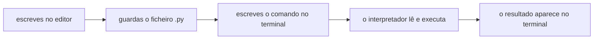

# Do algoritmo ao programa

Neste guia passas da algoritmia para a programação. Vês o que é um programa, onde se escreve, como se corre e como se reconhece cada tipo de erro. Os programas deste tema só escrevem texto no ecrã, numa sequência de instruções. Assim, as novidades são a linguagem e as ferramentas, e não o problema.

Usa o que fizeste na algoritmia. Rever: [O que é um algoritmo](../01-algoritmos/01-do-problema-ao-algoritmo.md#o-que-é-um-algoritmo), [Ler e escrever](../01-algoritmos/02-pseudocodigo.md#ler-e-escrever), [O resultado esperado decide-se antes de executar](../01-algoritmos/05-testar-depurar-e-melhorar.md#o-resultado-esperado-decide-se-antes-de-executar) e [Depurar com método](../01-algoritmos/05-testar-depurar-e-melhorar.md#depurar-com-método). Para praticar: [laboratório](laboratorios/01-do-algoritmo-ao-programa-laboratorio.md) e [ficha de exercícios](exercicios/01-do-algoritmo-ao-programa-exercicios.md).

## Neste guia

1. [Um programa é um algoritmo escrito para o computador](#um-programa-é-um-algoritmo-escrito-para-o-computador)
2. [O ciclo de vida de um programa](#o-ciclo-de-vida-de-um-programa)
3. [Correr um programa](#correr-um-programa)
4. [A consola do Python](#a-consola-do-python)
5. [Do editor de texto ao editor de código](#do-editor-de-texto-ao-editor-de-código)
6. [O IDE: as ferramentas numa só janela](#o-ide-as-ferramentas-numa-só-janela)
7. [Do `Escreve:` ao `print`](#do-escreve-ao-print)
8. [Os três tipos de erro](#os-três-tipos-de-erro)
9. [Depurar com método, agora no computador](#depurar-com-método-agora-no-computador)
10. [O registo da execução](#o-registo-da-execução)
11. [Exemplo guiado: as regras do pedra, papel, tesoura](#exemplo-guiado-as-regras-do-pedra-papel-tesoura)

## Um programa é um algoritmo escrito para o computador

Na algoritmia, quem executava os algoritmos eras tu, com papel e lápis. Com três casos de teste, leva uns minutos. Com os resultados de todos os jogos de uma liga, ninguém o faria à mão. Um computador executa milhões de instruções por segundo, mas não percebe português nem o pseudocódigo das aulas.

Para dar instruções a um computador, usa-se uma **linguagem de programação**. É uma linguagem com poucas palavras e regras rigorosas, em que cada instrução quer dizer uma só coisa. Um algoritmo escrito numa linguagem destas é um programa. O mesmo passo, em pseudocódigo e em Python:

```text
Escreve: "Olá"
```

```python
print("Olá")
```

O Python é a linguagem deste módulo, na versão 3. Escolheu-se para começar porque se lê quase como o pseudocódigo das aulas.

Quem executa o programa é o **interpretador**, um programa que lê o teu e confirma que está bem escrito. Depois executa as instruções uma a uma, de cima para baixo. Faz o que tu fazias com a tabela de trace, mas não se cansa nem adivinha. Executa o que está escrito, mesmo quando não é o que querias dizer. Um computador "com o Python instalado" é um computador com o interpretador.

## O ciclo de vida de um programa

Um programa não nasce quando se começa a escrever código. No duelo de dados, o projeto 1 da algoritmia, primeiro escreveste o contrato e o algoritmo, e simulaste-o com casos de teste. Faltava passá-lo para Python, testá-lo no computador e mudá-lo quando as regras mudassem.

As fases por que passa um programa formam o **ciclo de vida do software**:

1. Análise: perceber o problema e escrever o que o programa tem de fazer, como o contrato da algoritmia.
2. Desenho: decidir como o faz, com a decomposição e o algoritmo em pseudocódigo.
3. Implementação: escrever o programa numa linguagem de programação.
4. Testes: correr o programa com os casos de teste e comparar o obtido com o esperado. O que falhar corrige-se antes de o programa estar em uso.
5. Manutenção: mudar o programa depois de estar em uso, para corrigir um erro ou acrescentar uma regra.

Na algoritmia, trabalhaste a análise, o desenho e os testes no papel. Com o Python, juntas a implementação, os testes no computador e a manutenção. Saltar a análise é o erro típico. Sem saber o que o programa tem de fazer, não há resultado esperado, e sem ele não há forma de testar.

### Em cascata ou aos bocados

À forma de decidir por que ordem e quantas vezes se fazem as fases chama-se metodologia de desenvolvimento. Na forma **em cascata**, cada fase faz-se uma só vez, por inteiro, antes da seguinte. Um erro da análise só aparece nos testes, no fim. Na forma **incremental**, o programa cresce aos bocados, e cada bocado passa por todas as fases: escreves poucas linhas, corres, testas e só depois continuas. Os erros aparecem cedo, perto da linha que os causou. Nas aulas trabalhas de forma incremental.

## Correr um programa

### As quatro ferramentas

Para escrever e correr um programa usas quatro coisas, quase todas na mesma janela, e é fácil confundi-las. Nas aulas, o editor é o VS Code.

| Ferramenta | O que faz |
| --- | --- |
| Editor | Escreves e mudas o programa |
| Ficheiro `.py` | Guarda o programa no disco |
| Terminal | Recebe as tuas ordens, uma por linha |
| Interpretador | Executa o programa, quando o chamas no terminal |



O diagrama mostra o caminho de um programa, do editor até ao resultado.

O **terminal** é a janela onde dás ordens ao computador, escritas. Cada ordem é um **comando**. O terminal trabalha sempre dentro de uma pasta, e mostra-a antes do cursor, como `C:\Users\aluno\Documents\lp-python>`. A esse endereço da pasta chama-se caminho. Os ficheiros de um trabalho ficam numa pasta, a pasta do projeto, que se abre inteira no VS Code. Os nomes escrevem-se em minúsculas, sem espaços nem acentos, como `lp-python` e `ola.py`.

O VS Code e o Python são dois programas diferentes, instalados à parte. Um computador com o VS Code e sem o Python deixa-te escrever programas, mas não os consegue executar.

### O comando que põe o interpretador a trabalhar

Um programa escrito e guardado ainda não fez nada. Para que o computador o execute, chama-se o interpretador no terminal, na pasta do ficheiro. A isto chama-se correr o programa.

```python
# ola.py: o primeiro programa, para confirmar que o Python corre neste computador.
print("Olá, Python!")
print("O meu primeiro programa correu.")
```

```bash
python ola.py
```

```text
Olá, Python!
O meu primeiro programa correu.
```

A palavra `python` chama o interpretador, e `ola.py` diz-lhe que ficheiro deve executar. O interpretador executa as linhas de cima para baixo. A primeira linha começa com `#` e não aparece: é um comentário.

O comando muda de computador para computador: `python` ou `py` no Windows, `python3` no macOS e no Linux. Quando descobrires qual funciona no teu, é esse que usas sempre. Neste guia escreve-se `python`.

Antes de correr, guarda sempre o ficheiro, com Ctrl+S, ou Cmd+S no macOS. O interpretador lê o que está guardado no disco, e não o que vês no editor. No VS Code, cada ficheiro aberto tem um separador, uma aba com o nome no topo do editor. Uma bola cheia no separador, no lugar do X, quer dizer que há alterações por guardar.

## A consola do Python

Às vezes só queres saber o que faz uma linha, e criar um ficheiro só para isso leva tempo. A **consola do Python** é o modo em que o Python executa uma linha de cada vez e mostra logo o resultado. Entra-se nela escrevendo no terminal só `python`, sem nome de ficheiro. Aparece a versão do Python, uma linha em inglês e, por baixo, o sinal `>>>`. Esse sinal quer dizer que a consola está à espera de uma linha de Python.

Prevê o que aparece a seguir a cada uma destas linhas, escritas na consola:

```python
print("Olá da consola")
"DUELO DE DADOS"
```

```text
>>> print("Olá da consola")
Olá da consola
>>> "DUELO DE DADOS"
'DUELO DE DADOS'
```

Quando uma linha é só um texto, a consola mostra-o, com aspas simples à volta para dizer que é um texto. Num ficheiro, essa linha não escrevia nada: só o `print` escreve.

O que escreves na consola não fica guardado, e por isso ela serve para experimentar. Para sair, escreve-se `exit()`. Um comando do terminal escrito na consola, como `python ola.py`, dá `SyntaxError`. A regra é esta: com `>>>`, escreves Python; sem `>>>`, escreves comandos.

## Do editor de texto ao editor de código

O programa escreve-se num editor, mas qual? O Word, que usas nos trabalhos da escola, serve? E o Bloco de Notas?

Um ficheiro `.py` tem **texto simples**: só os caracteres que escreveste, sem negrito, tipos de letra nem cores guardadas. O Bloco de Notas é um editor de texto simples, e serve. O Word não serve. Guarda a formatação no ficheiro e troca as aspas retas, `"`, por aspas curvas, `“` e `”`, que o Python não reconhece.

Um **editor de código** é um editor de texto simples feito para escrever programas. O VS Code é um. Mostra o número de cada linha na margem e fecha sozinho as aspas e os parênteses. Também pinta cada parte do programa de uma cor, o realce de sintaxe. Se faltar a aspa que fecha um texto, o resto da linha fica da cor dos textos, e vês o erro. As cores não ficam guardadas no ficheiro.

## O IDE: as ferramentas numa só janela

Para fazer um programa, escreves, guardas, corres, lês as mensagens de erro e voltas a correr. Com um editor simples, cada coisa faz-se numa janela diferente, e passas o tempo a mudar de janela.

Um **IDE** é um programa que junta numa só janela as ferramentas para escrever, correr e corrigir programas. Essas ferramentas conhecem as palavras e as regras da linguagem. O nome vem das iniciais, em inglês, de ambiente de desenvolvimento integrado. O VS Code passa a ser um IDE para Python com uma **extensão**: um programa pequeno que lhe dá ferramentas novas. Nas aulas usa-se a extensão Python, da Microsoft.

| Ferramenta | Onde está | Para que serve |
| --- | --- | --- |
| Explorador (Explorer) | No painel da esquerda | Ver os ficheiros da pasta do projeto e criar ficheiros novos |
| Editor e separadores | Ao centro | Escrever o programa; cada ficheiro aberto tem um separador no topo |
| Terminal | No painel de baixo | Correr o programa com um comando e ver o que ele escreve |
| Sugestões | Numa lista que aparece enquanto escreves | Escrever os nomes depressa e sem erros |
| Sublinhado e painel Problems | No editor e no painel de baixo | Ver um erro de sintaxe ou um nome desconhecido antes de correres |
| Botão de correr | No canto de cima, à direita do editor | Correr o ficheiro aberto sem escreveres o comando |
| Barra de estado | Na faixa do fundo da janela | Ver a linha e a coluna do cursor, como `Ln 3, Col 12` |
| Extensões (Extensions) | Nos ícones da esquerda | Acrescentar extensões, como a do Python |
| Depurador (Run and Debug) | Nos ícones da esquerda | Correr o programa linha a linha |

O botão de correr guarda o ficheiro e escreve por ti o comando no terminal, com os caminhos completos. Por isso aparece uma linha comprida que não escreveste. O resultado é o mesmo do comando. Nas aulas continuas a escrever o comando, porque funciona em qualquer terminal, mesmo sem o VS Code.

### Quando é preciso um IDE, e quando não

Antes de abrires uma ferramenta, pergunta-te o que vais fazer:

| Situação | Ferramenta que chega | Porquê |
| --- | --- | --- |
| Experimentar uma linha | Consola do Python | Mostra logo o resultado, sem ficheiro |
| Mudar uma palavra num ficheiro, num computador sem o VS Code | Editor de texto simples | Abre depressa e guarda texto simples |
| Escrever, correr e corrigir um programa | IDE | Tem tudo à mão, na mesma janela |

O IDE ajuda quem escreve, mas não muda o que o programa faz, nem pensa por ti. Um programa sem nada sublinhado pode escrever uma linha errada.

## Do `Escreve:` ao `print`

Tens um algoritmo em pseudocódigo e queres passá-lo para Python. Neste tema, os algoritmos são sequências de `Escreve:`, e a passagem faz-se instrução a instrução. O ecrã de abertura de um quiz:

```text
Escreve: "QUIZ DE GEOGRAFIA"
Escreve: "São dez perguntas."
Escreve: "Cada resposta certa vale um ponto."
```

```python
# quiz.py: o ecrã de abertura de um quiz de geografia.
print("QUIZ DE GEOGRAFIA")
print("São dez perguntas.")
print("Cada resposta certa vale um ponto.")
```

| Linha | Instrução | O que aparece no ecrã |
| ---: | --- | --- |
| 1 | `# quiz.py: ...` | nada: é um comentário |
| 2 | `print("QUIZ DE GEOGRAFIA")` | `QUIZ DE GEOGRAFIA` |
| 3 | `print("São dez perguntas.")` | `São dez perguntas.` |
| 4 | `print("Cada resposta certa vale um ponto.")` | `Cada resposta certa vale um ponto.` |

Cada `Escreve:` passou a uma linha com `print`, pela mesma ordem, e o texto entre aspas ficou igual, com os acentos e os espaços.

Um **comentário** é uma nota para quem lê o código, a seguir a um `#` fora das aspas, que o Python não executa. Os programas das aulas começam todos por um comentário com o nome do ficheiro e para que serve.

### As regras de escrita do Python

O pseudocódigo aceitava uma frase clara, se a lógica estivesse certa. O Python não aceita nada fora das regras, a sintaxe. Para os programas deste tema, são estas:

1. A instrução escreve-se `print`, toda em minúsculas: `Print` é outra palavra.
2. O que se escreve vai entre parênteses, e cada parêntese que abre tem de fechar.
3. Um texto vai entre aspas, uma no início e outra no fim.
4. Escreve-se uma instrução por linha, encostada à margem esquerda.
5. Um comentário começa num `#` fora das aspas e vai até ao fim da linha. Pode ter uma linha só para ele, ou vir no fim de uma instrução, como em `print("Olá")  # cumprimenta`.

A estrutura de um programa deste tema é sempre a mesma. Primeiro, um comentário que diz o que é o ficheiro; depois, as instruções, pela ordem em que se executam.

## Os três tipos de erro

Quando um programa falha, a primeira pergunta é onde procurar, e a resposta depende do tipo de erro. Há três, e cada um se reconhece pelo que acontece no ecrã. Os três casos partem do `quiz.py`, com as três linhas do quiz como resultado esperado.

Primeiro caso: falta a aspa que fecha o texto na linha 3. Prevê se aparece a primeira linha do quiz, que está certa.

```python fragment erro de sintaxe de propósito: falta a aspa que fecha o texto
# quiz.py: o ecrã de abertura de um quiz de geografia.
print("QUIZ DE GEOGRAFIA")
print("São dez perguntas.)
print("Cada resposta certa vale um ponto.")
```

```text
  File "C:\Users\aluno\Documents\lp-python\quiz.py", line 3
    print("São dez perguntas.)
          ^
SyntaxError: unterminated string literal (detected at line 3)
```

Não aparece nenhuma linha. É um erro de sintaxe: como o interpretador confirma o ficheiro todo antes de executar, uma regra quebrada faz recusar o programa inteiro. A mensagem quer dizer "texto por terminar, detetado na linha 3".

Segundo caso: a linha 4 tem `Print`, com P maiúsculo.

```text
QUIZ DE GEOGRAFIA
São dez perguntas.
Traceback (most recent call last):
  File "C:\Users\aluno\Documents\lp-python\quiz.py", line 4, in <module>
    Print("Cada resposta certa vale um ponto.")
    ^^^^^
NameError: name 'Print' is not defined. Did you mean: 'print'?
```

As duas primeiras linhas apareceram. É um **erro de execução**: o programa estava bem escrito e começou a correr, mas parou numa linha que o Python não consegue executar. As linhas de antes já correram, e as de depois nunca correm. O VS Code pode sublinhar o `Print` antes de correres, mas o tipo decide-se pelo que acontece quando corres.

Terceiro caso: a linha 4 diz "vale dois pontos", em vez de "vale um ponto".

```text
QUIZ DE GEOGRAFIA
São dez perguntas.
Cada resposta certa vale dois pontos.
```

O programa correu até ao fim, sem mensagem, mas a última linha não é a esperada. É um **erro de lógica**: o programa corre e dá um resultado diferente do esperado. Só o encontras porque escreveste o resultado esperado antes de correr.

| Tipo de erro | Corre alguma linha? | Há mensagem? | Como o encontras |
| --- | --- | --- | --- |
| De sintaxe | Nenhuma | Sim, com `SyntaxError` ou parecido | Pela linha que a mensagem aponta |
| De execução | As que estão antes do erro | Sim, com `Traceback` | Pela linha que a mensagem aponta |
| De lógica | Todas | Não | Comparando o obtido com o esperado |

O nome do erro, antes dos dois pontos na última linha, ajuda. Mas o que decide o tipo é o que aconteceu: se correu alguma linha, e se houve mensagem.

### Como se lê uma mensagem de erro

A mensagem de um erro de execução chama-se **traceback**, que quer dizer rasto, e lê-se de baixo para cima:

1. A última linha diz o nome do erro e, depois dos dois pontos, uma descrição curta. Começa sempre por aqui.
2. Por cima, está a instrução onde o Python deu pelo problema, com sinais `^` por baixo da parte suspeita.
3. Mais acima, a linha com `File` diz o ficheiro e o número da linha, a seguir a `line`.

O caminho do ficheiro muda de computador para computador.

| Na mensagem | Quer dizer |
| --- | --- |
| `File`, `line` | Ficheiro, linha |
| `Traceback (most recent call last)` | Vem aí a mensagem de um erro de execução |
| `SyntaxError`, `invalid syntax` | Erro de sintaxe, escrita inválida |
| `unterminated string literal` | Texto por terminar: falta uma aspa |
| `NameError`, `is not defined` | Erro de nome: o Python não conhece uma palavra |
| `Did you mean` | Querias dizer |
| `in <module>` | Na parte principal do programa |

<details>
<summary>Para ires mais longe: as mensagens noutras versões do Python</summary>

As mensagens deste guia são as do Python 3.14. Num Python mais antigo, a mesma aspa por fechar pode dar `SyntaxError: EOL while scanning string literal`, isto é, o Python chegou ao fim da linha sem encontrar a aspa. As palavras mudam, mas o nome do erro, antes dos dois pontos, é o mesmo.

</details>

## Depurar com método, agora no computador

Os cinco passos de depurar com método, da algoritmia, são os mesmos no computador. Muda o que tens à mão em cada um:

| Passo | No computador |
| --- | --- |
| 1. Observar e reproduzir o erro | Corres outra vez e confirmas que o erro se repete. Escreves o esperado, o obtido e o tipo de erro |
| 2. Formular uma hipótese | Escreves uma explicação que se possa confirmar, como "falta a aspa que fecha o texto da linha 3" |
| 3. Verificar a hipótese | Lês a mensagem e a linha que ela aponta. Num erro de lógica, comparas o programa com o algoritmo |
| 4. Corrigir a causa | Mudas só o que causou o erro, uma coisa de cada vez, e guardas |
| 5. Voltar a testar tudo | Corres outra vez e comparas todas as linhas com o esperado |

O caso que falhou, com o esperado e o obtido, fica num comentário no fim do ficheiro, com a hipótese e o que mudaste. Fica no fim para as linhas do programa não mudarem de número.

## O registo da execução

O comando pode ser `python` num computador e `py` noutro, e a versão do Python muda as palavras das mensagens. Daqui a uma semana, já não te lembras do que usaste.

Por isso, fazes um **registo da execução** em cada computador onde trabalhas, no fim do primeiro programa que lá corres, como o `ola.py` do laboratório. É uma nota com a data e o computador, o comando que funciona, a versão do Python, o que apareceu e os erros que encontraste. A versão mostra-a o comando `python --version`.

```python
# ola.py: o primeiro programa, para confirmar que o Python corre neste computador.
print("Olá, Python!")
print("O meu primeiro programa correu.")

# Registo da execução
# Data: 29 de outubro de 2026
# Computador: o da sala, lugar 7
# Comando que funciona: python
# Versão: Python 3.14.8
# O que apareceu: as duas linhas, pela ordem do programa
# Erros: uma aspa por fechar na linha 3, erro de sintaxe, corrigido
```

Se a tua mensagem de erro não for igual à de um colega, compara as versões antes de pensar que o erro é outro.

## Exemplo guiado: as regras do pedra, papel, tesoura

Um colega está a fazer um jogo de pedra, papel, tesoura. Pede-te o ecrã de abertura, com o nome do jogo e as regras de quem ganha.

### Passo 1: Análise

O programa não lê nada, e as saídas são as linhas do ecrã. O resultado esperado, escrito antes de qualquer código:

```text
PEDRA, PAPEL, TESOURA
A pedra parte a tesoura.
A tesoura corta o papel.
O papel embrulha a pedra.
Se escolherem o mesmo, é empate.
```

### Passo 2: Desenho

Cada linha é um `Escreve:`, pela mesma ordem, numa sequência:

```text
Escreve: "PEDRA, PAPEL, TESOURA"
Escreve: "A pedra parte a tesoura."
Escreve: "A tesoura corta o papel."
Escreve: "O papel embrulha a pedra."
Escreve: "Se escolherem o mesmo, é empate."
```

### Passo 3: Implementação

Trabalha-se aos bocados. Primeiro, só o comentário e o título:

```python
# regras.py: o ecrã de abertura do pedra, papel, tesoura, com as regras de quem ganha.
print("PEDRA, PAPEL, TESOURA")
```

Com `python regras.py`, aparece `PEDRA, PAPEL, TESOURA`, como o esperado. Depois acrescentam-se as regras, mas, escritas à pressa, ficaram assim:

```python
# regras.py: o ecrã de abertura do pedra, papel, tesoura, com as regras de quem ganha.
print("PEDRA, PAPEL, TESOURA")
print("A pedra parte a tesoura.")
print("A tesoura corta o papel.")
print("Se escolherem o mesmo, é empate.")
```

### Passo 4: Testes

Corre-se outra vez, e aparece:

```text
PEDRA, PAPEL, TESOURA
A pedra parte a tesoura.
A tesoura corta o papel.
Se escolherem o mesmo, é empate.
```

Não há mensagem de erro, mas, comparando linha a linha, o obtido tem quatro linhas e o esperado tem cinco. Falta "O papel embrulha a pedra.".

### Passo 5: Depurar com método

1. Observar e reproduzir. Corre-se outra vez, e falta a mesma linha. Não há mensagem, e o programa correu até ao fim: é um erro de lógica.
2. Formular uma hipótese: "falta no programa o `print` da terceira regra".
3. Verificar a hipótese. O algoritmo tem cinco `Escreve:`, e o programa tem quatro `print`. Confirma-se.
4. Corrigir a causa. Acrescenta-se o `print` que falta, depois da regra da tesoura e antes do empate, porque o Python escreve pela ordem do ficheiro.
5. Voltar a testar tudo. Corre-se e comparam-se as cinco linhas com o esperado.

O programa corrigido, com as notas da depuração no fim:

```python
# regras.py: o ecrã de abertura do pedra, papel, tesoura, com as regras de quem ganha.
print("PEDRA, PAPEL, TESOURA")
print("A pedra parte a tesoura.")
print("A tesoura corta o papel.")
print("O papel embrulha a pedra.")
print("Se escolherem o mesmo, é empate.")

# Depuração: faltava a linha "O papel embrulha a pedra.", um erro de lógica.
# Hipótese: faltava o print da terceira regra. Acrescentei-o antes do empate.
```

Agora o que aparece é igual, linha a linha, ao resultado esperado do passo 1.

### Passo 6: Manutenção

Uma semana depois, o colega muda o jogo: ganha quem vencer duas de três jogadas. Mudar um programa em uso é manutenção. Volta-se à análise e acrescenta-se ao resultado esperado a linha "Ganha quem vencer duas de três jogadas.". No programa, acrescenta-se um `print` a seguir ao último, e testam-se outra vez as seis linhas.

## Erros frequentes

### `can't open file` e `No such file or directory`

A mensagem quer dizer "não consigo abrir o ficheiro: não existe esse ficheiro nem essa pasta". O terminal não está na pasta do ficheiro, ou o nome no comando tem um erro. Confirma que o caminho antes do cursor acaba na pasta do projeto. Confirma também que o nome no comando é igual ao do ficheiro, com o `.py`.

### O Windows não conhece o `python`

O Windows diz que não conhece o comando, ou abre a Microsoft Store. Fecha a loja e usa `py ola.py`. Se nenhum dos dois funcionar, o Python pode não estar instalado.

### O `Escreve:` copiado do pseudocódigo

Com uma linha como `Escreve: "Olá"`, o programa corre sem mensagem e sem escrever nada. O Python lê-a de outra maneira, que não escreve nada. É um erro de lógica. Troca cada `Escreve:` por `print`, com o texto entre parênteses.

### `SyntaxError: invalid character '“' (U+201C)`

Copiaste o programa de um documento, e o `^` aponta para uma aspa curva. O processador de texto trocou as aspas retas por curvas. Apaga-as e escreve-as outra vez no VS Code.

## Palavras novas deste guia

- Linguagem de programação: uma linguagem com poucas palavras e regras rigorosas, em que cada instrução quer dizer uma só coisa.
- Interpretador: o programa que lê o teu, confirma que está bem escrito e executa as instruções, uma a uma.
- Ciclo de vida do software: as fases por que passa um programa: análise, desenho, implementação, testes e manutenção.
- Em cascata: cada fase faz-se uma só vez, por inteiro, antes da seguinte.
- Incremental: o programa cresce aos bocados, e cada bocado passa por todas as fases.
- Terminal: a janela onde se escrevem comandos para o computador, um por linha.
- Comando: uma ordem escrita no terminal, como `python ola.py`.
- Consola do Python: o modo em que o Python executa uma linha de cada vez, a seguir ao `>>>`.
- Texto simples: texto só com os caracteres escritos, sem formatação guardada no ficheiro.
- Editor de código: um editor de texto simples feito para escrever programas.
- IDE: um programa que junta numa só janela as ferramentas para escrever, correr e corrigir programas.
- Extensão: um programa pequeno que se acrescenta ao VS Code para lhe dar ferramentas novas.
- Comentário: uma nota para quem lê o código, a seguir a um `#` fora das aspas, que o Python não executa.
- Erro de execução: um erro que para o programa numa linha que não se consegue executar.
- Erro de lógica: um erro sem mensagem, em que o programa corre e dá um resultado diferente do esperado.
- Traceback: a mensagem de um erro de execução, que se lê de baixo para cima.
- Registo da execução: a nota com o comando, a versão do Python e o que apareceu ao correr um programa.

## O que vem a seguir

No tema seguinte, [Dados e interação](02-dados-e-interacao.md), os programas passam a guardar valores, a fazer contas e a ler o que a pessoa escreve.

## Para saber mais

- [Transferir o Python](https://www.python.org/downloads/): a página oficial, em inglês, para instalares o Python no teu computador de casa.
- [Transferir o VS Code](https://code.visualstudio.com/download): a página oficial do editor das aulas, em inglês, com as versões para Windows, macOS e Linux.
- [A extensão Python do VS Code](https://marketplace.visualstudio.com/items?itemName=ms-python.python): a página oficial da extensão, em inglês.


