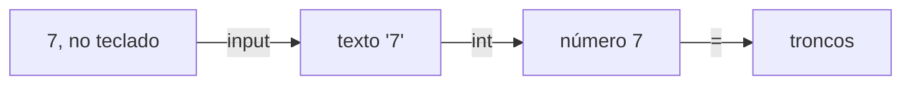

# Dados e interação

Neste guia, os teus programas passam a guardar valores, a fazer contas e a ler o que a pessoa escreve no teclado. Guardar e ler já fazias em pseudocódigo. As contas, a conversão de um texto num número e as partes de um texto são novas.

Usa as variáveis da algoritmia e a consola e os erros do tema 01. Rever: [Variáveis e estado](../01-algoritmos/02-pseudocodigo.md#variáveis-e-estado), [Ler e escrever](../01-algoritmos/02-pseudocodigo.md#ler-e-escrever), [A consola do Python](01-do-algoritmo-ao-programa.md#a-consola-do-python) e [Os três tipos de erro](01-do-algoritmo-ao-programa.md#os-três-tipos-de-erro). Para praticar: [laboratório](laboratorios/02-dados-e-interacao-laboratorio.md) e [ficha de exercícios](exercicios/02-dados-e-interacao-exercicios.md).

## Neste guia

1. [Guardar valores em variáveis](#guardar-valores-em-variáveis)
2. [Os tipos dos valores e as contas](#os-tipos-dos-valores-e-as-contas)
3. [Constantes](#constantes)
4. [Funções predefinidas](#funções-predefinidas)
5. [Ler do teclado e converter](#ler-do-teclado-e-converter)
6. [Juntar textos](#juntar-textos)
7. [Partes de um texto: índices e cortes](#partes-de-um-texto-índices-e-cortes)
8. [O dinheiro guarda-se em cêntimos](#o-dinheiro-guarda-se-em-cêntimos)
9. [Testar com uma tabela de entradas e saídas](#testar-com-uma-tabela-de-entradas-e-saídas)
10. [Exemplo guiado: os bilhetes do torneio](#exemplo-guiado-os-bilhetes-do-torneio)

## Guardar valores em variáveis

### Uma variável em Python não leva o tipo à frente

Um jogo de construção tem de se lembrar de quantos troncos tens. Na algoritmia, um valor destes ficava numa variável, e em Python também.

Em pseudocódigo escrevias `int troncos = 7`. Em Python, escreve-se só o nome, o `=` e o valor:

```python
troncos = 7
```

O `=` é a atribuição, como no pseudocódigo: guarda o valor da direita na variável da esquerda. O Python descobre o tipo pelo valor, e a variável nasce nesta linha.

Dentro de um `print`, o nome sem aspas dá o valor da variável, e com aspas dá a palavra. É a regra do `Escreve:` do pseudocódigo.

### O `print` põe um espaço entre os valores

Quase sempre, um programa escreve um texto e um valor na mesma linha, como "Troncos: 7". Como no pseudocódigo, as partes separam-se com vírgulas. Prevê o que escreve cada `print`:

```python
# espacos.py: o print com vírgulas, com e sem espaços dentro das aspas.
caixas = 2
print("Vão", caixas, "caixas")
print("Vão ", caixas, " caixas")
```

```text
Vão 2 caixas
Vão  2  caixas
```

O `print` escreve os valores pela ordem e põe sozinho um espaço entre cada dois. No segundo, os textos já traziam espaços, e ficam dois seguidos. No pseudocódigo das aulas, os espaços iam dentro das aspas; em Python, com vírgulas, não vão.

### Atribuir outra vez muda o valor

Juntas mais três troncos, gastas dois numa mesa, e o número tem de mudar. Muda-se com outra atribuição, com o mesmo nome à esquerda. Primeiro calcula-se o lado direito, com o valor que a variável tem nesse momento. Depois guarda-se o resultado, e o valor antigo perde-se.

```python
# troncos.py: o número de troncos muda à medida que o jogador joga.
troncos = 7
print("No início:", troncos)
troncos = troncos + 3
print("Depois de apanhar mais:", troncos)
troncos = troncos - 2
print("Depois de construir uma mesa:", troncos)
```

A tabela de trace mostra o valor de `troncos` depois de cada linha. O número da linha é o que o VS Code mostra à esquerda.

| Linha | Instrução | `troncos` depois | O que aparece no ecrã |
| ---: | --- | ---: | --- |
| 2 | `troncos = 7` | 7 | nada |
| 3 | `print("No início:", troncos)` | 7 | `No início: 7` |
| 4 | `troncos = troncos + 3` | 10 | nada |
| 5 | `print("Depois de apanhar mais:", troncos)` | 10 | `Depois de apanhar mais: 10` |
| 6 | `troncos = troncos - 2` | 8 | nada |
| 7 | `print("Depois de construir uma mesa:", troncos)` | 8 | `Depois de construir uma mesa: 8` |

Na linha 4, o lado direito usa o 7 e dá 10. Só depois o 10 fica guardado. É a forma dos totalizadores da algoritmia, como `total = total + valor`.

Uma variável não se pode usar antes da linha onde nasce. Com o `print(troncos)` antes de `troncos = 7`, o programa para com `NameError: name 'troncos' is not defined`. Quer dizer "o nome 'troncos' não está definido". É um erro de execução, e as linhas de antes já correram.

### Os nomes seguem regras e uma convenção

Um nome bom diz o que a variável guarda: `troncos` diz mais do que `t` ou `x`. O Python só aceita nomes que cumpram estas regras:

- um nome tem letras, algarismos e o traço baixo, `_`;
- não começa por um algarismo;
- não tem espaços: `total tabuas = 3` dá um erro de sintaxe;
- as maiúsculas contam: `troncos` e `Troncos` são variáveis diferentes.

Além das regras, há uma **convenção**, uma forma combinada entre programadores, que a linguagem não obriga a cumprir. Em Python, os nomes escrevem-se em minúsculas, com um traço baixo entre as palavras: `total_tabuas`. O `totalTabuas` do pseudocódigo das aulas funciona, mas não é a forma da linguagem.

Os nomes escrevem-se sem acentos nem cedilhas, como `numero` e `preco`, para ficarem iguais em qualquer teclado. Os acentos ficam dentro das aspas.

## Os tipos dos valores e as contas

### Cada valor tem um tipo

O número 7 e o texto `"7"` parecem iguais no ecrã, mas com o primeiro fazem-se contas e com o segundo não. O que se pode fazer com um valor depende do tipo dele. Em Python, o tipo não se escreve, mas continua a existir.

| Tipo | O que guarda | Exemplos | No pseudocódigo |
| --- | --- | --- | --- |
| `int` | números inteiros | `7`, `0`, `-3` | `int` |
| `float` | números com parte decimal | `2.5`, `7.0`, `-0.75` | `float` |
| `str` | textos, entre aspas | `"pedra"`, `"7"` | `string` |
| `bool` | verdadeiro ou falso | `True`, `False` | `bool`, com `true` e `false` |

A parte decimal de um `float` escreve-se com ponto: dois e meio é `2.5`. Um `bool` guarda um sim ou um não, como `tem_picareta = True`. Neste tema, os `bool` só se guardam e escrevem.

Para saber o tipo de um valor, usa-se o `type`, na consola do Python. O nome entre aspas simples é o tipo:

```text
>>> type(7)
<class 'int'>
>>> type(2.5)
<class 'float'>
>>> type("7")
<class 'str'>
>>> type(True)
<class 'bool'>
```

Os valores de um `bool` escrevem-se com maiúscula. Com `true` em minúsculas, como no pseudocódigo, aparece `NameError: name 'true' is not defined. Did you mean: 'True'?`, porque o Python procura uma variável com esse nome.

### As contas: os operadores

Um jogo faz contas a toda a hora, como quantas tábuas dão 7 troncos. Uma conta escrita num programa chama-se **expressão**. O sinal que diz que conta se faz chama-se **operador**.

| Operador | O que faz | Exemplo | Resultado |
| --- | --- | --- | ---: |
| `+` | soma | `7 + 2` | `9` |
| `-` | subtração | `7 - 2` | `5` |
| `*` | multiplicação | `7 * 2` | `14` |
| `/` | divisão, com parte decimal | `7 / 2` | `3.5` |
| `//` | divisão inteira | `7 // 2` | `3` |
| `%` | resto da divisão inteira | `7 % 2` | `1` |
| `**` | potência | `2 ** 3` | `8` |

A multiplicação escreve-se com asterisco, porque o "x" é uma letra e podia ser o nome de uma variável. A potência escreve-se com dois asteriscos: `2 ** 3` é 2 vezes 2 vezes 2.

### A divisão com `/` dá sempre um `float`

Prevê quanto dá `6 / 2`. Dá `3.0`, e não `3`. A divisão com `/` dá sempre um `float`, mesmo quando a conta é exata, e o ponto zero mostra-o.

### A divisão inteira e o resto

Num baú cabem 8 tábuas, e tens 28. Fazes 3 baús completos, que levam 24 tábuas, e sobram 4. A divisão com `/` dava 3.5, e meio baú não existe.

A **divisão inteira**, com `//`, diz quantas vezes um número cabe noutro: `28 // 8` dá `3`. O **resto**, com `%`, diz o que sobra: `28 % 8` dá `4`. No pseudocódigo, estas contas escrevem-se `div` e `resto`.

Confirmas as duas ao mesmo tempo. O divisor vezes a divisão inteira, mais o resto, dá o número de partida: 8 vezes 3, mais 4, dá 28.

Quando o número é mais pequeno do que o divisor, não cabe nenhuma vez, e sobra tudo: `5 // 8` dá `0`, e `5 % 8` dá `5`.

Usa `//` e `%` quando a parte decimal não faz sentido, como em baús, pessoas ou bilhetes. Usa `/` quando ela interessa, como numa média. Usa-os só com inteiros, com o número da esquerda igual ou maior do que zero e o divisor maior do que zero.

Dividir por zero, com `/`, `//` ou `%`, para o programa com `ZeroDivisionError`, o erro de divisão por zero.

### A ordem das contas é a da matemática

Em `2 + 3 * 4`, a multiplicação faz-se primeiro, e o resultado é `14`, e não 20. O Python segue a ordem da matemática:

1. primeiro, o que está entre parênteses;
2. depois, as potências;
3. depois, as multiplicações e as divisões, incluindo `//` e `%`;
4. por fim, as somas e as subtrações.

Entre multiplicações e divisões, ou entre somas e subtrações, faz da esquerda para a direita. Com parênteses, `(2 + 3) * 4` dá `20`.

Onde isto mais engana é nas médias. Prevê o que escreve cada linha, para a média das pontuações 14 e 17:

```python
# medias.py: a média de duas pontuações, com e sem parênteses.
print((14 + 17) / 2)
print(14 + 17 / 2)
```

```text
15.5
22.5
```

Na segunda linha, a divisão passa à frente da soma: divide só o 17, e soma-lhe 14. Uma média maior do que as duas pontuações é impossível, e é isso que denuncia o erro. Para dividir uma soma, a soma vai entre parênteses.

<details>
<summary>Para ires mais longe: a raiz quadrada, com <code>**</code></summary>

Elevar a `0.5` é o mesmo que tirar a raiz quadrada. `49 ** 0.5` dá `7.0`, porque 7 vezes 7 dá 49. Uma sala quadrada com 49 metros quadrados tem 7 metros de lado. O resultado é sempre um `float`, e só se usa com números iguais ou maiores do que zero. Para somar antes de tirar a raiz, usam-se parênteses: `(9 + 16) ** 0.5` dá `5.0`.

</details>

## Constantes

Num jogo, um tronco dá sempre 4 tábuas. Esse 4 é uma regra do jogo. Se aparecer solto em `tabuas = troncos * 4`, quem lê não sabe de onde vem. E se a regra mudar, tens de o procurar em todo o programa.

Em pseudocódigo, um valor destes era uma constante, com `const`. Em Python não há `const`: uma constante é uma variável com o nome todo em maiúsculas, que os programadores combinam não mudar.

```python
TABUAS_POR_TRONCO = 4
```

O Python não impede a mudança, mas o nome avisa quem lê. As constantes escrevem-se no início do programa, a seguir ao comentário, para se encontrarem depressa. A conta fica `tabuas = troncos * TABUAS_POR_TRONCO`, que se lê sem explicação.

## Funções predefinidas

### Uma função predefinida já vem com o Python

Tens 30 pedras e o teu amigo tem 45. A diferença é 15, mas `30 - 45` dá `-15`, e menos 15 pedras não diz nada. Falta uma maneira de ficar só com o número, sem o sinal.

Uma **função predefinida** é uma função que já vem com o Python, pronta a usar. Chama-se como as funções que escreveste na algoritmia: o nome e, entre parênteses, os argumentos. O `type` é uma função predefinida, e o `print`, a que no tema 01 chamámos instrução, também.

Ao contrário das que escreveste, a maior parte destas **devolve** um resultado: dá um valor, que podes guardar numa variável ou usar numa conta. A função `abs` devolve o número sem sinal: `abs(30 - 45)` dá `15`, e `abs(45 - 30)` também.

### O `int` corta a parte decimal

Uma divisão dá muitas vezes um número com parte decimal, como 3.9, e às vezes só interessa a parte inteira. O nome do tipo também é uma função: `int(3.9)` dá `3`, mesmo estando 3,9 muito perto de 4. O `int` não arredonda: corta as casas decimais e fica com a parte inteira.

### O `round` dá o inteiro mais próximo

`round(2.4)` dá `2`, e `round(2.6)` dá `3`. O caso que engana é o das meias, a meio caminho entre dois inteiros. Prevê quanto dão `round(2.5)` e `round(3.5)`.

`round(2.5)` dá `2`, e `round(3.5)` dá `4`. O Python leva as meias para o número par mais próximo, e não sempre para cima.

Para arredondar as meias sempre para cima, como na escola, com números positivos, soma-se 0.5 e corta-se com o `int`. `int(2.5 + 0.5)` dá `3`, e `int(2.4 + 0.5)` dá `2`.

## Ler do teclado e converter

### O `input` devolve sempre um texto

Até agora, os valores estavam escritos no programa. Para saber quantos troncos tem cada jogador, o programa tem de perguntar. Em pseudocódigo era o `ler valor`, e em Python é o `input`. Ele escreve a pergunta, espera que a pessoa escreva e carregue em Enter, e devolve o que ela escreveu.

```python
nome = input("Como se chama o teu mundo? ")
```

A pergunta acaba num espaço, dentro das aspas, para a resposta não ficar colada ao ponto de interrogação.

O `input` devolve sempre um texto, um `str`, mesmo que a pessoa escreva um número. Prevê o que aparece quando a pessoa escreve 7:

```python
# tipo_lido.py: confirma de que tipo é o valor que o input devolve.
troncos = input("Quantos troncos tens? ")
print(type(troncos))
```

```text
Quantos troncos tens? 7
<class 'str'>
```

O `type` diz o tipo de `troncos`, e o `print` escreve-o. Em `troncos` ficou o texto `"7"`, e não o número 7.

### Converter um texto num número

Um texto não serve para contas. Na consola, `"7" * 4` dá `'7777'`: entre um texto e um número, o `*` repete o texto. E não aparece nenhuma mensagem. É um erro de lógica, que só a comparação com o resultado esperado mostra.

Para fazer contas, converte-se o texto num número. **Converter** é transformar um valor de um tipo noutro, e há uma função para cada tipo:

| Função | Converte em | Exemplo | Resultado |
| --- | --- | --- | ---: |
| `int(x)` | número inteiro | `int("7")` | `7` |
| `float(x)` | número com parte decimal | `float("2.5")` | `2.5` |
| `str(x)` | texto | `str(7)` | `'7'` |

A forma habitual junta a leitura e a conversão numa só linha:

```python
# tabuas.py: lê os troncos do jogador e diz quantas tábuas dão.
TABUAS_POR_TRONCO = 4

# O int converte o texto escrito no teclado num número inteiro.
troncos = int(input("Quantos troncos tens? "))
tabuas = troncos * TABUAS_POR_TRONCO
print("Tábuas:", tabuas)
```

```text
Quantos troncos tens? 7
Tábuas: 28
```

A linha da leitura tem uma chamada dentro de outra, e lê-se de dentro para fora:



O `input` faz a pergunta e devolve o texto `'7'`. O `int` recebe esse texto e devolve o número 7. Só então o 7 fica guardado em `troncos`.

### Quando o texto não é um número

O `int` só converte textos que são números inteiros, e o `float` só converte textos que são números. Se a pessoa escrever `doze`, o programa para:

```text
Quantos troncos tens? doze
Traceback (most recent call last):
  File "C:\Users\aluno\Documents\lp-python\tabuas.py", line 5, in <module>
    troncos = int(input("Quantos troncos tens? "))
ValueError: invalid literal for int() with base 10: 'doze'
```

A mensagem quer dizer "valor inválido para o `int()` na base 10: 'doze'". A base 10 é a numeração de todos os dias, com os algarismos de 0 a 9. É um erro de execução. Neste tema, os programas partem do princípio de que a pessoa escreve o que lhe pedem.

## Juntar textos

Uma frase como `Tábuas: 28!` não se faz com vírgulas, porque o `print` punha um espaço antes do ponto de exclamação. Para teres exatamente os espaços que escolheste, juntam-se textos com o `+`.

Entre dois textos, o `+` não soma: junta-os. `"Baú" + " de madeira"` dá `'Baú de madeira'`, e os espaços são só os que estão dentro das aspas.

Entre um texto e um número, o `+` não sabe o que fazer:

```text
>>> print("Tábuas: " + 28)
Traceback (most recent call last):
  File "<python-input-0>", line 1, in <module>
    print("Tábuas: " + 28)
          ~~~~~~~~~~~^~~~
TypeError: can only concatenate str (not "int") to str
```

A mensagem quer dizer "só se pode juntar um texto a um texto, e não um `int`". Para juntar, converte-se o número em texto, com `str`: `"Tábuas: " + str(28)` dá `'Tábuas: 28'`.

## Partes de um texto: índices e cortes

### Um índice dá um carácter

No jogo, cada objeto do inventário tem um código, como `PED-015`. As três primeiras letras dizem o material, e os algarismos depois do hífen dizem o número. Para mostrar só o material, o programa precisa de uma parte do texto.

Um texto é uma sequência de caracteres. Um **carácter** é uma letra, um algarismo, um espaço ou um sinal. A posição de cada um é o seu índice, e os índices contam-se a partir do 0, como nos arrays da algoritmia. Também se pode contar a partir do fim, com índices negativos.

| Carácter | `p` | `e` | `d` | `r` | `a` |
| --- | --- | --- | --- | --- | --- |
| Índice | 0 | 1 | 2 | 3 | 4 |
| Índice negativo | -5 | -4 | -3 | -2 | -1 |

O índice escreve-se entre parênteses retos, a seguir ao texto ou à variável:

```text
>>> material = "pedra"
>>> material[0]
'p'
>>> material[4]
'a'
>>> material[-1]
'a'
```

`material[4]` e `material[-1]` dão o mesmo, porque são duas formas de dizer a última posição. Um índice que não existe, como `material[5]`, para o programa com `IndexError: string index out of range`, "índice do texto fora do intervalo".

### Um corte dá vários caracteres seguidos

Um **corte**, a que em inglês se chama slicing, escreve-se `texto[início:fim]`. Começa no índice do início e vai até ao índice do fim menos um: o carácter do fim já não entra.

| Carácter | `p` | `e` | `d` | `r` | `a` |
| --- | --- | --- | --- | --- | --- |
| Índice | 0 | 1 | 2 | 3 | 4 |
| Entra em `material[1:4]`? | não | sim | sim | sim | não |

Prevê o resultado de cada linha:

```text
>>> material[0:3]
'ped'
>>> material[1:4]
'edr'
```

A conta do fim menos o início diz quantos caracteres entram: 3 menos 0 dá 3.

Sem o início, o corte começa no princípio do texto. Sem o fim, vai até ao fim do texto:

```text
>>> material[:3]
'ped'
>>> material[2:]
'dra'
>>> material[-3:]
'dra'
```

O último corte começa no índice -3, o terceiro a contar do fim, e por isso dá os três últimos caracteres.

Com os cortes, o código dos objetos separa-se nas suas partes:

```python
# codigo.py: separa as partes do código de um objeto do inventário.
codigo = input("Código do objeto? ")
# As três primeiras letras são o material; os algarismos começam depois do hífen.
print("Material:", codigo[0:3])
print("Número:", int(codigo[4:]))
```

```text
Código do objeto? PED-015
Material: PED
Número: 15
```

O hífen está no índice 3, e por isso o número começa no índice 4. O corte dá o texto `'015'`, e o `int` converte-o.

O erro típico é esperar que o carácter do fim entre no corte. Quem quer as três primeiras letras e escreve `codigo[0:2]` fica só com duas, `'PE'`.

<details>
<summary>Para ires mais longe: o passo de um corte</summary>

Para ler um texto ao contrário, ou só de dois em dois caracteres, um corte pode ter um terceiro número, o passo: `texto[início:fim:passo]`. Sem ele, o passo é 1.

```text
>>> material[::2]
'pda'
>>> material[::-1]
'ardep'
```

Na primeira linha, o corte vai do princípio ao fim, de dois em dois: os índices 0, 2 e 4. Na segunda, o passo é -1, e o corte anda para trás, por isso o texto aparece ao contrário.

</details>

## O dinheiro guarda-se em cêntimos

Um bilhete custa 2,50 €, e parece natural guardá-lo como `2.5`. Mas experimenta `0.1 + 0.2` na consola:

```text
>>> 0.1 + 0.2
0.30000000000000004
```

O computador não consegue guardar exatamente muitos números com parte decimal, e fica um erro muito pequeno. Num jogo, ninguém nota. Com dinheiro, os erros acumulam-se, e uma conta deixa de bater certo ao cêntimo.

Por isso, o dinheiro guarda-se em cêntimos, num `int`, porque os inteiros são sempre exatos. O bilhete de 2,50 € guarda-se como `250`.

Para mostrar em euros, usam-se o `//` e o `%`, porque um euro tem 100 cêntimos. Com 750 cêntimos, `750 // 100` dá `7`, os euros, e `750 % 100` dá `50`, os cêntimos que sobram.

## Testar com uma tabela de entradas e saídas

Um programa pode dar certo com 7 troncos e errado com 0. Um caso só não chega para confiar nele.

Uma **tabela de entradas e saídas** tem uma linha por caso de teste: o que se escreve no teclado e o que deve aparecer. Escreve-se antes de correr, com o resultado calculado à mão, porque depois de veres o resultado é fácil aceitar o que apareceu. Um caso passa quando o ecrã mostra o que calculaste.

Para o `tabuas.py`:

| Troncos | Conta à mão | Saída esperada |
| ---: | --- | --- |
| 0 | 0 vezes 4 dá 0 | `Tábuas: 0` |
| 1 | 1 vezes 4 dá 4 | `Tábuas: 4` |
| 7 | 7 vezes 4 dá 28 | `Tábuas: 28` |

Escolhem-se casos que experimentem situações diferentes, como o valor mais pequeno que o programa aceita e um caso normal.

## Exemplo guiado: os bilhetes do torneio

A escola organiza um torneio de jogos, e cada bilhete custa 2,50 €. O programa pergunta quantos bilhetes a pessoa quer e diz quanto tem de pagar, em euros e cêntimos.

### Passo 1: Análise

A entrada é o número de bilhetes, um inteiro igual ou maior do que zero. A saída é o total, em euros e cêntimos. O preço é uma regra que não muda.

Antes de escrever código, faz-se a tabela de entradas e saídas:

| Bilhetes | Conta à mão | Saída esperada |
| ---: | --- | --- |
| 0 | 0 vezes 250 dá 0 cêntimos | `Total: 0 euros e 0 cêntimos` |
| 1 | 1 vezes 250 dá 250 cêntimos | `Total: 2 euros e 50 cêntimos` |
| 3 | 3 vezes 250 dá 750 cêntimos | `Total: 7 euros e 50 cêntimos` |
| 4 | 4 vezes 250 dá 1000 cêntimos | `Total: 10 euros e 0 cêntimos` |

O caso 0 é o valor mais pequeno. O caso 4 dá euros certos, em que o resto dá 0.

### Passo 2: Desenho

Em pseudocódigo, com o dinheiro em cêntimos:

```text
const PRECO_BILHETE = 250
const CENTIMOS_POR_EURO = 100
Escreve: "Quantos bilhetes queres? "
int bilhetes = ler valor
int total = bilhetes * PRECO_BILHETE
int euros = total div CENTIMOS_POR_EURO
int centimos = total resto CENTIMOS_POR_EURO
Escreve: "Total: ", euros, " euros e ", centimos, " cêntimos"
```

### Passo 3: Implementação

Começa-se pela leitura e pela conta do total, para confirmar que o valor chega ao programa como número:

```python
# bilhetes.py: diz quanto custam os bilhetes do torneio da escola, em euros e cêntimos.
# O dinheiro guarda-se em cêntimos, num int, para as contas serem exatas.
PRECO_BILHETE = 250

bilhetes = int(input("Quantos bilhetes queres? "))
total = bilhetes * PRECO_BILHETE
print("Total:", total, "cêntimos")
```

Com 3 bilhetes, escreve `Total: 750 cêntimos`. Falta passar para euros e cêntimos: acrescenta-se a constante e as duas contas, e troca-se o `print`. O programa completo fica assim:

```python
# bilhetes.py: diz quanto custam os bilhetes do torneio da escola, em euros e cêntimos.
# O dinheiro guarda-se em cêntimos, num int, para as contas serem exatas.
PRECO_BILHETE = 250
CENTIMOS_POR_EURO = 100

bilhetes = int(input("Quantos bilhetes queres? "))
total = bilhetes * PRECO_BILHETE

# Os euros são as centenas de cêntimos; o resto são os cêntimos que sobram.
euros = total // CENTIMOS_POR_EURO
centimos = total % CENTIMOS_POR_EURO
print("Total:", euros, "euros e", centimos, "cêntimos")
```

Do pseudocódigo para Python, o `const` e os tipos saíram. O `Escreve:` da pergunta e o `ler valor` juntaram-se num `input`, com o `int`. O `div` e o `resto` passaram a `//` e `%`, e os espaços saíram de dentro das aspas.

### Passo 4: Testes

Corre-se o programa quatro vezes, uma por linha da tabela, e compara-se. Com 3 bilhetes, aparece:

```text
Quantos bilhetes queres? 3
Total: 7 euros e 50 cêntimos
```

Com 0, 1 e 4 bilhetes, o ecrã mostra também a saída esperada, e o programa passou nos testes.

### Passo 5: Um erro de lógica que os testes apanham

Imagina que tinhas escrito `euros = total / CENTIMOS_POR_EURO`, com uma só barra. O programa corria sem mensagem e, com 3 bilhetes, escrevia `Total: 7.5 euros e 50 cêntimos`. O `7.5` já inclui os cêntimos, que aparecem duas vezes. A hipótese é "a divisão dos euros não é inteira". Com `total` a 750, a linha dos euros dá 7.5, e isso confirma-a. A correção é usar `//` e voltar a testar os quatro casos.

## Erros frequentes

### O tipo à frente, copiado do pseudocódigo

Com a linha `int total = 0` num programa, o programa nem começa a correr:

```text
  File "C:\Users\aluno\Documents\lp-python\total.py", line 1
    int total = 0
        ^^^^^
SyntaxError: invalid syntax
```

Acontece a quem traduz o pseudocódigo à letra. Corrige-se tirando o tipo: `total = 0`.

### O número escrito com vírgula, dentro do programa

Com `preco = 2,5` e `print("Preço:", preco)`, aparece `Preço: (2, 5)`, sem nenhum erro. No Python, a vírgula separa valores, e o 2 e o 5 ficaram guardados juntos. Só o apanhas se olhares para o resultado. Corrige-se com um ponto: `preco = 2.5`.

## Palavras novas deste guia

- Convenção: uma forma combinada entre programadores, que a linguagem não obriga a cumprir.
- Expressão: uma conta escrita num programa.
- Operador: o sinal que diz que conta se faz, como o `+` ou o `//`.
- Divisão inteira: a conta com `//`, que diz quantas vezes um número cabe noutro.
- Resto: a conta com `%`, que diz o que sobra da divisão inteira.
- Função predefinida: uma função que já vem com o Python, pronta a usar.
- Devolver: dar um resultado, um valor que se pode guardar numa variável ou usar numa conta.
- Converter: transformar um valor de um tipo noutro, como o texto `"7"` no número 7.
- Carácter: uma letra, um algarismo, um espaço ou um sinal de um texto.
- Corte: uma parte de um texto, escrita `texto[início:fim]`, que vai do índice do início até ao do fim menos um.
- Tabela de entradas e saídas: uma linha por caso de teste, com o que se escreve no teclado e o que deve aparecer.

## O que vem a seguir

No tema seguinte, [Seleção](03-selecao.md), o programa passa a decidir, com o `if`, o que faz a seguir.

## Para saber mais

- [Python como calculadora](https://docs.python.org/3/tutorial/introduction.html#using-python-as-a-calculator): a parte do tutorial oficial, em inglês, sobre os números, as contas e os textos na consola.


