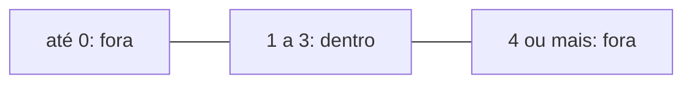

# Seleção

Neste guia, os teus programas passam a decidir: fazem uma coisa num caso e outra noutro, conforme os valores que leem. A ideia é a do `Se`, do `Senão se` e do `Senão` da algoritmia, e por isso o guia concentra-se no que muda em Python. O programa ainda não repete instruções: se um valor não serve, avisa e acaba.

Usa as decisões da algoritmia e o `input` do tema 02. Rever: [Seleção encadeada](../01-algoritmos/03-decisoes-e-validacao.md#seleção-encadeada), [Intervalos](../01-algoritmos/03-decisoes-e-validacao.md#intervalos), [Cada valor tem um tipo](02-dados-e-interacao.md#cada-valor-tem-um-tipo) e [Ler do teclado e converter](02-dados-e-interacao.md#ler-do-teclado-e-converter). Para praticar: [laboratório](laboratorios/03-selecao-laboratorio.md) e [ficha de exercícios](exercicios/03-selecao-exercicios.md).

## Neste guia

1. [As comparações dão `True` ou `False`](#as-comparações-dão-true-ou-false)
2. [Decidir com `if`](#decidir-com-if)
3. [Os dois pontos e a indentação são obrigatórios](#os-dois-pontos-e-a-indentação-são-obrigatórios)
4. [Dois caminhos: `if` e `else`](#dois-caminhos-if-e-else)
5. [Mais de dois caminhos: a cadeia com `elif`](#mais-de-dois-caminhos-a-cadeia-com-elif)
6. [Juntar condições com `and`, `or` e `not`](#juntar-condições-com-and-or-e-not)
7. [Validar um valor: dentro e fora de um intervalo](#validar-um-valor-dentro-e-fora-de-um-intervalo)
8. [Uma decisão dentro de outra](#uma-decisão-dentro-de-outra)
9. [Os casos de teste de cada ramo](#os-casos-de-teste-de-cada-ramo)
10. [Exemplo guiado: a nota do teste, do pseudocódigo ao Python](#exemplo-guiado-a-nota-do-teste-do-pseudocódigo-ao-python)

## As comparações dão `True` ou `False`

No inventário de um jogo de construção, o jogador pede um baú, e o programa tem de saber se as tábuas chegam. Uma decisão começa sempre numa pergunta de sim ou não. Os seis operadores são os do pseudocódigo: `==`, `!=`, `<`, `<=`, `>` e `>=`.

O resultado é um `bool`: `True` ou `False`, com maiúscula. No tema 02, só guardaste valores destes, e aqui vês de onde costumam vir:

```text
>>> tabuas = 24
>>> tabuas >= 16
True
>>> tabuas >= 32
False
>>> type(tabuas >= 16)
<class 'bool'>
>>> tabuas
24
```

A primeira linha não mostra nada, porque é uma atribuição. A última mostra que comparar não muda nada. Um só `=` guarda um valor, e dois, `==`, perguntam se dois valores são iguais.

### Comparar textos

Os operadores `==` e `!=` também comparam textos. Dois textos só são iguais se tiverem os mesmos caracteres, pela mesma ordem. As maiúsculas e os espaços contam.

```text
>>> "pedra" == "pedra"
True
>>> "Pedra" == "pedra"
False
>>> "pedra " == "pedra"
False
```

Na última comparação, o primeiro texto tem um espaço no fim, e por isso tem um carácter a mais.

## Decidir com `if`

O jogo avisa quando as tábuas estão quase a acabar, mas só nesse caso. A seleção simples do pseudocódigo executa um bloco só quando a condição é verdadeira. Em Python, escreve-se com `if`, que quer dizer "se":

```python fragment forma geral, com palavras no lugar da condição e das instruções
if condição:
    instruções que só correm quando a condição dá True
```

A linha do `if` acaba em dois pontos. As instruções que dependem dela vêm por baixo, quatro espaços para dentro, e formam o bloco. O bloco acaba na primeira linha que volta à coluna do `if`, e essa linha corre sempre. Prevê o que aparece com 3 tábuas e com 12:

```python
# stock_baixo.py: avisa quando as tábuas do inventário estão quase a acabar.
LIMITE_AVISO = 5

tabuas = int(input("Quantas tábuas tens? "))
# O bloco do if só corre quando a condição dá True.
if tabuas < LIMITE_AVISO:
    print("Atenção: tens poucas tábuas.")
print("Inventário verificado.")
```

| tabuas | `tabuas < 5` | O bloco | O que aparece |
| ---: | --- | --- | --- |
| 3 | `True` | corre | `Atenção: tens poucas tábuas.` e `Inventário verificado.` |
| 12 | `False` | é saltado | só `Inventário verificado.` |

A última linha aparece nos dois casos, porque está encostada à margem, fora do bloco.

### O `=` no lugar do `==`

Numa condição, a pergunta leva dois sinais. Com um só, o Python recusa o programa:

```text
  File "C:\Users\aluno\Documents\lp-python\esgotado.py", line 3
    if tabuas = 0:
       ^^^^^^^^^^
SyntaxError: invalid syntax. Maybe you meant '==' or ':=' instead of '='?
```

Quer dizer "escrita inválida: talvez quisesses `==`". É um erro de sintaxe, e nenhuma linha do programa corre.

## Os dois pontos e a indentação são obrigatórios

Como no pseudocódigo, só a indentação diz que linhas estão dentro de um bloco. A diferença é que o Python recusa o programa quando ela está errada. Os dois pontos anunciam que vem um bloco.

Sem os dois pontos no `stock_baixo.py`, a mensagem é esta, com o `^` a apontar para o fim da linha:

```text
  File "C:\Users\aluno\Documents\lp-python\stock_baixo.py", line 6
    if tabuas < LIMITE_AVISO
                            ^
SyntaxError: expected ':'
```

Com o `print` do aviso encostado à margem, sem a indentação, a mensagem é outra:

```text
  File "C:\Users\aluno\Documents\lp-python\stock_baixo.py", line 7
    print("Atenção: tens poucas tábuas.")
    ^^^^^
IndentationError: expected an indented block after 'if' statement on line 6
```

Um **`IndentationError`** é um erro de indentação. Em português: "esperava um bloco indentado depois do `if` da linha 6". Conta como erro de sintaxe: nenhuma linha correu, nem a do `input`.

Há um terceiro caso, sem mensagem nenhuma. Se o último `print` ficar com os quatro espaços, as duas linhas passam para dentro do bloco:

```python
# stock_baixo.py, com o último print dentro do bloco.
LIMITE_AVISO = 5

tabuas = int(input("Quantas tábuas tens? "))
if tabuas < LIMITE_AVISO:
    print("Atenção: tens poucas tábuas.")
    print("Inventário verificado.")
```

Com 3 tábuas, o programa dá o mesmo de antes. Com 12, aparece só a pergunta. É um erro de lógica, e só se vê num caso em que a condição dá `False`. Por isso, um teste de uma decisão experimenta sempre os dois lados.

## Dois caminhos: `if` e `else`

No jogo, uma ponte de madeira aguenta no máximo 4 jogadores de cada vez, e o programa tem de responder nos dois casos. A seleção composta escolhe entre dois blocos. O `Senão` escreve-se `else`, sem condição e com dois pontos, na mesma coluna do `if`.

```python
# ponte.py: a ponte de madeira do jogo aguenta no máximo 4 jogadores de cada vez.
MAXIMO_NA_PONTE = 4

jogadores = int(input("Quantos jogadores querem atravessar? "))
if jogadores <= MAXIMO_NA_PONTE:
    print("Podem atravessar.")
else:
    print("A ponte não aguenta. Atravessem em dois grupos.")
print("Fim da travessia.")
```

| jogadores | `jogadores <= 4` | Bloco que corre | Primeira linha no ecrã |
| ---: | --- | --- | --- |
| 3 | `True` | o do `if` | `Podem atravessar.` |
| 4 | `True` | o do `if` | `Podem atravessar.` |
| 5 | `False` | o do `else` | `A ponte não aguenta. Atravessem em dois grupos.` |

Corre sempre exatamente um dos dois blocos, e o último `print`, fora deles, aparece sempre. O `else` apanha todos os casos em que a condição deu `False`, e por isso não precisa de perguntar nada.

## Mais de dois caminhos: a cadeia com `elif`

O inventário classifica as tábuas em três estados: esgotado, baixo e normal. A seleção encadeada usava `Senão se`, e em Python escreve-se `elif`, com condição e dois pontos. As condições avaliam-se de cima para baixo, a primeira verdadeira ganha, e se nenhuma for verdadeira corre o `else`.

```python
# estado_stock.py: classifica as tábuas do inventário em esgotadas, poucas ou normais.
LIMITE_AVISO = 5

tabuas = int(input("Quantas tábuas tens? "))
if tabuas == 0:
    print("Esgotado")
elif tabuas < LIMITE_AVISO:
    print("Stock baixo")
else:
    print("Stock normal")
```

| tabuas | `tabuas == 0` | `tabuas < 5` | Bloco que corre | Ecrã |
| ---: | --- | --- | --- | --- |
| 0 | `True` | não é avaliada | o do `if` | `Esgotado` |
| 3 | `False` | `True` | o do `elif` | `Stock baixo` |
| 9 | `False` | `False` | o do `else` | `Stock normal` |

Com 0, a segunda condição também daria `True`, mas a cadeia já acabou. O `if`, o `elif` e o `else` estão na mesma coluna, e é isso que mostra que são a mesma cadeia. Uma cadeia pode ter os `elif` que forem precisos, e o `else` no fim é opcional.

### A ordem conta: o ramo inacessível

Como a primeira condição verdadeira ganha, a ordem das condições muda o resultado. Com as duas perguntas trocadas, procura um número de tábuas que faça aparecer "Esgotado":

```python
# estado_stock.py, com as perguntas trocadas: o ramo do Esgotado nunca corre.
LIMITE_AVISO = 5

tabuas = int(input("Quantas tábuas tens? "))
if tabuas < LIMITE_AVISO:
    print("Stock baixo")
elif tabuas == 0:
    print("Esgotado")
else:
    print("Stock normal")
```

Esse número não existe. Com 0, a primeira condição já dá `True`. Para chegar ao `elif`, é preciso ter 5 tábuas ou mais, e aí `tabuas == 0` dá sempre `False`.

Um **ramo inacessível** é um ramo que nenhum valor consegue fazer correr. O programa corre sem mensagem, mas um caso do enunciado nunca é tratado. Para o encontrares, pergunta a cada ramo que valor o faz correr. Quando uma condição está contida noutra, como o 0 dentro de `tabuas < 5`, a mais estreita vem primeiro.

## Juntar condições com `and`, `or` e `not`

Os operadores lógicos são os do pseudocódigo. Só mudam as palavras, escritas em minúsculas:

| Pseudocódigo | Python | Dá `True` quando |
| --- | --- | --- |
| `e` | `and` | as duas partes dão `True` |
| `ou` | `or` | pelo menos uma das partes dá `True` |
| `não` | `not` | a parte a seguir dá `False` |

### `and`: as duas coisas ao mesmo tempo

Para partir uma pedra, precisas de uma picareta e de pelo menos 2 de energia.

```python
# picareta.py: partir uma pedra pede uma picareta e energia que chegue.
ENERGIA_PARA_PARTIR = 2

tem_picareta = True
energia = int(input("Quanta energia tens? "))
if tem_picareta and energia >= ENERGIA_PARA_PARTIR:
    print("Partiste a pedra.")
else:
    print("Não consegues partir a pedra.")
```

Com 2 de energia, aparece `Partiste a pedra.`. Com 1, aparece a outra frase, e com `tem_picareta = False` também. O `tem_picareta` entra na condição sozinho, porque já é um `bool`.

### `or`: basta uma

O `or` serve, por exemplo, para aceitar uma resposta com maiúscula ou com minúscula:

```python
# chave.py: aceita a resposta S ou s, porque as duas querem dizer sim.
resposta = input("Tens a chave (S/N)? ")
if resposta == "S" or resposta == "s":
    print("A porta abriu.")
else:
    print("A porta continua fechada.")
```

Com `S` ou com `s`, a porta abre. Cada lado do `or` é uma comparação completa. Escrever só `resposta == "S" or "s"` não dá erro, mas o bloco do `if` corre com qualquer resposta. O lado direito não é uma pergunta, e o Python trata-o como `True`.

### `not`: o contrário

O `not` troca o valor da condição que vem a seguir, e serve sobretudo para os `bool`: `if not tem_picareta:` lê-se "se não tem a picareta". Com uma comparação, é melhor escrever a contrária: `energia < 2`, em vez de `not (energia >= 2)`.

### Parênteses quando se misturam `and` e `or`

Quando misturas os dois, usa parênteses para mostrar o que se avalia primeiro. Para abrir o portão com a chave ou com pelo menos 3 cristais, mas só de dia:

```python fragment mostra só a condição; as variáveis vêm de um programa que não está aqui
if (tem_chave or cristais >= 3) and de_dia:
    print("O portão abriu.")
```

Sem os parênteses, o Python faria o `and` antes do `or`, e a chave abria o portão também de noite.

## Validar um valor: dentro e fora de um intervalo

Um jogo tem os níveis de dificuldade 1, 2 e 3, e um 7 não pode entrar. Na algoritmia, a validação vinha em primeiro lugar, e em Python também. Um valor dentro de um intervalo escreve-se com `and`, e fora com `or`, com cada comparação trocada pela contrária:

```python fragment as duas condições, só para comparar; o programa completo vem a seguir
dificuldade >= 1 and dificuldade <= 3
dificuldade < 1 or dificuldade > 3
```



A reta tem três zonas, e os valores de fora estão nas duas pontas. Por isso, para estar fora, basta uma das comparações.

```python
# dificuldade.py: confirma o nível de dificuldade escolhido, de 1 a 3.
DIFICULDADE_MINIMA = 1
DIFICULDADE_MAXIMA = 3

dificuldade = int(input("Dificuldade (1 a 3)? "))
# A validação vem primeiro: um valor fora do intervalo não se usa.
if dificuldade < DIFICULDADE_MINIMA or dificuldade > DIFICULDADE_MAXIMA:
    print("Essa dificuldade não existe.")
else:
    print("Dificuldade escolhida:", dificuldade)
```

| dificuldade | `dificuldade < 1` | `dificuldade > 3` | Com `or` | Ecrã |
| ---: | --- | --- | --- | --- |
| 0 | `True` | `False` | `True` | `Essa dificuldade não existe.` |
| 1 | `False` | `False` | `False` | `Dificuldade escolhida: 1` |
| 3 | `False` | `False` | `False` | `Dificuldade escolhida: 3` |
| 4 | `False` | `True` | `True` | `Essa dificuldade não existe.` |

O erro típico é ligar as duas comparações de fora com `and`. Nenhum número é ao mesmo tempo menor do que 1 e maior do que 3, por isso a condição dá sempre `False`. Com 7, aparece `Dificuldade escolhida: 7`, e o ramo do aviso ficou inacessível. Com valores do meio, como o 2, este erro não se nota.

Se a pessoa escrever `dois`, o programa para antes do `if`, com um `ValueError`, porque o `int` não consegue converter o texto. Por agora, quem usa o programa escreve um número inteiro.

<details>
<summary>Para ires mais longe: uma forma mais curta de escrever um intervalo</summary>

O Python aceita também `1 <= dificuldade <= 3`, que se lê como na matemática. Vais encontrá-la em programas de outras pessoas. Nas aulas, escrevem-se duas comparações ligadas por `and`, como na algoritmia.

</details>

## Uma decisão dentro de outra

Um baú com cadeado só se abre com a chave, e só depois de aberto faz sentido contar as moedas. A segunda decisão vai para dentro do bloco da primeira, como a decisão aninhada do pseudocódigo.

```python
# bau.py: um baú com cadeado só se abre com a chave, e pode ter um tesouro.
MOEDAS_DE_TESOURO = 100

chave = input("Tens a chave (S/N)? ")
if chave == "S" or chave == "s":
    print("O baú abriu.")
    # Com o baú trancado, nem se perguntam as moedas.
    moedas = int(input("Quantas moedas tem o baú? "))
    if moedas >= MOEDAS_DE_TESOURO:
        print("Encontraste um tesouro.")
    else:
        print("O baú tem", moedas, "moedas.")
else:
    print("O baú está trancado. Precisas da chave.")
```

```text
Tens a chave (S/N)? S
O baú abriu.
Quantas moedas tem o baú? 150
Encontraste um tesouro.
```

Com `N`, aparece só a frase do baú trancado, e o programa nem pergunta as moedas. Cada `else` pertence ao `if` que está na mesma coluna, acima dele.

Aqui, uma cadeia com `elif` não chegava. Antes de saber se há tesouro, o programa tem sempre de dizer que o baú abriu e de perguntar as moedas. Quando não há nada em comum, a cadeia diz o mesmo com menos indentação.

## Os casos de teste de cada ramo

Cada execução percorre só um caminho, e um caso que passa não diz nada dos outros. Por isso, os casos escolhem-se com as duas regras da algoritmia:

- cada ramo tem pelo menos um caso que o faz correr;
- cada limite tem três casos: o valor imediatamente abaixo, o próprio limite e o valor imediatamente acima.

Os resultados esperados escrevem-se antes de correr, a partir do enunciado. A tabela de entradas e saídas ganha uma coluna para o ramo. Para o `dificuldade.py`, com os limites 1 e 3:

| dificuldade | Ramo | Resultado esperado | Porque se escolheu |
| ---: | --- | --- | --- |
| 0 | o do `if` | `Essa dificuldade não existe.` | Imediatamente abaixo do limite 1 |
| 1 | o do `else` | `Dificuldade escolhida: 1` | O limite 1 |
| 2 | o do `else` | `Dificuldade escolhida: 2` | Acima do limite 1 e abaixo do limite 3 |
| 3 | o do `else` | `Dificuldade escolhida: 3` | O limite 3 |
| 4 | o do `if` | `Essa dificuldade não existe.` | Imediatamente acima do limite 3 |

Com `dificuldade >= DIFICULDADE_MAXIMA`, só o caso do 3 falhava. Testar com 2 e com 10 nunca o mostrava.

## Exemplo guiado: a nota do teste, do pseudocódigo ao Python

Este problema está resolvido em pseudocódigo no [guia 03 da algoritmia](../01-algoritmos/03-decisoes-e-validacao.md#exemplo-guiado-classificar-a-nota-de-um-teste). Aqui passa-se para Python, com os mesmos casos de teste.

### Passo 1: O enunciado

> Um professor quer um programa que o ajude a classificar os testes. O programa lê a nota de um teste, que é um número inteiro na escala de 0 a 20. Se a nota for igual ou superior a 10, escreve "Positiva". Se for inferior a 10, escreve "Negativa". Se a nota escrita não pertencer à escala, o programa escreve "Nota inválida" e não a classifica.

### Passo 2: Os casos de teste, antes do programa

Os limites são o 0, o 10 e o 20, e cada um dá três casos:

| Nota | Resultado esperado | Porque se escolheu |
| ---: | --- | --- |
| -1 | Nota inválida | Imediatamente abaixo do limite 0 |
| 0 | Negativa | O próprio limite 0 |
| 1 | Negativa | Imediatamente acima do limite 0 |
| 9 | Negativa | Imediatamente abaixo do limiar 10 |
| 10 | Positiva | O próprio limiar |
| 11 | Positiva | Imediatamente acima do limiar |
| 19 | Positiva | Imediatamente abaixo do limite 20 |
| 20 | Positiva | O próprio limite 20 |
| 21 | Nota inválida | Imediatamente acima do limite 20 |

### Passo 3: O pseudocódigo

```text
const NOTA_MINIMA = 0
const NOTA_MAXIMA = 20
const LIMIAR_POSITIVA = 10
Escreve: "Nota do teste (inteiro de 0 a 20)?"
int nota = ler valor
Se nota < NOTA_MINIMA ou nota > NOTA_MAXIMA
    Escreve: "Nota inválida"
Senão se nota >= LIMIAR_POSITIVA
    Escreve: "Positiva"
Senão
    Escreve: "Negativa"
```

### Passo 4: Traduzir linha a linha

| Pseudocódigo | Python | O que mudou |
| --- | --- | --- |
| `const NOTA_MINIMA = 0` | `NOTA_MINIMA = 0` | Sem `const` |
| `Escreve: "..."` e `int nota = ler valor` | `nota = int(input("..."))` | As duas linhas juntam-se, e o `int` converte o texto |
| `Se condição` | `if condição:` | `if`, e os dois pontos no fim |
| `ou` | `or` | A palavra em inglês |
| `Senão se condição` | `elif condição:` | Uma palavra só, e os dois pontos |
| `Senão` | `else:` | Sem condição, com os dois pontos |
| `Escreve: "Positiva"` | `print("Positiva")` | O `print` |

### Passo 5: O programa, parte a parte

Começa-se pela validação, para confirmar que as notas fora da escala são apanhadas:

```python
# nota.py: classifica a nota de um teste, de 0 a 20, em positiva ou negativa.
NOTA_MINIMA = 0
NOTA_MAXIMA = 20

nota = int(input("Nota do teste (inteiro de 0 a 20)? "))
if nota < NOTA_MINIMA or nota > NOTA_MAXIMA:
    print("Nota inválida")
else:
    print("Nota válida")
```

Com 21, escreve `Nota inválida`, e com 10, `Nota válida`. Falta classificar. Acrescenta-se a constante do limiar, e o `else` dá lugar a um `elif` e a um `else` novos. O programa completo fica assim:

```python
# nota.py: classifica a nota de um teste, de 0 a 20, em positiva ou negativa.
NOTA_MINIMA = 0
NOTA_MAXIMA = 20
LIMIAR_POSITIVA = 10

nota = int(input("Nota do teste (inteiro de 0 a 20)? "))
# A validação vem primeiro: uma nota fora da escala não se classifica.
if nota < NOTA_MINIMA or nota > NOTA_MAXIMA:
    print("Nota inválida")
elif nota >= LIMIAR_POSITIVA:
    print("Positiva")
else:
    print("Negativa")
```

O `elif` não pergunta se a nota é menor ou igual a 20, porque uma nota fora da escala já ficou no primeiro ramo. O `else` não tem condição, porque uma nota válida que não é positiva só pode ser negativa.

### Passo 6: Correr os casos

O programa corre-se nove vezes, uma por linha da tabela do passo 2. Com 10, o próprio limiar:

```text
Nota do teste (inteiro de 0 a 20)? 10
Positiva
```

Os outros oito casos dão também o resultado da tabela, e o programa está confirmado para os três ramos e os três limites.

### Passo 7: O caso que apanha o operador trocado

Imagina que tinhas escrito `elif nota > LIMIAR_POSITIVA:`, sem o igual. O programa corria sem mensagem. Dos nove casos, só o 10 falhava, com `Negativa` em vez de `Positiva`. A hipótese é "a condição da positiva não inclui o 10", e confirma-se com o valor: `10 > 10` dá `False`. A correção é voltar a pôr `>=` e correr outra vez os nove casos. O 9 e o 11 davam o resultado certo com os dois operadores, e é por isso que a tabela tem o próprio limiar.

## Erros frequentes

### Palavras do pseudocódigo no meio do Python

Numa linha como `if nota >= 0 e nota <= 20:`, aparece `SyntaxError: invalid syntax`. Ficou uma palavra do pseudocódigo no código. Corrige-se trocando cada palavra pela do Python, com a tabela do passo 4 do exemplo guiado.

### Uma condição no `else`

Numa linha como `else nota < 10:`, aparece `SyntaxError: expected ':'`, com o `^` debaixo da condição. Se precisas de uma condição, usa `elif`. Se não precisas, apaga-a e deixa `else:`.

### Dois `if` separados em vez de uma cadeia

Com a nota 21, aparecem duas mensagens, `Nota inválida` e `Positiva`. Acontece quando a validação e a classificação ficam em dois `if` seguidos:

```python fragment dois if separados, com as constantes do nota.py
if nota < NOTA_MINIMA or nota > NOTA_MAXIMA:
    print("Nota inválida")
if nota >= LIMIAR_POSITIVA:
    print("Positiva")
else:
    print("Negativa")
```

O segundo `if`, encostado à margem, começa uma decisão nova, que corre sempre. Corrige-se trocando-o por `elif`: os resultados que são alternativas uns dos outros ficam numa só cadeia.

### O `elif` ou o `else` fora da coluna do seu `if`

Com dois ou três espaços a mais, aparece `IndentationError: unindent does not match any outer indentation level`, que quer dizer "o recuo não corresponde a nenhum nível de fora". Com quatro, aparece `SyntaxError: invalid syntax`, porque o Python vê o `else` dentro do bloco do `if`, sozinho. Corrige-se alinhando o `elif` e o `else` com o `if` a que pertencem.

### O `int` esquecido

Sem o `int`, a resposta do `input` fica um texto, e o `>=` dá erro:

```python
# pedido_sem_int.py: compara a resposta do input com um número, sem a converter.
baus = input("Quantos baús queres construir? ")
if baus >= 1:
    print("Pedido registado.")
```

```text
Quantos baús queres construir? 3
Traceback (most recent call last):
  File "C:\Users\aluno\Documents\lp-python\pedido_sem_int.py", line 3, in <module>
    if baus >= 1:
       ^^^^^^^^^
TypeError: '>=' not supported between instances of 'str' and 'int'
```

É um erro de execução, e diz que o `>=` não funciona entre um texto e um inteiro. A causa está na linha 2, onde falta o `int`, e não na linha 3, onde o Python deu pelo problema.

## Palavras novas deste guia

- `IndentationError`: o erro de indentação, quando falta um bloco ou uma linha fica num recuo que não corresponde a nenhum nível.
- Ramo inacessível: um ramo que nenhum valor consegue fazer correr.

## O que vem a seguir

No tema seguinte, Ciclo while, o programa passa a repetir instruções, por exemplo para voltar a pedir um valor até ele ser válido.

## Para saber mais

- [Instruções `if`](https://docs.python.org/3/tutorial/controlflow.html#if-statements): a parte do tutorial oficial do Python, em inglês, sobre o `if`, o `elif` e o `else`.
- [Comparações](https://docs.python.org/3/library/stdtypes.html#comparisons): a tabela oficial dos operadores de comparação, em inglês.


