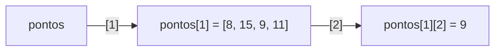

# Ciclo for e listas simples

Neste guia, os teus programas passam a guardar muitos valores com um só nome, numa lista, e a percorrê-los com o ciclo `for`. Somas, procuras, contas e mudas os valores de uma lista, e comparas o trabalho de duas versões do mesmo programa. No fim, guardas uma tabela inteira numa só variável.

Usa os arrays da algoritmia, os índices dos textos e a sentinela do tema 04. Rever: [Arrays: muitos valores numa só variável](../01-algoritmos/04-repeticao-e-padroes.md#arrays-muitos-valores-numa-só-variável), [Percorrer um array com o para cada](../01-algoritmos/04-repeticao-e-padroes.md#percorrer-um-array-com-o-para-cada), [Um índice dá um carácter](02-dados-e-interacao.md#um-índice-dá-um-carácter) e [Ler até à sentinela](04-ciclo-while.md#ler-até-à-sentinela). Para praticar: [laboratório](laboratorios/05-ciclo-for-e-listas-simples-laboratorio.md) e [ficha de exercícios](exercicios/05-ciclo-for-e-listas-simples-exercicios.md).

## Neste guia

1. [Uma lista guarda vários valores com um só nome](#uma-lista-guarda-vários-valores-com-um-só-nome)
2. [O índice é a posição de cada elemento](#o-índice-é-a-posição-de-cada-elemento)
3. [O `len` diz quantos elementos tem a lista](#o-len-diz-quantos-elementos-tem-a-lista)
4. [Percorrer a lista pelo valor, com `for`](#percorrer-a-lista-pelo-valor-com-for)
5. [Juntar elementos com `append`](#juntar-elementos-com-append)
6. [Contar voltas com `for` e `range`](#contar-voltas-com-for-e-range)
7. [Percorrer a lista pelo índice, com `range` e `len`](#percorrer-a-lista-pelo-índice-com-range-e-len)
8. [Escolher entre o valor e o índice](#escolher-entre-o-valor-e-o-índice)
9. [Mudar um elemento pelo índice](#mudar-um-elemento-pelo-índice)
10. [O maior valor de uma lista](#o-maior-valor-de-uma-lista)
11. [Procurar um valor com uma bandeira](#procurar-um-valor-com-uma-bandeira)
12. [Parar a pesquisa com `break`](#parar-a-pesquisa-com-break)
13. [Contar as voltas: a pesquisa com e sem `break`](#contar-as-voltas-a-pesquisa-com-e-sem-break)
14. [Saltar uma volta com `continue`](#saltar-uma-volta-com-continue)
15. [As funções prontas: `sum`, `max`, `min` e `in`](#as-funções-prontas-sum-max-min-e-in)
16. [A lista vazia e os três casos de teste](#a-lista-vazia-e-os-três-casos-de-teste)
17. [Listas de listas: uma tabela numa só variável](#listas-de-listas-uma-tabela-numa-só-variável)
18. [Percorrer uma lista de listas: um `for` dentro de outro](#percorrer-uma-lista-de-listas-um-for-dentro-de-outro)
19. [Exemplo guiado: as colheitas da quinta](#exemplo-guiado-as-colheitas-da-quinta)

## Uma lista guarda vários valores com um só nome

No jogo de construção, cada viagem à mina traz pedras. Trouxeste 12 na primeira, 7 na segunda, 24 na terceira, 5 na quarta e 30 na quinta. Com variáveis, precisavas de cinco nomes e de uma conta com os cinco. Com 50 viagens, de 50 nomes.

Em Python, o array do pseudocódigo chama-se lista. Escreve-se como na algoritmia: os valores entre parênteses retos, separados por vírgulas. Cada valor é um elemento, e os elementos ficam pela ordem em que os escreves.

```python
# mina.py: as pedras que trouxeste em cada viagem à mina.
pedras = [12, 7, 24, 5, 30]
print("Pedras por viagem:", pedras)
```

O resultado é `Pedras por viagem: [12, 7, 24, 5, 30]`, porque o `print` mostra a lista inteira, com os parênteses retos.

Uma lista também guarda textos, como `["picareta", "machado", "pá"]`. Quando o `print` escreve essa lista, mostra cada texto entre aspas simples, `['picareta', 'machado', 'pá']`, para se ver onde começa e acaba cada um.

## O índice é a posição de cada elemento

Para usar só as pedras da terceira viagem, é preciso dizer qual. Cada elemento tem uma posição, o índice, que começa em 0, como nos arrays e nos caracteres de um texto. Como nos textos, há também índices negativos, que contam a partir do fim.

| Elemento | 12 | 7 | 24 | 5 | 30 |
| --- | ---: | ---: | ---: | ---: | ---: |
| Índice | 0 | 1 | 2 | 3 | 4 |
| Índice negativo | -5 | -4 | -3 | -2 | -1 |

O índice escreve-se entre parênteses retos, a seguir ao nome da lista, como num texto. Um elemento usa-se como qualquer variável, numa conta ou num `print`:

```text
>>> pedras = [12, 7, 24, 5, 30]
>>> pedras[0]
12
>>> pedras[2]
24
>>> pedras[-1]
30
>>> pedras[0] + pedras[1]
19
```

A terceira viagem, para as pessoas, tem o índice 2. O `pedras[-1]` dá sempre o último elemento, seja qual for o tamanho da lista.

Numa lista de 5 elementos, os índices vão de 0 a 4. Na mesma consola, um índice que não existe dá erro:

```text
>>> pedras[5]
Traceback (most recent call last):
  File "<python-input-5>", line 1, in <module>
    pedras[5]
    ~~~~~~^^^
IndexError: list index out of range
```

Um **`IndexError`** é o erro de um índice que não existe. A última linha quer dizer "índice da lista fora dos limites". É um erro de execução: a linha está bem escrita, mas a lista só tem cinco viagens.

## O `len` diz quantos elementos tem a lista

Na algoritmia, o número de elementos de um array ficava numa constante. Se a lista ganhar uma sexta viagem e a constante ficar em 5, a sexta fica de fora, e o programa não avisa.

O **`len`**, do inglês *length*, comprimento, é uma função predefinida que recebe uma lista e devolve quantos elementos ela tem. Numa lista com `n` elementos, o último índice é `n - 1`.

```python
# mina_len.py: quantas viagens tem a lista, e quantas pedras trouxe a última.
pedras = [12, 7, 24, 5, 30]
numero_de_viagens = len(pedras)
print("Viagens:", numero_de_viagens)
print("Última viagem:", pedras[numero_de_viagens - 1], "pedras")
```

Aparecem `Viagens: 5` e `Última viagem: 30 pedras`. Com mais uma viagem na lista, os dois resultados mudam sozinhos. O `len` dá 5, mas o último índice é o 4, e por isso `pedras[len(pedras)]` dá sempre `IndexError`.

<details>
<summary>Para ires mais longe: o <code>len</code> de um texto</summary>

O `len` também conta os caracteres de um texto: `len("pedra")` dá 5. Os espaços e os sinais contam como caracteres, e `len("baú de ferro")` dá 12.

</details>

## Percorrer a lista pelo valor, com `for`

Para somar as pedras todas, escrever `pedras[0] + pedras[1] + ...` não serve com 50 viagens. Percorre-se a lista com um ciclo. O `Para cada quantidade em pedras` do pseudocódigo passa a `for quantidade in pedras:`, com os dois pontos e o corpo indentado, como no `while`.

Em cada volta, a variável recebe o elemento seguinte, e o ciclo acaba sozinho quando os elementos se esgotam. O `in` quer dizer "em". A variável tem o nome de um elemento, no singular.

Para somar, usa-se o acumulador do tema 04, que começa em 0 antes do ciclo e soma cada elemento com o `+=`. Rever: [O contador e o acumulador](04-ciclo-while.md#o-contador-e-o-acumulador).

```python
# total_pedras.py: soma as pedras de todas as viagens à mina.
pedras = [12, 7, 24, 5, 30]
total = 0
for quantidade in pedras:
    total += quantidade
print("Total de pedras:", total)
```

| Volta | `quantidade` | `total` no fim da volta |
| --- | ---: | ---: |
| antes do ciclo | sem valor | 0 |
| 1.ª | 12 | 12 |
| 2.ª | 7 | 19 |
| 3.ª | 24 | 43 |
| 4.ª | 5 | 48 |
| 5.ª | 30 | 78 |

O programa escreve `Total de pedras: 78`. O `print` está encostado à margem, fora do ciclo, e por isso corre uma só vez, depois da última volta.

## Juntar elementos com `append`

No tema 04, os programas liam valores até aparecer a sentinela, e contavam-nos ou somavam-nos. Depois do ciclo, cada valor tinha-se perdido, e só ficavam a contagem e o total. Para os guardar, a lista começa vazia, `[]`, e cresce um elemento de cada vez.

O `append` acrescenta um elemento no fim da lista. Escreve-se a seguir ao nome da lista, com um ponto: `pedras.append(12)`. Uma função que se escreve assim, ligada a um valor por um ponto, chama-se **método**. O `append` muda a própria lista e não devolve nada.

```python
# viagens.py: junta numa lista as pedras de cada viagem à mina, até aparecer o 0.
SENTINELA = 0

pedras = []
quantidade = int(input("Pedras desta viagem (0 para acabar)? "))
while quantidade != SENTINELA:
    pedras.append(quantidade)
    quantidade = int(input("Pedras desta viagem (0 para acabar)? "))
print("Viagens:", len(pedras))
print("Pedras por viagem:", pedras)
```

```text
Pedras desta viagem (0 para acabar)? 12
Pedras desta viagem (0 para acabar)? 7
Pedras desta viagem (0 para acabar)? 24
Pedras desta viagem (0 para acabar)? 0
Viagens: 3
Pedras por viagem: [12, 7, 24]
```

A lista nasce antes do ciclo, como um contador nasce a 0. A sentinela não entra, porque o ciclo acaba antes de chegar ao `append`. Com um 0 logo na primeira pergunta, aparecem `Viagens: 0` e `Pedras por viagem: []`, a lista vazia. Aqui a sentinela pode ser o 0, porque uma viagem traz sempre pelo menos uma pedra.

## Contar voltas com `for` e `range`

Às vezes não há lista nenhuma, e só se quer repetir um número certo de vezes. O jogo começa com três rondas de treino, e sabe-se antes de começar quantas voltas o ciclo vai dar. Na algoritmia, era o `Para`.

Em Python, o `Para` escreve-se com `for` e com o **`range`**, uma função que dá uma sequência de inteiros: `range(1, 4)` dá 1, 2 e 3. O primeiro número entra, e o segundo já não entra.

```python
# rondas_treino.py: o jogo começa com três rondas de treino.
RONDAS_DE_TREINO = 3

for ronda in range(1, RONDAS_DE_TREINO + 1):
    print("Ronda de treino", ronda)
print("Começa o jogo.")
```

| Volta | `ronda` | Durante a volta |
| --- | ---: | --- |
| 1.ª | 1 | escreve `Ronda de treino 1` |
| 2.ª | 2 | escreve `Ronda de treino 2` |
| 3.ª | 3 | escreve `Ronda de treino 3` |

Depois da 3.ª volta, aparece `Começa o jogo.`. O `+ 1` está lá porque o fim do `range` não entra, e as rondas vão até à 3.

As três peças de um ciclo estão todas na linha do `for`. Rever: [As três peças de um ciclo](04-ciclo-while.md#as-três-peças-de-um-ciclo).

| Peça | Com `while` | Com `for` e `range` |
| --- | --- | --- |
| Inicialização | `ronda = 1` | o primeiro número do `range` |
| Condição | `ronda <= RONDAS_DE_TREINO` | o segundo número, que não entra |
| Atualização | `ronda += 1` | não se escreve: o `for` passa ao número seguinte |

As formas do `Para` das aulas passam a `range` assim:

| No pseudocódigo | `range` | Valores da variável | Voltas |
| --- | --- | --- | ---: |
| `Para i de 1 até 10` | `range(1, 11)` | 1, 2, ..., 10 | 10 |
| `Para i = 0, i < 10, i++` | `range(0, 10)` | 0, 1, ..., 9 | 10 |
| a mesma, sem escrever o 0 | `range(10)` | 0, 1, ..., 9 | 10 |
| `Para i de 3 até 2` | `range(3, 3)` | nenhum | 0 |

O erro típico é esquecer que o fim não entra. Com `range(1, RONDAS_DE_TREINO)`, só há duas rondas de treino, sem nenhuma mensagem. Testa sempre a primeira e a última volta.

<details>
<summary>Para ires mais longe: o passo do <code>range</code></summary>

O `range` pode ter um terceiro número, o passo. Com um passo negativo, conta para trás, como na contagem antes de uma partida começar:

```python
for segundos in range(3, 0, -1):
    print(segundos)
print("Já!")
```

Aparecem 3, 2, 1 e `Já!`. O fim, o 0, também não entra.

</details>

## Percorrer a lista pelo índice, com `range` e `len`

Para escrever "Viagem 1 trouxe 12 pedras", cada volta precisa da posição do elemento, e o `for` pelo valor não a dá. Percorre-se então a lista pelo índice, como na algoritmia, com o `Para` e a variável de controlo.

O `range(0, len(pedras))` dá os números de 0 a 4, que são exatamente os índices válidos da lista. Em cada volta, `i` recebe um índice, e `pedras[i]` é o elemento nessa posição.

```python
# viagens_numeradas.py: escreve as pedras de cada viagem, com o número da viagem.
pedras = [12, 7, 24, 5, 30]
for i in range(0, len(pedras)):
    # As pessoas contam as viagens a partir de 1, e os índices começam no 0.
    print("Viagem", i + 1, "trouxe", pedras[i], "pedras")
```

| Volta | `i` | `pedras[i]` | Escreve |
| --- | ---: | ---: | --- |
| 1.ª | 0 | 12 | `Viagem 1 trouxe 12 pedras` |
| 2.ª | 1 | 7 | `Viagem 2 trouxe 7 pedras` |
| 3.ª | 2 | 24 | `Viagem 3 trouxe 24 pedras` |
| 4.ª | 3 | 5 | `Viagem 4 trouxe 5 pedras` |
| 5.ª | 4 | 30 | `Viagem 5 trouxe 30 pedras` |

O nome `i` é a escolha habitual para uma variável que guarda um índice.

## Escolher entre o valor e o índice

As duas formas passam por todos os elementos. A pergunta que decide é esta: preciso de saber em que posição está cada elemento?

| O que se compara | Pelo valor | Pelo índice |
| --- | --- | --- |
| A linha do ciclo | `for quantidade in pedras:` | `for i in range(0, len(pedras)):` |
| A variável recebe | o elemento | a posição |
| Para usar o elemento | `quantidade` | `pedras[i]` |
| Pode usar um índice que não existe | não | sim, se o `range` estiver errado |
| Serve para | somar, contar, comparar com um limite | dizer a posição, mudar um elemento, ler duas listas com os mesmos índices |

Duas listas com os mesmos índices guardam duas informações sobre as mesmas coisas. Aqui, `jogadores[i]` e `moedas[i]` são do mesmo jogador, e só o índice as liga:

```python
# moedas_equipa.py: as moedas de cada jogador, em duas listas com os mesmos índices.
jogadores = ["Ana", "Rui", "Bia"]
moedas = [30, 12, 45]
for i in range(0, len(jogadores)):
    print(jogadores[i], "tem", moedas[i], "moedas")
```

Aparecem `Ana tem 30 moedas`, `Rui tem 12 moedas` e `Bia tem 45 moedas`.

## Mudar um elemento pelo índice

Afinal, a segunda viagem trouxe 9 pedras, e não 7. Para corrigir, dás um valor novo ao elemento, como a uma variável: `pedras[1] = 9`. O 7 perde-se, e os outros elementos ficam como estavam.

Volta à lista original. No fim de semana, um bónus do jogo dá mais 5 pedras a cada viagem, e a lista tem de ficar `[17, 12, 29, 10, 35]`. Prevê o que escreve esta primeira tentativa:

```python
# bonus_tentativa.py: tenta dar mais 5 pedras a cada viagem, com o for pelo valor.
BONUS = 5

pedras = [12, 7, 24, 5, 30]
for quantidade in pedras:
    quantidade += BONUS
print("Com o bónus:", pedras)
```

Escreve `Com o bónus: [12, 7, 24, 5, 30]`, e a lista não mudou. Em cada volta, `quantidade` recebe uma cópia do valor do elemento, e o `+=` muda só a cópia. É o que acontecia com o para cada. Rever: [O para cada não muda o array](../01-algoritmos/04-repeticao-e-padroes.md#o-para-cada-não-muda-o-array).

Para mudar um elemento, é preciso a sua posição:

```python
# bonus.py: dá mais 5 pedras a cada viagem, com o for pelo índice.
BONUS = 5

pedras = [12, 7, 24, 5, 30]
for i in range(0, len(pedras)):
    pedras[i] += BONUS
print("Com o bónus:", pedras)
```

Escreve `Com o bónus: [17, 12, 29, 10, 35]`. Em cada volta, a linha do corpo lê o elemento da posição `i`, soma-lhe 5 e guarda o resultado na mesma posição. Só se mudam elementos que já existem: `pedras[5] = 10`, numa lista de cinco, dá `IndexError: list assignment index out of range`. Para acrescentar, usa-se o `append`.

## O maior valor de uma lista

Qual foi a viagem com mais pedras? Olhando para `[12, 7, 24, 5, 30]`, vês logo que foi a de 30. O programa não vê a lista toda de uma vez. Olha para um elemento de cada vez, e tem de se lembrar do maior que já viu.

O padrão é este: cada elemento que ultrapassa o maior visto até ali passa a ser o novo maior. No fim do ciclo, o maior é o maior de todos.

```python
# melhor_viagem.py: encontra o maior número de pedras trazidas numa só viagem.
pedras = [12, 7, 24, 5, 30]
# O maior começa no primeiro elemento, que é um valor da própria lista.
maior = pedras[0]
for quantidade in pedras:
    if quantidade > maior:
        maior = quantidade
print("Mais pedras numa viagem:", maior)
```

| Volta | `quantidade` | `quantidade > maior` | `maior` no fim da volta |
| --- | ---: | --- | ---: |
| antes do ciclo | sem valor | sem pergunta | 12 |
| 1.ª | 12 | `False` | 12 |
| 2.ª | 7 | `False` | 12 |
| 3.ª | 24 | `True` | 24 |
| 4.ª | 5 | `False` | 24 |
| 5.ª | 30 | `True` | 30 |

O programa escreve `Mais pedras numa viagem: 30`. Na 1.ª volta, o 12 compara-se consigo mesmo, e nada muda.

Para dizer também qual foi a viagem, percorre-se pelo índice e guarda-se a posição ao mesmo tempo que o valor:

```python
# melhor_viagem.py: diz qual foi a viagem com mais pedras, e quantas trouxe.
pedras = [12, 7, 24, 5, 30]
maior = pedras[0]
viagem_maior = 1
for i in range(0, len(pedras)):
    if pedras[i] > maior:
        maior = pedras[i]
        viagem_maior = i + 1
print("Melhor viagem:", viagem_maior, "com", maior, "pedras")
```

Aparece `Melhor viagem: 5 com 30 pedras`. Num empate, o `>` não troca a viagem, e fica a primeira das duas. Com `>=`, ficava a última.

## Procurar um valor com uma bandeira

Houve alguma viagem fraca, com menos de 8 pedras? O programa olha para as viagens uma a uma. Se encontrar uma, já sabe que sim, mas só pode dizer que não depois de ver a lista toda.

A resposta fica numa bandeira, a flag da algoritmia. É uma variável `bool` que começa em `False` e passa a `True` quando aparece o que se procura. Rever: [Padrão flag](../01-algoritmos/04-repeticao-e-padroes.md#padrão-flag).

```python
# viagem_fraca.py: diz se houve alguma viagem fraca, com menos de 8 pedras.
LIMITE_FRACA = 8

pedras = [12, 7, 24, 5, 30]
houve_fraca = False
for quantidade in pedras:
    if quantidade < LIMITE_FRACA:
        houve_fraca = True
if houve_fraca:
    print("Houve pelo menos uma viagem fraca.")
else:
    print("Nenhuma viagem foi fraca.")
```

Aparece `Houve pelo menos uma viagem fraca.`. Na 2.ª volta, o 7 iça a bandeira, e nas voltas seguintes ela continua `True`, porque nada a volta a pôr em `False`. O `if houve_fraca:` lê-se "se houve uma viagem fraca".

A resposta dá-se depois do ciclo. Com o `print` do "não" num `else` dentro do ciclo, a frase `Nenhuma viagem foi fraca.` aparecia três vezes, uma por cada viagem que não era fraca.

## Parar a pesquisa com `break`

Qual foi a primeira viagem fraca? Depois de a encontrar, o resto da lista não interessa. O `Parar` do pseudocódigo escreve-se `break`, e termina o ciclo logo ali, sem passar às voltas seguintes.

```python
# primeira_fraca.py: diz qual foi a primeira viagem fraca, com menos de 8 pedras.
LIMITE_FRACA = 8

pedras = [12, 7, 24, 5, 30]
encontrada = False
for i in range(0, len(pedras)):
    if pedras[i] < LIMITE_FRACA:
        print("Primeira viagem fraca: viagem", i + 1)
        encontrada = True
        break
if not encontrada:
    print("Nenhuma viagem foi fraca.")
```

| Volta | `i` | `pedras[i]` | `pedras[i] < 8` | O que acontece |
| --- | ---: | ---: | --- | --- |
| 1.ª | 0 | 12 | `False` | nada |
| 2.ª | 1 | 7 | `True` | escreve a resposta, iça a bandeira e sai do ciclo com o `break` |

Aparece `Primeira viagem fraca: viagem 2`. Olhar para os elementos um a um, a partir do primeiro, e parar no que se procura chama-se **pesquisa linear**. Sem o `break`, a viagem 4 também passava no `if`, e apareciam duas linhas a dizer "primeira". A bandeira continua a fazer falta. O ciclo pode acabar no `break` ou no fim da lista, e é ela que diz qual das duas aconteceu.

O `break` fica dentro do `if`, com oito espaços. Com quatro, alinhado com o `if`, executa-se logo na primeira volta, e o programa diz que nenhuma viagem foi fraca.

## Contar as voltas: a pesquisa com e sem `break`

O `break` também serve quando só se quer saber se houve alguma viagem fraca. A resposta não muda, mas o ciclo deixa de olhar para as viagens que já não interessam.

Para comparar o trabalho de duas versões, conta-se quantas voltas dá o ciclo, com um contador provisório. O contador soma 1 no início de cada volta e, como uma linha de observação do tema 04, sai do programa depois de medir.

```python
# viagem_fraca.py, com um contador de voltas provisório e o break.
LIMITE_FRACA = 8

pedras = [12, 7, 24, 5, 30]
voltas = 0
houve_fraca = False
for quantidade in pedras:
    voltas += 1
    if quantidade < LIMITE_FRACA:
        houve_fraca = True
        break
if houve_fraca:
    print("Houve pelo menos uma viagem fraca.")
else:
    print("Nenhuma viagem foi fraca.")
print("Voltas:", voltas)
```

Com esta lista, aparecem a mesma resposta e `Voltas: 2`. Sem o `break`, aparecia `Voltas: 5`. A tabela mostra as duas versões com outras listas, todas de cinco viagens:

| Lista | Resposta | Voltas sem `break` | Voltas com `break` |
| --- | --- | ---: | ---: |
| `[12, 7, 24, 5, 30]` | houve | 5 | 2 |
| `[5, 12, 24, 30, 9]` | houve | 5 | 1 |
| `[12, 9, 24, 30, 5]` | houve | 5 | 5 |
| `[12, 9, 24, 30, 10]` | não houve | 5 | 5 |

Sem o `break`, o ciclo dá sempre 5 voltas, e com ele dá entre 1 e 5. O **melhor caso** são os dados com que o programa faz menos trabalho: aqui, uma lista em que a primeira viagem é fraca. O **pior caso** são os dados com que faz mais: a única viagem fraca é a última, ou não há nenhuma.

Com mil viagens, a versão sem `break` dá sempre mil voltas, e a outra pode acabar na primeira. As duas versões dão a mesma resposta em todas as listas. Por isso, a versão com o `break` é uma melhoria: faz o mesmo com menos trabalho.

## Saltar uma volta com `continue`

Nas viagens em que a picareta se partiu, o jogo registou -1, e esse valor não pode entrar na soma. O `Continuar` do pseudocódigo escreve-se `continue`. Termina só a volta atual: as linhas abaixo dele não correm, e o ciclo passa ao elemento seguinte.

```python
# viagens_boas.py: soma as pedras das viagens que correram bem.
# Uma viagem em que a picareta se partiu ficou registada com -1.
PICARETA_PARTIDA = -1

pedras = [12, -1, 24, 5, -1]
total = 0
viagens_boas = 0
for quantidade in pedras:
    if quantidade == PICARETA_PARTIDA:
        continue
    total += quantidade
    viagens_boas += 1
print("Viagens que correram bem:", viagens_boas)
print("Pedras dessas viagens:", total)
```

Aparecem `Viagens que correram bem: 3` e `Pedras dessas viagens: 41`. Nas duas voltas do -1, o `continue` salta as duas contas. O -1 não é um número de pedras, mas um sinal combinado, e por isso tem um nome, como uma sentinela. O `break` acaba o ciclo, e o `continue` acaba só a volta.

<details>
<summary>Para ires mais longe: o <code>continue</code> num <code>while</code></summary>

Num `while`, o `continue` salta também a atualização, se ela estiver abaixo dele. A condição volta a ser testada com o mesmo valor, e o ciclo pode nunca acabar. Num `for`, este perigo não existe, porque é o próprio `for` que passa ao elemento seguinte.

</details>

## As funções prontas: `sum`, `max`, `min` e `in`

Somar, encontrar o maior e procurar são tão frequentes que o Python já os traz feitos. Agora que sabes o que fazem por dentro, podes usá-los diretamente.

| Função | O que devolve | Com `pedras = [12, 7, 24, 5, 30]` |
| --- | --- | --- |
| `sum(pedras)` | a soma dos elementos | `78` |
| `max(pedras)` | o maior elemento | `30` |
| `min(pedras)` | o menor elemento | `5` |
| `24 in pedras` | se o 24 está na lista | `True` |
| `25 in pedras` | se o 25 está na lista | `False` |

Fora da linha de um `for`, o `in` pergunta se um valor está na lista, e dá `True` ou `False`. Com o `sum` e o `len`, a média faz-se numa linha: `sum(pedras) / len(pedras)` dá `15.6`.

As funções prontas não respondem a tudo. O `max` dá o maior valor, mas não diz em que viagem foi. O `in` só procura um valor igual, e não responde a "há alguma viagem com menos de 8?". Quando precisas da posição ou de uma condição, voltas aos padrões à mão.

## A lista vazia e os três casos de teste

Uma lista pode não ter nenhum elemento: `[]`, a lista vazia, com o `len` igual a 0. É a lista das viagens de quem ainda não foi à mina, e um `for` sobre ela não dá nenhuma volta.

Com `pedras = []`, o `melhor_viagem.py` da secção do maior para logo na primeira linha do padrão:

```text
Traceback (most recent call last):
  File "C:\Users\aluno\Documents\lp-python\melhor_viagem.py", line 3, in <module>
    maior = pedras[0]
            ~~~~~~^^^
IndexError: list index out of range
```

Corrige-se com um `if len(pedras) == 0:`, que escreve `Ainda não fizeste nenhuma viagem.`, e o padrão do maior passa para o `else`. Com essa correção, os três casos dão:

| Lista | O que aparece |
| --- | --- |
| `[]` | `Ainda não fizeste nenhuma viagem.` |
| `[9]` | `Melhor viagem: 1 com 9 pedras` |
| `[12, 7, 24, 5, 30]` | `Melhor viagem: 5 com 30 pedras` |

Cada programa com listas testa-se, pelo menos, com estes três casos. A lista vazia apanha os índices que não existem e as divisões por zero. A lista de um elemento apanha o que falha quando a primeira volta é também a última. A lista de vários elementos apanha o que só aparece a partir da segunda volta.

As funções prontas também precisam deste cuidado: o `sum([])` dá 0, mas o `max([])` para o programa com `ValueError: max() iterable argument is empty`, e o `min([])` também.

## Listas de listas: uma tabela numa só variável

Num torneio do jogo, três jogadores jogam quatro rondas. Os pontos formam uma tabela, com uma linha por jogador e uma coluna por ronda. Com uma lista por jogador, precisavas de três nomes, e de mais um por cada jogador novo.

Os elementos de uma lista podem ser listas. Uma **lista de listas** guarda uma tabela numa só variável. Cada elemento é uma linha, e cada linha é uma lista com os valores das colunas.

```python
# torneio.py: os pontos de três jogadores em quatro rondas de um torneio.
# Uma linha por jogador e uma coluna por ronda.
pontos = [
    [10, 7, 12, 5],
    [8, 15, 9, 11],
    [14, 6, 10, 12],
]
print("Jogador 2, ronda 3:", pontos[1][2])
print("Pontos do jogador 1:", pontos[0])
print("Jogadores:", len(pontos))
print("Rondas:", len(pontos[0]))
```

Dentro dos parênteses retos, o Python aceita mudar de linha. Por isso, a tabela escreve-se com uma linha do torneio em cada linha do programa, e a vírgula depois da última é opcional.

| Linha e coluna | Ronda 1, coluna 0 | Ronda 2, coluna 1 | Ronda 3, coluna 2 | Ronda 4, coluna 3 |
| --- | ---: | ---: | ---: | ---: |
| Jogador 1, linha 0 | 10 | 7 | 12 | 5 |
| Jogador 2, linha 1 | 8 | 15 | 9 | 11 |
| Jogador 3, linha 2 | 14 | 6 | 10 | 12 |



`pontos[1]` é a linha de índice 1, a lista `[8, 15, 9, 11]`, e `pontos[1][2]` é o elemento de índice 2 dessa lista, o 9. O primeiro índice escolhe a linha, e o segundo escolhe a coluna. O programa escreve:

```text
Jogador 2, ronda 3: 9
Pontos do jogador 1: [10, 7, 12, 5]
Jogadores: 3
Rondas: 4
```

O `len(pontos)` conta as linhas, porque os elementos da lista de fora são as linhas. O `len(pontos[0])` conta os elementos da primeira linha, que são as colunas.

O erro típico é trocar a ordem dos índices. `pontos[2][1]` dá 6, que é a ronda 2 do jogador 3, sem nenhuma mensagem. E `pontos[3][0]` dá `IndexError`, porque só há três linhas.

## Percorrer uma lista de listas: um `for` dentro de outro

Para saber quantos pontos fez cada jogador, somam-se as rondas de cada linha. Um `for` passa pelas linhas, e, dentro dele, outro `for` passa pelos valores de uma linha. É o ciclo dentro de outro da algoritmia. Rever: [Um ciclo dentro de outro](../01-algoritmos/04-repeticao-e-padroes.md#um-ciclo-dentro-de-outro).

```python
# torneio_totais.py: soma os pontos de cada jogador do torneio.
pontos = [
    [10, 7, 12, 5],
    [8, 15, 9, 11],
    [14, 6, 10, 12],
]
for i in range(0, len(pontos)):
    # O total volta a 0 para cada jogador, antes de somar as rondas dele.
    total = 0
    for pontos_da_ronda in pontos[i]:
        total += pontos_da_ronda
    print("Jogador", i + 1, "fez", total, "pontos")
```

O ciclo de fora dá uma volta por jogador. Em cada uma, o de dentro dá todas as suas voltas, uma por ronda, e só então o de fora passa à linha seguinte. A tabela é a do ciclo de fora, e o que o de dentro faz cabe numa coluna:

| Volta de fora | `i` | `pontos[i]` | O ciclo de dentro | Escreve |
| --- | ---: | --- | --- | --- |
| 1.ª | 0 | `[10, 7, 12, 5]` | soma 10, 7, 12 e 5, e `total` fica 34 | `Jogador 1 fez 34 pontos` |
| 2.ª | 1 | `[8, 15, 9, 11]` | soma 8, 15, 9 e 11, e `total` fica 43 | `Jogador 2 fez 43 pontos` |
| 3.ª | 2 | `[14, 6, 10, 12]` | soma 14, 6, 10 e 12, e `total` fica 42 | `Jogador 3 fez 42 pontos` |

O `print` está no corpo do ciclo de fora, com quatro espaços, e por isso corre uma vez por jogador. Com oito, ficava no de dentro, e escrevia um total a meio em cada ronda.

O sítio do `total = 0` decide o que se soma. Antes dos dois ciclos, o total nunca voltava a 0, e o jogador 2 ficava com 77 pontos, os dele e os do jogador 1.

## Exemplo guiado: as colheitas da quinta

### Passo 1: O enunciado

> Na quinta do jogo, cada canteiro deu uma colheita de cenouras, guardada numa lista: `[12, 0, 7, 25, 3, 18]`. Uma colheita de 0 é "sem colheita", de 1 a 9 é "pequena", e de 10 ou mais é "grande". O programa conta os canteiros de cada categoria e diz qual deu a maior colheita, contando o primeiro como canteiro 1. Num empate, fica o primeiro canteiro. Uma quinta sem canteiros não tem maior colheita.

### Passo 2: Os casos de teste, antes do programa

Os resultados esperados saem do enunciado. Os limites das categorias são o 0 e o 1, e o 9 e o 10:

| Lista | Sem colheita | Pequenas | Grandes | Maior colheita | Porque se escolheu |
| --- | ---: | ---: | ---: | --- | --- |
| `[]` | 0 | 0 | 0 | não há | A lista vazia |
| `[0]` | 1 | 0 | 0 | canteiro 1, com 0 | Um só elemento, que é também o maior |
| `[0, 1, 9, 10]` | 1 | 2 | 1 | canteiro 4, com 10 | Os dois lados de cada limite |
| `[5, 8, 8]` | 0 | 3 | 0 | canteiro 2, com 8 | Um empate no maior |
| `[12, 0, 7, 25, 3, 18]` | 1 | 2 | 3 | canteiro 4, com 25 | Vários elementos, com as três categorias |

### Passo 3: Contar as categorias

As categorias contam-se com três contadores, um por categoria. Cada canteiro só cabe numa, e por isso uma cadeia com `if`, `elif` e `else` escolhe um contador em cada volta. Aqui não é preciso a posição, e percorre-se pelo valor. O programa começa assim:

```python
# colheitas.py: a maior colheita da quinta e quantos canteiros há de cada categoria.
LIMITE_GRANDE = 10

cenouras = [12, 0, 7, 25, 3, 18]

sem_colheita = 0
pequenas = 0
grandes = 0
for quantidade in cenouras:
    if quantidade == 0:
        sem_colheita += 1
    elif quantidade < LIMITE_GRANDE:
        pequenas += 1
    else:
        grandes += 1
print("Sem colheita:", sem_colheita)
print("Colheitas pequenas:", pequenas)
print("Colheitas grandes:", grandes)
```

Aparecem 1, 2 e 3, como na última linha da tabela. O `elif` não pergunta se a colheita é maior do que 0, porque o 0 já ficou no primeiro ramo.

### Passo 4: A maior colheita

A maior colheita precisa do número do canteiro, e por isso o padrão do maior percorre pelo índice. Acrescenta-se no fim do programa:

```python fragment acrescenta-se no fim do colheitas.py do passo 3
maior = cenouras[0]
canteiro_maior = 1
for i in range(0, len(cenouras)):
    # Com >, um empate não troca o canteiro: fica o primeiro.
    if cenouras[i] > maior:
        maior = cenouras[i]
        canteiro_maior = i + 1
print("Maior colheita: canteiro", canteiro_maior, "com", maior, "cenouras")
```

Com a lista do enunciado, aparece também `Maior colheita: canteiro 4 com 25 cenouras`.

### Passo 5: A quinta sem canteiros

Com `cenouras = []`, os três contadores ficam a 0, e o programa para em `maior = cenouras[0]`, com `IndexError`. O padrão do maior passa para dentro de um `if`, que confirma primeiro que há canteiros. O programa completo fica assim:

```python
# colheitas.py: a maior colheita da quinta e quantos canteiros há de cada categoria.
LIMITE_GRANDE = 10

cenouras = [12, 0, 7, 25, 3, 18]

sem_colheita = 0
pequenas = 0
grandes = 0
for quantidade in cenouras:
    if quantidade == 0:
        sem_colheita += 1
    elif quantidade < LIMITE_GRANDE:
        pequenas += 1
    else:
        grandes += 1
print("Sem colheita:", sem_colheita)
print("Colheitas pequenas:", pequenas)
print("Colheitas grandes:", grandes)

# Sem canteiros, não há maior colheita: cenouras[0] nem existe.
if len(cenouras) == 0:
    print("A quinta ainda não tem canteiros.")
else:
    maior = cenouras[0]
    canteiro_maior = 1
    for i in range(0, len(cenouras)):
        # Com >, um empate não troca o canteiro: fica o primeiro.
        if cenouras[i] > maior:
            maior = cenouras[i]
            canteiro_maior = i + 1
    print("Maior colheita: canteiro", canteiro_maior, "com", maior, "cenouras")
```

Começa-se a ler pelas constantes e pela lista. A primeira parte conta as categorias, pelo valor, e a segunda procura o maior, pelo índice, só quando há canteiros.

### Passo 6: Correr os casos

O programa corre-se cinco vezes, uma por linha da tabela do passo 2, mudando a lista do início. Os cinco casos dão o resultado da tabela.

### Passo 7: Porque é que a tabela tem um empate

Imagina que tinhas escrito `if cenouras[i] >= maior:`. O programa corria sem mensagem, e dos cinco casos só o `[5, 8, 8]` falhava, com o canteiro 3 em vez do 2. A hipótese é "num empate, o `>=` troca o canteiro", e confirma-se com os valores: na 3.ª volta, `8 >= 8` dá `True`. Sem o caso do empate, os testes não davam por este erro.

## Erros frequentes

### Usar o valor como se fosse o índice

Com `for quantidade in pedras:` e, no corpo, `print(pedras[quantidade])`, o programa para logo na primeira volta, com `IndexError: list index out of range`. A variável vale 12, e o 12 não é uma posição da lista. Pelo valor, usa-se diretamente a variável: `print(quantidade)`. Se precisas da posição, percorre pelo índice.

### O `range` a começar no 1, com o `i` como índice

Para numerar as viagens de 1 a 5, há quem ponha o `range` a contar como as pessoas:

```python
# viagens_de_1.py: numera as viagens com o range a começar no 1.
pedras = [12, 7, 24, 5, 30]
for i in range(1, len(pedras) + 1):
    print("Viagem", i, "trouxe", pedras[i], "pedras")
```

```text
Viagem 1 trouxe 7 pedras
Viagem 2 trouxe 24 pedras
Viagem 3 trouxe 5 pedras
Viagem 4 trouxe 30 pedras
Traceback (most recent call last):
  File "C:\Users\aluno\Documents\lp-python\viagens_de_1.py", line 4, in <module>
    print("Viagem", i, "trouxe", pedras[i], "pedras")
                                 ~~~~~~^^^
IndexError: list index out of range
```

O programa salta a primeira viagem e para na última volta. Os índices vão de 0 a 4, e o `i` foi de 1 a 5. Corrige-se com `range(0, len(pedras))` e o `i + 1` só no `print`: a posição e o número que as pessoas veem são coisas diferentes.

### Guardar o resultado do `append` na lista

Quem escreve `pedras = pedras.append(quantidade)` perde a lista. O `append` muda a lista e não devolve nada, e a atribuição guarda esse nada, o `None`, em `pedras`. No `append` seguinte, o programa para:

```text
AttributeError: 'NoneType' object has no attribute 'append'
```

Quer dizer "o `None` não tem o método `append`". O `append` escreve-se sozinho na linha, sem atribuição: `pedras.append(quantidade)`.

## Palavras novas deste guia

- `IndexError`: o erro de execução de um índice que não existe na lista.
- `len`: a função predefinida que devolve quantos elementos tem uma lista.
- Método: uma função que se escreve ligada a um valor por um ponto, como o `append` em `pedras.append(12)`.
- `range`: a função que dá uma sequência de inteiros, do primeiro número até ao segundo, sem o segundo.
- Pesquisa linear: olhar para os elementos de uma lista um a um, a partir do primeiro, e parar no que se procura.
- Melhor caso: os dados com que um programa faz menos trabalho.
- Pior caso: os dados com que um programa faz mais trabalho.
- Lista de listas: uma lista cujos elementos são listas, que guarda uma tabela numa só variável.

## O que vem a seguir

No tema seguinte, Funções e procedimentos, dás um nome a partes do programa, como somar uma lista, para as usares sempre que precisares.

## Para saber mais

- [Listas](https://docs.python.org/3/tutorial/introduction.html#lists): a parte do tutorial oficial do Python, em inglês, sobre as listas, os índices e o `len`.
- [Mais sobre listas](https://docs.python.org/3/tutorial/datastructures.html#more-on-lists): os métodos das listas, como o `append`, no tutorial oficial, em inglês.
- [Instruções `for`](https://docs.python.org/3/tutorial/controlflow.html#for-statements): o `for` no tutorial oficial, em inglês, com o `range` na secção seguinte.


