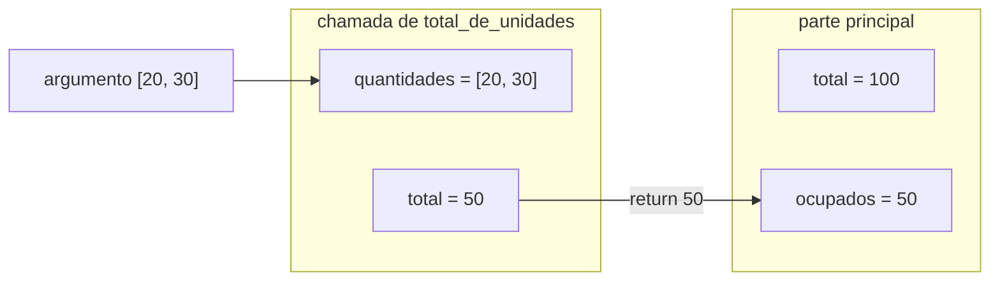
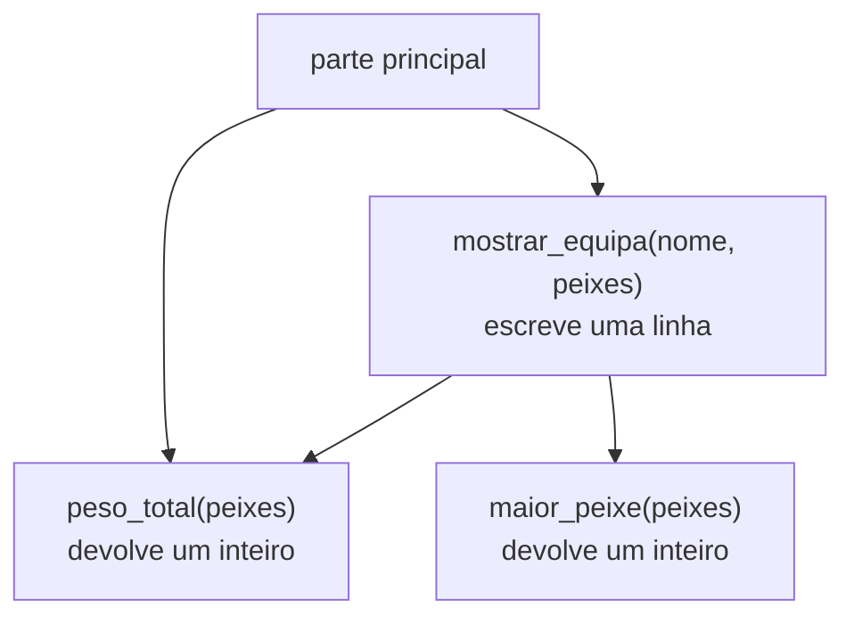

# Funções e procedimentos

Neste guia, passas para Python as funções que já escrevias em pseudocódigo, com `def`. Aprendes a parte que faltava: a função que devolve um valor ao programa, com `return`. Separas o que calcula do que escreve no ecrã, documentas cada função e testas cada uma sozinha.

Usa as funções da algoritmia, as funções predefinidas do tema 02 e as listas do tema 05. Rever: [Escrever uma função](../01-algoritmos/05-testar-depurar-e-melhorar.md#escrever-uma-função), [Parâmetros e argumentos](../01-algoritmos/05-testar-depurar-e-melhorar.md#parâmetros-e-argumentos), [Uma função predefinida já vem com o Python](02-dados-e-interacao.md#uma-função-predefinida-já-vem-com-o-python) e [O maior valor de uma lista](05-ciclo-for-e-listas-simples.md#o-maior-valor-de-uma-lista). Para praticar: [laboratório](laboratorios/06-funcoes-e-procedimentos-laboratorio.md) e [ficha de exercícios](exercicios/06-funcoes-e-procedimentos-exercicios.md).

## Neste guia

1. [Do pseudocódigo para Python, com `def`](#do-pseudocódigo-para-python-com-def)
2. [O `return` devolve um valor a quem chamou](#o-return-devolve-um-valor-a-quem-chamou)
3. [A documentação diz o que a função recebe e devolve](#a-documentação-diz-o-que-a-função-recebe-e-devolve)
4. [Testar cada função sozinha](#testar-cada-função-sozinha)
5. [Os procedimentos devolvem `None`](#os-procedimentos-devolvem-none)
6. [O `return` termina a função](#o-return-termina-a-função)
7. [As funções calculam, e a parte principal escreve](#as-funções-calculam-e-a-parte-principal-escreve)
8. [As variáveis de uma função são locais](#as-variáveis-de-uma-função-são-locais)
9. [Dentro da função: parâmetros, variáveis locais e constantes](#dentro-da-função-parâmetros-variáveis-locais-e-constantes)
10. [A ordem no ficheiro: constantes, funções e parte principal](#a-ordem-no-ficheiro-constantes-funções-e-parte-principal)
11. [Exemplo guiado: o concurso de pesca](#exemplo-guiado-o-concurso-de-pesca)

## Do pseudocódigo para Python, com `def`

Na algoritmia, o stock de cada artigo escrevia-se com três blocos quase iguais, até a função `mostraStock` os juntar num só. Em Python, escreve-se com outras palavras, e a forma de pensar não muda. Aqui, a função serve os materiais do armazém do jogo, e por isso o parâmetro `artigo` passa a `material`:

| Pseudocódigo | Python |
| --- | --- |
| `Função mostraStock(material, quantidade)` | `def mostrar_stock(material, quantidade):` |
| o corpo, com quatro espaços | o corpo, com quatro espaços |
| `mostraStock("tábuas", 7)` | `mostrar_stock("tábuas", 7)` |

O **`def`**, do inglês *define*, definir, começa o cabeçalho de uma função. O cabeçalho acaba com dois pontos, como a linha de um `if`, e o corpo vai indentado. O nome da função segue a convenção dos nomes das variáveis em Python: minúsculas, com traço baixo entre as palavras. Quando o nome tem um verbo, vai no infinitivo, como `mostrar_stock`.

```python
# stock.py: mostra o stock de três materiais e pede os que estão a acabar.
STOCK_MINIMO = 10


def mostrar_stock(material, quantidade):
    """Escreve o stock de um material e pede a encomenda se estiver a acabar.

    Recebe o nome do material, um texto, e a quantidade em stock, um inteiro
    igual ou maior do que zero. Não devolve nada: escreve uma ou duas linhas.
    """
    print("Stock de", material + ":", quantidade)
    if quantidade < STOCK_MINIMO:
        print("Encomendar", material)


mostrar_stock("troncos", 12)
mostrar_stock("tábuas", 7)
mostrar_stock("pedra", 25)
```

O programa escreve:

```text
Stock de troncos: 12
Stock de tábuas: 7
Encomendar tábuas
Stock de pedra: 25
```

Cada chamada executa o corpo com os seus argumentos, e só as tábuas, com 7, ficam abaixo do mínimo. Os parâmetros e os argumentos são os da algoritmia, e passam pela ordem: em `mostrar_stock("tábuas", 7)`, o `material` recebe `"tábuas"` e a `quantidade` recebe 7.

Por baixo do cabeçalho, entre três aspas de cada lado, fica a documentação da função. É um texto para quem a vai usar, e o Python não o executa. As duas linhas em branco antes e depois da função são uma convenção do Python, para se ver onde ela começa e acaba.

As linhas encostadas à margem, depois da função, são a parte principal do programa, o que na algoritmia era o algoritmo principal. É lá que o programa começa a fazer coisas. O `def` só cria a função, e o corpo só corre quando há uma chamada. Sem as três últimas linhas, o programa não escrevia nada, e também não dava erro.

Uma função como esta, que faz um trabalho e não tem `return`, chama-se **procedimento**. O trabalho deste é escrever no ecrã.

## O `return` devolve um valor a quem chamou

O armazém do jogo leva 120 unidades. Para saber quantos lugares ficam livres, o programa precisa do total de unidades, para o tirar a 120. Um procedimento que escrevesse o total com `print` não servia: o total aparecia no ecrã, mas o programa não o conseguia usar numa conta.

As funções predefinidas já resolviam isto. O `abs` devolve o número sem sinal, e esse valor guarda-se numa variável ou entra numa conta. Para uma função tua devolver um valor, escreve-se **`return`**, seguido do valor. O `return` entrega esse valor a quem chamou a função.

```python
# lugares.py: quantos lugares ficam livres no armazém.
CAPACIDADE = 120


def total_de_unidades(quantidades):
    """Devolve a soma das unidades de uma lista de quantidades.

    Recebe uma lista de inteiros, com as unidades de cada material.
    Devolve um inteiro: a soma, ou 0 se a lista estiver vazia.
    """
    total = 0
    for unidades in quantidades:
        total += unidades
    return total


ocupados = total_de_unidades([12, 30, 45])
print("Unidades no armazém:", ocupados)
print("Lugares livres:", CAPACIDADE - ocupados)
```

Aparecem `Unidades no armazém: 87` e `Lugares livres: 33`. A tabela segue a chamada da linha 17, passo a passo:

| Passo | Linha executada | `quantidades` | `total` | O que acontece |
| ---: | --- | --- | ---: | --- |
| 1 | `ocupados = total_de_unidades([12, 30, 45])` | `[12, 30, 45]` | sem valor | a lista passa para o parâmetro, e o programa entra na função |
| 2 | `total = 0` | `[12, 30, 45]` | 0 | o acumulador começa |
| 3 | o ciclo, com três voltas | `[12, 30, 45]` | 87 | soma 12, 30 e 45 |
| 4 | `return total` | `[12, 30, 45]` | 87 | entrega o 87, e a função acaba |
| 5 | `ocupados = 87` | já não existe | já não existe | a chamada passou a valer 87 |

No passo 5, o programa voltou à linha da chamada, e a chamada foi trocada pelo valor devolvido. Por isso, uma chamada pode estar em qualquer sítio onde caberia um valor: numa atribuição, numa conta, num `print` ou numa condição, como `if total_de_unidades([12, 30, 45]) > CAPACIDADE:`. Já o fazias com o `len` e o `abs`.

## A documentação diz o que a função recebe e devolve

Para usar a função `total_de_unidades`, um colega precisa de saber o que lhe dá e o que recebe de volta. Aceita a lista vazia? Devolve um número ou escreve-o? Ler o corpo para o descobrir dá trabalho, e numa função grande engana.

O texto entre as três aspas chama-se **docstring**, do inglês *documentation string*, texto de documentação. É o contrato da função, que na algoritmia se escrevia ao lado dela, agora dentro do código. Nos teus programas, tem sempre esta forma:

1. uma frase que diz o que a função faz ou o que devolve;
2. uma linha em branco;
3. o que recebe: cada parâmetro, com o tipo e o que quer dizer;
4. o que devolve, com o tipo, ou, num procedimento, o que escreve;
5. o que é preciso saber para a usar sem adivinhar, como um caso que ela não aceita.

A docstring de `total_de_unidades` tem três partes: a frase, o que recebe (uma lista de inteiros) e o que devolve (um inteiro). Responde também às duas perguntas do início: aceita a lista vazia, e então devolve 0. A do `mostrar_stock`, na secção anterior, diz o que o procedimento escreve.

Um comentário, com `#`, explica uma linha a quem lê o código. A docstring explica a função inteira a quem a vai usar. Uma docstring só com "Faz a conta." não serve: não diz que conta faz, nem o que a função recebe. Só com a docstring, um colega tem de conseguir escrever uma chamada certa e prever o resultado. Os exemplos curtos deste guia que só mostram um erro ou o `None` ficam com a primeira frase.

## Testar cada função sozinha

Um programa com três funções e uma parte principal pode falhar em quatro sítios. Na algoritmia, uma função testava-se antes de se juntar ao resto, com uma tabela de casos. Rever: [Testar uma função sozinha](../01-algoritmos/05-testar-depurar-e-melhorar.md#testar-uma-função-sozinha). Em Python, a tabela escreve-se no próprio ficheiro, e é o computador que faz as contas.

Cada caso é uma **linha de teste**: um `print` com a chamada e o valor esperado, escrito depois das funções e antes da parte principal. Os casos escolhem-se a partir da docstring, antes de olhar para o corpo, e o valor esperado calcula-se à mão. Uma função que recebe uma lista testa-se com a lista vazia, se a docstring a aceitar, e com listas de um e de vários elementos. Se há uma fronteira, testa-se o valor logo abaixo, o da fronteira e o logo acima.

```python
# total_testes.py: a função total_de_unidades, testada sozinha.


def total_de_unidades(quantidades):
    """Devolve a soma das unidades de uma lista de quantidades.

    Recebe uma lista de inteiros, com as unidades de cada material.
    Devolve um inteiro: a soma, ou 0 se a lista estiver vazia.
    """
    total = 0
    for unidades in quantidades:
        total += unidades
    return total


# Testes da função sozinha: o valor devolvido e o que se esperava.
print(total_de_unidades([]), "esperado: 0")
print(total_de_unidades([7]), "esperado: 7")
print(total_de_unidades([12, 30, 45]), "esperado: 87")
```

O resultado é este:

```text
0 esperado: 0
7 esperado: 7
87 esperado: 87
```

Cada linha mostra o devolvido e o esperado, lado a lado. Quando todas batem certo, a função está pronta a usar. Quando uma não bate, ou a função está errada, ou o esperado foi mal calculado. Refaz a conta à mão e, se estiver certa, procura o erro na função, com a rotina da depuração. Rever: [Depurar com método, agora no computador](01-do-algoritmo-ao-programa.md#depurar-com-método-agora-no-computador).

As linhas de teste guardam-se, para voltares a testar quando mudares a função. Desligam-se com um `#` no início de cada uma, e o Python passa a ignorá-las. No VS Code, selecionas as linhas e escolhes, no menu Edit, `Toggle Line Comment`, "ligar ou desligar o comentário da linha". Põe ou tira o `#` de todas ao mesmo tempo.

Uma linha de teste não é uma linha de observação do tema 04. A linha de observação mostra uma variável a meio do programa, e sai quando acabas de ver. A linha de teste confirma o que uma função devolve, e fica no ficheiro, desligada.

## Os procedimentos devolvem `None`

Um procedimento não tem `return`. O que vale, então, a sua chamada?

```python
# devolve_none.py: o que devolve um procedimento.
STOCK_MINIMO = 10


def mostrar_stock(material, quantidade):
    """Escreve o stock de um material e pede a encomenda se estiver a acabar."""
    print("Stock de", material + ":", quantidade)
    if quantidade < STOCK_MINIMO:
        print("Encomendar", material)


resultado = mostrar_stock("tábuas", 7)
print("A chamada devolveu:", resultado)
```

O resultado é este:

```text
Stock de tábuas: 7
Encomendar tábuas
A chamada devolveu: None
```

Quando uma função chega ao fim do corpo sem `return`, o Python devolve o `None`. É o valor que quer dizer "nada", que já viste com o `append`. Nas mensagens de erro, o tipo dele aparece como `NoneType`. Num procedimento, é o que se espera: ninguém usa o que ele devolve, e a chamada fica sozinha na linha, como `mostrar_stock("tábuas", 7)`.

O erro típico é o contrário: uma função que calcula, mas se esquece de devolver.

```python
# sem_return.py: uma função que calcula, mas se esquece de devolver.
CAPACIDADE = 120


def total_de_unidades(quantidades):
    """Devia devolver a soma das unidades, mas falta-lhe o return."""
    total = 0
    for unidades in quantidades:
        total += unidades


ocupados = total_de_unidades([12, 30, 45])
print("Unidades no armazém:", ocupados)
print("Lugares livres:", CAPACIDADE - ocupados)
```

```text
Unidades no armazém: None
Traceback (most recent call last):
  File "C:\Users\aluno\Documents\lp-python\sem_return.py", line 14, in <module>
    print("Lugares livres:", CAPACIDADE - ocupados)
                             ~~~~~~~~~~~^~~~~~~~~~
TypeError: unsupported operand type(s) for -: 'int' and 'NoneType'
```

A função calcula 87, mas chega ao fim sem o entregar, e devolve `None`. A última linha quer dizer "tipos que o `-` não aceita: `int` e `NoneType`". O `None` não é o 0, e as contas não o aceitam. A linha apontada é a da conta, mas a causa está na função. Quando vires `None` onde esperavas um valor, ou uma mensagem com `NoneType`, procura uma função que não chegou a um `return`. Aqui, corrige-se com `return total` no fim do corpo, com quatro espaços.

## O `return` termina a função

Qual é o primeiro material esgotado? No tema 05, a pesquisa precisava de uma bandeira, para saber se tinha encontrado, e de um `break`, para parar. Rever: [Parar a pesquisa com `break`](05-ciclo-for-e-listas-simples.md#parar-a-pesquisa-com-break).

O `return` acaba a função logo ali, mesmo a meio de um ciclo, e as linhas abaixo dele já não correm. Por isso, uma função pode ter mais do que um `return`, e a pesquisa fica sem bandeira e sem `break`.

```python
# esgotado.py: o primeiro material esgotado do armazém.


def indice_do_primeiro_esgotado(quantidades):
    """Devolve o índice do primeiro material esgotado.

    Recebe uma lista de inteiros, com as unidades de cada material.
    Devolve um inteiro: o índice do primeiro 0 da lista, ou -1 se nenhum
    material estiver esgotado.
    """
    for i in range(0, len(quantidades)):
        if quantidades[i] == 0:
            # Encontrado: o return devolve o índice, e a função acaba aqui.
            return i
    # Só se chega aqui depois de o ciclo ver todos os materiais sem encontrar um 0.
    return -1


nomes = ["troncos", "tábuas", "ferro", "carvão"]
quantidades = [12, 30, 0, 0]
posicao = indice_do_primeiro_esgotado(quantidades)
if posicao == -1:
    print("Nenhum material esgotado.")
else:
    print("Primeiro material esgotado:", nomes[posicao])
```

| Volta | `i` | `quantidades[i]` | `quantidades[i] == 0` | O que acontece |
| --- | ---: | ---: | --- | --- |
| 1.ª | 0 | 12 | `False` | nada |
| 2.ª | 1 | 30 | `False` | nada |
| 3.ª | 2 | 0 | `True` | `return i` devolve 2, e a função acaba sem a 4.ª volta |

Aparece `Primeiro material esgotado: ferro`. O carvão, também esgotado, nunca chega a ser visto.

O -1 é um valor combinado, que quer dizer "não há", porque a função, quando encontra, devolve sempre um índice de 0 para cima. A parte principal pergunta pelo -1 antes de usar a posição. Sem essa pergunta, numa lista sem esgotados, `nomes[-1]` dava o último material, sem nenhuma mensagem. O -1 é o índice negativo da última posição.

O `return -1` fica depois do ciclo, na coluna do `for`, com quatro espaços. Com oito espaços, dentro do ciclo, a função acabava logo na primeira volta, com os troncos, e dizia que nenhum material estava esgotado.

## As funções calculam, e a parte principal escreve

Uma função que escreve o resultado com `print`, em vez de o devolver, parece funcionar, porque o valor aparece no ecrã.

```python
# maior_escreve.py: uma função que escreve o maior em vez de o devolver.


def maior_quantidade(quantidades):
    """Devia devolver a maior quantidade de uma lista, mas escreve-a."""
    maior = quantidades[0]
    for unidades in quantidades:
        if unidades > maior:
            maior = unidades
    print("Maior quantidade:", maior)


mais_unidades = maior_quantidade([12, 30, 45])
if mais_unidades > 40:
    print("Há um material com mais de 40 unidades.")
```

```text
Maior quantidade: 45
Traceback (most recent call last):
  File "C:\Users\aluno\Documents\lp-python\maior_escreve.py", line 14, in <module>
    if mais_unidades > 40:
       ^^^^^^^^^^^^^^^^^^
TypeError: '>' not supported between instances of 'NoneType' and 'int'
```

O 45 aparece no ecrã, mas não volta para a parte principal. A função devolve `None`, e a comparação não se faz. Corrige-se trocando o `print` por `return maior`, e é a parte principal que escreve, se quiser.

| | Com `print` dentro da função | Com `return` |
| --- | --- | --- |
| O valor aparece no ecrã | sempre, em cada chamada | só se a parte principal o escrever |
| A parte principal pode usá-lo numa conta ou num `if` | não, recebe `None` | sim |
| Pode testar-se com uma linha de teste | não | sim |

Daqui sai uma regra das aulas: as funções que calculam devolvem. Quem escreve no ecrã é a parte principal, ou um procedimento cujo trabalho é escrever, como o `mostrar_stock`. Uma função que calcula também não lê do teclado, porque uma linha de teste ficava parada à espera de que escrevesses um valor. É a parte principal que pergunta, com o `input`, e passa o valor como argumento.

## As variáveis de uma função são locais

Na algoritmia, os parâmetros e as variáveis que nascem dentro de uma função eram as variáveis locais, que só existem enquanto a chamada dura. Rever: [As variáveis da função são da função](../01-algoritmos/05-testar-depurar-e-melhorar.md#as-variáveis-da-função-são-da-função). Em Python é igual, e o computador mostra-o.

```python
# locais.py: as variáveis de uma função só existem dentro dela.


def total_de_unidades(quantidades):
    """Devolve a soma das unidades de uma lista de quantidades.

    Recebe uma lista de inteiros, com as unidades de cada material.
    Devolve um inteiro: a soma, ou 0 se a lista estiver vazia.
    """
    total = 0
    for unidades in quantidades:
        total += unidades
    return total


total = 100
ocupados = total_de_unidades([20, 30])
print("Devolvido pela função:", ocupados)
print("O total da parte principal:", total)
```

Aparecem `Devolvido pela função: 50` e `O total da parte principal: 100`. Há duas variáveis `total`, com o mesmo nome, em sítios diferentes. A da função nasce na chamada e desaparece quando ela acaba. A da parte principal nunca deixou de valer 100.



O diagrama mostra os dois sítios. Cada um tem o seu `total`: na chamada só entra o argumento, e da chamada só sai o valor do `return`.

Uma variável local não se vê fora da função. Com `print(unidades)` acrescentado no fim, na linha 20, o programa escreve as duas linhas e para:

```text
Traceback (most recent call last):
  File "C:\Users\aluno\Documents\lp-python\locais.py", line 20, in <module>
    print(unidades)
          ^^^^^^^^
NameError: name 'unidades' is not defined
```

A variável `unidades` só existiu durante a chamada.

## Dentro da função: parâmetros, variáveis locais e constantes

Na algoritmia, havia uma regra das aulas: dentro de uma função só se usam os seus parâmetros, as suas variáveis locais e as constantes. O que mais fizer falta entra pelos parâmetros. Em Python, a regra é a mesma.

Imagina que queres contar os materiais que têm de ser encomendados, e escreves uma função que soma 1 a uma variável da parte principal:

```python
# encomendas.py: tenta contar as encomendas numa variável da parte principal.
MINIMO_ENCOMENDA = 10


def contar_encomenda(quantidade):
    """Devia somar 1 às encomendas se o material estiver abaixo do mínimo."""
    if quantidade < MINIMO_ENCOMENDA:
        encomendas += 1


encomendas = 0
contar_encomenda(4)
print("Encomendas:", encomendas)
```

```text
Traceback (most recent call last):
  File "C:\Users\aluno\Documents\lp-python\encomendas.py", line 12, in <module>
    contar_encomenda(4)
    ~~~~~~~~~~~~~~~~^^^
  File "C:\Users\aluno\Documents\lp-python\encomendas.py", line 8, in contar_encomenda
    encomendas += 1
    ^^^^^^^^^^
UnboundLocalError: cannot access local variable 'encomendas' where it is not associated with a value
```

O **`UnboundLocalError`** é o erro de uma variável local usada antes de ter valor. A mensagem quer dizer "não consigo usar a variável local `encomendas`, porque ainda não tem valor". `encomendas += 1` é o mesmo que `encomendas = encomendas + 1`. Como dá um valor a `encomendas`, o Python trata-a como variável local da função. Mas, para fazer a conta, tem primeiro de ler o valor dela, e a local ainda não tem nenhum. A mensagem aponta duas linhas: a chamada, na parte principal, e, por baixo, a linha dentro da função onde o programa parou.

Nas aulas, uma função não muda as variáveis da parte principal. Devolve um valor, e é a parte principal que o usa:

```python
# encomendas.py: conta os materiais que têm de ser encomendados.
MINIMO_ENCOMENDA = 10


def precisa_de_encomenda(quantidade):
    """Diz se um material tem de ser encomendado.

    Recebe a quantidade em stock, um inteiro igual ou maior do que zero.
    Devolve True se a quantidade estiver abaixo de MINIMO_ENCOMENDA, e False
    se não estiver.
    """
    return quantidade < MINIMO_ENCOMENDA


encomendas = 0
for quantidade in [12, 4, 30, 0]:
    if precisa_de_encomenda(quantidade):
        encomendas += 1
print("Encomendas:", encomendas)
```

Aparece `Encomendas: 2`, pelo 4 e pelo 0. A comparação dá `True` ou `False`, e o `return` devolve esse valor, que o `if` usa. A constante lê-se dentro da função sem problema, porque a função só a lê e nunca lhe dá um valor.

O Python deixa uma função ler uma variável da parte principal sem a receber por parâmetro, mas assim a função só serve para essa variável:

```python
# parametro_trocado.py: a função usa o nome da parte principal em vez do parâmetro.


def total_de_unidades(quantidades):
    """Devia devolver a soma das unidades da lista que recebe."""
    total = 0
    for unidades in base:
        total += unidades
    return total


base = [12, 30, 45]
mina = [60, 4, 15]
print("Base:", total_de_unidades(base))
print("Mina:", total_de_unidades(mina))
```

Aparecem `Base: 87` e `Mina: 87`, sem nenhuma mensagem. O ciclo percorre `base`, a lista da parte principal, e não o parâmetro, e por isso a mina fica com o total da base. Acontece muito numa função que nasceu de um bloco da parte principal e ficou com o nome antigo no corpo. Só um teste com outra lista dá por isso. No corpo, usa-se sempre o parâmetro: `for unidades in quantidades:`.

<details>
<summary>Para ires mais longe: a palavra <code>global</code></summary>

Na internet, vais encontrar a palavra `global`. Escrita no início de uma função, como `global encomendas`, deixa-a mudar a variável da parte principal, e o `UnboundLocalError` desaparece. Nas aulas, não se usa. A função passa a depender de uma variável que não recebeu, e já não se testa sozinha. E um valor da parte principal muda sem a parte principal o mostrar. Quando uma função tem de mudar um valor, recebe-o por parâmetro e devolve o valor novo.

</details>

## A ordem no ficheiro: constantes, funções e parte principal

Um programa com funções arruma-se sempre por esta ordem:

1. o comentário do topo, que diz o que o programa faz;
2. as constantes;
3. as funções, cada uma com a sua docstring;
4. as linhas de teste, desligadas com `#`;
5. a parte principal.

O Python executa o ficheiro de cima para baixo, e é a linha do `def` que cria a função. Neste programa, a chamada aparece antes do `def`:

```python
# ordem.py: a chamada aparece antes do def.

ocupados = total_de_unidades([12, 30, 45])
print("Unidades no armazém:", ocupados)


def total_de_unidades(quantidades):
    """Devolve a soma das unidades de uma lista de quantidades."""
    total = 0
    for unidades in quantidades:
        total += unidades
    return total
```

O programa para logo na linha 3:

```text
Traceback (most recent call last):
  File "C:\Users\aluno\Documents\lp-python\ordem.py", line 3, in <module>
    ocupados = total_de_unidades([12, 30, 45])
               ^^^^^^^^^^^^^^^^^
NameError: name 'total_de_unidades' is not defined
```

A função está escrita no ficheiro, mas o Python ainda não chegou ao `def` quando encontra a chamada. Corrige-se pondo a função antes da parte principal.

## Exemplo guiado: o concurso de pesca

### Passo 1: O enunciado

> No lago do jogo, duas equipas pescam durante cinco minutos, e o peso de cada peixe, em gramas, fica numa lista por equipa. A equipa azul pescou `[350, 120, 800]`, e a verde pescou `[400, 400, 300, 90]`. O programa mostra, para cada equipa, o peso total e o maior peixe, e diz quem ganhou. Ganha quem tiver mais gramas no total, e, com o mesmo total, é empate. Uma equipa que não pescou nada tem 0 gramas e não tem maior peixe.

### Passo 2: As funções que fazem falta

O que se repete de uma equipa para a outra são duas contas e uma linha no ecrã. As contas passam a funções que devolvem: `peso_total(peixes)` e `maior_peixe(peixes)`. A linha passa a um procedimento, `mostrar_equipa(nome, peixes)`. A parte principal guarda as listas, chama o procedimento para cada equipa e decide quem ganhou, com os totais devolvidos.



O diagrama mostra quem chama quem. A parte principal chama o procedimento e a função do peso total, e o procedimento chama as duas funções.

### Passo 3: Os casos de teste, antes das funções

Os casos saem do enunciado e do que cada função recebe:

| Chamada | Esperado | Porque se escolheu |
| --- | ---: | --- |
| `peso_total([])` | 0 | A lista vazia |
| `peso_total([90])` | 90 | Um só peixe |
| `peso_total([350, 120, 800])` | 1270 | Vários peixes |
| `maior_peixe([90])` | 90 | Um só peixe, que é também o maior |
| `maior_peixe([800, 120])` | 800 | O maior no início |
| `maior_peixe([120, 350, 800])` | 800 | O maior no fim |
| `maior_peixe([400, 400, 300, 90])` | 400 | Um empate no maior |

A lista vazia não entra nos casos do `maior_peixe`, porque sem peixes não há maior peixe. É o procedimento `mostrar_equipa` que trata a equipa que não pescou nada, antes de chamar o `maior_peixe`.

### Passo 4: A função `peso_total`, testada sozinha

O programa começa pela primeira função e pelas suas linhas de teste:

```python
# pesca.py: o concurso de pesca no lago do jogo, com duas equipas.


def peso_total(peixes):
    """Devolve o peso de todos os peixes de uma equipa.

    Recebe a lista dos pesos dos peixes, inteiros, em gramas.
    Devolve um inteiro: a soma dos pesos, ou 0 se a lista estiver vazia.
    """
    total = 0
    for peso in peixes:
        total += peso
    return total


# Testes das funções sozinhas: o valor devolvido e o que se esperava.
print(peso_total([]), "esperado: 0")
print(peso_total([90]), "esperado: 90")
print(peso_total([350, 120, 800]), "esperado: 1270")
```

Aparecem `0 esperado: 0`, `90 esperado: 90` e `1270 esperado: 1270`. As três linhas batem certo.

### Passo 5: A função `maior_peixe`

A segunda função entra a seguir à primeira, antes das linhas de teste. É o padrão do maior do tema 05, e a docstring avisa que precisa de pelo menos um peixe:

```python
def maior_peixe(peixes):
    """Devolve o peso do maior peixe de uma equipa.

    Recebe a lista dos pesos dos peixes, inteiros, em gramas, com pelo menos
    um peixe. Devolve um inteiro: o maior peso. Com a lista vazia, para com
    IndexError, por isso confirma antes que a equipa pescou alguma coisa.
    """
    maior = peixes[0]
    for peso in peixes:
        if peso > maior:
            maior = peso
    return maior
```

No fim das linhas de teste, entram os quatro casos do `maior_peixe`:

```python
print(maior_peixe([90]), "esperado: 90")
print(maior_peixe([800, 120]), "esperado: 800")
print(maior_peixe([120, 350, 800]), "esperado: 800")
print(maior_peixe([400, 400, 300, 90]), "esperado: 400")
```

As sete linhas batem certo, e as duas funções estão prontas a usar.

### Passo 6: O procedimento e a parte principal

As linhas de teste desligam-se, e entram o procedimento e a parte principal. O programa completo fica assim:

```python
# pesca.py: o concurso de pesca no lago do jogo, com duas equipas.


def peso_total(peixes):
    """Devolve o peso de todos os peixes de uma equipa.

    Recebe a lista dos pesos dos peixes, inteiros, em gramas.
    Devolve um inteiro: a soma dos pesos, ou 0 se a lista estiver vazia.
    """
    total = 0
    for peso in peixes:
        total += peso
    return total


def maior_peixe(peixes):
    """Devolve o peso do maior peixe de uma equipa.

    Recebe a lista dos pesos dos peixes, inteiros, em gramas, com pelo menos
    um peixe. Devolve um inteiro: o maior peso. Com a lista vazia, para com
    IndexError, por isso confirma antes que a equipa pescou alguma coisa.
    """
    maior = peixes[0]
    for peso in peixes:
        if peso > maior:
            maior = peso
    return maior


def mostrar_equipa(nome, peixes):
    """Escreve o resultado de uma equipa: o peso total e o maior peixe.

    Recebe o nome da equipa, um texto, e a lista dos pesos dos peixes,
    inteiros, em gramas. Não devolve nada: escreve uma linha.
    """
    # Sem peixes, não há maior peixe, e o maior_peixe nem pode ser chamado.
    if len(peixes) == 0:
        print("Equipa", nome + ": 0 gramas, sem peixes")
    else:
        total = peso_total(peixes)
        maior = maior_peixe(peixes)
        print("Equipa", nome + ":", total, "gramas, maior peixe com", maior)


# Testes das funções sozinhas: o valor devolvido e o que se esperava.
# print(peso_total([]), "esperado: 0")
# print(peso_total([90]), "esperado: 90")
# print(peso_total([350, 120, 800]), "esperado: 1270")
# print(maior_peixe([90]), "esperado: 90")
# print(maior_peixe([800, 120]), "esperado: 800")
# print(maior_peixe([120, 350, 800]), "esperado: 800")
# print(maior_peixe([400, 400, 300, 90]), "esperado: 400")


# A parte principal: os peixes de cada equipa, em gramas.
azul = [350, 120, 800]
verde = [400, 400, 300, 90]
mostrar_equipa("azul", azul)
mostrar_equipa("verde", verde)
total_azul = peso_total(azul)
total_verde = peso_total(verde)
if total_azul > total_verde:
    print("Ganhou a equipa azul.")
elif total_verde > total_azul:
    print("Ganhou a equipa verde.")
else:
    print("Empate.")
```

O programa escreve:

```text
Equipa azul: 1270 gramas, maior peixe com 800
Equipa verde: 1190 gramas, maior peixe com 400
Ganhou a equipa azul.
```

Começa-se a ler pela parte principal, no fim. Ela só guarda as listas, chama o procedimento duas vezes e decide quem ganhou, com os totais que a função devolve. As contas estão nas duas funções, testadas nos passos 4 e 5, e o procedimento só escreve.

### Passo 7: Correr os casos

A parte principal corre-se com outras listas, mudando as linhas `azul = ...` e `verde = ...`:

| `azul` | `verde` | O que aparece |
| --- | --- | --- |
| `[350, 120, 800]` | `[]` | `Equipa verde: 0 gramas, sem peixes` e `Ganhou a equipa azul.` |
| `[350, 120, 800]` | `[1270]` | `Equipa verde: 1270 gramas, maior peixe com 1270` e `Empate.` |
| `[]` | `[]` | As duas equipas com `0 gramas, sem peixes`, e `Empate.` |
| `[100]` | `[400, 400, 300, 90]` | `Equipa azul: 100 gramas, maior peixe com 100` e `Ganhou a equipa verde.` |

Os quatro casos dão o que a tabela diz. O da equipa sem peixes confirma que o `maior_peixe` não chega a ser chamado com a lista vazia.

## Erros frequentes

### Um argumento a menos na chamada

Com `mostrar_stock("tábuas")`, sem a quantidade, o programa para:

```text
TypeError: mostrar_stock() missing 1 required positional argument: 'quantidade'
```

A mensagem quer dizer "falta 1 argumento obrigatório: `quantidade`". Cada parâmetro precisa do seu argumento. Compara a chamada com o cabeçalho, argumento a argumento: o número tem de ser o mesmo, e a ordem também.

## Palavras novas deste guia

- `def`: a palavra que começa o cabeçalho de uma função em Python.
- Procedimento: uma função sem `return`, que faz um trabalho, como escrever no ecrã; a sua chamada devolve `None`.
- `return`: a instrução que entrega um valor a quem chamou a função e acaba a função.
- Docstring: a documentação de uma função, entre três aspas de cada lado, logo por baixo do cabeçalho.
- Linha de teste: um `print` com a chamada de uma função e o valor esperado, para os comparar.
- `UnboundLocalError`: o erro de execução de uma variável local usada antes de ter valor.

## O que vem a seguir

No tema seguinte, Validar e depurar, os teus programas passam a aguentar entradas inválidas, como um texto onde se esperava um número.

## Para saber mais

- [Definir funções](https://docs.python.org/3/tutorial/controlflow.html#defining-functions): a parte do tutorial oficial do Python, em inglês, sobre o `def`, os parâmetros e o `return`.
- [Strings de documentação](https://docs.python.org/3/tutorial/controlflow.html#documentation-strings): as docstrings no tutorial oficial, em inglês.


