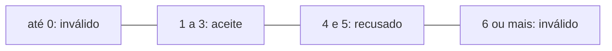

# Laboratório: Seleção

## O que vais construir

Vais construir o `bancada.py`, a bancada de construção do inventário de um jogo. O inventário tem 24 tábuas, cada baú gasta 8, e a bancada constrói de 1 a 5 baús de cada vez. O programa pergunta quantos baús queres e responde que o pedido é inválido, aceite ou recusado. Com 3 baús e com 4, o ecrã fica assim:

```text
Quantos baús queres construir (1 a 5)? 3
Pedido aceite. Baús construídos: 3
Tábuas no inventário: 0
```

```text
Quantos baús queres construir (1 a 5)? 4
Pedido recusado. Faltam 8 tábuas.
Tábuas no inventário: 24
```

1. [Fase 1: As comparações dão `True` ou `False`](#fase-1-as-comparações-dão-true-ou-false)
2. [Fase 2: Decidir com `if`](#fase-2-decidir-com-if)
3. [Fase 3: Dois caminhos: `if` e `else`](#fase-3-dois-caminhos-if-e-else)
4. [Fase 4: Mais de dois caminhos: a cadeia com `elif`](#fase-4-mais-de-dois-caminhos-a-cadeia-com-elif)
5. [Fase 5: Validar um valor: dentro e fora de um intervalo](#fase-5-validar-um-valor-dentro-e-fora-de-um-intervalo)
6. [Fase 6: Os casos de teste de cada ramo](#fase-6-os-casos-de-teste-de-cada-ramo)

## O que precisas

- A pasta `lp-python`, aberta no VS Code, com o terminal aberto dentro dela. Se não a tiveres, cria-a em Documentos e abre-a com a opção `Open Folder...` do menu File.
- O teu comando para correr programas, `python`, `py` ou `python3`. Onde o texto diz `python`, usa o teu.

Este laboratório começa um programa novo, e não precisa do `inventario.py`.

## Fase 1: As comparações dão `True` ou `False`

Experimentas comparações na consola, sem criar ficheiros. Uma comparação é uma pergunta de sim ou não, e responde `True` ou `False`. Rever: [As comparações dão `True` ou `False`](../03-selecao.md#as-comparações-dão-true-ou-false).

1. Entra na consola: no terminal, escreve só o teu comando e carrega em Enter. O que deves ver: a versão do Python e `>>>`.

2. Guarda um valor e faz duas perguntas. Escreve cada linha a seguir ao `>>>`. O que deves ver:

   ```text
   >>> tabuas = 24
   >>> tabuas >= 16
   True
   >>> tabuas >= 32
   False
   ```

   A atribuição não responde nada. Com 24 tábuas, um pedido de 16 cabe, e um de 32 não cabe.

3. Faz mais perguntas, sem mudar o valor. O que deves ver:

   ```text
   >>> tabuas == 24
   True
   >>> tabuas != 24
   False
   >>> type(tabuas == 24)
   <class 'bool'>
   >>> tabuas
   24
   ```

   Perguntar não muda nada, e `tabuas` continua com 24.

4. Compara textos. Prevê cada resposta antes de carregares em Enter:

   ```python
   "baú" == "baú"
   "Baú" == "baú"
   ```

   O que deves ver:

   ```text
   >>> "baú" == "baú"
   True
   >>> "Baú" == "baú"
   False
   ```

   O `B` maiúsculo e o `b` minúsculo são caracteres diferentes.

5. Sai da consola: escreve `exit()` e carrega em Enter. O que deves ver: o terminal outra vez, sem o `>>>`.

### Paragem 1

Não ficou nenhum ficheiro novo na pasta.

Pensa antes de continuares: com `tabuas = 24`, o que dão `tabuas <= 24` e `tabuas < 24`? A resposta: `True` e `False`. Os dois operadores só discordam no próprio 24.

## Fase 2: Decidir com `if`

O programa passa a aceitar o pedido só quando as tábuas chegam. As instruções que dependem da condição ficam num bloco, quatro espaços para dentro. Rever: [Decidir com `if`](../03-selecao.md#decidir-com-if).

1. Cria o programa, ainda sem decisão. No painel Explorer, passa o rato por cima de `LP-PYTHON`, carrega no ícone `New File...`, escreve `bancada.py` e carrega em Enter. Escreve esta primeira versão:

   ```python
   # bancada.py: a bancada de construção do inventário de um jogo de construção.
   # O jogador pede baús, e o programa aceita ou recusa o pedido.

   # A regra do jogo, que não muda enquanto o programa corre.
   TABUAS_POR_BAU = 8

   tabuas = 24
   baus = int(input("Quantos baús queres construir? "))
   precisas = baus * TABUAS_POR_BAU

   print("Tábuas no inventário:", tabuas)
   ```

2. Guarda e corre:

   ```bash
   python bancada.py
   ```

   Escreve `2` e carrega em Enter. O que deves ver: a pergunta e `Tábuas no inventário: 24`. Isto quer dizer que o programa lê o pedido, mas ainda não decide nada. Se aparecer outra coisa, vê [Se alguma coisa falhar](#se-alguma-coisa-falhar).

3. Acrescenta a decisão. Em `bancada.py`, a seguir à linha em branco que está depois de `precisas`, acrescenta:

   ```python
   # O bloco do if só corre quando as tábuas chegam para o pedido.
   if precisas <= tabuas:
       tabuas = tabuas - precisas
       print("Pedido aceite. Baús construídos:", baus)
   ```

   Quando carregas em Enter depois dos dois pontos, o VS Code já começa a linha seguinte com quatro espaços. O `print` do inventário fica encostado à margem.

4. Guarda e corre com `2`. O que deves ver:

   ```text
   Quantos baús queres construir? 2
   Pedido aceite. Baús construídos: 2
   Tábuas no inventário: 8
   ```

   Corre outra vez, com a seta para cima e Enter, e escreve `4`. O que deves ver:

   ```text
   Quantos baús queres construir? 4
   Tábuas no inventário: 24
   ```

   Dois baús precisam de 16 tábuas, e o bloco correu. Quatro precisam de 32, e o bloco foi saltado.

5. Provoca um erro de propósito. Apaga os dois pontos do fim da linha do `if`, guarda e corre. O que deves ver:

   ```text
     File "C:\Users\aluno\Documents\lp-python\bancada.py", line 12
       if precisas <= tabuas
                            ^
   SyntaxError: expected ':'
   ```

   É um erro de sintaxe, e por isso a pergunta dos baús nem apareceu. Volta a pôr os dois pontos e guarda.

6. Provoca um erro de lógica. Põe quatro espaços no início da última linha, a do inventário. Guarda, corre e escreve `4`. O que deves ver: só a pergunta, e mais nada, porque a linha passou para dentro do bloco, que foi saltado. Tira os quatro espaços e guarda.

### Paragem 2

O `bancada.py` aceita um pedido que cabe no stock e desconta as tábuas. Com um pedido que não cabe, mostra só o inventário.

Pensa antes de continuares: com 3 baús, o pedido é aceite? A resposta: sim. Três baús precisam de 24 tábuas, `24 <= 24` dá `True`, e as tábuas passam a 0.

## Fase 3: Dois caminhos: `if` e `else`

O programa passa a responder também quando o pedido não cabe. É o `Senão` do pseudocódigo, que se escreve `else`, sem condição. Rever: [Dois caminhos: `if` e `else`](../03-selecao.md#dois-caminhos-if-e-else).

1. Em `bancada.py`, entre o bloco do `if` e o `print` do inventário, acrescenta:

   ```python fragment continua o if
   else:
       # Esta conta só se faz quando o pedido é recusado.
       faltam = precisas - tabuas
       print("Pedido recusado. Faltam", faltam, "tábuas.")
   ```

2. Guarda, corre e escreve `4`. O que deves ver:

   ```text
   Quantos baús queres construir? 4
   Pedido recusado. Faltam 8 tábuas.
   Tábuas no inventário: 24
   ```

   A condição deu `False`, e correu o bloco do `else`. As tábuas não mudaram, porque o desconto está no bloco do `if`.

3. Experimenta o limite. Corre com `3`. O que deves ver: `Pedido aceite. Baús construídos: 3` e `Tábuas no inventário: 0`. O 3 é o maior pedido que cabe, e o 4 é o primeiro que já não cabe.

4. Provoca um erro no limite. Na linha do `if`, troca o `<=` por `<`. Prevê o que aparece com 3 baús, guarda e corre. O que deves ver:

   ```text
   Quantos baús queres construir? 3
   Pedido recusado. Faltam 0 tábuas.
   Tábuas no inventário: 24
   ```

   É um erro de lógica, sem mensagem: `24 < 24` dá `False`. Com 2 ou com 4, os dois operadores dão a mesma resposta. Volta a pôr `<=`, guarda, corre com `3` e confirma `Pedido aceite`.

### Paragem 3

O programa aceita os pedidos que cabem no stock e recusa os outros, com as tábuas que faltam.

Pensa antes de continuares: o que acontece com um pedido de -2 baús, e faz sentido? A resposta: o pedido é aceite, e o inventário passa a ter 40 tábuas, porque descontar menos 16 é somar 16. O programa está a dar tábuas de graça.

## Fase 4: Mais de dois caminhos: a cadeia com `elif`

A decisão passa a ter três ramos: inválido, aceite e recusado. A validação vem em primeiro lugar, numa cadeia com `elif`. Rever: [Mais de dois caminhos: a cadeia com `elif`](../03-selecao.md#mais-de-dois-caminhos-a-cadeia-com-elif).

1. Em `bancada.py`, substitui o comentário e a linha do `if` por estas:

   ```python fragment o elif continua nas linhas de baixo
   # A validação vem primeiro: um pedido sem baús não se aceita nem se recusa.
   if baus < 1:
       print("Pedido inválido: pede pelo menos 1 baú.")
   elif precisas <= tabuas:
   ```

   As duas linhas de baixo ficam como estão e passam a ser o bloco do `elif`.

2. Guarda e corre com `-2`, com `0` e com `1`. O que deves ver com -2:

   ```text
   Quantos baús queres construir? -2
   Pedido inválido: pede pelo menos 1 baú.
   Tábuas no inventário: 24
   ```

   Com 0, a mesma resposta. Com 1, `Pedido aceite. Baús construídos: 1` e `Tábuas no inventário: 16`.

### Paragem 4

O programa tem três respostas, e os pedidos de menos de 1 baú já não mexem no inventário.

Pensa antes de continuares: e se a validação viesse depois, com `if precisas <= tabuas:` primeiro e `elif baus < 1:` a seguir? O que aparecia com -2? A resposta: `Pedido aceite`, porque `-16 <= 24` já dá `True`, e a cadeia acaba aí. Nenhum pedido chegava ao ramo do inválido.

## Fase 5: Validar um valor: dentro e fora de um intervalo

A bancada só constrói até 5 baús, e por isso os pedidos válidos são de 1 a 5. Um pedido é inválido abaixo de 1 ou acima de 5, e as duas comparações ligam-se com `or`. Rever: [Validar um valor: dentro e fora de um intervalo](../03-selecao.md#validar-um-valor-dentro-e-fora-de-um-intervalo).

1. Os limites passam a constantes. Em `bancada.py`, substitui o comentário e a constante do início por estas quatro linhas:

   ```python
   # As regras do jogo, que não mudam enquanto o programa corre.
   TABUAS_POR_BAU = 8
   MINIMO_BAUS = 1
   MAXIMO_BAUS = 5
   ```

2. Na linha da leitura, muda a pergunta, para quem usa o programa saber o limite:

   ```python
   baus = int(input("Quantos baús queres construir (1 a 5)? "))
   ```

   Guarda, corre e escreve `2`. O que deves ver: a pergunta nova e `Pedido aceite. Baús construídos: 2`.

3. Substitui o comentário, o `if` e o seu `print` por estas linhas:

   ```python
   # A validação vem primeiro: um pedido fora dos limites não se aceita nem se recusa.
   if baus < MINIMO_BAUS or baus > MAXIMO_BAUS:
       print("Pedido inválido: pede de", MINIMO_BAUS, "a", MAXIMO_BAUS, "baús.")
   ```

4. Guarda e corre com 5 e com 6. O que deves ver:

   ```text
   Quantos baús queres construir (1 a 5)? 5
   Pedido recusado. Faltam 16 tábuas.
   Tábuas no inventário: 24
   ```

   ```text
   Quantos baús queres construir (1 a 5)? 6
   Pedido inválido: pede de 1 a 5 baús.
   Tábuas no inventário: 24
   ```

   O 5 é válido, e passa à pergunta das tábuas. O 6 já está fora do intervalo.

5. Provoca um erro de propósito. Na linha do `if`, troca o `or` por `and`. Prevê o que aparece com 6, guarda e corre. O que deves ver com 6: `Pedido recusado. Faltam 24 tábuas.`. E com 0: `Pedido aceite. Baús construídos: 0`. Nenhum número é ao mesmo tempo menor do que 1 e maior do que 5, e nenhum pedido chega ao ramo do inválido. Volta a pôr `or`, guarda, corre com `6` e confirma `Pedido inválido`.

### Paragem 5

O programa valida o pedido, aceita os que cabem no stock e recusa os outros. O ficheiro `bancada.py` completo, como deve estar agora:

```python
# bancada.py: a bancada de construção do inventário de um jogo de construção.
# O jogador pede baús, e o programa aceita ou recusa o pedido.

# As regras do jogo, que não mudam enquanto o programa corre.
TABUAS_POR_BAU = 8
MINIMO_BAUS = 1
MAXIMO_BAUS = 5

tabuas = 24
baus = int(input("Quantos baús queres construir (1 a 5)? "))
precisas = baus * TABUAS_POR_BAU

# A validação vem primeiro: um pedido fora dos limites não se aceita nem se recusa.
if baus < MINIMO_BAUS or baus > MAXIMO_BAUS:
    print("Pedido inválido: pede de", MINIMO_BAUS, "a", MAXIMO_BAUS, "baús.")
elif precisas <= tabuas:
    tabuas = tabuas - precisas
    print("Pedido aceite. Baús construídos:", baus)
else:
    # Esta conta só se faz quando o pedido é recusado.
    faltam = precisas - tabuas
    print("Pedido recusado. Faltam", faltam, "tábuas.")
print("Tábuas no inventário:", tabuas)
```

As constantes e a leitura vêm primeiro. A cadeia tem os três ramos, e o inventário aparece no fim, em qualquer caso.

Pensa antes de continuares: como escreverias a condição de um pedido válido? A resposta: `baus >= MINIMO_BAUS and baus <= MAXIMO_BAUS`, porque tem de cumprir as duas comparações.

## Fase 6: Os casos de teste de cada ramo

Corres o programa com um caso por ramo e três por limite, e comparas com o que calculaste antes. Os limites são o 1, o 3 e o 5. Rever: [Os casos de teste de cada ramo](../03-selecao.md#os-casos-de-teste-de-cada-ramo).



O diagrama mostra as quatro zonas dos pedidos, e de onde vem cada limite.

1. Os casos de teste são os pedidos de 0 a 6 baús. Antes de correres, calcula o que o programa deve mostrar em cada um. A resposta:

   | Baús | Ramo | Resposta esperada | Tábuas no fim | Porque se escolheu |
   | ---: | --- | --- | ---: | --- |
   | 0 | inválido | `Pedido inválido: pede de 1 a 5 baús.` | 24 | Abaixo do limite de baixo |
   | 1 | aceite | `Pedido aceite. Baús construídos: 1` | 16 | O limite de baixo |
   | 2 | aceite | `Pedido aceite. Baús construídos: 2` | 8 | Acima do limite de baixo e abaixo do limite do stock |
   | 3 | aceite | `Pedido aceite. Baús construídos: 3` | 0 | O limite do stock |
   | 4 | recusado | `Pedido recusado. Faltam 8 tábuas.` | 24 | Acima do limite do stock e abaixo do limite de cima |
   | 5 | recusado | `Pedido recusado. Faltam 16 tábuas.` | 24 | O limite de cima |
   | 6 | inválido | `Pedido inválido: pede de 1 a 5 baús.` | 24 | Acima do limite de cima |

2. Corre o programa sete vezes, com a seta para cima, e compara as duas últimas linhas do ecrã com a tabela. Com 0, deves ver:

   ```text
   Quantos baús queres construir (1 a 5)? 0
   Pedido inválido: pede de 1 a 5 baús.
   Tábuas no inventário: 24
   ```

3. Se um caso falhar, depura com método. Rever: [Depurar com método, agora no computador](../01-do-algoritmo-ao-programa.md#depurar-com-método-agora-no-computador). Num comentário no fim do `bancada.py`, escreve o caso, o esperado, o obtido, o tipo de erro e a tua hipótese. Corrige só a causa e volta a correr os sete casos.

### Paragem 6

Os sete casos da tabela passaram.

Pensa antes de terminares: das versões erradas que experimentaste, que caso apanhou cada uma? A resposta: o `<` no lugar do `<=` só se nota com 3 baús. O `and` no lugar do `or` nota-se com 0 e com 6. Um pedido do meio, como o 2, dava o resultado certo nas duas.

## Se alguma coisa falhar

1. Guardaste as alterações? Só o que está guardado corre.
2. O terminal está em `lp-python`? O caminho antes do `>` ou do `%` tem de acabar nessa pasta.
3. Aparece `>>>`? Estás na consola, e sais com `exit()`.
4. O terminal não responde? O programa espera que escrevas um número, a seguir à pergunta.
5. A tua mensagem tem outras palavras? As deste laboratório são as do Python 3.14. O nome do erro é o mesmo noutras versões, e o caminho do ficheiro muda.

### `SyntaxError: expected ':'`

Faltam os dois pontos no fim de uma linha com `if`, `elif` ou `else`.

### `IndentationError`

Uma linha de um bloco não tem os quatro espaços, ou tem um recuo que não corresponde a nenhum nível. O `elif` e o `else` ficam na coluna do `if`.

### `SyntaxError: invalid syntax. Maybe you meant '==' or ':=' instead of '='?`

Escreveste um só `=` numa condição. Para perguntar, usam-se dois.

### `TypeError: ... not supported between instances of 'str' and 'int'`

A leitura dos baús ficou sem o `int`. A causa está na linha do `input`, e não na do `if`.

### Aparecem duas respostas, ou falta uma linha

Uma linha ficou no bloco errado. Se a linha do inventário não aparece num dos casos, ficou dentro de um bloco. Se aparecem duas respostas, um `elif` foi escrito como `if`.

## Desafios

1. Sem tábuas. Quando um pedido aceite deixa o inventário com 0 tábuas, o jogo avisa: `Ficaste sem tábuas.`. Acrescenta o aviso e testa-o com os sete casos da fase 6. Pista: o aviso só faz sentido depois de um pedido aceite.

2. Os baús grandes. A bancada passa a construir o baú pequeno, que gasta 8 tábuas, e o grande, que gasta 12. O programa pergunta primeiro o tipo, com `P` ou `G`, e depois quantos baús. Um tipo que não seja `P` nem `G` dá `Tipo de baú inválido.`, depois das duas perguntas. Escolhe os casos de teste, com um para cada resposta e para cada tipo, e escreve-os num comentário no fim do ficheiro. Pista: as tábuas de cada baú passam a depender de uma decisão, que vem antes da conta das tábuas.

3. Os troncos que faltam. Quando o pedido é recusado, o jogo diz também quantos troncos tens de apanhar, sabendo que cada tronco dá 4 tábuas. Com 4 baús faltam 8 tábuas, e o programa escreve `Troncos a apanhar: 2`. Testa-o com 4 e com 5 baús, e depois com o inventário a 26 tábuas. Pista: pensa no caso em que as tábuas que faltam não chegam para um tronco inteiro.

## Antes de terminares

- [ ] O `bancada.py` pergunta quantos baús queres construir e dá uma de três respostas: inválido, aceite ou recusado.
- [ ] Os limites da bancada estão em constantes, e a validação vem em primeiro lugar na cadeia.
- [ ] Correste os sete casos da fase 6, e cada um deu o que calculaste antes de correr.


